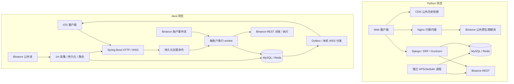

# Python 与 Java 后端架构、行情和交易维护对比

核对日期：2026-10-31。本文是现状评估与建议，未采纳迁移决定，也未改变交易行为。

## 结论

Python 项目在资金、普通/带单模式、结算和外部手动仓保护方面覆盖更完整，公共历史 K 线的 CDN 分发也更成熟。Java 项目把账户事件、持久化命令和每账户串行处理放在中心，适合统一维护 iOS 的行情、仓位和订单状态；但动态策略评估周期更长，单实例推送和请求预算仍限制横向扩展。

现有测速呈现的是：Python 的 CDN 历史首屏更快，Java 的动态接口更快；实时推送各有优势，不能给出“Java 全面更快”的结论。下单尚无同口径的分段实测，接口返回成功的里程碑也不同。

## 范围、证据与线上边界

- Python：父目录 `TradeTools-Binance`，本地分支 `codex/manual-position-protection`，HEAD `ae9cbaf5efce`，包含大量既有未提交修改。本文分析工作区实现，不把它等同于生产。
- Java / iOS：本目录，复制记录基线为 `tradetools-usdc` / `ff3bcb7d98e6`；以本轮实际读取的 Java、Swift 和配置为准。复制、后续测试环境及客户端记录分别保留在 [开发日志](DEVELOPMENT_LOG.md)。
- Python 的生产版本最后只读核对记录见父项目 [文档目录](../../docs/README.md) 和 [发布前审阅](../../docs/deployment-review-2026-10-30.md)；本轮没有重新核对部署配置。
- 网络结果引用同日已有的 [接口延迟对照](../../docs/interface-latency-comparison-2026-10-31.md) 与 [原始 JSON](../../docs/interface-latency-comparison-2026-10-31.json)，本轮重新计算中位数和 P95 核对一致，没有重复发起线上测试。
- 本轮未运行真实交易、迁移、部署或压力测试。静态代码的正确性、故障恢复能力与实盘验收是不同证据。

## 架构与取舍



图中 Java 为一个 JVM 内的模块化单体，worker、行情采集和 HTTP 并非独立服务。Python 的 API 与调度进程隔离，但仍共享数据库、Redis 和交易所额度。

| 方面 | Python 当前实现 | Java 当前实现 | 取舍 |
| --- | --- | --- | --- |
| 技术与边界 | Django / DRF，独立 APScheduler；普通与带单线程池分开 | Java 25 / Spring Boot，行情、交易、HTTP、WSS 同进程；虚拟线程处理阻塞任务 | Python 便于隔离 API 与后台资源；Java 统一事实与客户端协议，但共用进程的故障影响面较大 |
| 业务覆盖 | 资金规范化、转账、结算、普通/带单、外部手动仓强制保护 | 行情、策略提醒、账户事实镜像、R 定仓和多级止盈止损 | Java 当前交易功能不能直接替代 Python 全部业务 |
| 交易事实更新 | REST 查询与定时维护为主 | User Data Stream 为主，启动、断线和周期 REST 兜底 | Java 通常能更早知道成交与仓位变化；实际时延受队列、交易所和对账阻塞影响 |
| 并发控制 | Redis 账户活动/提交锁、绑定代际、持久化开仓幂等；部分后台任务另有 MySQL GET_LOCK | 账户行锁、持久化命令、Redis 可续期 lease、数据库 fencing、单账户串行 worker | Java 对账户写入归属的控制更集中；双方都不能凭本地锁承诺交易所绝对只执行一次 |
| 限频 | Redis 跨进程额度，按 background / normal / critical 预留 | 进程内 synchronized 权重预算，公共行情与私有请求共享 | Python 更适合为保护/平仓保留额度；Java 全市场补线可能挤占账户维护，多实例同 IP 也缺统一预算 |
| 可维护性 | 核心 views / services 约三千行，业务耦合仍高 | 模块入口更清楚，但 ExecutionCoordinator 也约三千七百行 | 模块化和换语言都不能自动解决复杂度，需要继续拆分责任与补充观测 |
| 扩容 | 公共历史与行情可绕过 Django；后台任务仍受锁和轮询组织约束 | lease/fencing 支持账户归属竞争，但 WS 会话、序号和广播只在本机 | Java 尚未完成端到端多实例事件路由，不能直接多开副本并假定用户事件完整 |

Python 账户活动/提交锁默认 120 秒，未看到自动续期；Java lease 默认 30 秒、每 10 秒续期。Java fencing 约束本地数据库与 worker，Binance 并不参与同一原子事务，因此仍依赖确定的 clientOrderId、未知结果查询和恢复流程。

Java Outbox 当前在调用本机 `publishToUser` 后标记已发布，没有客户端 ACK；目标连接若在另一个实例，本机可能没有订阅者。发送队列满时也可能丢实时通知。持久化 Outbox 不等于客户端可靠投递，状态查询与重连快照仍然必要。

## K 线：首屏、实时和校准是三条不同路径

| 环节 | Python | Java / iOS |
| --- | --- | --- |
| 历史首屏 | 浏览器本地缓存 → CDN 公共 300 根快照 → 源站 Redis → Binance REST | 鉴权接口先查 MySQL；数量不足才 REST 补齐并回写；支持时间分页、最多 1500 根 |
| 服务端数据源 | 请求与快照缓存为主；图表使用 Binance 所选原生周期流 | 全部目标合约原生 1m 连续 K 线落库，完整分钟聚合 5m / 15m / 1h / 4h / 1d |
| 未收线推送 | Nginx 转发 Binance 到浏览器，Django 不参与每条消息处理 | Java handler 直接发布未收线事件，无须等 MySQL 提交；收线事件在事务提交后发布 |
| 客户端当前高周期柱 | 订阅所选原生周期 K 线，包含该周期 OHLCV | 同时消费高周期收线与 1m / ticker 价格，构造临时柱；价格合并保留原成交量，快照负责校正 |
| HTTP 校准 | WS 健康时约 30 秒；不可用时约 2 秒轮询 | 图表约 15 秒 REST 校准 |
| 画图频率 | 当前 Web 写图节流 750ms | 当前生产路径未找到文档所称明确的 250ms 客户端合帧保障 |

Python 的常规共享缓存刷新节奏按周期为 1m 约 2 秒、15m 约 10 秒、1h 约 30 秒、4h 约 120 秒；`fresh=1` 另用约 2 秒短缓存并合并并发请求。CDN 快照响应很快，并不表示末根一定是刚收到的交易所事件。

Java 虽然写入 Redis ZSET，当前 `MarketKlineController.storedKlines` 的常规历史读取直接查询 MySQL，不能按“命中 Redis”解释其速度。REST fallback 主要由数量不足触发，未见“数量足够但尾部陈旧”的独立兜底判断，应同时观测末根时间和响应时间。

Java 每分钟补线和约 30 秒补线安全延迟用于确认缺口，不是实时行情固定等待 30 秒。它的收线持久化及聚合仍在每个 stream 的消费循环中同步执行，慢 MySQL 会影响该 stream 后续消费；异步策略执行并未把采集与数据库完全隔离。WSS 使用 4 个分发线程和 5000 容量有界队列，满时丢任务，以快照校正为前提。

### 同日 HTTP 实测摘要

下表为同一 Mac、相近时段、连接复用、每场景每环境 30 次的中位数 / P95，单位 ms。基础 270 次和 Python fresh 30 次均成功。

| 场景 | Python USDT | Java 原 USDC 环境 | Java 首尔环境 |
| --- | --- | --- | --- |
| 鉴权后轻量读取 | 1464.5 / 4194.4 | 34.7 / 159.1 | 156.4 / 232.0 |
| 10 个交易对行情 | 945.7 / 2132.4 | 42.0 / 410.6 | 169.1 / 542.2 |
| BTC / 1h / 300 根历史 | 19.3 / 124.5 | 52.8 / 188.7 | 196.4 / 269.1 |

Python 历史请求 30/30 CDN HIT；Java 是鉴权读库接口。Python fresh 校准另测为 1085.3 / 5988.9ms，可能访问 Binance，不能与 Java 常规读库视作同一刷新语义。轻量鉴权与行情接口的查询内容也不同。这些是功能体验与部署链路的结果，不是 Python / Java 语言性能基准。

### 同时 60 秒实时流观察

| 指标 | Python USDT | Java 原 USDC 环境 | Java 首尔环境 |
| --- | --- | --- | --- |
| WSS 握手 | 1272ms | 138ms | 566ms |
| 连接开始至首有效 K 线 | 1669ms | 591ms | 4214ms |
| 有效 K 线消息数 | 80 | 23 | 22 |
| 消息间隔中位 / 最大 | 581 / 4227ms | 1852 / 8299ms | 1702 / 8299ms |
| 接收时间减事件 E 中位 / P95 | 88 / 1022ms | 77 / 191ms | 89 / 191ms |

这是一轮连接观察。BTCUSDT 与 BTCUSDC 的活跃度及流类型不同；消息少不能判定丢包。Binance 校时请求全部超时，E 年龄使用未校准本机时钟，只作相对参考。两套 Java 同期出现长静默，仍需查源流与服务端，不应因为收到时 E 年龄小就认定持续更新更好。

上述结果测到网络收包，没有测到实际屏幕绘制。Python 的 750ms 写图节流、iOS 的主线程处理及显示刷新都要另算。长期稳定性、同合约同源、校时、断网恢复和交易分段验收统一沿用 [测速报告的六项口径](../../docs/interface-latency-comparison-2026-10-31.md#后续统一按六个方面验收)，不另建一份相互冲突的标准。

## 下单：先统一“成功”的含义

Python 当前典型路径：

```text
HTTP 请求 → 账户活动/提交锁与绑定复核 → 持久化开仓幂等记录
→ 提交交易所或按原 clientOrderId 恢复
→ 确认成交 → 保存订单与策略快照 → 尝试安装保护 → HTTP 返回
```

Java 当前典型路径：

```text
HTTP 请求 → 校验、交易规则与价格读取 → 事务内锁账户并复核
→ 持久化命令、R 与执行快照 → 唤醒账户 worker → 返回命令状态
→ worker 提交交易所 → 账户事件/REST 更新成交 → 安装保护与止盈
```

| 对比点 | Python | Java |
| --- | --- | --- |
| HTTP 完成里程碑 | 通常已确认实际成交或限价委托状态，并尝试保护；具体以响应状态为准 | 通常仅命令已持久化/受理；返回后异步执行 |
| 等待成交 | 回包已有成交则立即采用；否则轮询显式等待合计最多约 8 秒，再加网络时间 | 命令提交成功可能仍是订单 NEW；SUCCEEDED 不等于 FILLED |
| 超时不确定 | 按原 clientOrderId 查询，记录 uncertain；有持久化幂等与恢复 | UNKNOWN 按原 clientOrderId 查询，避免盲目再提交；命令和订单状态分开 |
| 排队风险 | 慢交易所请求占用 API worker；轮询维护也可能稍后收敛 | 同账户串行保证顺序；同 worker 的慢 REST 对账会阻塞后续命令与事件 |
| 立即返回成本 | 同步外部调用较多 | 仍可能在受理前请求市场规则/价格，不能理解成纯数据库写入 |

Java worker 的空闲队列最多等待约 500ms，有命令唤醒机制；这不是每笔固定额外等待，也不是执行时延承诺。双方均有安全换保护、部分成交处理和策略快照，不能把 Python 描述为没有幂等或状态管理。

真正公平的订单速度应分别记录：请求入站、持久化受理、发往 Binance、交易所接单、首笔成交、全部成交、保护确认、客户端可见。当前没有这组同口径数据，因此不能给出“Java 下单快多少倍”。Binance 对部分 503 明确要求先确认未知执行结果，见 [官方通用说明](https://developers.binance.com/en/docs/products/derivatives-trading-usds-futures/general-info)。

## 订单维护：状态更快与策略更快不能互相替代

下表是代码默认调度参数，不是线上 SLA；实际会叠加请求耗时、任务抖动、排队、限频和退避。

| 维护事项 | Python | Java |
| --- | --- | --- |
| 成交与仓位事实 | REST 轮询为主，限价订单任务约 5 秒 | 账户流事件优先归并，REST 兜底；更新通常不必等整轮轮询 |
| 缺失保护检查 | 约 10 秒 | 保护/止盈健康检查默认 5 秒；异常补单另有至少 15 秒起退避，不能承诺 5 秒修复 |
| 动态 R / 移动止损 | 约 10 秒 | 默认 60 秒评估 |
| 外部手动仓 | 约 10 秒发现，已有强制止损与超额风险退出规则 | 有账户/仓位镜像；不能视作已等价实现 Python 的强制接管规则 |
| 全量事实校正 | 按后台任务与账户逐轮处理 | 活跃约 60 秒、空闲约 300 秒轻对账；完整发现约 30 分钟 |
| 发往客户端的账户事件 | 主要由查询/刷新获得 | Inbox 去重、事实事务、Outbox；默认 250ms 发布轮询，后续还要排队与发送 |

Python 普通维护任务有约 1–2 秒 jitter，`max_instances=1`、`coalesce=True`；同一维护任务内逐账户处理，前面账户慢会延后后续账户。普通与带单线程池分开缓解跨模式争用，但不能消除同一任务内部排队。

Java 的 60 秒策略周期不表示已有交易所止损要等 60 秒才触发；已挂单由 Binance 触发。它限制的是应用何时提高止损、激活动态级别或发起新的策略动作。已预挂的多级止盈也要与应用侧动态动作区分。

两边 R 语义还有实质差异：Python 每轮读取当前 1m 标记价 K 线高低，并累积已观察到的持仓方向极值；Java 每轮用当次 markPrice 计算 profitR 和止损候选，之后只收紧不放宽。若价格短暂冲高再回落，Java 可能没有在评估点看到该价，结果与 Python 不同。Python 也不能据此保证补获停机期间全部历史极值。直接搬相同 R 参数不能保证相同交易结果。

Java 提供 Maker / GTC / Algo 市价止盈，以及市价止损、限价加保底市价和 NONE 等可选方式；Python 当前核心保护以 STOP_MARKET 为主。Java 更灵活，也增加了剩余数量、部分成交、未知委托、备用保护和退避状态的组合复杂度。资金安全仍需逐项验证；Java 文档列出的 Testnet 真实订单与故障注入验收尚不能按“已有代码”认定完成，Python 未发布修改同样不能借用旧生产记录作验证。

## 建议与待验证

1. **先优化可观测性和动态 API。** 按统一阶段记录端到端时间、末根新鲜度、队列等待和保护确认时间。Python 动态 API 秒级与 CDN 毫秒级并存，已有连接测试提示源站链路成本较高，但没有内部计时，暂不能锁定 Django CPU 或网络是唯一原因。
2. **保留 Python 的业务约束，吸收 Java 的账户事件机制。** 账户流、持久化命令和账户串行归并值得借鉴；资金、带单身份、结算、绑定代际和外部仓保护需要逐条对齐。当前仅建议，不实施迁移，也不让两套引擎同时维护同账户同批订单。
3. **Java 行情读取继续减轻数据库负担。** 可评估热点历史缓存、已有 Redis 数据读取与公共历史 CDN，同时增加尾部新鲜度判定。缓存键和权限必须区分公共行情与私有状态。
4. **优先对齐策略语义，再谈缩短 60 秒周期。** 明确触发价、极值、预挂单和应用动态动作的区别；单纯调短周期会增加 REST 和队列压力。
5. **扩容前补路由与统一限频。** Java 需要跨实例用户事件投递、连接路由或可恢复的状态刷新方案，以及共享预算和保护优先级；不能只靠虚拟线程或账户 lease 扩副本。

配置与文档仍有三处待对齐：Java AGENTS 描述原生 1h 三目标，现行代码是原生 1m 多周期聚合；实时文档的 250ms 客户端合帧未在生产路径确认；账户同步 YAML 回退为 true，而 `.env.example` / Compose 默认 false。本文记录差异，未改变用户要求、配置或业务逻辑；运行环境是否启用账户流需要查实际配置，不能从 YAML 单独推断。

## 主要代码与主题文档

| 主题 | Python 证据 | Java / iOS 证据 |
| --- | --- | --- |
| 架构与业务范围 | [架构](../../docs/architecture.md)、[交易安全](../../docs/trading-safety.md)、[资金](../../docs/capital-and-transfers.md) | [上下文](PROJECT_CONTEXT.md)、[交易执行](TRADING_R_EXECUTION.md)、[账户同步](TRADING_ACCOUNT_SYNC_DESIGN.md) |
| 行情 API / 缓存 | [views.py](../../server/trading/views.py)、[market_snapshots.py](../../server/trading/market_snapshots.py)、[行情文档](../../docs/market-data.md) | [MarketKlineController](../backend/app-service/src/main/java/com/oovso/market/MarketKlineController.java)、[MarketKlineService](../backend/app-service/src/main/java/com/oovso/market/MarketKlineService.java) |
| 客户端实时 | [binanceKlineStream.ts](../../tools/src/shared/lib/binanceKlineStream.ts)、[KlineChartCard.tsx](../../tools/src/pages/trading/KlineChartCard.tsx) | [MarketChartViewModel](../frontend/ios-app/TradeTool/Features/Chart/MarketChartViewModel.swift)、[ChartDataPipeline](../frontend/ios-app/TradeTool/Features/ChartEngine/Data/ChartDataPipeline.swift) |
| 开仓与保护 | [opening.py](../../server/trading/opening.py)、[execution.py](../../server/trading/execution.py)、[services.py](../../server/trading/services.py)、[locks.py](../../server/trading/locks.py) | [TradingExecutionService](../backend/app-service/src/main/java/com/oovso/trading/TradingExecutionService.java)、[TradingExecutionCoordinator](../backend/app-service/src/main/java/com/oovso/trading/TradingExecutionCoordinator.java) |
| 调度与事实归并 | [scheduler.py](../../server/trading/scheduler.py)、[binance_rate_limit.py](../../server/common/binance_rate_limit.py) | [TradingAccountSessionManager](../backend/app-service/src/main/java/com/oovso/trading/TradingAccountSessionManager.java)、[TradingExchangeEventReducer](../backend/app-service/src/main/java/com/oovso/trading/TradingExchangeEventReducer.java)、[BinanceRestRequestBudget](../backend/app-service/src/main/java/com/oovso/binance/BinanceRestRequestBudget.java) |
| 实时投递边界 | [行情文档](../../docs/market-data.md) | [RealtimeEventPublisher](../backend/app-service/src/main/java/com/oovso/realtime/RealtimeEventPublisher.java)、[TradingOutboxPublisher](../backend/app-service/src/main/java/com/oovso/trading/TradingOutboxPublisher.java)、[协议文档](REALTIME_WEBSOCKET.md) |

本文维护跨项目比较结论；各项目业务规范仍由对应主题主文档维护，接口测速的采样与原始数据以同日测速报告为准。
