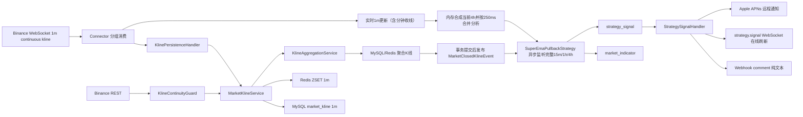

# 项目上下文

> 整合版说明（2026-10-31）：本文保留来源系统的业务或实现资料。当前运行入口、服务器、原生页面与验证边界以 [整合说明](INTEGRATION.md)、[运维](operations.md) 和 [变更](changes.md) 为准；Java 模块仅作参考。


最后核对日期：2026-10-22。

本文用于让新的开发对话快速理解当前实现、关键决策和历史上已经解决的问题。

## 1. 项目范围

服务监听币安 USD-M 中满足以下条件的合约：

```text
quoteAsset = ${BINANCE_QUOTE_ASSET:USDC}
contractType = PERPETUAL
status = TRADING
```

`binance.usdm.continuous-kline.quote-asset` 是唯一报价资产配置入口。生产环境
通过 `BINANCE_QUOTE_ASSET` 设置，修改后需要重启服务。行情发现、WebSocket、
补线、策略白名单和 iOS 行情列表都读取这一配置，不再各自写死交易对后缀。

当前基础行情订阅使用币安原生 `1m` 连续 K 线：

```text
{pair}_perpetual@continuousKline_1m
```

本地基于完整 `1m` 收盘 K 线提前聚合并保存常用周期：

```text
1m -> 5m / 15m / 1h / 4h / 1d
```

当前 `15m` 与 `1h` 主提醒消费完整收盘 K 线并使用相同规则；二次提醒也只消费完整收盘 K 线，`15m` 来源检查 `15m`，`1h` 与 `4h` 来源检查 `1h`。`4h` EMA144 主提醒是明确例外：使用当前未收线 `1m` 更新在内存合成 provisional `4h` K 线，条件首次满足即正式提醒，不等待 4h 收盘。该临时 4h K 线不得写入 `market_kline`/`market_indicator`，也不得用于交易下单。

## 2. 数据链路



### WebSocket

实现类：

```text
com.oovso.binance.BinanceUsdMarginedPerpetualContinuousKlineConnector
```

当前行为：

- `pro`/默认端点使用主网 `https://fapi.binance.com` 与
  `wss://fstream.binance.com/market/stream`；`dev` profile 固定覆盖为 Binance
  USD-M Futures Testnet 的 `https://testnet.binancefuture.com` 与
  `wss://fstream.binancefuture.com/market/stream`。REST 和 WebSocket 必须处于同一
  环境。连续 K 线使用 `/market/stream` 路由。
- WebSocket 当前订阅 `continuousKline_1m`。策略所需 `15m` 与 `1h` K 线由本地完整 `1m` 数据聚合出来，在各自收盘后触发提醒；`4h` 主提醒同时消费未收线 1m 更新，在内存合成当前 4h 并盘中触发。
- 每个连接最多承载 `50` 个 stream。
- 全局订阅间隔 `250ms`，避免币安 `1008 Too many requests`。
- 使用虚拟线程消费每个 stream 的原始消息队列。
- 每 `15s` 检查连接健康状态。
- 断线后按 `1s -> 2s -> 4s ...` 指数退避，最大 `60s`。
- 每 `5min` 重新读取 exchangeInfo。
- 新上市合约加入已有空闲分组或新建连接。
- 下架合约取消订阅；Redis 旧 key 依赖过期时间自动清理。

SDK 自带连接池没有直接用于当前分组方案，`WebSocketClientConfiguration.usePool=false`。项目自己按每组 50 个 stream 管理连接和重连。项目显式使用 `binance-common 2.2.1`，关闭旧连接时调用 `stop()` 取消 SDK 内部重连 Timer，再由项目连接组守护统一重连。

Spring Boot 自身的 `RestClient`/`RestTemplate` 请求工厂固定使用 JDK HTTP Client。
这是因为币安 SDK 所需 Jetty 11 与 Spring Boot 3.5 默认探测的 Jetty 12 客户端 API
不兼容；不要删除 `spring.http.client.factory=jdk`。

### 事件日志

K 线逐条接收日志、首条/收线日志和周期累计计数均已关闭，避免高频行情淹没交易
诊断信息。仍保留订阅启动、交易对刷新、断线重连和消费异常日志。

## 3. MySQL 与 Redis

数据库结构统一由 Flyway 管理：

```text
db/migration/mysql/V1__market_and_auth_schema.sql
db/migration/mysql/V2__trading_schema.sql
db/migration/common/V3__legacy_schema_compatibility.java
db/migration/mysql/V4__risk_based_execution.sql
db/migration/mysql/V5__trading_order_health_repair.sql
db/migration/common/V6__remove_trading_execution_switches.java
db/migration/common/V7__create_app_push_device.java
db/migration/common/V8__create_strategy_signal_read.java
db/migration/common/V9__harden_app_push_device.java
db/migration/common/V10__create_strategy_signal_user_state.java
db/migration/common/V11__create_external_trade_signal.java
db/migration/common/V12__replace_external_trade_signal_with_external_message.java
db/migration/common/V13__create_strategy_notification_preference.java
db/migration/common/V14__four_hour_ema_pullback_episodes.java
```

`baseline-on-migrate=true` 用于首次接管已有数据库，基线版本固定为 `0`，因此
首次接管后仍会执行 V1/V2/V3/V4/V5/V6/V7，不会跳过第一批版本化迁移。V1/V2 对新库
创建完整结构；V3 只兼容 Flyway 接管之前的旧库，补齐 `source_interval`、
账户同步字段和 Outbox 认领字段；V4 增加以损定仓执行计划、级别快照和交易命令
审计字段；V5 增加完整执行快照、保护/止盈健康巡检游标、补挂 revision、累计成交
基线和持久化退避状态；V6 删除不再使用的账户级下单开关字段；V7 创建 APNs 设备
令牌注册表；V10 保存每个用户对信号的删除状态和可重复设置的单次二次提醒状态；
V13 保存每个用户的 `15m`、`1h`、`4h` 策略提醒开关；V14 保存 4h EMA144 触达状态，
并为信号增加 `touch_event_time_ms`，区分同轮趋势内独立回踩且保持每次触达幂等；
V15 增加持久化的最后提醒时间，并从已有 4h 主信号回填，使升级和重启均遵守滚动 24 小时冷却。
Spring SQL init 已关闭，原有两个启动时
`SchemaInitializer` 已删除。已发布迁移必须保持不变；后续只能追加新版本。

主要表：

| 表 | 用途 |
| --- | --- |
| `market_kline` | 保存收盘后的原生 1m K 线和本地聚合 K 线 |
| `market_indicator` | 保存 EMA21、EMA55、EMA144、MACD 和 SuperTrend |
| `strategy_signal` | 保存最终策略信号 |
| `four_hour_ema_pullback_state` | 按交易对持久化 4h EMA144 触达、脱离、事件游标、方向及最后提醒时间，行锁保证冷却状态与信号同事务更新 |
| `app_user` | 保存 iOS/API 登录用户与 PBKDF2 密码摘要 |
| `app_push_device` | 保存登录用户的 APNs token、安装 ID、sandbox/production 环境和启用状态 |
| `strategy_signal_read` | 按用户保存策略信号已读回执；进入对应 K 线详情后才写入 |
| `strategy_signal_user_state` | 按用户保存信号删除状态及 `NONE/ACTIVE/TRIGGERED` 二次提醒状态；触发后可再次激活 |
| `strategy_notification_preference` | 按用户保存 `15m`、`1h`、`4h` 策略提醒及信号列表可见性开关；无记录时默认全部开启 |
| `external_message` | 原样保存通过独立 Key 校验的通用外部 JSON 与接收时间 |
| `reference_trade_notification` | 保存五类参考交易通知投影，按发送方 `event_id` 幂等 |
| `trading_exit_strategy` | 保存用户定义的 1–5 级止盈止损策略 |
| `trading_exit_strategy_level` | 保存每一级 R 触发、减仓与移动止损动作 |
| `trading_loss_limit` | 保存当前与延迟生效的单笔止损额配置 |
| `trading_order_settings` | 保存账户级默认策略和建仓/止盈/止损委托方式 |
| `trading_account_balance` | 保存账户流与 REST 收敛后的分资产余额 |
| `exchange_order` | 保存普通订单与 Algo 条件单状态机镜像 |
| `exchange_fill` | 按 symbol + tradeId 幂等保存成交、手续费和已实现盈亏 |
| `trading_exchange_event` | 保存脱敏规范化的账户流事件 Inbox 与语义哈希 |
| `trading_outbox` | 事务提交后向所属 APP 用户发布私有交易事件 |
| `trading_command` | 保存真实交易写请求、请求哈希和结果未知对账状态 |
| `trading_position_plan` | 冻结每笔建仓的 R、交易规则、成交和当前保护状态 |
| `trading_position_plan_level` | 冻结分级减仓与止损棘轮的执行状态 |

`market_kline` 业务唯一键：

```text
exchange + market_type + contract_type + pair + interval_code + open_time_ms
```

`source_interval` 用于区分原生 K 线和聚合 K 线。REST 直接补线得到的 K 线来源周期为自身周期；WebSocket `1m` 实时聚合出的 `5m`、`15m`、`1h`、`4h`、`1d` 来源周期记录为 `1m`。Flyway V3 在首次接管旧库时补齐该字段并修正历史来源周期；补线缺口判断只看目标周期是否存在，不再按来源周期判定。

APNs 注册环境由 iOS 构建产物中的 `APS_ENVIRONMENT` 展开值决定，不再用
Debug/Release 编译条件猜测。注册时服务器校验 App Bundle ID 必须等于配置的
`APNS_TOPIC`；Apple 判定无效的 token 会记录失效时间和原因，同一 token 在 App
启动时重复注册也不会重新启用，只有系统颁发的新 token 才会恢复推送。

重复的 WebSocket 或 REST 数据使用 upsert，不会重复插入。

Java 25 下 Netty 的 Unsafe 内存访问会输出 JVM 级启动警告。项目默认设置
`io.netty.noUnsafe=true`，Redis/Lettuce 仍通过安全路径工作，避免启动日志出现
`sun.misc.Unsafe::allocateMemory` 警告。

### Redis

Redis key：

```text
kline:BINANCE:USDM:{contractType}:{pair}:{interval}
```

数据结构为 ZSET：

```text
score  = openTimeMs
member = K线 JSON
```

每个交易对按周期配置保留最近 K 线：

- 新 K 线按 `openTimeMs` 覆盖同一根。
- 超过容量后从 ZSET 最左侧移除最旧数据。
- key 过期时间为 `180` 天，用于清理长期下架币种。

## 4. API 登录鉴权

后端认证使用 Sa-Token `1.45.0` 的 Spring Boot 3 starter，并通过
`sa-token-redis-jackson` 将登录会话持久化到现有 Redis。

```text
POST /api/auth/login     账号密码登录，返回 accessToken 和用户资料
POST /api/auth/register  账号密码注册，成功后直接返回 accessToken 和用户资料
GET  /api/auth/me        Bearer Token 获取当前用户
POST /api/auth/logout    注销当前 Token
```

路由规则：

```text
/api/auth/login 公开
/api/auth/register 公开
/api/** 其他路由统一执行 StpUtil.checkLogin() 并确认数据库用户仍处于启用状态
```

客户端请求头：

```http
Authorization: Bearer <accessToken>
```

Token 最长有效期 `30` 天，连续 `24` 小时无请求会失效；同账号允许最多
`5` 个并发 Token，每次登录生成独立 Token。认证失败统一返回
`code/message/data` 响应，未登录或 Token 失效使用 HTTP `401`。

用户密码不由 Sa-Token 保存。`app_user` 为每个用户保存独立随机盐，并使用
`PBKDF2WithHmacSHA256`、`210000` 次迭代生成摘要。首次部署可通过
`APP_ADMIN_ACCOUNT`、`APP_ADMIN_PASSWORD`、`APP_ADMIN_EMAIL` 和
`APP_ADMIN_DISPLAY_NAME` 创建初始管理员；已存在账号不会被启动配置覆盖。
自助注册默认开启，可通过 `APP_REGISTRATION_ENABLED=false` 关闭。注册时如果
账号本身不是邮箱，后端会使用 `账号@local.invalid` 填充数据库必填邮箱字段。

### APP 实时 WebSocket

APP 与后端实时通信统一使用 `/ws/v1`，复用现有 Sa-Token Bearer Token。
单连接通过频道订阅承载实时 K 线和策略信号，后续账户、持仓和订单事件继续扩展
同一协议。行情列表先调用 `GET /api/market/tickers` 获取确定快照，再订阅
`market.ticker` 增量；ticker 来自币安 `!ticker@arr` 全市场 24h ticker 流，
后端只分发当前报价资产下正在交易的永续合约。iOS 每 200ms 按交易对合并最新
ticker 后批量刷新列表，避免高频消息逐条触发 SwiftUI 全列表重绘。
币安全市场 ticker 是数组消息，后端接收上限默认 `1MB`，可通过
`BINANCE_MARKET_TICKER_MESSAGE_MAX_BYTES` 调整，不能沿用 Jetty 默认的 `64KB`。

行情搜索页使用以下分页快照接口：

```text
GET /api/market/tickers/popular?page=0&size=10
GET /api/market/tickers/search?query=BTC&page=0&size=20
```

`popular` 和 `search` 都只返回当前报价资产下正在交易的永续合约，并按
`quoteVolume24h` 从高到低排序。搜索会忽略输入中的空格、`/`、`-` 等币对分隔符。
响应包含 `page`、`size`、`totalElements`、`totalPages`、`hasNext` 和 `items`。
后端复用 5 秒行情快照，避免 iOS 输入防抖期间仍对 Binance REST 产生密集请求。

K 线图首屏与向前分页统一使用：

```text
GET /api/market/klines?symbol=BTCUSDC&interval=1h&limit=1500
GET /api/market/klines?symbol=BTCUSDC&interval=1h&beforeOpenTime=...&limit=1500
GET /api/market/klines?symbol=BTCUSDC&interval=1h&limit=1500&tradingData=openInterest,topPositionRatio
```

查询先从 MySQL 读取；数量不足时才使用相同边界请求 Binance，并把本地缺失且已经
收盘的兜底 K 线批量写回 MySQL 和 Redis，回写不触发策略事件。同一时间点优先保留
本地记录。`beforeOpenTime` 是严格排他边界：Binance 请求转换为
`endTime=beforeOpenTime-1`，MySQL 使用 `open_time_ms < beforeOpenTime`；响应仍按时间
升序返回，分页之间不能重复边界 K 线。`tradingData` 只允许请求当前启用统计面板所需
的 `openInterest`、`topAccountRatio`、`topPositionRatio`、`globalAccountRatio`、
`buySellVolume` 和 `basis`；没有该参数时后端不查询或输出合约统计数据。该查询只服务
前端展示，不改变行情全市场采集、补线或策略白名单语义。

`market.kline` 保留给实时 K 线图，`strategy.signal` 继续用于提醒。详细消息信封、
心跳、重连、序号及私有事件隔离规则见
[`REALTIME_WEBSOCKET.md`](REALTIME_WEBSOCKET.md)。

### 实盘交易安全边界

已否决并删除 iOS 直接保存 Binance API Secret、签名和请求私有接口的原型代码。
Phase 1 由 Java 服务使用 AES-256-GCM 加密保存 Binance 凭证，并提供账户/仓位
只读刷新及服务器风控参数 API；iOS 只通过本项目 HTTPS API 绑定、配置与展示，
升级时会清理旧 Binance Keychain 项，不能持有或取回 Binance Secret。

交易后端详细设计、Algo Order 迁移、安全换单状态机、故障恢复和分阶段上线门槛见
[`TRADING_BACKEND_DESIGN.md`](TRADING_BACKEND_DESIGN.md)。Phase 3 的以损定仓、
普通/Algo 下单、部分成交保护、分级减仓和每分钟止损棘轮已经
落代码；执行公式与状态边界见 [`TRADING_R_EXECUTION.md`](TRADING_R_EXECUTION.md)。
系统不再提供全局或账户级下单开关；是否可下单只由账户 `ACTIVE + SYNCED`、有效
lease/fencing token 和既有风控校验共同决定。尚未经过 Binance Futures Testnet 真实
接口验收，因此当前只能宣称实现完成并通过本地自动测试，不能宣称已具备主网资金安全验收结论。

Phase 2 的账户监听、listenKey 续期、REST 收敛、事件 Inbox、普通/Algo 订单
状态机、断线恢复、Redis 租约、MySQL fencing 和 APP 私有事件已经按照
[`TRADING_ACCOUNT_SYNC_DESIGN.md`](TRADING_ACCOUNT_SYNC_DESIGN.md) 落代码。
`TRADING_ACCOUNT_SYNC_ENABLED` 默认仍为 `false`；账户同步未启用或尚未达到 `SYNCED`
时不能提交交易命令。尚未完成的是 Binance Futures Testnet 故障注入与稳定运行验收，
未通过前不能接入主网凭证执行交易。

账户绑定时，Java 会强制校准 Binance 账户默认值：账户级持仓模式设为 `HEDGE`；
当前配置报价资产下所有
`TRADING + PERPETUAL` 交易对先读取账户专属 `/fapi/v1/leverageBracket`，再分别调用
`/fapi/v1/leverage` 设置其实际允许的最大 `initialLeverage`，不能统一硬写 125。
绑定流程在外部配置后重新读取账户并确认 `HEDGE`，成功后才加密落库。该批量设置只在
绑定 API 时执行。应用启动恢复账户工作线程时交叉读取
`/fapi/v1/positionSide/dual` 与 `/fapi/v1/accountConfig`，校准并确认两者均为
`HEDGE`，不读取杠杆档位，也不批量修改交易对杠杆；随后才建立 User Data Stream 并做
REST 对账。新建仓命令不再根据数据库模式提前拦截，派发前也不查询或修改持仓模式；
固定发送用户选择的 `LONG/SHORT positionSide`，且每个命令只提交一次。Binance 明确
拒绝时直接保存错误并结束命令，`-4061` 提示用户自行在 Binance 切换为双向持仓后
重新下单。只有网络超时等结果未知场景会按原 client ID 做只读查询，不会再次提交。
监听、模式校准或对账失败时进入 `DEGRADED`，禁止新建仓并按连接退避
自动重试。若账户已有挂单或持仓导致
`-4067/-4068`，必须先在 Binance 撤单或平仓。已知交易所错误码由服务端翻译为中文
展示消息，数据库仍保留稳定错误码供状态机判断和审计。

`dev` profile 的私有 REST、账户对账、普通/Algo 下单统一使用
`https://testnet.binancefuture.com`，User Data Stream 使用
`wss://fstream.binancefuture.com/private`；它们与 dev 公共行情端点属于同一 Futures
Testnet 环境。Testnet Key 与主网 Key 不通用，dev 不得保存或使用主网凭证。配置测试会
同时断言这四个端点，避免以后只切换行情却把下单留在主网。测试网和主网共用完全相同的业务、
风控、下单、对账和订单状态机代码，只替换上述四个连接端点。

`dev` 同时默认开启脱敏的 Binance 私有 REST 诊断日志。每次账户、持仓、杠杆、普通
订单、Algo 条件单和 listenKey 操作都会以 `BINANCE_PRIVATE_REST` 打印 HTTP 方法、
路径、业务参数、HTTP 状态和 JSON 响应；API Key、Secret、签名和 listenKey 永远不会
进入日志。其他 profile 默认关闭，可临时设置
`BINANCE_PRIVATE_REST_DIAGNOSTIC_LOGGING=true` 排障。

设置页已增加服务器持久化的分级止盈止损策略与止损额配置。分级策略最多 5 级，
每级包含盈利触发 R、按初始仓位计算的减仓百分比，以及以下移动止损方式之一：

```text
NONE                 不移动止损
FIXED_R              一次移动到固定 R 位置
TRAILING_PROFIT_R    持续保持在“当前浮盈 - N R”位置
```

止损额由 iOS 只提交 1%–25% 的整数比例，Java 使用最近同步的账户余额计算并冻结
绝对金额。调低金额立即生效；调高金额写入 pending 配置并延迟 2 小时生效。读取
或再次修改配置时会原子提升已经到期的 pending 值。

下单设置按交易账户保存：默认止盈止损策略可不选、可选已有策略并随时清除；
建仓和止盈支持 `MAKER_ONLY` / `LIMIT` / `MARKET`，止损支持
`LIMIT` / `MARKET` / `NONE`。选择限价止损时必须设置大于 1R 的保底市价
止损位置；其他止损方式不保存该值。删除正在被默认
引用的策略时，Java 会在同一事务中清除引用。新建仓会冻结当时的策略、止损额和
下单设置；后续修改默认配置不会追溯改变已打开仓位。`executionEnabled` 已从 API、
数据库和 iOS 删除；`canExecute` 只反映账户当前是否处于 `ACTIVE + SYNCED` 的可下单
运行状态，不是可配置开关。

建仓计划另存完整 JSON 快照与 SHA-256，级别动作和执行方式的 update SQL 不允许被
后续设置覆盖。建仓首次部分成交后同时安装止损和全部 `reducePercent > 0` 的分级止盈：
`MAKER_ONLY` 使用 `LIMIT + GTX`，`LIMIT` 使用 `LIMIT + GTC`，`MARKET` 使用带数量的
`TAKE_PROFIT_MARKET` 条件 Algo 单；恢复旧计划时若价格已经越过 MARKET 目标，则直接
提交普通市价减仓，避免条件单因会立即触发而被拒绝。活动计划默认每 5 秒按冻结 client
ID 通过 REST 核对主止损、限价止损的保底市价单和全部已配置止盈单。确认缺失或失败后
按持久化 revision 与指数退避补挂；
止盈部分成交使用每次尝试前的累计成交基线，只补冻结计划量中的未成交部分。服务重启
后继续这些持久化游标，不读取届时的默认设置来重建旧计划。建仓部分成交即可启动
级别订单；R 检测仍只负责激活该级止损移动。后续继续成交会先确认撤销覆盖不足的旧
止盈，再按增加后的累计建仓量换单。多级预挂止盈统一预留仓位容量，同轮市价成交和
人工减仓后都不会继续按旧仓位盲挂。
仓位结束时先撤销未成交的建仓余量和全部退出单，撤销失败时保持 `DEGRADED` 并按
持久化退避重试，全部清理成功后才标记 `CLOSED`。建仓事务通过账户行
`FOR UPDATE` 串行化活动计划预留，防止不同幂等键并发创建同方向计划。人工市价或
Maker 平仓会把关联计划置为 `MANUAL_CLOSING`，先确认撤销剩余建仓和全部止盈，等待
期间保留止损且不补止盈；仓位归零、代际变化或 Maker 剩余量超过仓位时主动撤销残单。

iOS 图表把未收盘 `market.kline` 作为 provisional candle 合并；由于后端原生实时
K 线流是 `1m`，`5m/15m/1h/4h/1d` 页面会同时订阅所选周期和 `1m`，用 `1m`
最新成交价驱动当前周期 provisional candle，并把所有周期的图表发布统一限制为最多
每 `250ms` 一帧。`market.ticker` 继续提供 24h 数据并作为价格兜底；所有周期每
`15s` 使用 REST 快照校准，不再排除 `1h`。K 线、最新价格、EMA 和 SuperTrend
在同一帧更新，提交态指标不被实时分支污染。可由 `1m` 聚合的高周期最新 REST 页使用
服务器已有的连续闭合 `1m` 聚合并附带当前未收盘柱；该柱不写库、不触发策略事件。
iOS 安装首屏快照时会立即合并同周期缓存实时价，并依次以当前 ticker 和列表页价格
兜底，因此不会等待下一条 WebSocket 消息才画出当前柱。当前币安真机校准规则
包括：SuperTrend 线到 K 线收盘价之间的低透明度红绿带、仅三条内部竖网格线、固定
K 线间隔且缩放时实体同步增粗、左滑极限时画面只保留最后 5 根 K 线，以及白色虚线
最新价、黑底白色圆角描边和白字价格标签。价格标尺是覆盖在全宽 K 线画布上的透明层，
不裁掉其下方 K 线、指标或横向网格；主图和副图网格使用独立背景批次，MACD、成交量
及其他副图柱线始终绘制在网格上方。当前 K 线可见时，虚线只连接当前 K 线与右侧
价格标签，并在拖动和缩放期间逐帧跟随当前 K 线，价格轴端点与标签保持固定；当前 K 线
移出右侧时改为整行虚线，并把带右箭头的标签移动到价格标尺左侧。
十字光标及其白色坐标价格标签在当前价的全部图元之后绘制；两者重叠时优先完整显示
白色坐标价格，避免当前价黑色底框或文字覆盖它。
主图还会标记当前屏幕内的最高价和最低价；`>>` 快速复位按钮已移除。
Binance 参考 App 固定通过 USB 真机 XCUITest 直接控制，不使用 iPhone 镜像、模拟器、
网页截图或 Appium；Dev B 运行器、页面前置状态、单指标采集顺序和故障恢复见
`frontend/ios-app/docs/BINANCE_XCUITEST_REAL_DEVICE_CONTROL.md`。
主图指标现已按币安真机默认值接入 `MA(7/25/99)`、`BOLL(20,2)`、
`SAR(0.02,0.2)` 和 `AVL`。MA 使用收盘价简单移动平均；BOLL 使用总体标准差并绘制
UP/MB/DN 三线，不填充带宽区域；SAR 使用标准抛物线转向递推并绘制黄色空心方块；
AVL 使用单根 K 线 `quoteVolume / volume`。四项都支持未收盘 K 线的 provisional
计算且不污染提交态，并使用统一插件注册、选择持久化、参数持久化、动态图例行和
线/标记 figure style 扩展口，后续主图指标与副图不需要修改计算引擎核心。
副图已继续接入币安默认参数的 `KDJ(9,3,3)`、`OBV`、`WR(14)`、
`StochRSI(14,14,3,3)` 和 `ATR(14)`。合约统计副图 `O.I.`、`L.S Acco.`、
`L.S Posit.`、`L.S Ratio`、`B.S Vol.`、`Basis` 读取 K 线 REST 响应最新数据点内的
`tradingData`。iOS 只把当前启用的统计面板作为 `tradingData` 查询参数发送，后端只
请求并返回对应统计源；默认图表不请求任何合约统计数据。实时价格 tick 合并时保留
该统计快照，下一次 15 秒 REST 校准再刷新。
统计缺失使用 `.hidden`，不会画伪造零值，也不会误触发 K 线缺口恢复。渲染扩展现支持
普通柱、左右成对柱、零轴面积、堆叠比例柱和折线组合，新增同类副图只需注册插件与
产品配置，不需要修改 `ChartIndicatorEngine`、视口或 Metal 提交管线。

K 线详情的滚动内容在图表时间轴处结束；原图表下方的重复指标行、涨跌幅统计、
委托订单/深度图/最新成交区域已移除。前端每两秒的盘口轮询、模拟盘口与成交数据，
以及专用的后端深度查询接口和币安深度请求也已删除，无对应数据库表需要迁移。
顶部页签、大块行情摘要和重复周期工具栏也已移除，仅保留合约标题及紧凑实时价格。
顶部铃铛入口已移除，收藏星位于原铃铛的最右侧位置。
首屏只显示主图、主图下方的时间轴和第一个已开启副图；其余副图向下滚动查看，
不会被关闭。各副图的指标名称与数值移至自身底部图例区，十字光标选中态同步显示；
副图按开启先后排列，关闭后重新开启会追加到最后；切换币种、周期及正常重启保留
已保存顺序。选择状态不再经过无序集合重排，校准初始配置仅在应用启动时设置一次。
共用时间标签位于主图下方，网格线与十字竖线不穿过时间轴或副图文字区。
主图使用剩余可用高度，副图保持每个 72pt，时间轴保持 24pt。价格轴按原 298pt
主图（268pt 绘图区）归一化默认比例，新增高度扩大价格范围，蜡烛实体、影线和横向
宽度不会随容器增高而自动拉伸；手动价格轴缩放继续生效。
横向拖动、惯性、双指时间轴缩放和价格轴缩放都在手势进行中持续提交 Metal 帧；
越过预渲染缓冲区或价格范围需要重建时使用单在途、只保留最新请求的合并队列，
不会因连续手势反复取消异步构建而等到手势结束才更新。
固定底部的指标/副图横向选择区、币种和周期滚轴，以及指标设置、杠杆、下单设置、
做多/做空菜单保持不变。持仓中心的真实委托与策略使用的买卖报价不受影响。

K 线详情页底部已提供划线下单。做多/做空后，
市价建仓只显示一条可上下拖动的止损线；`LIMIT` 和 `MAKER_ONLY` 建仓
显示建仓线与止损线。划线层直接使用 Metal 每帧的主图价格区间和绘图坐标，
价格标尺缩放、切换周期或浏览历史数据时仍与价格轴对齐。划线状态底部只显示
“下单”与取消；下单按钮生成稳定的幂等键并请求 Java 交易命令 API，结果未知时保留
原幂等键供再次查询，不能重新生成命令盲目下单；交易所已经明确拒绝时保留划线但
清除旧幂等键，修正参数后可以生成新命令重试。
原“现货”入口已替换为“设置”，使用 `NavigationStack` 进入服务器持久化的下单设置页。
原“工具”入口已替换为当前交易对杠杆；点击后通过 Java 的
`GET/PUT /api/trading/accounts/{accountId}/leverage` 读取或修改单交易对杠杆。弹窗按
Binance 深色样式提供加减、档位滑杆、最大持仓 U 和高杠杆风险提示。拖动建仓/止损线
时，页面使用 `回撤% = |建仓价 - 止损价| / 建仓价` 和
`仓位U = R / |建仓价 - 止损价| * 建仓价` 实时展示预览；市价单的建仓价使用进入
划线状态时的参考价格。预览不修改冻结 R，也不代替 Java 下单时的最终精度校验。

iOS 底部主菜单已增加“持仓”，顶部使用“持仓 / 限价委托 / 历史持仓”三个页签。
`GET /api/trading/accounts/{accountId}/position-center` 一次返回当前持仓、活动普通
限价单和服务端聚合后的历史持仓；页面先取确定快照，再订阅 `trading.account`、
`trading.position`、`trading.order` 和 `trading.fill` 增量事件触发刷新，也支持手动
下拉刷新。当前持仓展示方向、全仓/逐仓、杠杆、未实现盈亏、ROI、开仓/标记/强平/
盈亏平衡价和保证金；限价委托展示买卖/开平方向、委托与已成交数量；历史持仓按
成交序列划分完整生命周期，汇总加仓、减仓和最终平仓的加权均价、已实现盈亏及全部
成交手续费。不同手续费资产分别展示，不能用固定费率在客户端估算。为限制查询成本，
接口最多扫描最近 10,000 笔本地成交；达到上限时返回 `historyTruncated=true` 并在
页面明确提示。

限价委托页只为本系统创建的活动建仓限价单返回 `entryCancelable=true` 和“撤单”入口；
止盈、止损与 Binance 外部订单不可从该入口撤销。点击后不再二次确认，iOS 直接调用
`DELETE /api/trading/accounts/{accountId}/entry-orders/{orderId}` 创建幂等
`CANCEL_ENTRY` 命令，由账户串行 worker 撤销剩余未成交数量并查询未知结果。部分成交
数量不会回滚，原仓位计划继续使用下单时快照安装保护和执行后续止盈止损。

## 5. 补线与连续性

实现类：

```text
com.oovso.market.KlineContinuityGuard
```

当前行为：

- 启动长跨度历史补线默认关闭。开启后从当前安全收盘时间开始，按 `10` 天窗口由近到远推进，最早检查到 UTC `2018-01-01 00:00:00`。
- 启动历史补线每个窗口检查 `1m`、`5m`、`15m`、`1h`、`4h`、`1d`。最新 10 天窗口完成后，再推进到前一个 10 天窗口。
- 每分钟常规巡检只修最近窗口。默认巡检 `1m`、`5m`、`15m`、`1h`、`4h`、`1d`。
- 补线缺哪个周期就直接从 Binance REST 拉哪个周期，不再为了补高周期强制补 `1m` 再聚合。
- 每 `60s` 检查一次当前报价资产下所有正在交易的永续合约。
- 单次 REST 请求最多 `1500` 根，超过时自动分块。
- REST 请求之间暂停 `300ms`。
- 最新收盘 K 线使用 `30s` 安全延迟，避免请求尚未稳定的数据。
- 起始时间不会早于币种 `onboardDate` 向上对齐后的完整 K 线边界，新上市币种不会被强行补到上市之前。
- 补线写入 MySQL 和 Redis，但不会触发实时策略通知，也不会调用实时本地聚合。
- 运行时 WebSocket 收到完整 `1m` 收盘 K 线后，会尝试聚合 `5m`、`15m`、`1h`、`4h`、`1d`。只有源 `1m` 数量完整时才保存目标周期，避免用缺口数据生成错误K线。
- 实时 K 线和聚合 K 线落库事务提交成功后才发布 `MarketClosedKlineEvent`；数据模块不再同步调用策略模块。
- 启动补线结束后，从 MySQL 预热 Redis。

如果 Binance REST 出现临时 TLS/PKIX 证书链异常：

- 只打印单行 WARN。
- 当前守护轮次跳过，下次继续重试。
- 交易对刷新失败时保留当前订阅。
- 不影响已建立的 WebSocket 实时行情。
- 其他未知异常仍打印完整堆栈。

公共行情与私有账户 REST 共用单例 IP 权重预算。所有响应都会回收
`X-MBX-USED-WEIGHT-1M`；HTTP `429/418` 会优先读取响应体 `banned until`
时间戳，其次读取 `Retry-After`，在截止时间前于本地阻止新的 REST 请求。账户 worker
按同一截止时间退避；启动时 `exchangeInfo` 暂时失败不会终止 Spring 容器，行情连接器
保留运行状态并在后台重试。

## 6. 策略

实现类：

```text
com.oovso.strategy.SuperEmaPullbackStrategy
```

策略编码：

```text
SUPER_EMA144_PULLBACK_REVERSAL
```

历史库中可能仍有 `SUPER_TREND_PULLBACK_REVERSAL`，当前版本不再生成该信号；
SuperTrend 只用于趋势方向、翻转识别和指标展示。

完整 `15m`、`1h` 与 `4h` 收盘 K 线通过 `MarketClosedKlineEvent` 异步处理；`15m` 和 `1h` 共用全部指标、回踩、过滤与去重规则。`4h` 主提醒另由 `FourHourIntrabarStrategyHandler` 消费实时 `1m` WebSocket 更新（包括分钟收线末包），`FourHourIntrabarKlineAggregator` 校验本 4h 桶此前完整 1m 连续性，并与最近 499 根完整 4h 合成 500 根分析序列。快照同时保留原始 1m 更新，用于识别新影线。实时包按交易对只保留最新值、按约 250ms 行情节奏合并分析；当前分钟及 4h 历史在同一桶内缓存，避免每个行情包重复查询数据库，历史不足时一分钟后再尝试加载。临时 4h 只参与主信号判断，不保存 K 线或指标；原完整 4h 收线链路保留为兜底，并由同一信号唯一键防重。显式白名单币种无条件运行原策略；白名单外币种仍必须通过动态市场筛选和本地 K 线质量过滤。

### 指标

使用 ta4j 0.22.6：

```text
EMA fast period      = 21
EMA middle period    = 55
EMA slow period      = 144
MACD periods         = 12, 26
SuperTrend ATR       = 10
SuperTrend multiplier= 6
计算历史             = 3000 根 15m K线 / 1500 根 1h K线 / 500 根 4h K线
```

策略要求 MySQL 中 `15m` 至少有 `3000` 根、`1h` 至少有 `1500` 根、`4h` 至少有 `500` 根收盘 K 线。
不足时跳过本次分析，等待补线完成。

### 触发顺序

`15m` 与 `1h`：

1. 从当前 K 线向前找到最近一次 SuperTrend 方向翻转。
2. 翻转距当前不得超过 `30` 根 K 线。
3. 从翻转下一根开始寻找首次 EMA144 回踩/回抽；EMA55 和 SuperTrend 只计算与展示，不触发独立回踩提醒。
4. EMA144 首次触达后即可进入信号判断。
5. 当前配置不强制要求反转 K 线形态；识别到形态时仍写入信号详情。
6. 通过距离过滤后写入 `strategy_signal`。
7. 同一次翻转、同一方向下最多生成一条 EMA144 回踩信号。

`4h` 独立按 EMA 排列和盘中价格触发：

1. 必须严格满足多头 `EMA21 > EMA55 > EMA144` 或空头 `EMA21 < EMA55 < EMA144`。
   任意两线相等或三线交错均不提醒。旧 `ema144-outermost-required` 属性仅兼容配置解析，
   不再允许放宽 4h 的三线排列前提。
2. 不要求 SuperTrend 翻转，不受翻转后 30 根、每轮仅一次、局部极值、形态或离开极值距离过滤限制。
   SuperTrend 继续计算和记录。
3. 首次进入 EMA144 容差区即触发；价格跳过容差区时用前后两次实时价判断穿越。
4. 同一交易对的 4h 主信号滚动 24 小时最多提醒一次，多空方向共用冷却，以服务端实际生成提醒的时间
   计算，行情积压、补发或事件时间跳跃不能提前结束冷却；满 24 小时边界允许新的触达。冷却期间仍消费行情和影线、维护触达状态，过期不会
   补发旧触达；价格必须先回到趋势一侧并离开容差区（多头高于上界，空头低于下界），
   再次触达才构成新回踩。15m/1h 和用户主动设置的二次提醒沿用各自规则。
5. `FourHourEmaPullbackStateService` 在数据库事务内锁定交易对状态行、更新状态和最后提醒时间
   并写入信号，提交成功后才分发通知，落库失败不会占用冷却额度。重复、乱序事件与重启
   不会重新消费已经触发的触达，升级时优先从已保存的 4h 主信号创建时间回填最后提醒时间。
6. 有原始 1m 更新时不回放累计 4h 旧影线；累计 4h 高低价仅用于缺少原始分钟的首次观察或
   缺少盘中观察的收线兜底。持续更新使用实时价格，
   并使用原始 1m 的新分钟区间或新增方向性极值捕获触达后快速回落的影线。源分钟及其
   高低点水位持久化，旧影线不会导致立即重复提醒；同时间戳的收线与原始分钟事件允许
   补充新影线信息，避免处理顺序导致漏报。未收线 K 线和指标仍不写库。

### EMA/MACD 指标

EMA21、EMA55 和 MACD(12,26) 继续计算、保存并用于 K 线展示，但不再生成金叉或死叉策略信号。历史库里的交叉信号不会出现在用户信号列表中。

### 回踩定义

当前：

```yaml
pullback-touch-tolerance-atr-multiple: 0.1
pullback-touch-tolerance-max-rate: 0.002
ema-close-confirmation-required: false
relative-extreme-lookback-bars: 5
relative-extreme-min-comparison-bars: 3
relative-extreme-min-qualifying-ratio: 0.6
relative-extreme-tolerance-atr-multiple: 0.5
relative-extreme-tolerance-max-rate: 0.005
```

EMA144 回踩使用以下容差与收盘确认规则。目标值和 ATR10 都取候选 K 线当时的指标值，不使用当前值回填历史。

```text
allowedDistance = min(ATR10 × 0.1, target × 0.002)
```

多头和空头都使用目标线到整根 K 线价格区间 `[low, high]` 的最短距离：

```text
target < low  时：distance = low - target
target > high 时：distance = target - high
其他情况：       distance = 0

distance <= allowedDistance
```

方向只影响可选的收盘确认，不影响目标线与 K 线区间之间的几何距离。这样可避免做空时整根 K 线位于目标线上方、或做多时整根 K 线位于目标线下方，却被误判为已经触达。

影线真正触碰或穿过目标线时 `distance = 0`，必然成立。ATR 容差适配不同币种和不同波动阶段，`0.2%` 只作为异常大 ATR 时的上限。

`15m` 与 `1h` 触达 EMA144 后还会进行一个宽松的方向性局部极值过滤：

```text
SuperTrend 多头：比较候选K的 low
SuperTrend 空头：比较候选K的 high

extremeTolerance = min(ATR10 × 0.5, candidateExtreme × 0.5%)
```

候选K最多与此前 `5` 根、且不早于本次 SuperTrend 翻转的K线比较。多头候选低点加上容差后，必须不高于至少 `60%` 的此前低点；空头候选高点减去容差后，必须不低于至少 `60%` 的此前高点。这是“近似低点/高点”而不是严格创新低/创新高：允许保留有价值的次低点、次高点，也不会因为一根异常长影线把后面的正常回踩全部过滤。

如果 SuperTrend 刚翻转，可用于比较的此前K线不足 `3` 根，则直接放行，避免错过趋势早期的有效 EMA144 回踩。某次触达没有通过极值过滤时不会占用“首次回踩”名额，系统会继续向后寻找本轮趋势内第一个合格触达。

`ema-close-confirmation-required=false` 表示影线触达即成立，不要求收盘价重新回到目标线另一侧。

如果以后打开收盘确认：

```text
多头 close >= target * (1 - ema-break-allow-rate)
空头 close <= target * (1 + ema-break-allow-rate)
```

NEARUSDC 的历史案例说明了这个区别：

```text
2026-06-18 20:00 high 已触达 EMA
旧逻辑因 close 略高于允许线而等到 23:00
关闭收盘确认后，首次回抽正确识别为 20:00
```

### 反转形态

当前：

```yaml
reversal-pattern-required: false
reversal-lookahead-bars: 3
```

当前首次触达目标线即可触发，不会因为没有反转形态而跳过。`reversal-lookahead-bars` 仅在以后重新开启形态过滤时生效。

支持的主要形态：

```text
十字星、蜻蜓线、墓碑石
锤形线、上吊线、倒锤形线、射击之星
看涨吞没、看跌吞没
刺透、乌云盖顶
启明星、黄昏之星
多方炮、空方炮
三兵、三鸦
上升三法、下跌三法
仙人指路、一阳指、断头阴
```

未识别出形态时：

```text
patternCode = NO_REVERSAL_PATTERN
score = 50
```

### 滞后过滤

全局过滤：

```yaml
max-post-touch-move-away-atr: 2.5
max-post-touch-move-away-rate: 0.05
```

多头：

```text
moveAwayPrice = trigger close - 回踩后最低价
moveAwayAtr   = moveAwayPrice / 当前 ATR
```

空头：

```text
moveAwayPrice = 回抽后最高价 - trigger close
moveAwayAtr   = moveAwayPrice / 当前 ATR
```

单根末端形态还要求靠近回踩极值：

```yaml
max-terminal-pattern-extreme-distance-atr: 0.35
```

适用形态：

```text
十字星、蜻蜓线、墓碑石、锤形线、上吊线、倒锤形线、射击之星
```

该规则用于过滤类似历史上的：

```text
2026-06-20 02:00 LTCUSDC SHORT 上吊线
```

这根形态距离本轮回抽高点已经过远，信号价值较低。

### 信号去重

唯一维度：

```text
exchange + market + contract + pair + interval
+ strategyCode + flipOpenTime + direction
```

`15m` 与 `1h` 同一次 SuperTrend 翻转、同一方向下，EMA144 最多保存一条信号，
`touch_event_time_ms` 固定为 `0`，沿用原策略编码、业务 UUID 与翻转去重。
`4h` 的业务 UUID 按独立触达事件时间生成，数据库唯一键在原维度后附加
`touch_event_time_ms`；因此同轮趋势或同根 K 线内允许多次真实回踩，重复行情仍不重复落库。
没有可追溯 SuperTrend 翻转的 4h 信号将 `flip_open_time_ms` 记为 `0`，通知显示缺省值，
不会把触达时间伪装成翻转时间。历史库中可能保留旧的 EMA55、SuperTrend 回踩和
EMA21/EMA55 金叉死叉信号，当前不再生成，信号列表也会过滤历史金叉/死叉记录。

信号页右上角提供提醒设置，通过以下鉴权接口按用户读写三个来源周期的 APNs 开关：

```text
GET /api/strategy/notification-preferences
PUT /api/strategy/notification-preferences
```

关闭周期开关会从当前用户的信号历史查询与在线列表中隐藏该周期，并停止对应主信号和
二次提醒的 APNs 推送。服务端在分页前按登录用户的开关过滤，全部关闭时返回空列表；
iOS 保存设置后立即刷新，并过滤实时事件和通知恢复的信号，重新开启后可再次查询历史。
策略计算、全局信号落库与 Webhook 继续运行；尚无配置记录的用户默认三个周期都开启。

用户向左滑动信号可执行“二次提醒”或“删除”。删除由
`strategy_signal_user_state` 按用户隐藏，不修改全局 `strategy_signal`；每次设置的二次提醒只触发一次，触发后允许用户再次设置：

```text
NONE -> ACTIVE -> TRIGGERED
        ACTIVE -> 删除时回到 NONE 并隐藏
TRIGGERED -> 再次设置后回到 ACTIVE
```

`StrategySignalReversalMonitor` 只消费提醒设置后新产生的完整 `15m` 或 `1h` 收盘事件，并用条件更新从
`ACTIVE` 原子切换到 `TRIGGERED`，所以重复收线事件不会重复推送。二次提醒沿用原信号
方向：LONG 等待看涨反转，SHORT 等待看跌反转；每次重新设置会覆盖请求时间并清除上次触发结果，因此只会评估重新设置后完成的收盘 K。通知只发送给设置该提醒的用户设备，
WebSocket 事件也使用用户隔离通道。

来源为 `15m` 的信号监听后续 `15m` 反转K；来源为 `4h` 的信号仍监听后续 `1h` 反转K，而不是等待 `4h` 反转K。提醒和跳转始终保留原信号来源周期。来源周期与二次提醒检测周期在查询层解耦，不需要新增数据库字段。

二次提醒使用 `CandlestickPatternDetector.detectConfirmedReversal` 的严格集合。启明星/
黄昏之星、吞没、刺透/乌云盖顶、带前置反向走势的三兵/三鸦、锤形/上吊线、射击之星、
蜻蜓线/墓碑石可以触发；上升/下跌三法、多空方炮、仙人指路、一阳指、断头阴属于
延续或突破形态，不触发二次提醒。普通十字星只有犹豫含义、倒锤需要后续确认，也不
直接触发。OHLC 不完整、价格非正或高低价不包住开收盘的数据会被拒绝。

严格反转 K 线以外，`MacdMomentumDecayDetector` 还会检查 MACD(12,26,9) 柱能量是否开始衰减，两者为“或”关系。每次对应检测周期收盘后只比较最新两根柱：

```text
abs(最新已收盘 MACD 柱) < abs(上一根 MACD 柱)
```

MACD 衰减不区分原信号是 `LONG` 还是 `SHORT`，不要求柱位于零轴哪一侧、连续扩张、前置价格反向运行或最小衰减幅度；相等不触发。来源为 `15m` 的信号使用后续 `15m` K 线和 MACD 柱判断，来源为 `4h` 的信号仍使用后续 `1h` K 线和 `1h` MACD 柱判断。信号列表中 `ACTIVE` 显示“二次提醒已设置”标识，`TRIGGERED` 显示本次触发类型，并提供“再次提醒”操作。

### 通知分发

信号只有在 `strategy_signal` 插入成功后才进入通知流程：

```text
insert ignore 成功
-> 等待当前数据库事务提交
-> StrategySignalHandler
-> WebhookStrategySignalHandler 异步 POST 纯文本 comment（可选）
-> RealtimeStrategySignalHandler 发布 strategy.signal
-> ApnsStrategySignalHandler 直连 Apple APNs HTTP/2（可选）
```

iOS 的“策略通知”开关控制 APNs 权限与当前安装的设备注册。通知携带完整信号摘要，
冷启动点击时先恢复该信号并打开“信号”页；信号卡片可继续进入对应交易对来源周期 K 线
详情。WebSocket 只更新在线信号列表，不再生成本地系统通知，因此 App 被终止时仍可
通过 APNs 收到提醒。

APNs 实现：

```text
POST /api/push/devices/register
POST /api/push/devices/unregister
GET /api/strategy/notification-preferences
PUT /api/strategy/notification-preferences

com.oovso.notification.PushDeviceService
com.oovso.notification.ApnsStrategySignalHandler
com.oovso.notification.ApnsHttp2PushGateway (Pushy HTTP/2)
```

设备 token 只接受十六进制并按 `device_token + environment` 唯一；注册请求携带当前
Bundle ID，服务器必须确认它与 `APNS_TOPIC` 一致。同一安装更新 token 或切换环境时
先停用旧记录。普通退出登录停用当前安装的所有环境，不影响同账号其他设备。APNs
返回 `410`、`BadDeviceToken`、`DeviceTokenNotForTopic` 或 `Unregistered` 时持久记录
失效原因并停用对应 token；同一个失效 token 再次注册不会恢复，只有新 token 才恢复。
`429/500/503` 按配置重试。Apple `.p8` 私钥只允许通过
`APNS_PRIVATE_KEY_BASE64` 注入，启动时开启 APNs 但配置不完整会直接失败，禁止静默降级
为 WebSocket 本地通知。

```yaml
notification:
  apns:
    enabled: false
    team-id: ${APNS_TEAM_ID:}
    key-id: ${APNS_KEY_ID:}
    private-key-base64: ${APNS_PRIVATE_KEY_BASE64:}
    topic: ${APNS_TOPIC:com.oovso.trade}
    expiration-seconds: 21600
    max-attempts: 3
```

每次新信号成功写入 `strategy_signal` 时会打印一条包含以下固定前缀的 INFO 日志：

```text
STRATEGY_SIGNAL_CREATED
```

回踩日志内容包含策略编码、交易对、周期、方向、触发价、回踩目标及首次触达值、EMA55、EMA144、SuperTrend、形态、评分、翻转 K 线时间、首次回踩/回抽时间和触发 K 线时间。EMA/MACD 交叉日志包含策略编码、交易对、方向、触发价、交叉类型、EMA 快慢线和 MACD 值。

如果事务回滚，不发送外部通知。Webhook 或 APNs 发送失败也不会影响 K 线保存、指标保存或策略信号落库。

### 白名单

`strategy.super-ema-pullback.symbol-whitelist`：

```text
BTC, ETH, SOL, SUI, BCH, NEAR, WLFI, HBAR, ETC, DOGE, ASTER, LINK,
WLD, LTC, DOT, AVAX, 1000SHIB, ADA, ZEC, BNB, AAVE, XLM, TRX,
1000PEPE, TRUMP, UNI, TON, TAO, XRP
```

重要边界：

- 白名单配置的是基础币种，不带 `USDC` 或 `USDT` 后缀。
- 系统按当前 `quote-asset` 生成交易对，并与 Binance 当前 `TRADING`
  永续合约取交集；不存在的对应交易对会自动排除。
- 白名单币种绕过动态筛选，保持原有策略行为。
- 白名单外币种只有通过动态筛选后才运行策略和提醒。
- WebSocket、MySQL、Redis 和补线仍处理全部目标合约。
- 空白名单表示没有币种绕过筛选，所有币种都按动态规则准入。
- 修改后需要重新编译并重启应用。

### 动态币池

配置前缀：

```text
strategy.super-ema-pullback.symbol-filter
```

`StrategySymbolEligibilityService` 使用单线程定时任务刷新白名单外币种的市场准入快照，默认启动延迟 `60s`、每小时刷新一次。快照超过 `2h` 视为失效，白名单外币种保守跳过。

市场筛选数据来自 Binance USD-M 公共 REST：

```text
exchangeInfo                 上市时间与交易状态
24hr ticker                 24h 成交额与涨跌幅
bookTicker                  买一卖一价差
premiumIndex                当前资金费率
openInterestHist(1h, 25根)  当前持仓价值与24h变化率
```

默认门槛：

```text
上市天数                         >= 90 天
24h 成交额                       >= 3000 万当前报价资产
最近30天每日成交额中位数          >= 3000 万当前报价资产
持仓价值                         >= 1000 万当前报价资产
买一卖一相对价差                 <= 0.05%
资金费率绝对值                   <= 0.05%
24h 涨跌幅绝对值                 <= 20%
24h 持仓价值变化率绝对值          <= 40%
最近30天振幅超过 4 ATR 的策略周期K线 <= 3 根
EMA144 斜率                      与当前 SuperTrend 方向一致
ADX14                            >= 20
```

市场快照筛选通过后，`DynamicSymbolKlineFilter` 使用 MySQL 中已加载的最近30天当前策略周期 K 线完成成交额中位数、异常K、EMA斜率和 ADX 检查；`15m` 按每天 96 根、`1h` 按每天 24 根、`4h` 按每天 6 根分组。任何外部数据缺失或快照过期只会阻止白名单外币种运行策略，不影响行情采集、MySQL、Redis 或补线。

## 7. 通用外部 JSON 消息接收

实现：

```text
POST /api/external/messages
com.oovso.external.ExternalMessageController
com.oovso.external.ExternalMessageService
com.oovso.external.ExternalMessageStore
com.oovso.external.ExternalMessageHandler
com.oovso.reference.ReferenceTradeMessageHandler
com.oovso.reference.ReferenceTradeNotificationParser
```

接口使用独立的 `X-External-Message-Key` 鉴权，不依赖 App Sa-Token 会话。Key 缺失或
不正确时返回 `401`；功能关闭或服务端密钥不足 32 字节时返回 `503`。

```bash
export EXTERNAL_MESSAGE_ENABLED=true
export EXTERNAL_MESSAGE_API_KEY="$(openssl rand -hex 32)"
export REFERENCE_TRADE_NOTIFICATION_TARGET_EMAIL="475842526@qq.com"
```

Key 校验成功后先确认请求体是单个合法 JSON 值，并将请求正文原样保存到
`external_message.payload_json`。随后 `ExternalMessageHandler` 列表按内容选择业务
处理器；未知类型不报错，只保留原文，后续新增消息类型无需修改控制器或收件服务。

参考处理器只解析统一信封的 `schemaVersion`、`eventId`、`type`、`title`、`content`、
`occurredAt`，不从 Markdown `content` 中反推币种、价格或数量。当前识别 `OPEN`、
`STOP_LOSS`、`STRATEGY_TAKE_PROFIT`、`MANUAL_TAKE_PROFIT`、`REDUCTION` 五类，忽略
新增字段；已识别类型缺少必填字段时整笔事务回滚并返回 `400`。投影表按发送方
`eventId` 去重，重复投递仍返回 `202`，但不会重复推送。

参考通知投影与原始消息在同一事务落库；仅首次事件在事务提交后通知 listener。
APNs listener 异步向 `REFERENCE_TRADE_NOTIFICATION_TARGET_EMAIL` 对应用户投递，失败
只记录日志，不影响数据库。App 通过 `GET /api/reference/trade-notifications` 分页查询，
客户端从发送方标题和 Markdown 正文中提取交易对、方向及与类型对应的关键价格/比例，
以紧凑卡片展示，不显示测试说明和重复时间。若提取出的基础币种存在对应的 `USDC`
合约，点击卡片进入该交易对的 `1h` K 线；不存在时卡片不可点击。服务端仍不拆解正文，
并完整保留原始标题和内容。V12 删除旧 `external_trade_signal`，重建通用收件表与参考投影表。

## 7.1 纯文本 Webhook

实现：

```text
com.oovso.notification.WebhookStrategySignalHandler
com.oovso.notification.StrategySignalTextFormatter
com.oovso.notification.WebhookNotificationProperties
```

通过环境变量启用：

```bash
export WEBHOOK_NOTIFICATION_ENABLED=true
export STRATEGY_SIGNAL_WEBHOOK_URL='https://example.com/webhook/external'
export STRATEGY_SIGNAL_WEBHOOK_KEY='replace_me'
```

处理器按目标站点 JSON 协议在顶层发送 `eventId`、`sourceName`、`symbol`、`signal`、
`strategy`、`interval`、`price`、`timestamp`、`comment` 和 `indicators`。`indicators` 包含评分、
形态代码和策略明细，完整 UTF-8 纯文本信号放在 `comment` 字段。内部交易对以
`USDC` 结尾时，仅 Webhook 出站 `symbol` 和 `comment` 改为 `USDT`；结构化 `signal`
字段的 `LONG/SHORT` 出站改为 `BUY/SELL`。请求类型为
`application/json; charset=UTF-8`。任何 `2xx` 状态均视为成功；HTTP `429`、`5xx` 与网络
异常按配置重试，其他 `4xx` 不重试。Webhook 必填配置拆分为开关、无查询参数的 HTTPS
地址和访问 key；key 只能通过实际 `.env` 或 Jenkins Secret file 注入，日志不会输出
URL、key 或响应正文。

## 8. 历史回测基线

不同报价资产的历史深度、流动性和交易对集合可能不同。每次切换报价资产后，
需要等待对应历史数据补齐并重新建立回测基线，不能沿用旧报价资产的信号数量
和时间点。

## 9. K线形态检测顺序

检测器是“命中第一个即返回”，顺序会影响最终 `patternCode`。

多头大致优先级：

```text
上升三法 -> 三兵 -> 启明星 -> 多方炮 -> 看涨吞没 -> 刺透
-> 仙人指路 -> 一阳指 -> 蜻蜓线 -> 锤形线 -> 倒锤形线 -> 十字星
```

空头大致优先级：

```text
下跌三法 -> 三鸦 -> 黄昏之星 -> 空方炮 -> 看跌吞没 -> 乌云盖顶
-> 断头阴 -> 墓碑石 -> 上吊线 -> 射击之星 -> 十字星
```

## 10. 依赖与兼容性

### Java

项目已升级到 Java 25：

```text
/opt/homebrew/opt/openjdk@25/libexec/openjdk.jdk/Contents/Home
```

### Binance SDK 与 Jetty

依赖：

```text
binance-derivatives-trading-usds-futures 2.0.0
binance-common 2.2.1（显式依赖）
```

Binance WebSocket SDK 使用 Jetty 11 API，而 Spring Boot 3.5 默认可能管理 Jetty 12。`pom.xml` 显式将相关 Jetty 组件对齐到 `11.0.25`，否则会出现：

```text
NoClassDefFoundError:
org/eclipse/jetty/client/api/Response$CompleteListener
```

不要删除这组 dependencyManagement。

`binance-common 1.2.1` 会为每个连接创建无法取消的内部重连 Timer。旧连接被项目替换并停止 Jetty client 后，Timer 仍可能执行 `connect()`，产生 `ClosedChannelException` 和 `HTTP response code: 0`。当前显式升级到 `2.2.1`，其 `stop()` 会取消 Timer 并停止 Jetty client；不要降回 `1.2.1`，也不要把连接清理改回只关闭 Session。

### exchangeInfo SDK 模型问题

Binance SDK 2.0.0 曾在解析 exchangeInfo 时把类似 `-0.10000000` 的字段按 Long 解析，导致：

```text
JsonSyntaxException / NumberFormatException
```

当前项目绕过该模型，使用 JDK `HttpClient` 获取 exchangeInfo，并用 Gson JSON tree 手工读取所需字段。

## 11. 常见日志判断

### WebSocket 正常

启动时会输出订阅数量和 WebSocket 连接数量。运行中不再周期打印 K 线接收计数；
连接关闭、静默超时、重连和消费异常仍会记录。

### `channel was closed` / `1006`

通常来自 SDK 连接替换或异常断开。项目会按连接组自动重连。需要结合后续重连成功日志、
行情接口实际数据是否更新判断，不能仅看单行日志。

### `Timer-*` / `ClosedChannelException` / `HTTP response code: 0`

这是旧版 `binance-common 1.2.1` 的内部重连 Timer 在已关闭的 Jetty channel 上重新发送订阅导致的本地写入失败。当前已通过 `binance-common 2.2.1` 的 `stop()` 取消旧连接 Timer。若部署后仍出现，先确认运行时依赖树和容器镜像已更新，而不是继续运行旧包。

### `1008 Too many requests`

说明订阅提交过快。当前通过：

```text
每连接 50 streams
全局订阅间隔 250ms
```

进行控制。

### TLS/PKIX

当前只打印简短 WARN：

```text
Binance REST TLS certificate validation failed...
```

REST 定时任务会稍后重试，WebSocket 已建立连接不受影响。不要关闭证书校验。

## 12. 测试

执行：

```bash
JAVA_HOME=/opt/homebrew/opt/openjdk@25/libexec/openjdk.jdk/Contents/Home \
'/Applications/IntelliJ IDEA.app/Contents/plugins/maven/lib/maven3/bin/mvn' test
```

最后测试基线：

```text
Tests run: 331
Failures: 0
Errors: 0
```

测试环境使用 H2，关闭真实 WebSocket、补线和策略任务；认证接口集成测试使用
内存 Sa-Token DAO，完整验证登录、Bearer 访问、退出和退出后 `401`；行情接口
测试覆盖当前报价资产过滤、成交额排序、分页、缓存复用和币对搜索归一化。
Phase 2 新增测试覆盖私有 WebSocket 边界、用户流解析、事件幂等归并、
普通/Algo 订单状态机、REST 完整对账与旧库表结构升级。
Phase 3 新增测试覆盖 R 仓位计算、命令幂等、当前 Algo 事件字段、部分成交策略启动、
止盈换单与容量预留、人工减仓、关闭清理退避以及 Flyway V4/V5/V6/V7 迁移。
账户默认值测试覆盖绑定时的双向持仓切换与账户档位最大杠杆，并断言应用启动只校准
双向模式、不会批量修改杠杆；建仓不预检/修改持仓模式、单次提交以及 `-4061` 中文
错误返回、单交易对杠杆读取/更新均有覆盖；
建仓限价委托的权限筛选、幂等撤单派发与 iOS 可取消能力解码另有覆盖；iOS 仓位/回撤
预览也有覆盖。

4h 回归覆盖严格三线多空排列、反序和相等拒绝、ZECUSDC 实际误触发数值、原始 1m 影线、
旧影线防重、滚动 24 小时冷却及边界、多空切换与重启不能绕过冷却、升级回填、
收线事件先后顺序、并发、事务回滚及通知提交后分发。信号查询另覆盖周期开关
过滤后分页、用户隔离、全部关闭和重新开启；实时主信号与二次提醒使用相同开关。

## 13. Docker Compose 与 Jenkins 部署

根目录文件：

```text
compose.yaml
compose.remote.yaml
Jenkinsfile
.env.example
backend/app-service/Dockerfile
backend/app-service/.dockerignore
deploy/jenkins/Dockerfile
deploy/jenkins/compose.yaml
deploy/jenkins/plugins.txt
deploy/validate-production-env.sh
```

Compose 服务：

```text
trade_mysql  MySQL 8.4，数据卷 trade_mysql_data
trade_redis  Redis 7.4，AOF 持久化，数据卷 trade_redis_data
trade_app    Java 25 后台行情、策略与认证 API 服务
```

应用运行环境由 `application.yaml` 的 `spring.profiles.active=pro` 统一决定，Compose
不再重复注入 `SPRING_PROFILES_ACTIVE`。`application-pro.yml` 不保存生产密码，数据库
和 Redis 凭据从环境变量读取；测试代码通过 `@ActiveProfiles("test")` 独立覆盖，测试
资源不会决定生产容器的运行 profile。
应用文件日志写入容器内 `/app/logs/trade-tool.log`，Compose 通过 `LOG_DIR` 映射到宿主机目录。

首次部署：

```bash
cp .env.example .env
# 修改 .env 中的数据库、Redis、管理员和通知参数
mkdir -p logs
chmod 777 logs
docker compose up -d --build
```

如果部署服务器不保存 Git 仓库，使用 `Jenkinsfile` 的 SSH 部署流程：

```text
Jenkins 从 Gitee checkout
-> 对比上次成功构建并判定 FULL / BACKEND / SKIP
-> 校验参数并打包后端源码
-> SSH Pipeline Steps 上传到 /tmp/trade-tool-jenkins-workspace/source
-> Jenkins Secret file 安装为 /opt/trade-tool/.env.production.candidate
-> validate-production-env.sh 拒绝占位密钥、Testnet 地址和不完整通知配置
-> 服务器 Docker BuildKit 构建镜像并执行全部 Java 测试
-> Compose 使用 BUILD_NUMBER-GIT_COMMIT 镜像标签切换容器
-> /api/auth/me 冒烟检查
-> 启动或冒烟失败时恢复 .env.production.previous 和上一镜像
-> 冒烟成功后删除同一 APP_IMAGE 下除当前标签外的旧应用镜像
```

变更范围规则：`Jenkinsfile`、`compose*.yaml`、`.env.example`、`deploy/**`、生产
Dockerfile 或 `.dockerignore` 变化时使用 `FULL`，执行完整 Compose 发布；只有
`backend/app-service/**` 业务文件变化时使用 `BACKEND`，Compose 固定带
`--no-deps trade_app`，复用服务器现有 `.env.production` 和 `compose.yaml`，只更新
应用镜像标签，不覆盖 Nginx、Compose 或整份生产环境文件，也不操作 MySQL、Redis
服务；仅 iOS APP 或文档变化时使用
`SKIP`，不读取生产 Secret file、不建立 SSH 连接。无法取得可靠的上次成功提交、
重复构建同一提交，或手动选择 `FORCE_FULL_DEPLOY` 时使用 `FULL`，避免应部署的变更
被静默跳过。

远程服务器需要 Docker、Docker Compose v2、宿主机 Nginx、SSH、`tar`、`curl` 和镜像源网络。
Jenkins 节点不需要 Docker、Maven 或 Java 25；远程连接由 SSH Pipeline Steps 插件
执行。Jenkins 使用的 SSH 账号需要能执行 `docker`，并且对部署目录和远程构建目录有写入权限。
部署时 `LOG_DIR` 固定为 `/opt/trade-tool/logs`，因此宿主机可直接查看：

```text
/opt/trade-tool/logs/trade-tool.log
```

可以用下面的命令查找策略信号：

```bash
grep STRATEGY_SIGNAL_CREATED /opt/trade-tool/logs/trade-tool.log
```

Jenkins 需要三类凭据：Gitee 拉取凭据、生产服务器用户名/密码 `ssh-home`，以及完整
生产环境 Secret file `trade-tool-production-env`。生产 SSH 配置使用
`allowAnyHosts=true`，不再依赖 `known_hosts` Secret file，便于通过参数更换服务器；
代价是流水线不验证 SSH host key，服务器地址和链路必须由可信运维渠道确认。仓库内
Jenkins 镜像通过 `plugins.txt` 预装所需插件，并且不挂载宿主机 `docker.sock`。

生产只保留 `compose.remote.yaml`，Jenkins 将其安装为 `/opt/trade-tool/compose.yaml`。
该文件同时管理应用、MySQL、Redis 和 `trade_network`；指定服务名即可只初始化
`trade_mysql trade_redis`。数据使用宿主机目录 `/opt/trade-tool/mysql/data`、
`/opt/trade-tool/redis/data`，数据库镜像固定摘要，Jenkins 会自动拉取新服务器缺失的
基础镜像。3306/6379 默认仅绑定 `127.0.0.1`，远程排障通过 SSH 隧道，不得直接暴露
公网。

迁移时必须先通过当前生产 Compose 干净停止 `trade_app`、`trade_mysql`、
`trade_redis`，再以保留权限和 UID/GID 的方式复制整个 `/opt/trade-tool`；禁止热拷贝
正在写入的 MySQL 数据目录。目标服务器需要相同 CPU 架构，并预装 Docker、Compose v2
和运行中的 Nginx。切换 Jenkins 地址并执行完整部署后，应用镜像会在目标机重新构建，
MySQL/Redis 直接复用复制后的目录。

部署注意事项：

- `.env` 和 `.env.production` 都不能提交真实密码；Jenkins 只从 Secret file 注入。
- 生产环境文件权限固定为 `600`，临时上传副本会在本次流水线结束时删除。
- Dockerfile 使用 BuildKit `type=cache` 将 Maven 本地仓库保存在 `trade-tool-maven-repository` 缓存中；首次构建或依赖版本变化时才需要下载。执行 `docker builder prune` 会清空该缓存。
- Jenkins 构建失败不会停止旧 `trade_app`；切换或冒烟失败自动尝试恢复上一版本，
  不删除 MySQL、Redis 容器或 `/opt/trade-tool` 下的数据目录。
- 旧应用镜像只在新版本启动且冒烟成功后清理，并且只匹配当前 `APP_IMAGE`；当前版本、
  MySQL/Redis/基础镜像和 BuildKit/Maven 缓存都会保留，因此部署失败时仍可回滚。
- 源码包只包含 Jenkins checkout 的提交。新增源码未加入 Git 或未提交时不会上传。
- `APP_TAG` 建议使用 `${BUILD_NUMBER}` 或 Git commit。
- MySQL 和 Redis 仅绑定宿主机 `127.0.0.1`，不会直接暴露到公网。
- 应用 HTTP 默认通过 `APP_PORT_MAPPING=127.0.0.1:8686:8686` 绑定宿主机回环地址，必须由宿主机
  HTTPS 反向代理转发，不能直接把明文登录接口暴露到公网。
- Compose 配置中 MySQL/Redis 具备健康检查，应用等待二者健康后启动。
- 生产服务器由宿主机 Nginx 独占 80/443；既有前端容器只映射到
  `127.0.0.1:8080/8444`。`binance.oovso.com:443` 转发到
  `127.0.0.1:8686`，证书保存在权限为 `700` 的 `/opt/trade-tool/nginx/ssl`。
- 共享服务器默认资源上限为 `trade_app=1g`、`trade_mysql=768m`、
  `trade_redis=256m`，Java 堆上限 `640m`；无 Swap 的小内存机器仍建议先扩容再长期运行。

## 14. 后续开发建议

当前尚未形成仓库内正式回测模块，历史回测主要通过临时 Java 脚本连接 dev MySQL 完成。后续值得优先补充：

1. 将回测逻辑提取为可复用服务或命令行入口。
2. 输出每条信号后续收益、最大有利波动和最大不利波动。
3. 为 EMA144 回踩、ATR 滞后过滤和信号去重补充独立单元测试。
4. 增加健康指标：最新收盘 K 线时间、缺口数量、REST 连续失败次数、WebSocket 组状态。

## 15. 修改原则

- 先读取当前代码和 `application.yaml`，不要仅依赖历史对话。
- 数据采集范围与提醒白名单必须保持分离。
- 修改策略参数后同时更新本文。
- 回测必须说明窗口、历史长度、配置值和数据完整性。
- 不要回滚工作区中与当前任务无关的用户改动。
