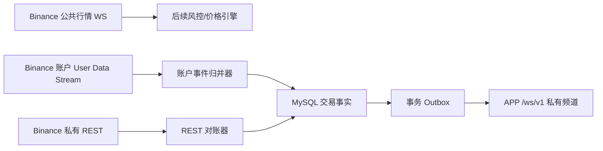
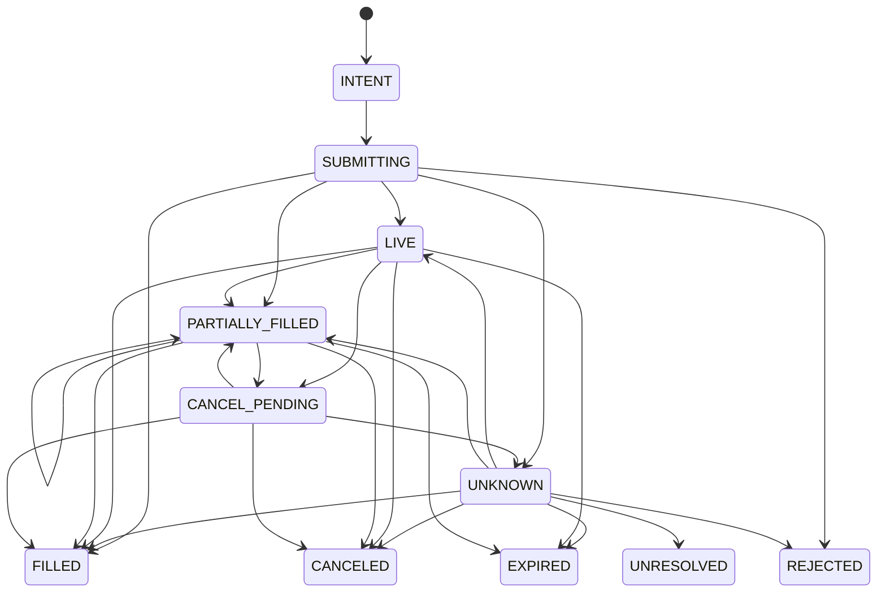
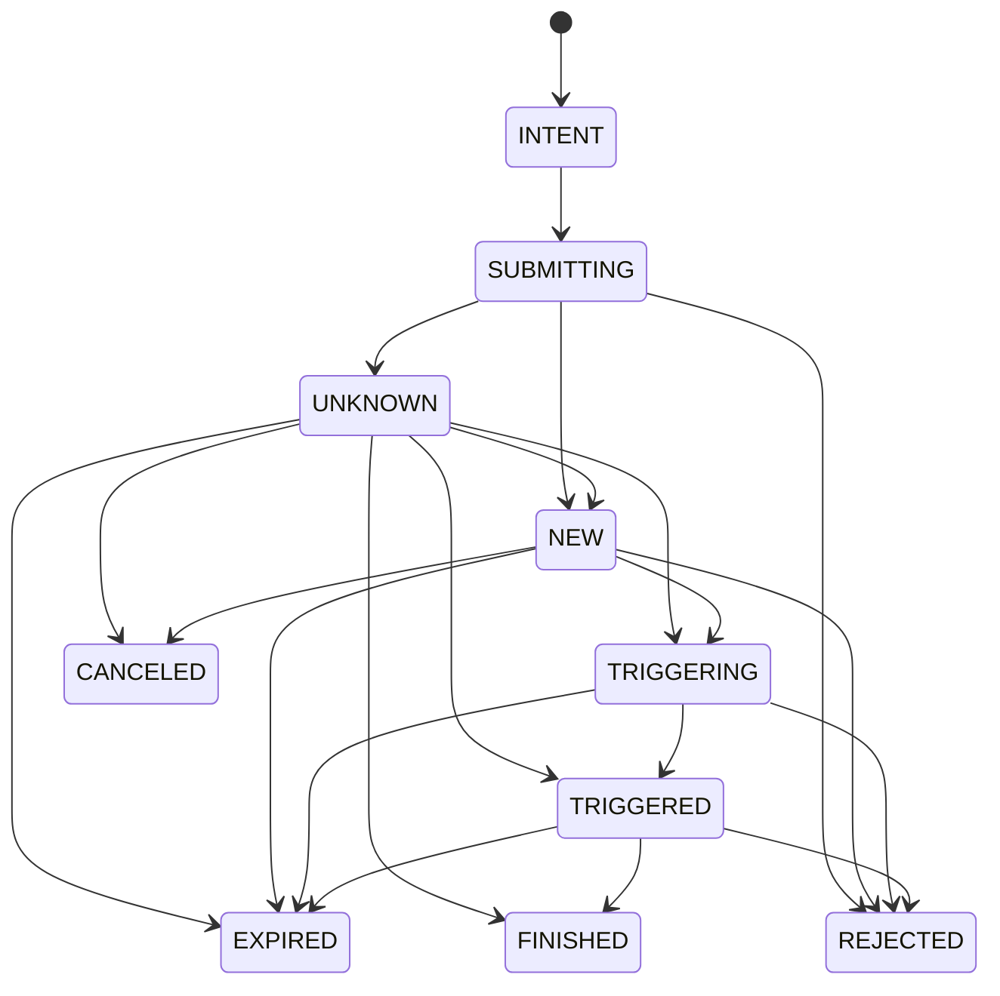

# Binance USD-M 账户监听、REST 对账与订单状态机设计

最后审计日期：2026-08-05。

实现状态：账户监听和对账已经落入 Java 后端；Phase 3 的建仓、保护单、分级减仓与
止损棘轮也已于 2026-08-07 落代码。配置默认关闭，尚未完成 Binance Futures Testnet 故障注入
和稳定运行验收。执行细节见 `TRADING_R_EXECUTION.md`。

## 1. 目标与边界

本文细化 `TRADING_BACKEND_DESIGN.md` 的 Phase 2，作为后续 Java 落代码的直接依据。
本文主体描述可信的账户、仓位、普通订单和 Algo 条件单镜像；真实执行在该事实层之上
实现，不改变本章的对账规则。

目标：

1. API 密钥绑定成功后，由 Java 后端持续维护 Binance User Data Stream；
2. 服务启动、WebSocket 断线、listenKey 失效和结果未知时，通过 REST 收敛状态；
3. 用幂等事件归并和订单状态机抵抗重复、迟到、乱序以及 REST/WS 交叉到达；
4. 把账户同步状态推送给所属 iOS 用户，但不暴露凭证和 Binance 私有原文；
5. 为下一阶段真实下单、固定保护单及移动止盈止损提供可靠事实层。

事实同步层明确不做：

- 不自行调用新建、修改或撤销订单接口；所有写操作只允许由 fenced 账户执行器发起；
- 不因发现仓位而自动安装保护单；
- 不从 iOS 直接连接 Binance；
- 不把 WebSocket 当作可重放消息队列；
- 不把 Redis 当作订单、仓位或同步状态的事实来源；
- 不因代码路径已可执行而绕过后续 Futures Testnet 验收。

## 2. 官方接口约束

当前设计基于 Binance USD-M 官方契约：

- listenKey 创建后有效 60 分钟，`PUT /fapi/v1/listenKey` 续期 60 分钟；
- 用户流地址为 `wss://fstream.binance.com/private/ws/<listenKey>`；
- 单条 WebSocket 连接最多持续 24 小时；
- 同一用户、同一连接、同一事件类型按 `T` 和 `E` 有序；跨事件类型应使用 `E`
  辅助比较，但仍不能假定存在全局事务序号；
- `ACCOUNT_UPDATE` 只推送发生变化的余额和仓位，未出现的 symbol 不能解释为仓位归零；
- `ORDER_TRADE_UPDATE` 是普通订单状态的主要实时来源；
- `ALGO_UPDATE` 是条件单从 `NEW` 到 `TRIGGERING`、`TRIGGERED`、`FINISHED`、
  `REJECTED` 或 `EXPIRED` 的主要实时来源；
- 收到 `listenKeyExpired` 后不会再有用户事件，必须重新取得有效 listenKey；
- 部分 HTTP 503 表示执行结果未知，不能直接判定失败并重新下单。

REST 对账使用：

```text
POST /fapi/v1/listenKey           创建/取得 listenKey
PUT  /fapi/v1/listenKey           续期 listenKey
DELETE /fapi/v1/listenKey         关闭 listenKey

GET /fapi/v3/account              账户和余额快照
GET /fapi/v3/positionRisk         当前仓位快照
GET /fapi/v1/openOrders           普通未完成订单
GET /fapi/v1/openAlgoOrders       Algo 条件单
GET /fapi/v1/order                按 orderId/clientOrderId 查询普通订单
GET /fapi/v1/algoOrder            按 algoId/clientAlgoId 查询条件单
GET /fapi/v1/allOrders            按 symbol 补查最近订单
GET /fapi/v1/userTrades           按 symbol 补查成交
```

`openOrders` 和 `openAlgoOrders` 不带 symbol 时权重较高。全 symbol 查询只用于启动、
重连和低频全发现；正常周期对账优先按当前持仓、活动订单和本系统命令涉及的 symbol
查询，不能每分钟对每个账户执行两次全市场订单查询。

官方参考：

- [User Data Streams](https://developers.binance.com/en/docs/products/derivatives-trading-usds-futures/user-data-streams)
- [User Data Stream REST](https://developers.binance.com/en/docs/catalog/core-trading-derivatives-trading-usd-s-m-futures/api/rest-api/user-data-streams)
- [账户 REST](https://developers.binance.com/en/docs/catalog/core-trading-derivatives-trading-usd-s-m-futures/api/rest-api/account)
- [交易与订单 REST](https://developers.binance.com/en/docs/catalog/core-trading-derivatives-trading-usd-s-m-futures/api/rest-api/trade)
- [REST 503 与限频规则](https://developers.binance.com/en/docs/products/derivatives-trading-usds-futures/general-info)

## 3. 已确定的架构决策

### 3.1 连接位置

每个已绑定且未停用的 Binance 账户由 Java 维护一条账户会话。手机是否在线、APP
是否在前台、当前有没有仓位，都不能决定 Binance 用户流是否运行。

公共行情 WebSocket、Binance 账户 WebSocket、APP `/ws/v1` 是三条不同链路：



账户流只负责账户、仓位和订单变化，不承担移动止损的价格触发。后续价格触发必须
继续使用与订单 `workingType` 一致的 Mark Price 或 Contract Price 行情。

### 3.2 REST 与 WebSocket 的职责

```text
WebSocket：运行期间低延迟增量，是主要更新来源
REST：绑定验证、启动快照、断线恢复、周期校验、未知结果查询
MySQL：已归并交易事实、幂等边界和审计事实来源
Redis：会话租约、热点快照和短期协调，不保存唯一事实
```

任何一条链路都不能单独宣称状态可信。只有用户流已连接且一次完整 REST 对账已经
收敛，账户才进入 `SYNCED`。

### 3.3 私有连接技术选型

公共行情保持现有 Binance SDK 和 Jetty 11，不做迁移。私有 REST 继续扩展当前
`BinanceUsdmPrivateRestClient`。账户 WebSocket 单独使用 JDK
`java.net.http.WebSocket`，原因是：

- 不改变当前公共行情 SDK 2.0.0、Jetty 11 和 `binance-common 2.2.1` 的稳定组合；
- listenKey 用户流协议简单，不需要 SDK 的订阅池；
- 连接、队列、续期、滚动重连和故障状态必须由本系统明确控制；
- 私有连接与公共行情连接可以独立限流、监控和停止。

不得关闭 TLS 证书校验。User Data Stream URL 必须来自环境配置，并校验为 `wss`。

## 4. 账户生命周期与同步状态

现有 `trading_account.status` 继续表示账户生命周期，不再同时表示同步健康度：

```text
PENDING_VERIFICATION
ACTIVE
PAUSED
CREDENTIAL_ERROR
DISABLED
```

新增独立 `sync_status`：

```text
STOPPED
CONNECTING
BUFFERING
RECONCILING
SYNCED
DEGRADED
AUTH_FAILED
```

推荐迁移字段：

```text
sync_status
stream_generation
last_stream_event_ms
last_stream_connected_at_ms
last_reconciled_at_ms
last_full_discovery_at_ms
last_sync_error_code
consecutive_sync_failure_count
reconcile_revision
```

账户不能因为 `DEGRADED` 从设置页消失。查询账户时按生命周期 `ACTIVE/PAUSED` 返回，
另外展示 `syncStatus`、最后事件时间、最后对账时间和脱敏错误。

允许真实执行时必须同时满足：

```text
trading.enabled
&& TRADING_ACCOUNT_SYNC_ENABLED=true
&& trading_account.status == ACTIVE
&& trading_account.sync_status == SYNCED
&& 当前实例持有有效账户租约与 fencing token
```

系统不提供额外的全局或账户级下单开关。

## 5. 绑定、启动、换 Key 与解绑

### 5.1 绑定

绑定接口不在数据库事务提交前启动后台线程：

1. 校验 API Key/Secret 格式；
2. 使用账户、仓位模式等签名 REST 请求验证凭证；
3. AES-256-GCM 加密凭证；
4. 事务内保存账户、初始 REST 只读快照和默认设置；
5. 保存 `status=ACTIVE`、`sync_status=CONNECTING`；
6. 事务提交后发布 `TradingAccountBoundEvent`；
7. `TradingAccountSessionManager` 异步启动账户会话；
8. 绑定响应可以立即返回 `CONNECTING`，APP 通过快照或私有频道看到 `SYNCED`。

HTTP 绑定请求不等待长时间 WebSocket 重试。同步失败不会删除已经验证并加密保存的
凭证，而是显示 `DEGRADED`；认证明确失败才进入 `AUTH_FAILED/CREDENTIAL_ERROR`。

### 5.2 服务启动

Spring 完成数据库、Redis和主密钥初始化后，扫描生命周期为 `ACTIVE/PAUSED` 且凭证
完整的账户。`ACTIVE` 自动启动会话，`PAUSED` 默认继续只读监听和对账，但不允许执行。
每个会话先交叉读取 `/fapi/v1/positionSide/dual` 与 `/fapi/v1/accountConfig`，确认
两处状态均为双向持仓，再建立 listenKey；此处不能批量修改交易对杠杆。
手机无需在线。

### 5.3 更换 Key

先验证并加密新 Key，在事务中增加 credential revision，再让会话管理器停止旧会话、
取得新凭证并重新同步。新会话未 `SYNCED` 前保持执行关闭。旧 listenKey 只做
best-effort 关闭，失败时等待其自然过期，不能为清理失败继续保留旧 Secret。

### 5.4 解绑

解绑顺序：

1. 事务内把账户置为 `DISABLED`、关闭执行并增加 fencing token；
2. 会话发现 token 失效后停止消费和请求；
3. 关闭 WebSocket，并 best-effort 删除 listenKey；
4. 清除数据库凭证密文、nonce 与 fingerprint；
5. 当前仓位镜像标记停止同步，但不能自动撤销 Binance 上已有订单。

“解绑账户”和“撤销交易所订单”永远是两个动作。

## 6. AccountSessionWorker

一个账户同一时刻只能有一个逻辑 worker：

```text
TradingAccountSessionManager
  -> AccountSessionWorker(accountId, fenceToken)
       -> BinanceUserDataStreamClient
       -> AccountEventBuffer
       -> TradingReconciliationService
       -> TradingExchangeEventReducer
```

会话启动顺序：

1. 获取账户短租约并原子增加 `execution_fence_token`；
2. 解密凭证，只保留在该 worker 的受限生命周期内；
3. `POST /fapi/v1/listenKey`；
4. 连接 `/private/ws/<listenKey>`，立即进入 `BUFFERING`；
5. WebSocket 回调只校验大小、解析事件头并放入有界队列；
6. 执行第 7 节完整 REST 对账；
7. 对账与缓冲事件收敛后进入 `SYNCED`；
8. 单账户串行消费事件，不同账户可使用虚拟线程并行。

默认每个账户队列容量建议 `10_000`。队列满、JSON 无法解析、事件处理事务连续失败时
不能静默丢事件：立即进入 `DEGRADED`、关闭当前连接并重新对账。

### 6.1 listenKey 与连接维护

- 每 30 分钟续期，不能等到第 60 分钟；
- 续期返回 `-1125` 或收到 `listenKeyExpired` 时重新创建 listenKey；
- 连接异常按 `1s -> 2s -> 4s ... -> 60s` 加随机抖动重试；
- 在连接接近 23 小时时主动重建 WebSocket，并立即 REST 对账；
- 正常滚动连接也按可能存在事件缺口处理，不能只换 socket 不对账；
- listenKey 按凭证处理，不写日志、不进入指标标签、不返回 iOS、不持久化到 MySQL/Redis；
- 丢失租约或 fencing token 变化时，worker 必须先停止新请求再退出。

## 7. REST 对账算法

### 7.1 完整对账

完整对账用于绑定后首次同步、服务启动、WebSocket 重连、listenKey 失效、队列溢出
和人工强制对账：

1. WebSocket 已连接并开始缓冲事件；
2. 记录本轮 `reconcileRevision` 和缓冲队列切点；
3. 获取账户、仓位、全 symbol 普通未完成订单、全 symbol Algo 未完成订单；
4. 对本系统处于 `UNKNOWN/UNRESOLVED` 的订单按 client ID 单独查询；
5. 对断线窗口内本系统涉及的 symbol 查询 `allOrders/userTrades`；
6. 在一个 MySQL 事务中应用快照；
7. 再按接收顺序归并缓冲事件，事件归并规则禁止状态倒退；
8. 如果本轮期间收到交易相关事件或发现漂移，执行第二次验证快照；
9. 最多执行三轮收敛；仍有未决漂移则保持 `DEGRADED`，不能强行标记同步成功；
10. 收敛后记录 `last_reconciled_at_ms` 并切换为 `SYNCED`。

只有当四类快照全部成功时，才允许用“REST 未出现”关闭本地仓位或活动订单。任一接口
失败都不能执行部分删除。

### 7.2 增量和周期对账

建议默认频率：

```text
有仓位、活动订单或未来执行已启用：每 60 秒轻量对账
空闲账户：每 5 分钟账户/仓位轻量对账
全 symbol 普通订单 + Algo 订单发现：每 30 分钟
DEGRADED：立即对账，失败后指数退避，最大 60 秒
UNKNOWN/UNRESOLVED 订单：独立高优先级按 client ID 查询
```

频率必须可配置并受全局 IP 权重预算限制。高权重全 symbol 查询由统一调度器错峰，
不能让大量账户在整点同时请求。

### 7.3 快照归并规则

- `ACCOUNT_UPDATE` 是增量：只更新事件中列出的资产和仓位；
- REST `positionRisk` 是全量：仅在完整成功的快照事务中关闭未出现的本地当前仓位；
- 普通/Algo open-order 快照缺少本地活动订单时，先按 ID 查询，不能直接标记取消；
- REST 发现未知 client ID 的订单，按 `origin=EXTERNAL` 建镜像，系统不能自动撤销；
- 只把数据库里确实存在的确定性 client ID 标记为 `origin=SYSTEM`，不能仅凭相似前缀；
- REST 与事件的价格、数量全部使用 `BigDecimal`；
- 每次对账输出 drift 计数，不记录私有响应正文。

### 7.4 断线恢复的已知限制

Binance 用户流不提供历史事件重放，`allOrders` 和 `userTrades` 又要求 symbol。对本系统
自己的命令，因为数据库已持久化 symbol 和 client ID，可以精确补查。对用户在断线
期间通过 Binance APP 完成且已经全开全平的陌生 symbol，无法只靠“当前仓位 + 当前
挂单”保证重建完整历史。

因此 Phase 2 保证：

- 当前余额、当前仓位、当前普通挂单和当前 Algo 挂单最终一致；
- 本系统产生的订单和成交可精确恢复；
- 已知/近期 symbol 的外部成交尽力补齐；
- 不承诺恢复断线期间任意陌生 symbol 的完整外部交易历史。

如果断线前后同方向仓位都非零，但无法证明中间没有平仓再开仓，设置
`continuity_status=UNCERTAIN`，不得复用旧 position generation 执行自动保护。

## 8. 用户流事件处理

### 8.1 Inbox 与事务边界

新增只追加 `trading_exchange_event` inbox。WebSocket 事件先生成语义哈希：

```text
ACCOUNT_UPDATE:
  accountId + e + T + E + reason + 规范化余额/仓位数组哈希

ORDER_TRADE_UPDATE:
  accountId + e + orderId + executionType + status
  + T + tradeId + accumulatedFilledQty

ALGO_UPDATE:
  accountId + e + algoId + algoStatus + T + actualOrderId
```

`unique(trading_account_id, event_hash)` 保证滚动连接或重复消息只应用一次。不要把
stream generation 放入唯一键，否则同一事件从新旧连接到达时无法去重。

单条事件处理必须在同一事务中完成：

```text
insert inbox（重复则结束）
-> 更新余额/仓位/订单/成交
-> 更新账户 last_stream_event_ms
-> 写 trading_outbox
-> commit
```

事务提交后才推送 APP。原始私有 JSON 不写日志；Inbox 只保存必要的规范化字段、
事件哈希和脱敏诊断，不保存 API Key、listenKey 或签名信息。

### 8.2 事件处理表

| 事件 | 处理方式 |
| --- | --- |
| `ACCOUNT_UPDATE` | upsert 列出的余额和仓位；不得关闭未列出的仓位 |
| `ORDER_TRADE_UPDATE` | 驱动普通订单状态机；`TRADE` 时幂等写成交 |
| `ALGO_UPDATE` | 驱动 Algo 状态机并关联 `actualOrderId` |
| `CONDITIONAL_ORDER_TRIGGER_REJECT` | 标记条件单/保护降级并立即报警、对账 |
| `ACCOUNT_CONFIG_UPDATE` | 更新已知配置，并触发轻量 REST 校验 |
| `MARGIN_CALL` | 记录风险事件并报警，不把它当成最终仓位快照 |
| `listenKeyExpired` | 停止接受当前流为可信来源，重新建流并完整对账 |
| `TRADE_LITE` | Phase 2 只计数，不作为成交事实，避免与完整订单事件重复记账 |
| 未知事件 | 记录类型和指标；涉及订单/仓位且无法解析时进入 `DEGRADED` |

## 9. 数据模型

### 9.1 `trading_account_balance`

```text
id, trading_account_id, asset
wallet_balance, cross_wallet_balance, balance_change
last_event_ms, last_reconcile_revision, update_time, version
unique(trading_account_id, asset)
```

账户总保证金余额仍保留在 `trading_account` 作为展示快照，分资产明细写入独立表。

### 9.2 扩展 `trading_position`

新增：

```text
last_event_ms
last_reconcile_revision
continuity_status          CONTINUOUS / UNCERTAIN
source                     REST / USER_STREAM
```

仓位从零到非零、确定发生方向翻转，或断线后无法证明生命周期连续时增加 `generation`。
旧 generation 的迟到订单或保护事件不能写入当前 generation。

### 9.3 `exchange_order`

```text
id, trading_account_id, trading_position_id, position_generation
order_class                REGULAR / ALGO
origin                     SYSTEM / EXTERNAL
purpose                    ENTRY / EXIT / STOP / TAKE_PROFIT / UNKNOWN
symbol, side, position_side, order_type, time_in_force, working_type
client_order_id, exchange_order_id
client_algo_id, exchange_algo_id, actual_order_id
quantity, price, trigger_price
executed_quantity, cumulative_quote, average_price
reduce_only, close_position
status, exchange_status, execution_type, reject_reason
exchange_create_ms, exchange_update_ms, last_event_ms
last_reconcile_revision, version
```

唯一键至少包括：

```text
unique(trading_account_id, order_class, client_order_id/client_algo_id)
unique(trading_account_id, order_class, exchange_order_id/exchange_algo_id)
```

Algo ID 与普通 order ID 分列，不能混用。

### 9.4 `exchange_fill`

```text
id, trading_account_id, exchange_order_row_id
symbol, trade_id, order_id
side, position_side, price, quantity, quote_quantity
commission, commission_asset, realized_pnl, maker
trade_time_ms, create_time
unique(trading_account_id, symbol, trade_id)
```

订单的累计成交量用于状态归并，`exchange_fill` 用于审计、手续费和实际 R 计算。

### 9.5 `trading_exchange_event`

```text
id, trading_account_id, event_type, event_hash
exchange_event_ms, transaction_ms, received_at_ms
entity_key, normalized_summary, applied_state
create_time
unique(trading_account_id, event_hash)
```

### 9.6 `trading_command` 与 `trading_outbox`

沿用总设计。虽然 Phase 2 不发送真实订单，也应先建好状态与唯一键，下一阶段不能临时
在 Controller 内直接下单。

## 10. 普通订单状态机

`status` 是系统规范状态，`exchange_status` 保留 Binance 原始枚举。状态机必须允许
WebSocket 事件早于 REST 响应到达。



规则：

- `FILLED/CANCELED/REJECTED/EXPIRED/EXPIRED_IN_MATCH` 是交易所终态，不回退到 LIVE；
- `executed_quantity` 只能增加，不能因迟到事件减少；
- 部分成交后撤单，状态可以是 `CANCELED`，但成交明细和累计成交量必须保留；
- 同一 order 在 `T/E` 相同或倒退时，只有累计成交量增加或更强终态才允许更新；
- `TRADE` 使用 `tradeId` 写 `exchange_fill`，重复事件不得重复手续费和盈亏；
- REST 503 未知进入 `UNKNOWN`，先等待用户流并按确定性 client ID 查询；
- 默认 30 秒确认窗口内按退避多次查询仍无法确认时进入 `UNRESOLVED` 并报警，
  不能生成新 client ID 自动重下；
- 外部订单从 REST 或用户流直接进入对应交易所状态，`origin=EXTERNAL`。

## 11. Algo 条件单状态机



- `TRIGGERED` 表示已进入撮合引擎，不代表已经成交；
- `FINISHED` 后仍需使用 `actualOrderId` 关联普通订单，确认是成交还是撤销；
- `REJECTED/EXPIRED` 如果属于保护单，立即把保护状态标为不足并报警；
- 未触发条件单不假定可原地修改，后续移动保护继续使用总设计中的安全换单流程；
- 用户手动创建的条件单同样镜像，但不自动认领为本系统保护单。

系统管理的活动计划还会按持久化 client ID 定期执行 REST 订单健康巡检，覆盖主止损、
限价止损的保底市价单和建仓成交后预挂的全部止盈单。该巡检是 User Data Stream 的保底，不替代账户
流；结果未知时查询原 ID，只有确认缺失/终态且退避到期后才以新 revision 补挂。
`FINISHED` 的限价止损父 Algo 单若已生成仍活动的普通子单，必须继续视为有效保护。

## 12. 命令状态与未知结果

下一阶段真实执行必须先持久化命令：

```text
RECEIVED -> VALIDATED -> PERSISTED -> DISPATCHING
DISPATCHING -> CONFIRMING -> SUCCEEDED
DISPATCHING -> FAILED_KNOWN
DISPATCHING -> UNKNOWN -> RECONCILING
RECONCILING -> SUCCEEDED / FAILED_KNOWN / UNRESOLVED
```

每个命令保存请求体哈希和 `Idempotency-Key`。同一用户使用相同幂等键和相同请求体
返回第一次结果；相同幂等键对应不同请求体返回 `422`。REST 超时或结果未知时，
命令和 order row 都保留原 client ID，严禁盲重试产生第二张订单。

## 13. 并发与多实例

当前生产是单应用容器，但数据模型从第一版就保留多实例安全：

- Redis 账户租约默认 30 秒，每 10 秒续租；
- 取得租约后在 MySQL 原子增加 `execution_fence_token`；
- Worker 每次写账户事件和未来发送命令前校验 token；
- 丢失 Redis 不能让旧 worker 继续执行；
- 同一账户的事件、对账和未来命令使用单分片串行器；
- 不同账户可并行，不能用一个全局锁阻塞所有账户；
- 对账调度、REST IP 权重和订单权重是全局预算，不能只按账户限流。

Phase 2 即使真实执行关闭，也要测试双 worker 争抢时只有一个能够更新 `SYNCED`，为
Phase 3 留下可靠 fencing 基础。

## 14. APP API 与私有实时事件

账户响应新增：

```text
syncStatus
lastStreamEventAtMillis
lastReconciledAtMillis
degradedReason
canExecute
snapshotRevision
```

新增只读接口：

```text
GET  /api/trading/accounts/{accountId}/snapshot
GET  /api/trading/accounts/{accountId}/orders
GET  /api/trading/accounts/{accountId}/fills
POST /api/trading/accounts/{accountId}/reconcile
```

`reconcile` 只是请求后台对账，返回 `202`，不能在 HTTP 线程同步阻塞整轮 Binance
请求。仅账户所有者可调用，并限制频率。

APP `/ws/v1` 增加：

```text
trading.account
trading.position
trading.order
trading.fill
```

所有私有事件必须通过 `publishToUser`，事务提交后从 Outbox 发布。APP 重连先请求
`snapshot`，再订阅增量；进程内 sequence 出现缺口时重新取快照，不要求服务器重放。

## 15. 配置建议

在 `trading.sync` 下新增配置，测试环境默认关闭：

```yaml
trading:
  sync:
    enabled: false
    user-stream-base-url: wss://fstream.binance.com/private
    keepalive-interval-millis: 1800000
    connection-rollover-millis: 82800000
    event-queue-capacity: 10000
    reconnect-initial-backoff-millis: 1000
    reconnect-max-backoff-millis: 60000
    active-reconcile-interval-millis: 60000
    idle-reconcile-interval-millis: 300000
    full-discovery-interval-millis: 1800000
    max-convergence-passes: 3
    unresolved-order-timeout-millis: 30000
    lease-ttl-millis: 30000
    lease-renew-interval-millis: 10000
```

主网和 Futures Testnet 的 REST、WebSocket 地址必须成对配置并启动时校验环境一致。不能让
Testnet listenKey 连接主网，也不能为解决 TLS 错误关闭证书验证。

## 16. 可观测性与报警

指标：

```text
trading_account_sync_state{account}
trading_user_stream_connected{account}
trading_user_stream_event_age_seconds{account}
trading_user_stream_reconnect_total{reason}
trading_user_stream_queue_depth{account}
trading_reconcile_total{type,result}
trading_reconcile_drift_total{entity}
trading_exchange_event_duplicate_total{type}
trading_order_unknown_total{class}
trading_order_unresolved_total{class}
trading_position_continuity_uncertain_total
trading_private_rest_weight_used
```

账户 ID 作为指标标签时使用低基数内部短标识，不能使用 API Key、listenKey、symbol
无限组合或用户输入 label。以下情况立即报警：

- 有仓位的账户超过阈值未收到用户事件且 REST 对账失败；
- listenKey 连续续期失败；
- 队列溢出或关键事件解析失败；
- 普通/Algo 订单长期 `UNKNOWN/UNRESOLVED`；
- 条件保护单 `REJECTED/EXPIRED`；
- 仓位 continuity 变为 `UNCERTAIN`；
- Binance REST 429/418、认证失败或时间持续偏差。

## 17. 测试矩阵

### 17.1 单元测试

- 所有普通订单合法状态迁移和非法回退；
- Algo `NEW -> TRIGGERING -> TRIGGERED -> FINISHED` 及拒绝/过期；
- 累计成交量单调、tradeId 去重、部分成交后撤单；
- `ACCOUNT_UPDATE` 未列出的仓位不会被关闭；
- REST 完整快照可以关闭已不存在仓位；
- 迟到 REST/WS 不覆盖更新状态；
- 事件哈希在滚动连接重复投递时保持一致；
- 503 unknown 不生成第二个 client ID；
- position generation 和 continuity 不确定规则。

### 17.2 集成测试

- 绑定事务提交后才启动 worker；
- 服务启动自动恢复所有可监听账户；
- listenKey 续期、`-1125`、expired、24 小时滚动连接；
- 连接后缓冲事件与两轮 REST 快照收敛；
- 任一快照接口失败时不执行缺失删除；
- 队列溢出进入 `DEGRADED` 并触发对账；
- Inbox、业务表、Outbox 在同一事务；
- 两实例 fencing token 防止旧 worker 写入；
- 私有事件只发送给账户所属 app user；
- 日志、异常、指标和 API 响应无 Secret/listenKey/签名泄露。

### 17.3 Futures Testnet 验收

Phase 2 先在 Futures Testnet 连续运行 72 小时：

- Java 重启后当前账户、仓位和订单自动恢复；
- 人工在 Binance Futures Testnet 建仓、部分成交、撤单、平仓，APP 最终一致；
- 主动断网、让 listenKey 失效、制造 REST 超时，均能进入 DEGRADED 并恢复；
- 不发生重复订单/成交记录；
- 账户未达到 `ACTIVE + SYNCED` 时始终没有任何写交易请求。

账户同步专项仍需完成该验收；Phase 3 执行代码虽已实现，也必须在同一个 Testnet 故障
环境中证明未知结果不会重复下单、旧保护不会先被撤销。

## 18. 实施顺序

建议拆为八个可独立验收的小步骤：

1. Flyway 数据库迁移：sync 字段、balance、order、fill、inbox、outbox；
2. 私有 REST 扩展：listenKey、账户/仓位、普通/Algo 挂单和按 ID 查询；
3. `BinanceUserDataStreamClient`：连接、消息大小、续期、停止与错误分类；
4. `TradingOrderStateMachine` 和 `TradingExchangeEventReducer`；
5. `TradingReconciliationService`：完整、轻量和未知订单对账；
6. `TradingAccountSessionManager`：绑定后启动、重启恢复、租约与 fencing；
7. Outbox 与 `/ws/v1` 私有账户/仓位/订单事件；
8. Futures Testnet 故障注入与 72 小时稳定性验收。

第 1～7 步与下单适配层代码已经完成，但在 Testnet 验收完成前继续保持真实执行关闭。
代码完成不代表可以主网下单。
