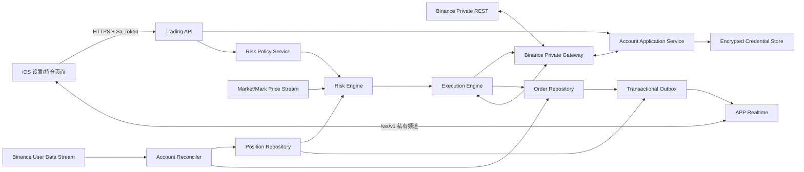

# Java 实盘交易与动态风控后端设计

> 整合版说明（2026-10-31）：本文保留来源系统的业务或实现资料。当前运行入口、服务器、原生页面与验证边界以 [整合说明](INTEGRATION.md)、[运维](operations.md) 和 [变更](changes.md) 为准；Java 模块仅作参考。


最后审计日期：2026-08-07。

## 1. 结论

Binance API Key、Secret Key、账户、仓位、订单和止盈止损状态必须由 Java
服务统一管理。iOS 只负责录入、配置和展示，不直接请求 Binance 私有接口，也不
保存 Binance 凭证。

首版继续采用现有 Spring Boot 模块化单体，不立即拆微服务。交易域与公共行情、
提醒域在代码、线程池、限流和数据库表上隔离，但可以复用现有 MySQL、Redis、
Sa-Token 认证、市场行情以及 `/ws/v1` 私有消息能力。

核心安全原则：

1. 仓位出现后优先在 Binance 交易所放置原生保护单，不能只靠 Java 进程监控价格。
2. Java 负责监听仓位、计算策略和逐步收紧保护位；服务中断时，最后一张已确认的
   交易所保护单仍然有效。
3. 止损只能向降低风险的方向移动。更新条件单时必须先确认新单生效，再撤旧单，
   不允许产生无保护窗口。
4. MySQL 是交易状态与审计事实来源；Redis 只用于租约、热点快照和短期去重。
5. 默认关闭真实执行，先通过单元测试、故障测试和 Binance Futures Testnet 环境验收，再按
   账户显式开放生产执行。

## 2. 当前实施状态与迁移边界

Phase 1 的安全边界已于 2026-08-04 落地：

- Java 使用 AES-256-GCM 加密保存 Binance API Key 与 Secret，并用账户身份作为
  AAD；主密钥只接受 `TRADING_CREDENTIAL_MASTER_KEY` 环境变量注入；
- Java 私有 REST 客户端负责 HMAC、服务器时间校准、账户 V3、仓位 V3 与持仓模式
  查询；错误响应不回显 Binance 原文或签名查询串；
- 已提供绑定、解绑、手动刷新、当前仓位、单交易对杠杆和风控参数 API，所有接口均受
  Sa-Token 用户归属校验；
- 已提供 1–5 级分级止盈止损策略 CRUD。每级可以减仓、一次移动到固定 R，或持续
  保持在“当前浮盈减 N R”的位置，Java 同时校验 R 递增和累计减仓不超过 100%；
- 止损额设置只接受 1%–25% 的整数比例，由 Java 使用最新余额计算绝对金额并冻结；
  调低立即生效，调高进入 2 小时 pending 窗口；
- 已提供账户级下单设置：可选默认止盈止损策略，且分别配置建仓、
  止盈和止损委托方式；限价止损必须配置大于 1R 的保底市价止损；
- iOS 的 Binance HMAC 签名器、`fapi.binance.com` 直连和 Binance 凭证 Keychain
  存储已经删除；升级后的 APP 会清理旧 Keychain 服务项；
- iOS 的余额与风控设置只通过 Java API 读取和保存，旧的本地风控参数不自动覆盖
  服务器数据，需要用户在绑定后重新确认一次。

Phase 1/2 的凭证、User Data Stream、后台对账和订单事实层已经完成。Phase 3 的
以损定仓、下单/Algo 条件单、部分成交保护、分级减仓和止损棘轮已于 2026-08-07
落代码，详见 [`TRADING_R_EXECUTION.md`](TRADING_R_EXECUTION.md)。全局和账户级下单
开关已删除；系统仍未通过 Binance Futures Testnet 故障注入，不能宣称已经完成主网资金安全验收。

## 3. Binance 2026 接口约束

方案只依赖 Binance 官方公开接口：

- 账户快照：`GET /fapi/v3/account`；
- 仓位快照：`GET /fapi/v3/positionRisk`；
- 普通开仓、平仓订单：`POST /fapi/v1/order`；
- 止损、止盈和跟踪止损：`POST /fapi/v1/algoOrder`；
- 条件单查询与对账：`GET /fapi/v1/openAlgoOrders`、
  `GET /fapi/v1/algoOrder`、`GET /fapi/v1/allAlgoOrders`；
- 条件单撤销：`DELETE /fapi/v1/algoOrder`；
- 账户实时事件：User Data Stream 的 `ACCOUNT_UPDATE`、
  `ORDER_TRADE_UPDATE` 和 `ALGO_UPDATE`。

官方变更日志明确指出，从 2025-12-09 起 `STOP_MARKET`、
`TAKE_PROFIT_MARKET`、`STOP`、`TAKE_PROFIT` 和
`TRAILING_STOP_MARKET` 已迁移到 Algo Service。把这些类型提交到旧的
`POST /fapi/v1/order` 会得到 `-4120 STOP_ORDER_SWITCH_ALGO`，并且未触发
条件单不支持修改。因此动态保护位必须使用新建与撤销流程，不能假定存在原地改单。

参考：

- [USD-M 账户 API](https://developers.binance.com/en/docs/catalog/core-trading-derivatives-trading-usd-s-m-futures/api/rest-api/account#account-information-v3)
- [USD-M 交易与 Algo Order API](https://developers.binance.com/en/docs/catalog/core-trading-derivatives-trading-usd-s-m-futures/api/rest-api/trade#new-algo-order)
- [USD-M User Data Streams](https://developers.binance.com/en/docs/products/derivatives-trading-usds-futures/user-data-streams)
- [USD-M API 通用可靠性规则](https://developers.binance.com/en/docs/products/derivatives-trading-usds-futures/general-info)
- [USD-M API Change Log](https://developers.binance.com/en/docs/products/derivatives-trading-usds-futures/change-log)

当前项目使用的 Binance Java SDK `2.0.0` 早于上述条件单迁移。私有交易适配层
首版使用 JDK `HttpClient` 和独立签名器实现官方接口，不强行复用或升级公共行情
SDK；这样不会破坏现有 Jetty 11 对齐、连续 K 线订阅与断线清理逻辑。

## 4. 总体架构



推荐包结构：

```text
com.oovso.trading.api              Controller、DTO、用户权限边界
com.oovso.trading.application      绑定、查询、策略配置、命令编排
com.oovso.trading.domain           仓位、保护计划、状态机、价格规则
com.oovso.trading.infrastructure   Binance 私有 REST/WS、加密、租约
com.oovso.trading.persistence      Mapper、实体、Outbox
com.oovso.trading.realtime         仅向所属 APP 用户推送私有事件
```

公共 `com.oovso.strategy` 继续只生成分析信号。它不能直接调用 Binance 下单；
将来需要自动开仓时，必须先生成带幂等键的 `TradingCommand`，由交易应用层进行
账户风控后再交给执行引擎。

## 5. 凭证与账户安全

### 5.1 绑定流程

1. iOS 通过 HTTPS 把 API Key 和 Secret 发送到 Java 的一次性绑定接口。
2. 服务在内存中完成 HMAC 验证，调用账户 V3、仓位模式和账户配置接口。
3. 将 USD-M 账户设为双向持仓；读取账户专属杠杆档位，把当前报价资产下全部交易中
   永续合约设为各自最大初始杠杆。账户已有挂单或持仓时不能静默跳过模式切换。
4. 外部配置完成后重新读取账户，只有确认 `HEDGE` 才加密保存凭证。
5. 响应只返回 API Key 掩码、账户模式、结算资产和同步状态；已知错误使用中文提示。
6. 原始 Secret 不进入日志、异常、审计 JSON、Redis、指标标签或 API 响应。

推荐用户创建本系统专用 Binance API Key：只开放 USD-M 读取与交易权限，关闭
提现权限，并只允许 Java 服务器固定出口 IP。移动网络 IP 不能进入 Binance 白名单。

### 5.2 加密存储

定义 `CredentialCipher` 接口，业务代码不能接触主密钥实现：

- 数据采用 AES-256-GCM 加密，随机 96-bit nonce；
- AAD 至少包含 `appUserId + tradingAccountId + exchange + keyVersion`，防止密文
  被复制到其他用户记录后解密；
- API Key 和 Secret 一起放入加密 credential blob；数据库只额外保存 Key 掩码和
  不可逆 fingerprint；
- 生产首选云 KMS/Vault 的 envelope encryption；单机首版可由
  `TRADING_CREDENTIAL_MASTER_KEY` 注入 32 字节 Base64 主密钥；
  `.env.example` 只能包含变量名和空占位，真实主密钥不能写入源码、配置模板、
  镜像、数据库或日志；
- 保存 `key_version`，支持后台逐行重加密；解密失败立即把账户置为
  `CREDENTIAL_ERROR`，不能继续下单。

绑定、换 Key 和解绑属于高风险动作，需要最近一次密码确认；未来有
MFA 后升级为 MFA 确认。解绑前先暂停执行并确认本系统管理的保护单处置策略，不能
静默撤掉交易所保护单。

## 6. 数据模型

所有金额、数量和价格使用 `decimal(38,18)`/`BigDecimal`，禁止 `double`。所有
写模型包含 `version` 做乐观锁，时间同时保存 Binance 毫秒时间戳和服务器时间。

### 6.1 `trading_account`

```text
id, app_user_id, exchange, market_type, environment
label, quote_asset, credential_ciphertext, credential_nonce
credential_fingerprint, api_key_masked, key_version
position_mode, multi_assets_mode
status, last_verified_at, last_synced_at
last_stream_event_ms, consecutive_failure_count
execution_fence_token, version
```

关键约束：

```text
unique(app_user_id, exchange, market_type, environment, credential_fingerprint)
index(status)
```

账户状态：

```text
PENDING_VERIFICATION -> SYNCING -> ACTIVE
ACTIVE -> DEGRADED -> SYNCING -> ACTIVE
任意状态 -> PAUSED / CREDENTIAL_ERROR / DISABLED
```

### 6.2 `trading_risk_policy`

```text
id, trading_account_id, policy_revision, enabled
working_type                 MARK_PRICE / CONTRACT_PRICE
fixed_stop_loss_percent
fixed_take_profit_percent
max_loss_amount, settlement_asset
trailing_stop_json
moving_take_profit_json
emergency_stop_json
created_by, create_time, update_time, version
```

策略保存时创建不可变 revision。已经打开的仓位默认绑定开仓时的 revision；用户
显式选择“应用到现有仓位”时才生成保护计划变更命令，避免编辑默认设置时突然移动
已有真实订单。

#### 6.2.1 `trading_exit_strategy` / `trading_exit_strategy_level`

当前设置页已经落地独立的分级策略表，避免把后续执行所需的级别动作塞进不可查询的
客户端 JSON：

```text
trading_exit_strategy:
id, trading_account_id, strategy_name, strategy_revision, version

trading_exit_strategy_level:
id, exit_strategy_id, level_no, trigger_r, reduce_percent
move_stop_mode, move_stop_r
```

`level_no` 唯一且只能连续为 1–5；`trigger_r` 必须逐级增加；`reduce_percent` 按
初始仓位百分比计算，累计不能超过 100%。`FIXED_R` 只执行一次，
`TRAILING_PROFIT_R` 表示未来执行器持续把保护位收紧到“当前浮盈减 N R”。

#### 6.2.2 `trading_loss_limit`

```text
id, trading_account_id, revision
current_percentage, current_amount
pending_percentage, pending_amount, pending_effective_at_ms
balance_snapshot, settlement_asset, version
```

iOS 不提交绝对金额。Java 用最近同步余额计算预览页面核对过的金额档位并冻结
`current_amount`。调低金额直接替换 current 并清除 pending；调高金额保留 current，
写入 2 小时后生效的 pending。该表与旧 `trading_risk_policy.max_loss_amount` 分开，
避免对已经部署的 Phase 1 表做不兼容列迁移。

### 6.3 `trading_position`

```text
id, trading_account_id, symbol, position_side, generation
quantity, entry_price, break_even_price, mark_price
liquidation_price, leverage, margin_type, isolated_margin
unrealized_pnl, status, exchange_update_ms, last_event_ms, version
```

唯一业务键为：

```text
trading_account_id + symbol + position_side
```

仓位从零变成非零，或者单向模式发生方向翻转时，`generation` 加一。所有保护计划
与订单都带 generation，旧仓位的迟到事件不能污染新仓位。

### 6.4 `position_protection`

```text
id, trading_position_id, position_generation, policy_revision
status, anchor_price, high_water_price, low_water_price
desired_stop_price, confirmed_stop_price
desired_take_profit_price, confirmed_take_profit_price
stop_algo_order_id, take_profit_algo_order_id
last_evaluated_price, last_adjusted_at, adjustment_generation
error_code, error_message_redacted, version
```

保护状态：

```text
PENDING -> INSTALLING -> PROTECTED
PROTECTED -> REPRICING -> PROTECTED
PROTECTED -> DEGRADED / PAUSED / CLOSING
任意状态 -> CLOSED / ERROR
```

### 6.5 `exchange_order`

统一保存普通订单和 Algo Order：

```text
id, trading_account_id, trading_position_id, position_generation
order_class                  REGULAR / ALGO
purpose                      ENTRY / EXIT / STOP / TAKE_PROFIT / EMERGENCY
client_order_id, exchange_order_id
client_algo_id, exchange_algo_id
symbol, side, position_side, order_type, working_type
quantity, price, trigger_price, activate_price, callback_rate
reduce_only, close_position, status
exchange_create_ms, exchange_update_ms, raw_response_redacted, version
```

`clientOrderId`/`clientAlgoId` 由服务确定性生成且不超过 Binance 的 36 字符限制，
例如 `tt-{accountShard}-{positionHash}-{generation}-{leg}-{sequence}`。数据库唯一键和
这个客户端 ID 共同构成跨超时、重启和重复请求的幂等边界。

### 6.6 `trading_command` 与 `trading_outbox`

`trading_command` 保存每个绑定、配置、下单、撤单、换保护位和暂停命令：

```text
id, app_user_id, trading_account_id, idempotency_key
command_type, request_json_redacted, status
result_reference, error_code, attempt_count
create_time, update_time
```

唯一键：`app_user_id + idempotency_key`。客户端网络重试必须得到第一次命令结果，
不能重复下单。

`trading_outbox` 与业务状态在同一 MySQL 事务提交，提交后再推送 APP 私有频道。
推送失败不回滚仓位和订单状态；APP 重连后使用 REST 快照补齐。

## 7. Java API 契约

### 7.1 Phase 1 已实现

```text
POST   /api/trading/accounts
GET    /api/trading/accounts
POST   /api/trading/accounts/{accountId}/refresh
DELETE /api/trading/accounts/{accountId}

GET    /api/trading/accounts/{accountId}/positions
GET    /api/trading/accounts/{accountId}/risk-policy
PUT    /api/trading/accounts/{accountId}/risk-policy

GET    /api/trading/accounts/{accountId}/exit-strategies
POST   /api/trading/accounts/{accountId}/exit-strategies
PUT    /api/trading/accounts/{accountId}/exit-strategies/{strategyId}
DELETE /api/trading/accounts/{accountId}/exit-strategies/{strategyId}

GET    /api/trading/accounts/{accountId}/loss-limit
PUT    /api/trading/accounts/{accountId}/loss-limit

GET    /api/trading/accounts/{accountId}/order-settings
PUT    /api/trading/accounts/{accountId}/order-settings
```

绑定请求中的 Secret 只用于服务器内存中的验证和加密，绝不出现在响应中。GET 账户
响应只包含 API Key 掩码、账户模式、结算资产、余额和同步时间。风控参数、分级策略、
止损额与下单设置用于新建仓计划快照。系统没有额外下单开关；账户必须处于
`ACTIVE + SYNCED`，且执行 worker 的 lease/fencing token 有效。

### 7.2 后续完整契约

所有接口都要求现有 Sa-Token；服务必须校验账户的 `app_user_id` 等于当前登录用户。

```text
POST   /api/trading/accounts
GET    /api/trading/accounts
GET    /api/trading/accounts/{accountId}
POST   /api/trading/accounts/{accountId}/verify
POST   /api/trading/accounts/{accountId}/pause
POST   /api/trading/accounts/{accountId}/resume
DELETE /api/trading/accounts/{accountId}

GET    /api/trading/accounts/{accountId}/snapshot
GET    /api/trading/accounts/{accountId}/positions
GET    /api/trading/accounts/{accountId}/orders
DELETE /api/trading/accounts/{accountId}/entry-orders/{orderId}
GET    /api/trading/accounts/{accountId}/commands/{commandId}

GET    /api/trading/accounts/{accountId}/risk-policy
PUT    /api/trading/accounts/{accountId}/risk-policy

GET    /api/trading/positions/{positionId}/protection
PUT    /api/trading/positions/{positionId}/protection
POST   /api/trading/positions/{positionId}/protection/pause
POST   /api/trading/positions/{positionId}/protection/resume
```

写接口必须带：

```http
Idempotency-Key: <UUID>
If-Match: <当前资源 revision/version>
```

建仓限价撤单不复用通用订单删除：服务端必须按账户所有权、`SYSTEM + ENTRY + LIMIT`
及活动状态逐项核验，避免误撤止盈、止损或外部订单。撤单作为 `CANCEL_ENTRY` 命令进入
账户串行 worker；超时先按原 client order ID 查询，不能盲目重复写请求。部分成交时
只撤剩余委托，已经成交的仓位继续绑定原计划快照并维持保护。该风险收敛操作不受账户
“允许新建仓”开关限制，但仍要求服务器交易总闸门开启、账户 `ACTIVE + SYNCED` 且
worker lease/fencing token 有效。

更新冲突返回 `409`，幂等键对应不同请求体返回 `422`。Secret 只允许出现在绑定
请求体，绑定响应和之后的查询永远不返回 Secret。

APP WebSocket 增加仅向所属用户发布的频道：

```text
trading.account
trading.position
trading.order
trading.protection
```

这些频道必须通过现有 `publishToUser` 发送，不得使用 `publishPublic`。消息只包含
掩码 Key、账户/仓位/订单状态和可展示错误，不包含签名参数、Secret 或 Binance
原始私有响应。

## 8. 账户与仓位实时同步

每个 `ACTIVE` 交易账户由一个 `AccountSessionWorker` 独占：

1. 取得账户租约；
2. 交叉读取 `/fapi/v1/positionSide/dual` 与 `/fapi/v1/accountConfig`，只校准并确认
   两处账户状态均为双向持仓，不读取或修改任何交易对杠杆；
3. 创建 listenKey 并连接 User Data Stream；
4. 同时取得账户 V3、仓位 V3、普通挂单和 Algo 挂单 REST 快照；
5. 合并连接建立期间缓存的 WebSocket 事件；
6. 对账完成后把账户从 `SYNCING` 切换到 `ACTIVE`；
7. 消费 `ACCOUNT_UPDATE`、`ORDER_TRADE_UPDATE`、`ALGO_UPDATE`；
8. 每 30 分钟续期 listenKey，并在 24 小时连接上限前主动滚动重连。

全部交易对最大杠杆只在绑定 API 的流程中设置。应用启动可以校准双向持仓；新建仓
命令本身不读取、校验或修改持仓模式，也不因 `-4061` 重试。每个命令只提交一次，
Binance 明确拒绝后立即结束并返回中文错误，由用户自行修改持仓模式后创建新命令。
结果未知只允许按原 client ID 查询，不允许重发。启动、重连和周期对账不得批量修改账户杠杆；用户在 K 线详情
页修改杠杆时，只调用当前交易对的
`/fapi/v1/leverage`，并读取 `/fapi/v1/leverageBracket` 返回 UI 所需档位上限。

官方说明 listenKey 有效期为 60 分钟、单连接最多 24 小时，并建议优先使用用户流
而不是高波动时期可能延迟的 REST 查询。因此 REST 用于启动、重连和定期对账，
WebSocket 是运行中的主更新源。

同一账户同一事件类型按官方 `E` 事件时间排序。数据库更新还要比较交易所更新时间、
累计成交量和状态优先级，忽略迟到回退事件。WebSocket 断线、listenKey 失效或事件
长时间静默时，账户进入 `DEGRADED`：

- 保留已经确认的交易所保护单；
- 冻结新的开仓和主动放宽风险操作；
- 不因连接失败撤掉旧保护单；
- 重新创建用户流并完成 REST 全量对账后才能恢复 `ACTIVE`。

多实例部署通过 Redis 短租约加 MySQL fencing token 确保同一账户只有一个执行者。
Redis 丢失不能让两个实例同时下单；每个执行命令写入时必须校验 fencing token。

## 9. 250ms 行情与风控计算

价格推送和交易所请求必须解耦。250ms 行情进入内存风险引擎，不进行逐条 MySQL
写入，也不为每个 tick 调用 Binance REST：

```text
价格事件
-> 按 symbol 找到当前有仓位且启用保护的账户
-> 按 account + symbol + positionSide 分片串行执行
-> 更新内存 high/low water mark
-> 计算 desired protection
-> 没跨过最小移动步长则结束
-> 跨过步长且超过冷却时间才生成 ReplaceProtectionCommand
```

每个仓位的计算是 O(1)，索引方向是 `symbol -> protected positions`，不能每 250ms
扫描所有用户和所有合约。分片执行器保证同一仓位严格串行，不同仓位可以并行。

数据源必须与保护单 `workingType` 一致：

- `CONTRACT_PRICE` 使用当前合约成交价流；
- `MARK_PRICE` 使用 Binance Mark Price 流；
- 不能用 CONTRACT_PRICE 计算阈值，却提交 MARK_PRICE 条件单后假设两者同时触发。

首选交易所原生 `TRAILING_STOP_MARKET`，因为 Binance 在服务离线时仍会持续跟踪。
只有官方 callback/activation 模型无法表达业务规则时，才启用 Java 自定义移动算法。
即使使用自定义算法，也应同时保留一张更宽的交易所紧急止损作为灾难兜底。

高低水位只在发生以下情况时持久化：

- 生成了新的保护位；
- 达到周期 checkpoint；
- 服务优雅关闭。

重启时先读取交易所现有保护单和当前价格，以“不能放宽已经确认止损”为规则恢复，
不能只依赖最后一次内存水位。

## 10. 保护价格计算

固定止损同时受比例和最大亏损额限制。对 USD-M 线性合约，先计算：

```text
distanceByPercent = entryPrice * stopLossPercent
distanceByAmount  = max(0, maxLossAmount - feeAndSlippageReserve)
                    / abs(positionQuantity)
distance          = min(distanceByPercent, distanceByAmount)

LONG  stop = entryPrice - distance
SHORT stop = entryPrice + distance
```

`maxLossAmount` 是风险上限，不是下单金额。它不能保证实际成交亏损绝不超过该数值，
因为跳空、滑点、手续费和交易所故障仍可能造成偏差。价格和数量提交前必须读取
`exchangeInfo` 的 tick size、step size、最小名义价值并做方向安全的 BigDecimal
取整。

固定止盈：

```text
LONG  takeProfit = entryPrice * (1 + takeProfitPercent)
SHORT takeProfit = entryPrice * (1 - takeProfitPercent)
```

移动止损使用激活收益、回撤比例/ATR、最小移动 tick 数和冷却时间。不可违反：

```text
LONG  newStop >= confirmedStop
SHORT newStop <= confirmedStop
```

“移动止盈”在产品上可能有两种不同含义，数据模型都预留但不能混用：

1. 价格有利时把止盈目标继续向外移动；
2. 达到盈利激活点后用跟踪退出锁定利润，本质更接近 trailing stop。

首版只实现固定止盈、固定止损和交易所原生跟踪止损。自定义移动止盈必须在明确
激活、回撤、最大等待时间和部分减仓语义后作为新的 policy type 上线，不能复用一个
含糊的布尔开关。

## 11. 安全换单状态机

Binance 不支持修改未触发 Algo Order，因此移动保护位执行：

1. 锁定 `account + symbol + positionSide + positionGeneration`；
2. 重新读取仓位内存快照并确认仍非零；
3. 计算并按交易所过滤器归一化新价格；
4. 验证新止损没有放宽风险；
5. 使用新 `clientAlgoId` 创建新 Algo Order；
6. 通过响应、`ALGO_UPDATE` 或按 client ID 查询确认新单为 `NEW/WORKING`；
7. 在同一数据库事务中切换 active order 引用并写 outbox；
8. 最后撤销旧 Algo Order；
9. 撤旧失败时保留两张 reduce/close 语义保护单并进入对账，不能先撤新单。

活动执行计划另有持久化 REST 健康巡检：同时核对主止损、保底止损和建仓成交后预挂的
全部止盈。确认缺失或已撤销/拒绝/过期后，按 revision 与指数退避补挂；止盈补挂只提交冻结计划
量扣除历史累计成交后的剩余量。巡检、每分钟移动和服务重启都只能读取建仓时冻结的
R、订单方式、策略级别与交易规则，不得重新读取当前默认设置覆盖旧计划。

`NEW/WORKING` 只代表条件单已被 Algo Service 接受，并不保证触发时一定成交。
官方迁移规则说明条件单触发前不做保证金检查；服务必须消费 `ALGO_UPDATE` 的
`REJECTED/EXPIRED`，立即把仓位置为未充分保护并报警。是否自动提交紧急市价减仓
必须是单独、明确启用的账户策略，不能在设计中暗自假设用户同意。

全仓保护优先使用 `closePosition=true`。数量保护必须区分持仓模式：

- 单向模式使用正确反向 side，并设置 `reduceOnly=true`；
- 双向模式必须传 `LONG/SHORT positionSide`，且遵守 Binance 不允许同时传
  `reduceOnly` 的规则；
- 任一保护单都不能在平仓后反向开仓。

普通开仓/平仓订单与 Algo 条件单分别建模，不能把 `orderId` 与 `algoId` 混为一个
字段。收到仓位归零后，先确认 generation，再清理对应保护计划和残留条件单。

## 12. 幂等、超时和交易所异常

Binance 官方说明，部分 `503` 响应代表执行结果未知，订单可能已经成功。执行层
必须遵守：

- 任何下单都有确定性 client ID；
- 结果未知时先等待用户流或按 client ID 查询；
- 查询确认不存在后才允许使用同一个业务命令重试；
- 绝不能在超时后立即生成新的 client ID 盲目重下；
- `429` 按 `Retry-After` 退避，`418` 立即停止请求并报警；
- 跟踪 `X-MBX-ORDER-COUNT-*` 和请求权重响应头；
- 风险降低类命令优先于开仓和非必要换单。

每账户设置 Token Bucket，每个 symbol 的保护换单再加最短冷却时间和最小价格步长。
250ms 行情频率不等于 250ms 下单频率。

## 13. 失败策略与自动安全门

新建仓必须满足以下运行状态：

```text
trading.enabled
&& TRADING_ACCOUNT_SYNC_ENABLED=true
&& trading_account.status=ACTIVE
&& trading_account.sync_status=SYNCED
&& 当前实例持有有效账户租约与 fencing token
```

系统不提供全局或账户级下单开关。以下故障状态会自动阻止新的交易写操作：

- 仓位保护暂停：必须向用户明确显示当前交易所仍存在哪些订单；
- 凭证故障：停止所有新请求，保留交易所订单并报警；
- 行情陈旧：不移动保护位，不放宽旧止损；
- 用户流故障：进入 `DEGRADED` 并强制 REST 对账；
- MySQL 不可用：不执行无法先持久化幂等命令的下单；
- Redis 不可用：单实例可按配置降级，多实例禁止取得新账户执行权。

“暂停监控”与“撤销交易所保护单”必须是两个独立动作，不能共用一个开关。

## 14. 可观测性与审计

日志只记录内部账户 ID、命令 ID、掩码客户端订单 ID、symbol、状态和错误码。禁止
记录请求签名、完整查询字符串、API Key、Secret、Authorization 和私有原始报文。

必须暴露以下指标：

```text
trading_account_session_state
trading_user_stream_event_age_seconds
trading_position_reconcile_drift_total
trading_unprotected_position_total
trading_protection_replace_total{result}
trading_binance_request_seconds{operation,status}
trading_binance_unknown_result_total
trading_order_rate_limit_remaining
trading_command_backlog
trading_outbox_backlog
```

以下情况立即报警：有仓位但无已确认保护单、保护换单持续失败、用户流事件超时、
凭证失效、未知订单结果长时间未决、数据库与 Binance 仓位不一致、接近订单限频。

审计记录只追加，不允许业务接口修改。至少能回答：谁在何时修改了哪一版策略、
服务按什么行情计算出什么目标价、提交了哪个 client ID、Binance 如何响应、最终由
哪个事件确认。

## 15. 测试与上线门槛

### 15.1 自动测试

- 官方 HMAC 向量、参数排序和时间偏差测试；
- BigDecimal tick/step/minNotional 取整测试；
- 单向/双向、LONG/SHORT、全平/部分平组合测试；
- 固定止盈止损、金额上限和移动止损性质测试；
- 同一命令重复 100 次只产生一个 exchange client ID；
- 503 未知、429、418、超时、迟到事件和乱序事件测试；
- 新单成功但撤旧失败、服务在每个状态机步骤崩溃的恢复测试；
- listenKey 过期、24 小时滚动连接和 REST 对账测试；
- 两实例争抢同一账户时 fencing token 测试；
- 所有日志和 API 响应的 Secret 泄露扫描。

### 15.2 分阶段上线

```text
Phase 0  设计与接口桩，真实执行永久关闭
Phase 1  服务器凭证绑定、账户/仓位只读同步、APP 展示
Phase 2  User Data Stream、数据库对账、私有 APP 实时推送
Phase 3  以损定仓、固定/动态保护与分级减仓代码实现（已完成，待 Testnet 验收）
Phase 4  Binance Futures Testnet 故障、重启、部分成交与安全换单验收
Phase 5  主网单独测试账户、小仓位、人工确认模式
Phase 6  按账户开放自动保护；之后才评估自动开仓和自定义移动止盈
```

进入主网前必须满足：

- 连续 7 天 Testnet 运行无未保护仓位；
- 所有未知结果最终均可自动对账，不出现重复订单；
- 任意时刻杀死 Java 进程，交易所已有止损仍然有效；
- 重启后能从 Binance 和 MySQL 恢复同一 position generation；
- 真实执行默认关闭且必须由管理员和账户用户双重启用；
- 完成固定出口 IP、主密钥/KMS、备份恢复、告警和值班验证。

## 16. 下一步实施顺序

Phase 1～3 的数据库、加密接口、账户同步、订单事实、以损定仓和动态保护代码已经
落地。自动测试覆盖主密钥、HMAC、Flyway V4/V5/V6、完整执行快照、R 数量规整、止盈
部分成交补单和止损棘轮；iOS Dev A
模拟器构建也必须保持通过。

接下来按以下顺序验收和推进：

1. 在服务器安全注入主密钥，并确认 Binance API Key 只允许服务器固定出口 IP；
2. 使用 Dev A 真机完成绑定、余额、仓位、手动刷新、解绑和风控保存联调；
3. 使用 Release 真机复验同一套 Java API，不允许出现客户端直连 Binance；
4. 按 [`TRADING_R_EXECUTION.md`](TRADING_R_EXECUTION.md) 在 Binance Futures Testnet 逐项验证
   三种建仓、三种止损、部分成交保护、分级减仓和每分钟棘轮；
5. 注入超时、5xx、断流、lease 丢失、进程强杀与重启，并完成稳定运行验收；
6. 全部 Testnet 验收通过前不得接入主网凭证。
