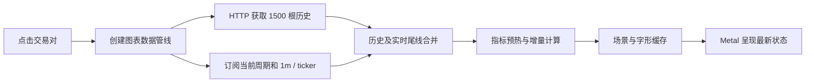

# 行情与原生图表

整合环境使用 Python 采集和推送，SwiftUI / Metal 显示。接口和当前性能样本见 [整合说明](INTEGRATION.md)。

## 服务端数据

`market_stream` 发现当前报价资产全部正在交易的永续合约，默认 USDT。连续 1m K 线按组直接订阅 Binance 公共 WebSocket，ticker 独立订阅。收盘线持久化到 MySQL，热数据和事件进入 Redis；完整分钟桶聚合为 5m / 15m / 1h / 4h / 1d，缺分钟时不伪造完整桶。

补线、预热、周期保留和历史 REST 请求受共享预算约束。原生 `/api/market/klines` 使用 `beforeOpenTime` 做排除边界分页，WSS `/ws/v1` 按订阅推送。慢客户端队列有界，认证过期后刷新会话并重新连接。

2026-11-01 对齐原 USDC 关键路径，后端已部署至 47.80.22.243（首尔服务器）：未收盘 K 线由事件唤醒立即写缓存并发布，不再固定等待 200 ms；收盘存储、ticker、历史任务、统计和预热独立运行。收盘写入后才发布确认事件，数据库操作不占用 live 缓存锁。单个行情进程内统一比较／更新 live 状态，防止并发写入重新打开已收盘线；待存储收线缓冲最多 10,000 条，超限丢弃最旧公共行情并记录告警，由缺口补全恢复。

公共行情通过 `integrated:market:v2:{channel}:{symbol}:{interval}` Redis 主题路由，ticker 的周期为 `-`。ASGI 只订阅连接需要的具体／通配主题，再执行协议过滤；账户与策略继续使用原总线和用户／模式隔离。公共批次以 Redis Lua 原子分配 sequence 并发布，批量 pipeline 仅一次往返，避免并发生产者反序交付。

## 后台自动补全与首屏读取

2026-11-01 实现，后端已部署为 `integrated-20261101-74b8e5d-wss`：`/api/market/klines` 只读取 MySQL / Redis 快照，不在请求内访问 Binance。响应新增可选 `historyPending`、`statisticsPending`、`hasMoreHistory`，原字段保留；`Server-Timing` 分别报告历史读取和统计缓存处理耗时。币种目录只读取采集器维护的缓存及一天内的最后快照；完全未准备时返回可重试 503，不在页面请求中同步刷新目录。

`MarketHistoryTask` 为持久化公共行情任务，由既有 `market_stream` 进程单独执行；没有新增交易 worker 或交易写入。按币种、周期、分页边界及任务类型去重，页面请求优先于常规维护。任务使用 180 秒租约，进程中断后可重新领取；失败按指数退避，最长 300 秒，页面轮询不会重置退避。运行过程继续消耗共享的 background 请求预算；1500 根 continuousKlines 按 10 权重估算，不挤占交易关键请求预留。

- 启动和每 5 分钟发现币种时，为当前报价资产的全部在交易永续合约安排 1m / 5m / 15m / 1h / 4h / 1d 维护。下架任务移除，已完成的按需任务定期清理。
- 每次处理最多一页 1500 根：先补最新尾部，再检查内部缺口，之后向前扩展保留窗口。完整一轮按任务到期时间轮转，不在启动时并发轰击交易所。
- 保留窗口依次为 7 / 14 / 30 / 90 / 180 / 365 天；到上市边界或窗口边界停止向前请求。停牌等空缺不伪造 K 线，空补线稍后重查。
- 收盘数据继续按币种、周期、开盘时间 upsert。补全事务提交后变更快照缓存版本，页面下一次读取立即可见；REST 旧线不混入 Socket 有序实时流。
- 发现合约时缓存 `onboardDate`，补线向上对齐当前周期的上市边界；未知上市时间仍按保留窗口和空结果处理。
- 历史独立领取任务；持仓量、多空比、主动买卖量与基差由 6 个统计 worker 有界并发执行并缓存 30 秒，HTTP 只附加已就绪数据。并发没有增加共享 REST 配额。
- 启动与每 5 分钟刷新币种目录时，按缓存成交额优先顺序、在容量允许时逐项预热共享窗口：1m / 5m / 15m / 1h 各最多 3000 根，4h / 1d 各最多 1500 根；历史页每个边界最多 1500 根。缓存按 symbol／interval／before／revision 共享，limit 仅切片；TTL 300 秒，提交后更新 revision。窗口可能受现有数据及保留天数限制。
- 当前周期缺少 live 桶时，用连续本地分钟线及最新分钟增量构造未收盘部分桶，缺分钟不伪造。

`history_cache.py` 单独约束公共历史缓存：JSON 无损压缩后每窗最多 256 KiB，Redis 最多保留 64 窗，压缩值上限合计 16 MiB（另有键和索引开销）；只淘汰自身命名空间内最久未读窗口，不改变 Redis 全局 `noeviction` 策略，也不删除账户锁／预算键。预热容量已满就跳过数据库读取，用户按需读取可替换最旧窗口；过大窗口直接读数据库而不缓存。该约束依据当前 Compose 的 80 MB Redis 配额，不承诺全市场所有周期同时驻留。TTL 从最近读取计算，版本变更使旧窗口自然过期或被淘汰；SQLite / LocMem 开发配置只用于功能替身，不模拟生产容量。

客户端先同步准备账户范围，立即启动行情连接，然后刷新账户资料；图表页面不预加载下单资料，点击交易入口后仍走原 USDT 业务表单。保留 1500 根指标预热及 500 根显示窗口，单次历史响应即展示，分页已有部分数据也立即合并；待补全空页保留边界和加载资格，取消原每 1／2 秒、最多 8 次的短轮询。快照合并保留更晚的 Socket 尾部和收盘线，切周期／关闭取消旧任务，重连 epoch 校验继续生效。

### 补全就绪协议

`ready.data.capabilities` 新增 `market.history`。客户端仅在服务端声明支持时发送该订阅，连接旧后端时仍保留 K 线、ticker 与账户订阅。订阅过滤字段与 K 线一致：`symbols`、`intervals`；服务端确认 Redis 路由已安装后返回 `ack`，客户端据此补读一次，恢复订阅前错过的通知。

按需历史／统计任务完成并提交后，发送 `market.history` 的 `upsert` 事件，data 为 `symbol`、`interval`、`kind`、`beforeOpenTime`，kind 沿用 `history` 或 `stats:…`，最新窗口的 before 为 null。客户端只刷新当前币种／周期，历史页通知只重读对应待补边界；常规维护没有额外就绪事件。通知失败只记录简短日志，不把成功任务重新标为失败；保留 15 秒校对应对漏通知、断线及旧后端。当前本地客户端将通知／校对与在途历史请求合并，先显示正在下载的响应，完成后最多补读一次；切周期、重连 epoch 和退出仍取消旧任务。

上线前需应用 `market_stream.0002_markethistorytask`，再配套更新 API / market 及对应客户端；本次关键路径对齐没有新增迁移。公共行情主题由原总线切换为 v2，API 与 market 必须共同升级／回滚，混用两版会丢失公共行情。迁移只新增公共行情任务表，不改交易表或持仓；旧代码回滚可忽略该表，不能把代码回滚等同于数据库还原。旧客户端能忽略新增字段，但冷数据请求可能暂时显示空图，建议配合新客户端升级。

## 与原 USDC 实现的核对（2026-11-01）

本次只读对照 `/Users/apple/work/tradetools-usdc`，来源 Git HEAD 为 `2ed33f7d2da9380e6fc6e6b1c0076550c4156c36`，整合版以当前工作区为准。11 月 1 日进一步核对时，来源目录有其他任务的导航／手势改动；以下将来源 HEAD 与工作区区别核对，不将那些改动计为本轮变更。原 Java 部署已退役，本次未重启它，没有原版与整合版在同设备、同网络下的 A/B 结果。

### 页面进入到首帧的完整顺序

双方都使用 **HTTP 历史快照 + WSS 实时增量**。iOS 连接应用后端，后端连接 Binance；全部历史并不通过 Binance Socket 直接送入 iOS。行情列表的 `DashboardViewModel` 相同，差异主要在身份、页面外壳和延迟显示。

`MarketChartViewModel.start` 先建立 pipeline 和事件监听，再启动订阅与历史请求，不等待下单资料。高于 1m 的图表同时订阅 1m，把最近价格合入当前时间桶。首次拿到历史后，用 1500 根预热指标，页面价格序列保留末 500 根，图表管线保留预热历史；实际绘制只生成可见区域与缓冲区的场景。默认 EMA／SUPER／MACD／VOL 不请求外部统计。双方均保留 15 秒校对，Socket 重连使用新 epoch，切币种／周期使旧管线结果失效。

### 历史读取：查到秒级等待的具体差异

原 Java 的 `MarketKlineController.storedKlines` 调用 Mapper 查询 MySQL 最近／边界之前最多 1500 根收线；它没有从 Redis ZSET 读取 HTTP 历史。数据不足时同步访问 Binance、保存缺失收线后合并，因此原版冷数据和外部超时也存在慢路径。当前 Python HTTP 只读取本地快照，缺线安排持久任务，不同步等待交易所。

| 细节 | 原 USDC | 整合版及本轮处理 |
| --- | --- | --- |
| 目标周期窗口 | MySQL 直接取请求根数 | `warm_history` 共享窗口：短周期最多 3000、4h／1d 最多 1500，按 revision 失效后读库，limit 切片；不是逐根 ZSET 的原样复制 |
| 当前未收盘桶 | `aggregatePartialBucket` 只查询当前桶范围内的闭合分钟，检查连续性后聚合 | 旧整合实现先读／预热 3000 根 1m 再过滤当前桶；11 月 1 日定向修复为相同的时间范围查询，仍叠加最新分钟增量且检查缺口 |
| 证据 | 范围查询见 Java `KlineAggregationService` 与 `MarketKlineMapper.selectClosedInRange` | 47.80.22.243（首尔服务器）的分段样本：BTC 1h 目标窗口 16.3 ms，额外 1m 窗口 2653.67 ms，其中 SELECT 2619.67 ms；总计 2675.18 ms。ADA／LINK 同路径为 673.25／482.91 ms |
| 线数据体积 | `KlineItem` 主要包含八个时间／OHLC／成交量字段及可选统计 | 当前每根还含 symbol／contractType／interval／closed／eventTime；保留字段兼容，历史 GET 已启用 gzip。1500 根 BTC 从约 423 KB 降至约 66 KB |
| 冷数据与补线 | HTTP 不足时同步补线；守护另行巡检 | 已有数据立即返回；持久化任务去重、租约、优先级、退避及上市边界继续保留，不为了外观相同恢复同步外部等待 |
| 缓存容量 | 各 symbol／interval ZSET 按根数维护；预热已够长时跳过 | 版本化压缩窗口，最多 64 窗／16 MiB 压缩值，预热满容量跳过；按需窗口替换旧窗，不能承诺 522 个合约的全部周期常驻 |

部分桶回归在修复前确认读入 62 根、实际只需 2 根闭合分钟；修复后仅处理当前桶的 2 根，加上 live minute 生成相同 OHLC／成交量。缺少开头分钟时仍返回空桶，不能把不连续数据标成完整 K 线。

### 附加统计与“取消后重读”回归

Java 的 `loadChartTradingData` 将所选统计并发请求后 `allOf(...).join()`，缓存 30 秒，外部 HTTP 超时为 20 秒；请求可能等最慢的一项。Python 的 6 个统计 worker 在后台有界并发，HTTP 附加已就绪缓存，未就绪时由 `market.history` 通知更新，两者调度不完全相同。

整合版新增就绪协议时存在一个具体回归：订阅 `ack` 或每项统计／历史完成通知会调用 `reload`，后者取消在途 HTTP。网络稍慢、通知先后到达时，同一快照反复下载，首屏可能被延后。原 USDC 没有这个历史就绪频道。受控测试在第一响应被门闩阻塞时发送 6 次通知，修复前首屏下载被取消、实际出现 4 次读取；这证明取消链路存在，不证明用户 TestFlight 12 必然含该版代码。

本地客户端已将后台通知和 15 秒校对改为在途合并：先呈现现有响应，再进行至多一次合并的后续读取；翻页也不因就绪通知取消下载。每个请求有独立 ID，旧任务完成不能清除新任务或覆盖加载状态。显式切周期、重新建立连接 epoch、指标所需统计变化与离开页面仍会使旧任务失效。订阅确认恢复漏通知、旧后端能力兼容继续保留。客户端改动尚未分发。

### 实时采集、分发与收盘

| 环节 | 原 USDC | 当前整合版 |
| --- | --- | --- |
| 上游消费 | Binance continuous 1m，按 pair 的队列由虚拟线程消费，依次调用 handlers；分组重连和退避 | Binance continuous 1m，async 分组接收；live、收线、ticker、历史、统计、预热独立执行 |
| 未收盘推送 | `RealtimeLiveKlineHandler` 无匹配订阅者立即返回；进程内 dispatcher 分发 | 事件唤醒发布，不再固定等 200 ms；Redis 缓存／按 symbol 与 interval 的主题进入 ASGI，仍有一次跨进程传输和序列化成本 |
| 收盘 | 数据库事务提交后事件；完整分钟到齐才聚合大周期 | 收线事务提交后发布，同样不补造缺失分钟；live 锁不覆盖数据库，收线缓冲有界 |
| 订阅与慢客户端 | 先匹配 recipients 再序列化，bounded dispatcher 与 session 发送限额 | Redis 主题先筛选，再按连接过滤与有界队列发送；慢连接关闭，保留账户／模式鉴权 |
| 顺序与恢复 | 每流 sequence，dispatcher 多线程；不能据此声称所有跨任务发送严格串行 | 公共批次 Lua 原子分配 sequence 并发布；客户端保持 epoch／sequence／收线屏障，发现缺口重取快照 |
| 自动补全 | 单独守护 fixedDelay 60 秒、分页和请求间延时、上市边界、启动预热 | 持久化任务、共享预算、公平轮转、容量限制；原版按目标根数，当前按保留天数，调度结构仍不同 |

报价资产与负载也不同：当前覆盖全部 USDT 永续，样本目录为 522 个合约；不能将较少 USDC 合约的运行体验直接归因为 Java 语言更快。实时通道快也不能抵消历史首个 HTTP 被取消或多读 3000 根的耗时。

### 原生绘制与交互为何能保持流畅

逐段核对 `CandleStore`、`ChartDataPipeline`、`KlineIngressState`、指标引擎、`KlineChartSceneController`、`ChartSceneBuilder`、`MetalRenderer`、资源 ring 与 shader：

- 历史是不可变快照，live tail 单独替换；收盘才提交指标历史，盘中通过 provisional 计算，不逐 tick 重算全部历史。迟到收线触发恢复而非静默篡改指标。
- 初次快照安装才做整段指标预热；之后按收线增量更新。Python 适配保留“晚 HTTP 不覆盖较新 Socket 尾线／收盘线”的合并增强，新增工作量是内存合并，没有网络等待。
- 场景构建复用历史对象身份、viewport、面板与价格域形成的静态缓存；价格／live 变化走动态批次。字形 atlas 和格式器复用，横拖保留可见内容位置。
- 场景请求覆盖旧的 pending request；渲染 mailbox 容量为 1，有代次的 GPU 槽位防止重用仍在飞行的资源，后台／恢复只保留最新状态。
- 当前与来源的场景构建、指标、Metal 主体相同；差异包括账户／接口适配、保留更新数据、返回手势预留、未引用实现删除及日志 bundle 标识。没有证据表明总代码行数造成十多秒首屏。

### 测量与结论边界

11 月 1 日修复前，在本机直连 47.80.22.243（首尔服务器）的无绑定 QA 账号测得：12 个合约的 1h／1500 根为 0.61～0.92 秒；另一个 BTC 样本 1.036 秒，WSS 六次 RTT 中位 135.77 ms，未复现手机十多秒。gzip 发布后热 BTC 样本为 221.56／309.11 ms，但刚重启后的部分桶慢路径仍出现 1.56～3.12 秒服务处理，随后通过上面的分段探针定位额外 1m 读取。

13:26（北京时间）最终范围查询版 `integrated-20261101-kline-range-6413a8768d2b` 已部署到 47.80.22.243（首尔服务器），六容器 healthy、HTTPS 深度健康及鉴权 WSS 心跳通过。对同路径分段复测，BTC 总处理 **42.69 ms**、当前桶 SELECT **19.58 ms**；ADA／LINK 总处理 284.61／246.44 ms，仍有目标窗口冷读取。公网样本 BTC1h 为 942.14／226.48 ms，ETH1h 555.86 ms，SOL1h 353.71 ms，BTC1m 冷读取 1338.33 ms（服务 history 1104.81 ms）；均 1500 根、无 stale，六次 RTT 中位 239.755 ms。不同时间缓存与链路状态不同，不按该组样本计算稳定加速倍数。

最后一轮独立 wire 探针也记录了网络波动：identity 423060 bytes，服务 history 44.11 ms／响应头 295.85 ms／完整接收 6338.11 ms；gzip 约 66.4 KB，两次完整接收 1221.60／864.02 ms。此前 gzip 热样本曾为 221.56／309.11 ms，因此不能只选最快样本承诺半秒首屏；压缩降低流量，不能消除链路抖动。1m 冷请求依然可能读取 3000 根共享窗口，和原版 HTTP 只取最多 1500 根仍有差异，后续若继续优化需保留指标完整性和缓存容量限制。

Debug 模拟器的临时分段记录：图表启动至首个 GPU 命令完成约 2.816 秒；历史请求 1158.53 ms，快照准备 1381.44 ms，场景构建 2.423 ms，Metal 宿主初始化 267.38 ms。GPU 完成不等于手机屏幕显示；自动化曾记录的 6.7 秒包含 AX 检测等待，不能作为绘制耗时。临时 GPU 日志已删除。

用户运行 **TestFlight 1.0.1 (12)**，尚未取得该构建的 commit 对应关系；本轮 App Store Connect／Xcode Cloud 会话已过期，没有修改云端配置。不能说该包一定包含现有工作区取消回归，也不能用模拟器／HTTP 结果宣布真机十多秒问题已全部解决。最终验收仍需同设备记录点击到首帧、热／冷 HTTP、切周期、分页和断线恢复；本轮源码未提交、未推送、未上传 TestFlight。

### 按首屏交接计划补验（2026-11-01）

本轮复用已有请求合并、gzip 和部分桶范围查询，不重新实现这些路径。进一步补充真实结构的订阅 ack、无关币种／周期过滤、下载失败后重试、不响应取消的晚到请求、15 秒真实校对定时器、连接重建和旧分页失效测试。重连时发现旧 epoch 的分页任务未取消；新代际保留其待补边界、取消并使旧回调失效，等新快照及已排队的合并补读安装完成，再恢复该边界。新增“先分页、后新快照”的受控测试先失败，修复后通过；不能跨连接代际复用旧响应，也不能使新快照覆盖刚恢复的页面。

13:48（北京时间）在 47.80.22.243（首尔服务器）只读剖析当前 range 版，没有清空缓存或重新部署。BTC1h 自然缓存未命中总处理 68.54 ms（目标窗口 SELECT 29.06 ms、缓存压缩写入 10.87 ms、当前桶 6.08 ms）；BTC1m 未命中 164.02 ms（SELECT 130.70 ms、缓存写入 13.98 ms），随后的命中读取 10.12 ms（缓存读取／解压 7.37 ms）；ETH1h 未命中 52.18 ms。MySQL EXPLAIN 分别使用已有 `market_candle_identity` 的反向读取和 `market_candle_recent`，没有添加索引、扩大缓存或修改 3000 根共享窗口。该组样本的服务处理成本不足以解释十多秒首屏，暂不扩大 P1。

本轮公网 wire 复核：identity 423060 bytes／1477.33 ms，gzip 66443／66474 bytes、283.40／305.67 ms，解压后均为 1500 根；gzip 服务 history 分别 11.35／10.86 ms。首次 QA 登录曾 20 秒读取超时，重试后成功；该失败发生在登录阶段，不计入图表首帧样本，也不从报告中省略。同期内部健康读取约 13 ms、六容器 healthy。

13:55～14:01（北京时间）使用专用 iPhone 18 Pro／iOS 27.2 模拟器、Xcode 27.2、Debug-Seoul、关闭覆盖率、本地 `74b8e5d` 加当前未提交工作区，连接同一 range 版后端；本地版本设置为 1.0.1 (3)，不等于手机 TestFlight 12。BTCUSDT／1h，每次历史返回 1500 根，默认 EMA／SUPER／MACD／VOL 和 500 根显示窗口保留，未开启外部统计。计时为应用内单调时钟，从列表按钮 action 到首个有效 Metal 命令完成；AX 仅用于操作和确认，截图已实际查看。

| 场景 | 有效样本 | 中位数 | P95 | 范围 |
| --- | ---: | ---: | ---: | ---: |
| 连续热进入 | 20 | 467.63 ms | 756.49 ms | 343.61～1249.45 ms |
| App 重启后进入 | 5 | 772.31 ms | 924.16 ms | 499.37～934.58 ms |

重启共尝试 6 次：原批次第 5 次在 20 秒内没有出现 BTC 列表，尚未点击图表；保留为一次启动恢复失败，补测一次成功。它不在图表耗时分位数内，不能把原批次 UI 用例写成全部通过。最初搭建采样时另有一次系统保存密码弹窗阻挡返回，排除该轮，随后测试增加延迟弹窗处理和准确的返回按钮标识。App 重启不能证明服务端冷缓存；本轮没有清空生产 Redis，也没有取得 5 次可确认的冷缓存首帧。

20 次热进入均为一次首屏读取、一次 ack 合并补读，普通通知取消数为 0；第一份 frame 已安装后才开始补读，不等待第二份响应。分段中位数：点击→VM 18.56 ms、VM→HTTP 调用 17.93 ms、请求适配 2.24 ms、完整 HTTP 接收 299.97 ms、解码 5.76 ms、返回→快照／指标 frame 71.23 ms、场景 4.29 ms、宿主初始化 4.41 ms、GPU 提交→完成 6.49 ms。各段中位数不能相加冒充总耗时分位数。最初一次进入的 VM→HTTP 为 202.33 ms，此后明显降低；当前采样没有重现旧日志中的 831 ms 缺口，证明它不能统称为取消重发，不能反推旧样本每毫秒的归属。

上述模拟器首帧代理达到交接报告提出的热进入 P95 1.5 秒观察目标，因此不扩大 P2、不重写渲染器或减少指标。GPU completion 仍不等于物理手机屏幕呈现，公网波动、启动恢复超时和 TestFlight 12 的实际代码关系继续待验。28 处临时探针已逐项删除，网络、场景、宿主、Metal 和列表源码哈希恢复到插入探针前；没有保留调试日志模块。原 USDC Java 已退役，本轮仍是源码对照与整合版测量，没有同条件 A/B。

14:02～14:04 的独立 HTTP 核对覆盖 BTC／ETH／ZEC／SOL／BCH／DOGE／BNB／ADA 的 1h，均返回 1500 根，耗时 414～929 ms；BTC1m 为 1500 根／383 ms，4h 为 1081 根／244 ms，1d 为 366 根／197 ms。全部检查排序、唯一时间、OHLC、实际 gzip 和 `Vary: Accept-Encoding`。ZEC／SOL 首次为 stale／pending，14:04 只读复查已不 stale，最新闭合小时线无滞后，对应按需补线任务已完成、attempts=0；不是声称全市场始终无缺口。BTC4h／1d 的可用窗口较短、pending 保留；1h 历史页立即返回 662 根且严格小于排除边界，后台继续准备。开启 openInterest 的读取返回 1500 根／350 ms，statisticsPending=true，证明待统计不阻塞历史响应；未在本轮逐个币种／周期做 UI 首帧或长稳验收。

最终本地行情后端 41 项全过（含专用临时 Redis），客户端快速路径 18 项与核心图表 127 项全过；移除探针后 generic iOS Release 未签名构建通过。证据在忽略的 `.integration-runtime/KlineFirstFrame/`，包括 `CorrectnessFinal.xcresult`、`first-frame-summary.json`、wire、阶段剖析、API 矩阵及补全复查；原批次 UI 结果有一次进入列表前超时，补测单项通过。没有新增后端发布、提交、推送或 TestFlight 分发。

## 客户端

- `Features/Dashboard/`：列表、搜索、自选和可见行情订阅。
- `Features/Chart/`：周期切换、历史请求、实时价格、指标设置与交互。
- `Features/ChartEngine/`：闭合历史 / live tail、增量指标、场景、Metal、字形图集和手势。
- REST 快照与 Socket 事件经入口状态合并；epoch / sequence / 收线屏障避免旧连接、乱序和恢复过程污染当前图表。
- 历史与 live tail 分离，实时变化不重建整段历史。渲染 mailbox 容量为 1，GPU 资源使用有代次的槽位；暂停和恢复只呈现最新快照。

图表当前维护入口见 [图表架构](../frontend/ios-app/docs/KLINE_CHART_ARCHITECTURE.md) 与 [校准方法](../frontend/ios-app/docs/KLINE_CHART_CALIBRATION.md)。来源项目的设计和历史报告从 [来源索引](sources.md) 查询。

### 图表代码体积与引用清理（2026-11-01）

按 `Features/Chart/` 与 `Features/ChartEngine/` 的 Swift／Metal 物理行统计，清理前为 49 文件、26,910 行，清理后为 46 文件、25,652 行，净减少 1,258 行；不把空行、注释或测试算作纯 GPU 绘制逻辑。其他目录的网络、模型、测试若一起计数，口径会更大。

| 清理后范围 | 物理行 | 实际用途 |
| --- | ---: | --- |
| `Chart/` | 3,530 | 图表页面、行情加载、指标配置与当前划线下单覆盖层 |
| `ChartEngine/Data`、`Domain` | 1,465 | 历史与 live 合并、时序隔离、颜色与数据模型 |
| `ChartEngine/Host`、`Viewport` | 2,923 | UIKit／SwiftUI 宿主、缩放、横拖、十字光标、时间轴与惯性 |
| `ChartEngine/Indicators` | 5,967 | 正在使用的主图／副图技术指标、参数、临时值与收盘值 |
| `ChartEngine/Scene` | 5,328 | 场景构建、文字布局、面板、坐标投影与批次 |
| `ChartEngine/Rendering/Metal` | 3,495 | shader、渲染器、GPU 槽位、字形图集、故障恢复与呈现健康 |
| `ChartEngine/Diagnostics` | 2,944 | 其中 2,844 行压力工具受 `#if DEBUG` 保护，另有已接入的 MetricKit 订阅 |

删除了无页面／运行调用的 `ChartDrawingTools.swift` 通用标注模块、`ChartSignposts.swift`、`ChartLeverageSettingsView.swift`，以及未使用的 Figure／Bar 描述与旧订单提交状态。同时移除图表目录外 932 行 `TradingSettingsModels.swift`：它服务于已经没有入口的 Java 账户／风控／订单／杠杆 API，当前 Python 业务使用 `USDTStore`；当前划线覆盖层实际需要的订单类型移入自身文件。仅验证这些退休实现的 14 项旧单测同步移除。现在使用的价格线覆盖层和技术指标有真实调用，仍在工程中。

图表的行数包括数据正确性、指标与交互责任，不能仅按总行数推断首屏速度。当前首屏仍由 HTTP／WSS 与场景准备链路决定；该清理任务当时按用户安排没有进行性能复测；后续本轮定向排障和性能样本见上文。此前模拟器目标及测试目标编译、设备 Release 未签名构建通过，不能视为本次手机验收。

### 行情页延迟指示

行情页右上角在编辑自选按钮左侧显示“延迟数字 + 四格信号图标”。测量复用已鉴权的 App → 后端 WSS 应用层 ping / pong，以 `requestId` 匹配、`ContinuousClock` 单调时钟计算往返耗时（RTT），取最近三次有效样本的中位数。它反映客户端到应用服务的链路，不代表 Binance 行情源延迟或订单成交速度。

当前本地客户端仅在行情页可见且 App 在前台时每 2 秒探测，保持单个在途样本；未返回的请求不会被下一次自动探测覆盖，超时仍为 3 秒。进入页面、恢复前台或活动网络变化时立即重置并探测。点击延迟区域会清空旧中位数并立即重测，连续点击合并；等待期间显示三个明暗轮替的圆点，开启系统“减弱动态效果”时使用静态圆点。自动采样已有读数时保留上一读数，避免周期性闪烁。有效值显示 0–999 ms，超上限截为 999；断线或超时显示红色 `-- ms`，不再用 999 代替失败。有效值低于 200 ms 为绿色，200–499 ms 为黄色，500 ms 及以上为红色。离开行情页或进入后台取消额外探测和网络监听，连接仍沿用服务端协商的常规心跳（默认 20 秒）。重复调用 `connect()` 保留已有连接状态与心跳，避免页面重新初始化后停止采样。

2026-11-01 本轮客户端修改仅保留本地，尚未推送或分发。旧安装包仍可能把未测得状态显示成 999；服务端部署不会改变手机里的显示代码。新版 WSS 鉴权在同步线程调用前后清理过期 Django 数据库连接，避免长时间复用线程保留空闲 MySQL 连接；拒绝日志仅记录异常类型，不记录 Token 或账号。部署前发现 WSS 403，更新后基础握手和 ping / pong 已通过；尚未用长稳复测证明连接清理就是全部 403 的根因。

## 排障与验收

分别记录历史接口耗时、首条有效 Socket 数据、渲染耗时、连接恢复及分页一致性。HTTP 的 `Server-Timing` 不含网络传输或客户端呈现时间；Debug 的 `MarketChart` 日志分别记录 `history_http` 和 `chart_snapshot_ready`（快照准备完成，不能当作 GPU 已呈现）。HTTP101 只证明握手，不证明有行情；K 线事件延迟不等于订单执行延迟。

网络切换、后台恢复、token 刷新、切币种 / 周期及历史分页均需覆盖。当前短样本存在本机链路延迟离群点，尚未完成真机长期稳定性验收；实际结果与边界见 [变更](changes.md) 和 [已知事项](known-issues.md)。
