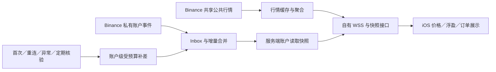
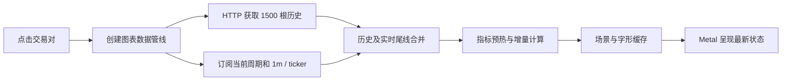
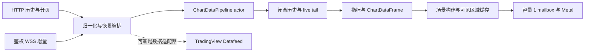

# 行情与原生图表

整合环境使用 Python 采集和推送，SwiftUI / Metal 显示。接口和当前性能样本见 [整合说明](INTEGRATION.md)。

## 首帧加载提示与画面交接（2026-11-07，本地）

旧版波形加载提示由 SwiftUI 在 `renderState == nil` 时显示；场景构建结束即移除，但 UIKit 遮挡仍等待实际首帧呈现，二者之间会只剩纯色背景。现在同一 Metal 宿主的 `loadingCover` 同时承载既有波形，通过 `UIHostingConfiguration` 托管；数据读取、指标与场景准备、GPU 提交至当前 stream／epoch 首帧呈现期间持续显示，再由同一个主线程回调移除动画和遮挡。旧 epoch 的迟到呈现不能结束当前加载，周期切换继续复用宿主。

主题显式传入托管内容；离开窗口或应用非活跃时暂停波形，首帧后及宿主释放时移除内容，渲染错误显示在遮挡上方并暂停其后的动画。该修复消除加载提示提前撤下的空档，不代表 HTTP、指标或首次 Metal 初始化的耗时已缩短；新包首次打开及真实网络表现仍需实机验收。回归证据见 [开发](development.md#加载交接与-live-普通切换2026-11-07本地)。

## K 线换根时旧尾线连续保留（2026-11-06，本地）

用户报告多个周期换根时，刚结束的 K 线消失数秒，随后又出现。本地实际管线回放复现：原本应有 `[0, 3600000, 7200000]` 三根，换根帧只剩 `[0, 7200000]`。报价跨桶时 `upsertProvisional` 直接替换唯一 `liveTail`；Socket 缺少可信收盘时虽产生 `.unverifiedClosed` 屏障，`CandleStorage.apply` 却仍把它当唯一尾线，紧随的新尾线再次将其覆盖。旧线未进入历史区，只有可信 close 或 HTTP 校对回来才补回。该故障在构造场景之前已出现，不依赖网络延迟或 nginx 压缩。

本地修复让 `CandleStorage` 在 ticker／OHLC／保留新数据的快照推进尾线前，将旧尾线放入有界显示历史并标为 `.unverifiedClosed`。可信 close 按 openTime 原位替换，不能重复插入、倒退新尾线，或被迟到的未确认事件降级；分页和旧快照也不能将该标记自动变成 `.closed`。历史载荷仍受原 `historyLimit` 约束，不填造缺失桶。

`ChartDataPipeline` 的真实指标引擎只提交连续的可信闭合前缀；待确认区间用值副本生成显示指标，不推进已确认计算器。显示副本按 K 线历史／已确认指标历史对象缓存，普通 tick 复用，避免等待收盘期间反复重建全部指标。后续乱序 close 仍请求原快照恢复；权威快照到达后重建可信状态。报价构造的新桶沿用相邻旧尾线的收盘价作临时开盘锚点，真实 OHLC 仍由原订阅和 HTTP 校正。

原缺线两条回放先失败；修复后新增六项及原有恢复／快速路径共 **64 项 host 回归通过**，涵盖 1m／5m／1h／周线的实际场景图元、迟到快照、可信 close 校正、指标结果和历史复用、分页不升格、有限窗口及乱序恢复。App／Widget generic iOS 无签名 Release 构建通过。完整证据与命令见 [开发](development.md#k-线换根连续性回归2026-11-06本地)。修复已以 `79f812b` 提交推送；自动构建状态见[客户端交付](testflight.md#换根修复与完整源码交付2026-11-06)。配套后端已[完整发布](operations.md#完整同源发布2026-11-06)，但手机连续换根仍需安装新包实机验收。

## 首屏同步补齐与传输调整（2026-11-06）

用户在链路对比后授权按 USDC 模式实施第一批提速改造，全部为服务端改动，不需要新客户端：

- **首屏缺口请求内有界同步补齐**：`load_history` 仅在最新窗（`before=None`）出现 stale 或窗口内缺口时，经 `service.sync_backfill` → `repair.fetch_page` 同步拉取一页（≤1500 根、normal 优先级预算、4 秒超时、`market:syncfill:{symbol}:{interval}` 30 秒冷却键合并并发读）并落库后立即重读快照，一次响应给出补齐后的尾部；上游全局限速冷却期间跳过，失败或冷却期内回落到原持久任务＋`market.history` 通知路径，`historyPending` 语义保留。深段缺口仍归后台 worker，不在请求内循环补线。原“HTTP 绝不外呼交易所”的契约由用户决策替换为 USDC 的“一次有界外呼＋失败降级”。
- **热窗缓存扩容**：`history_cache.MAX_WINDOWS` 64→192（单窗压缩 256 KiB、TTL 300 秒不变，窗口载荷合计上限 48 MiB，不含 Redis 开销及其他命名空间），`compose.integrated.yaml` Redis `maxmemory` 80mb→256mb、`mem_limit` 128m→320m，仍为 `noeviction`＋AOF。部署需重建 redis 容器；扩容减轻不同 symbol／interval 争用 LRU，真正冷读仍会 miss，revision 正确性约束不变。
- **K 线响应压缩移交 nginx**：`KlinesView` 移除 `@gzip_page`，将约 400 KiB JSON 的压缩 CPU 工作移出 Python 请求处理线程；`deploy/integrated/nginx-location.conf` 增加 `gzip on / gzip_proxied any / gzip_comp_level 5 / gzip_types application/json / gzip_vary on`。实际 Django 5.2.17 的旧 gzip 为 **level 6**，ASGI 为每请求建立 `ThreadSensitiveContext`，并非全部同步视图共享一个线程；不能按“level 9／全局单线程”估算收益。部署时必须同步更新宿主 nginx snippet，否则响应暂为未压缩（功能不受影响，仅体积回升）。
- **WSS 认证／订阅 ack 审查后不改**：JWT＋MySQL 用户检查是私有交易频道的安全边界且每连接仅一次、运行在工作线程；ack 先于 Redis 路由安装会破坏“ack 后读一次即可恢复”的协议不变量，丢事件将触发客户端 1500 根全量重拉，净负收益；socket 在 App 启动时已预连接，握手不在图表首屏关键路径。

本地隔离回归（`.integration-runtime/ChartIntervalLatencyNov5/run_isolated_backend.py`，禁外网）：`market_stream` 114 项、`common`、`trading`（含 `test_public_market_klines`／`test_snapshot_prewarm`）全部通过；相关测试已改写到新契约（stale 尾部首个请求内治愈、空读一次外呼后冷却合并、压缩断言移交代理）。交付状态：源码 `bb5e53b` 随本轮推送；2026-11-06 16:44:27（北京时间）已配套部署到 **47.80.22.243（首尔服务器）**，Redis 已保留 AOF 卷重建，宿主 snippet 已同步并 reload，两个实际限定包各 277 项隔离回归通过。当前发布仅叠加三项行情改动，保留原运行周期和两套来源；源码中尚未上线的 16h 等新增周期、共享分发与账号通知不在本次范围。版本、备份和回滚见 [运维](operations.md#首屏补齐redis-扩容与-nginx-压缩发布2026-11-06)。

公网原始字节检查：发布前 gzip 66372 bytes／JSON 423035 bytes，发布后 nginx level 5 gzip **69910 bytes**／JSON **423036 bytes**，identity 无压缩头；1500 根、统计与鉴权 WSS 冒烟通过。两次当前桶可能变化，字节略有差异正常；这证明压缩交接有效，不能以这组不同时间的 HTTP 样本量化 CPU 或手机收益。

2026-11-06 19:29 只读实测：完整发布 `integrated-20261106-full-7e29236` 后真机 49 份 displayed 样本首帧中位 1119→**766 ms**、服务端 history 中位 130.3→**20.6 ms**、首屏多次请求 4/49→2/49；公网探针 12 样本 stale 0／pending 1（BTC 4h 首轮，次轮消除）、history 热窗 6.8～17.3 ms、冷读最高 388.7 ms。完整发布含共享分发等其他改动且非受控 A/B，归因限制与证据见[变更](changes.md#2026-11-06首屏提速上线实测验收只读)。

发布前 16:21 的最近 50 份真实报告中，49 份 displayed，首帧中位 1119.17 ms、history 130.32 ms、TTFB 291.10 ms、transfer 218.68 ms、frame ready 后呈现 115.25 ms；各段中位数不能相加，币种／周期及缓存状态混合，非受控 A/B。发布后本轮只读复查新增 **0 份**诊断；尚无发布后真实样本，首帧收益待用户实际打开图表后再测，不复用旧报告当作新结果。

4 秒是传给单次 REST 的超时，预算等待、持久化与重读另计，不是整个 HTTP 的截止时间。已部署的原生周期只拉一页；源码 16h 的分页来源可能调用两次 8h REST，各自超时，不能写成所有未来周期总耗时最多 4 秒。同步补线可能让真正冷／缺口的单次 HTTP 更慢，目标是减少 pending 后的二次完整拉取；真实首屏须结合请求次数和整段呈现时间评估。

## 与 USDC 再次对照与后续方向（2026-11-06）

本次重新核对整合版 `7e8a4ab3186c0f863be5ccf2f6f70bdf6e2064d2` 与只读 USDC `104d7d7fc44d244087fa06841659246965b3914b`：所选 16 个整合版、12 个 USDC 源码／部署文件均与各自 HEAD 一致，未纳入来源目录其他改动。范围与 SHA-256 清单见 [开发记录](development.md#usdc-再次源码对照2026-11-06)。初次对照仅分析；用户随后授权实施前两项，当前结果见 [统计与缓存生命周期](#后台统计与历史缓存生命周期2026-11-06)。其他项仍为候选；用户“App 未更新但几乎无等待”的反馈及其归因限制见 [提速复盘](#用户反馈与提速归因2026-11-06)。

### 已缩小的差异与保留的取舍

公共行情每连接重编码、重复 Redis 接收／解码已经在源码中解决：每个 ASGI 事件循环共享接收器，再按主题与权限投递内存队列。2026-11-06 核验 47.80.22.243（首尔服务器）仍运行旧发布包，不能将源码状态当作线上状态。USDC 仍有采集到 WSS 进程内直达、无订阅先返回的优势；当前仍保留独立采集、live cache 与跨进程 Redis，完整直达尚未实现。

当前 iOS 源码已有原 USDC 没有的短时周期缓存、两根核验、Metal 宿主复用和通知水位合并；USDC 同样每 15 秒完整读取，并无可直接移植的增量校对协议。USDC HTTP 缺历史时同步补交易所、所选统计在请求内加载；当前后台补全应保留。USDC 全局 dispatcher 满队列时丢弃发送任务，当前每连接有界队列及失败后快照恢复属于不同取舍，不能靠照搬更大的全局队列保证低延迟。

### 候选改动与推荐顺序

| 顺序／方向 | 当前源码事实与 USDC 对照 | 建议与验收重点 | 是否需要新客户端 |
| --- | --- | --- | --- |
| 1：后台统计与前台历史隔离 | 改前六路 worker 各自调用 `load_history(..., 1500, schedule_repair=False)`，以默认前台优先级读／填历史 LRU；现改为共用 HTTP 请求保存的最小时间上下文，不再读／晋升历史窗口。USDC 没有这条后台任务路径，但在 HTTP 内等待统计 | 已完成最小上下文复用及六路统计不改变前台 LRU 的回归；生产命中率／SQL／P95 收益仍待测。**不能直接套 `prewarm=True`**，其跳过构建时返回空数组，不适合作为统计成功的依据 | 后端可独立做 |
| 2：旧 revision 与分页的缓存管理 | 改前 `persist` 只更新 revision，旧 key 暂占共享 64 窗 LRU；现提交后原子轮转 revision 并回收该流全部旧窗口，写入时校验版本。分页也共用该池及整个周期的 revision。USDC 虽维护逐币种／周期 ZSET，历史 Controller 实际直接查 SQL | 已覆盖旧分页回收、迟到构建、事务回滚、其他热流与缓存故障；仍按整个流失效，最新窗／分页配额隔离与更细粒度失效未实现。保留 revision 正确性，不能只去掉 key 中的版本或盲目增大容量 | 后端可独立做 |
| 3：统计就绪与 K 线历史变化分开处理 | 后端已发 `kind=stats:…`；iOS `receive(market.history)` 未按 kind／当前所选统计过滤，统一失效周期缓存并完整核验。现有水位只合并已覆盖／重叠通知，分散到达仍可能引发多次完整读取。USDC 没有 `market.history`，因此也没有这条通知驱动补读 | 先忽略当前未选统计的完成通知；所选统计按桶／版本合并，再评估统计单独读取和更新副图。真实 history、分页、未知 kind、缺口及重连继续完整恢复，不能统一丢弃通知。验证关闭指标后迟到通知、六类分散完成与恢复交错 | 需要；独立统计读取还需后端配合 |
| 4：采集实时任务的调度保障 | live、ticker、收线、六路统计、预热与维护均使用默认 `asyncio.to_thread` executor；任务虽已分离，没有专属实时 executor。USDC 按 pair 消费与独立发送 dispatcher 的线程组织不同，也有 handler 顺序阻塞的可能 | 先测从 live／ticker 提交到开始执行的等待；若确有竞争，再用有界的实时执行资源与后台并发预算隔离。保持 live／closed 的缓存顺序锁、关闭流程及故障恢复；线程隔离不等于消除 GIL，也未证明现在线程池已饱和 | 后端可独立做 |
| 5：15 秒校对改为条件／增量读取 | 两套 iOS 都按 15 秒完整读取 1500 根；当前仅短时缓存回切使用两根核验，常规校对仍完整获取。当前 HTTP 无相应增量版本协议 | 将闭合历史版本、当前桶及统计版本分别校验，未变化复用历史，变化再补差；首访、真实重连、缺口与补线回改仍取完整快照。不能只凭 closed revision 返回 304，因为 live OHLC／成交量与统计仍会变，也不能无条件把 1500 改成 2 | 需要客户端与后端配合 |
| 后续：当前高周期桶的共享计算 | 当前 `partial_bucket` 在高周期 live 缓存不覆盖当前桶时查源线并聚合；USDC `aggregatePartialBucket` 也在 HTTP 内读范围源线。共享已闭合历史命中不保证免除这次 SQL | 若同币种／周期多人读造成重复聚合，按源线 revision／当前桶共享已闭合部分，再叠加最新 1m；不能累加重复分钟成交量，补线、晚收线、缺口与跨桶必须失效。两者共同存在，非 USDC 独有优势 | 后端可独立做 |
| 后续：持续拖动的场景／buffer 复用 | USDC 在缓冲内主要复用横向 Metal 变换；当前为连续纵轴适配，在显示帧节奏下追加场景构建，静态 revision 变化会重新打包并创建 buffer | 在保持连续纵轴、订单标签与十字线行为的前提下，测场景／buffer／帧耗时，评估固定层与价格变换分离、GPU buffer 容量复用。已有按帧合并及一个在途场景，不能再次当作缺失；不以恢复旧版松手才适配代替优化 | 需要 |

第一批 **后台统计取数／缓存隔离＋旧 revision 回收** 已实现并通过隔离回归，目标是减少冷访与忙时竞争；统计通知筛选作为下一批客户端工作。调度隔离按实测 executor 等待决定。每项单独比较，验收使用同一 App／币种／周期／网络，分别看冷首访、热回切及持续推送，沿用既有恢复与正确性回归。

### 完整直达与无人订阅先返回

USDC 的剩余实时路径优势仍可借鉴，但当前已经近乎无等待，宜先测采集→live cache／Redis→API→手机各段。完整行情网关需要重新界定唯一采集者、sequence、订阅 ACK、重启和缺口恢复，暂列后续架构候选。采集端跳过无人订阅的分发则需要跨进程订阅状态、失效租约及订阅建立的竞态处理，未知状态应继续发布；供 HTTP 使用的 live cache 和收线落库不能一起跳过。直接用 Redis 频道订阅计数判断无人订阅会遗漏当前 pattern 订阅，不能作为实现依据。

再次对照阶段没有重新运行已退役 Java 或做新一轮运行时 A/B。后续实施的本地测试及 47.80.22.243（首尔服务器）限定发布状态分别见 [开发](development.md#历史缓存生命周期与统计隔离2026-11-06)和[运维](operations.md#历史缓存与统计限定发布2026-11-06)；尚无新手机延迟倍数或容量结论。

## 后台统计与历史缓存生命周期（2026-11-06）

HTTP 缺失统计时，在调度前保存一个 300 秒的最小上下文（symbol、interval、末根 openTime／closeTime），六类统计任务共用。worker 不再调用 `load_history`，因此不读取／构造／晋升前台历史窗口。上下文缺失走既有持久任务退避，等待后续 HTTP 请求提供新上下文，不回退完整历史，也不发虚假 ready；统计接口、缓存键、映射与通知协议保持原样。

闭合线 SQL 提交后，使用 Django cache 所在 Redis 的 Lua 原子更新 revision，并从最多 64 窗的 LRU 中移除该 symbol／interval 的旧版本（含分页）。构建写入同时比较期望 revision，拒绝版本轮转后迟到的旧构建回填；在途请求仍可能返回其原有快照，下一次读取走新版本。事务回滚不触发失效，其他币种／周期与私有、预算键不受影响。保留 64 窗、单窗压缩 256 KiB、TTL 300 秒、预热让位、冷读合并与 SQL 降级；没有靠扩容掩盖占位。（同日后续窗口上限已调整为 192 窗并同步扩大 Redis 配额，见[首屏同步补齐与传输调整](#首屏同步补齐与传输调整2026-11-06)；revision 与淘汰机制不变。）

本地完整行情 114 项通过；按 47.80.22.243（首尔服务器）实际 API／market 两个旧基线分别叠加的限定发布包各 92 项通过。验证范围见 [开发](development.md#历史缓存生命周期与统计隔离2026-11-06)，发布状态见 [运维](operations.md#历史缓存与统计限定发布2026-11-06)。本轮无客户端／协议／配置／数据库迁移，手机耗时收益待同条件实测；通知 kind 筛选、增量校对与执行池隔离仍未实现。

## 与 USDC 的前端和数据推送对照（2026-11-05）

整合版基线为已推送 GitHub 的 `dd4e5dbfe18a5774b14f412eda2aabba3697bb2d`；USDC 来源为 [来源索引](sources.md) 中只读目录的 `104d7d7fc44d244087fa06841659246965b3914b`。本次检查的 USDC 图表、网络、Java 行情／推送及主配置路径相对该 HEAD 没有未提交改动，未纳入来源目录其他 Scheme／网络研究改动。以下为源码对照，不是两套后端同设备／同网络的性能 A/B；没有启动已退役 Java 服务或追加生产操作。

### 前端差异

两者仍是 SwiftUI＋自研 Metal、HTTP 历史＋WSS 增量。完整首次读取 1500 根用于指标预热，视图模型价格数组保留末 500 根，实际生成可见区域及缓冲场景；收线提交指标，盘中计算 provisional，不逐 tick 重算全部历史。`KlineIngressState`、`RealtimeKlineIngress`、EMA／RSI／SAR／VOL、多项其他指标、glyph atlas／texture cache、GPU resource ring 仍逐字相同。

| 环节 | USDC `104d7d7` | 整合版 `dd4e5db` | 对耗时／行为的含义 |
| --- | --- | --- | --- |
| 切周期 | 新建管线、清 frame、每次 HTTP 1500 根 | 最近 3 个非活动周期、同桶 10 秒缓存，回切先发布完整 frame，后台只核验 2 根 | 热返回可绕开完整网络等待；冷周期仍要读取 |
| Metal 宿主 | frame／场景为空时移除 Representable，回来重建 renderer | 始终保留宿主，加载暂停／遮挡，按 stream＋epoch 追踪真实提交首帧 | 省去切换中的资源重建，旧 GPU 回调不能结束新周期加载 |
| 完整快照与指标 | `CandleStore` 为独立 actor，快照安装后重新预热指标 | 管线 actor 内同步持有 `CandleStorage`，相同闭合历史保留对象及指标，增加 quote／真实 OHLC 合并和恢复屏障 | 减少不变历史的重算和 actor 间交错；真实历史变化仍重建 |
| 校对与通知 | 固定 15 秒 `reload`；没有 `market.history`；每个 ready 都开启新 epoch | 15 秒在途合并；区分首次握手和真实重连；通知按 `serverTime` 去重，未覆盖补读排在首帧之后 | 原版协议较简单；整合版额外承担 pending 恢复，已修复取消／重复读问题 |
| 断线、后台与旧响应 | 已有 epoch／sequence／buffer drop 和快照恢复 | 增加前后台显式恢复、等待初始快照的发布屏障、旧请求／分页 ID 和缓存失效 | 恢复约束更多，避免用旧历史提前发布新 epoch |
| 订阅与鉴权 | 订阅变更由独立 Task 发送，ack 不发布给模型 | 按 socket 串行发送订阅变更、能力协商、ack 发布、交易模式 header、token 续期 | 快切时保持线上订阅顺序；增加协议编排，不是固定半秒等待 |
| 手势与场景 | 横拖优先复用横向 GPU transform，场景在缓冲不足或结束等时点更新 | 增加按显示帧合并的连续 viewport／价格域适配、auto 固定域、主图纵向操作 | 整合版在持续拖动时有更多场景及静态 buffer 工作，成本需单独测量 |
| 绘制内容 | 原图例、十字线、指标与交互 | 增加订单右轴标签与连接、持仓 B／S、主题／图例适配、Super 连续填充等；shader 矩形边缘修复 | 增加部分 CPU 排版、图元及分层；不能假定所有差异都增加 GPU 耗时 |
| 周期 | 6 种：1m／5m／15m／1h／4h／1d | 13 种，新增 3m／30m／2h／8h／16h／3d／1w | 是能力和聚合范围增加，不是同时绘制 13 个周期 |

当前 `ChartEngine` 目录为 42 个文件，USDC 为 44 个；共同文件中 18 个字节相同、24 个不同，整合版移除两个未使用文件。24 个不同包括样式、格式、指标参数、宿主和数据恢复变化，不能用这个数量推导性能比例，也不能再把 11 月 1 日的“多数文件相同”当作现行逐文件结论。此次清单及 SHA-256 在忽略目录 `.integration-runtime/USDCComparisonNov5/source-comparison.json`。

前端已知受控证据仍见 [本轮验证](development.md#周期缓存宿主复用与首帧优先2026-11-05本地)：固定 500ms HTTP，热返回模型 frame 566.26 → 0.0716ms；这是取数模型就绪，不含屏幕呈现。此前 USDC／整合旧模型的相同 HTTP 对照均约 550–570ms，未证实模型本身额外增加半秒；不是各版本完整渲染器的 A/B。

### 数据采集与推送差异

| 环节 | USDC Java | 当前 Python 整合版 | 对耗时／正确性的含义 |
| --- | --- | --- | --- |
| 原始行情 | 主配置 continuous 1m、每连接 50 streams，按 pair 队列由虚拟线程消费，依次调用 handlers | continuous 1m、每连接 80 streams；async 接收，live／收线／ticker／历史／6 路统计分别执行 | 两者都以 1m 为基础；当前普通 live 发布不等数据库收线 |
| 未收盘发布路径 | handler → 内存 dispatcher → WebSocket session；先检查订阅者，无人订阅即返回 | pending 按 symbol／interval 保留较新事件，唤醒发布 → live cache → Redis Lua PubSub → ASGI 共享接收／内存分发 → WebSocket | 当前多缓存访问、跨进程 hop 和 JSON 编解码；发布忙时合并中间 live 事件，无固定 200ms 节流等待 |
| 序列化与扇出 | 匹配 recipients 后 ObjectMapper 编码一次，再向各 session 派发同一字符串 | 采集端编码并发布；ASGI 共享接收器解码一次，逐连接筛选并投递同一字符串；内部字段在共享接收器清理后编码一次 | 后续已去掉公共行情每连接重编码与重复解码；Redis 跳转仍存在。USDC 无订阅市场的编码／分发工作仍较少 |
| 顺序 | 进程内每流 AtomicLong；默认 4 线程 dispatcher／5000 任务队列 | Redis Lua 原子分配 sequence 并 publish，同批 pipeline；每连接单 sender／128 条队列、5 秒发送超时 | 当前跨生产者 sequence 与发布一致；USDC 多线程发送不能由 sequence 分配推断绝对有序。队列不同单位，不能直接比较容量优劣 |
| 收盘与聚合 | 事务内写库／ZSET 并聚合，提交后发 closed 事件；同 pair handler 顺序执行 | 收线独立任务先提交数据库再发布，随后对到边界的大周期聚合／持久化／发布；缺分钟不伪造 | USDC 收线 handler 可能占用该 pair 消费线程；当前将实时与收线工作分开 |
| 首次 HTTP | Controller 直接查 Mapper／MySQL；不足时同步 Binance 补线；所选统计并发请求后 join | 版本化压缩历史缓存，冷态查 MySQL；stale／缺口先做一次有界同步补线（2026-11-06 起），失败或深缺口回落 pending 排后台，完成后 market.history 通知；统计仍只读缓存、缺则排后台 | 首响应口径已与 USDC 对齐但补线有一页／超时／冷却约束；统计仍不在请求内等待，USDC HTTP 并不读其维护用 Redis ZSET |
| 历史缓存与后台工作 | 按 symbol／interval 维护 ZSET，但该 Controller 不消费它 | 共享最多 192 窗 LRU（2026-11-06 由 64 扩容）；maintenance 已改预热优先级；统计任务仍用默认前台窗口读取 | 当前命中可省 SQL，未命中或后台竞争仍可能慢；统计 lane 挤占是剩余待测项 |
| 市场范围与长周期 | 源码主配置报价资产默认 USDC，常规 6 周期 | USDT 全市场、13 周期，16h 用 8h 源线，部分长周期用小时源线 | 实际上游负载与查询范围不同；没有本次运行时合约数量对照 |

两边都没有对每一个高周期持续接收 Binance 原生完整 OHLC：高周期收线由分钟聚合，前端同时订阅 1m／ticker 推动当前价，HTTP 获取／校正当前桶。价格变化及时不等于高周期高低价、成交量每个 tick 都完整更新；这也是当前热返回仍需要两根权威核验的原因。Redis PubSub 与 Java dispatcher 都没有向客户端提供持久游标重放，断线仍依靠快照恢复。

证据入口：当前 [`MarketChartViewModel`](../frontend/ios-app/TradeTool/Features/Chart/MarketChartViewModel.swift)、[`ChartDataPipeline`](../frontend/ios-app/TradeTool/Features/ChartEngine/Data/ChartDataPipeline.swift)、[`Host`](../frontend/ios-app/TradeTool/Features/ChartEngine/Host/KlineChartHostView.swift)、[`collector`](../server/market_stream/collector.py)、[`service`](../server/market_stream/service.py)、[`bus`](../server/market_stream/bus.py)、[`websocket`](../server/market_stream/websocket.py)。USDC 同名 iOS 文件，以及 `backend/app-service/src/main/java/com/oovso/` 下 `realtime/RealtimeLiveKlineHandler.java`、`RealtimeEventPublisher.java`、`RealtimeClientSession.java`、`market/MarketKlineController.java`、`MarketKlineService.java`、`KlineAggregationService.java` 和 `binance/BinanceUsdMarginedPerpetualContinuousKlineConnector.java`；配置以 `src/main/resources/application.yaml` 的显式 1m 为准，不能仅看 properties 类的 1h 默认值。

剩余性能判断：USDC 的进程内实时路径更短是源码事实；它贡献多少毫秒、当前更多绘制工作占多少 CPU/GPU，仍缺同条件分段测量。优先测采集接收→cache／Redis 发布→ASGI→手机收到→场景→呈现，并分别观察切周期与持续拖动；现有 87ms ping RTT 不能代替行情端到端延迟。当前缓存与宿主优化已推送，真实手机效果、后端统计 lane／SQL／网络波动仍待验证。

## 公共行情编码复用与 USDC 思路（2026-11-06，本地）

已复用 USDC“一次编码、按订阅分发”的一部分：`market.kline`／`market.ticker`／`market.history` 事件由发布端编码后，ASGI 仍验证 JSON 和当前订阅，顶层不含内部 `_` 字段时直接把 Redis 原字符串放入该连接的发送队列。含内部字段的行情及其他事件仍剔除内部字段后编码；用户／模式过滤先于入队。Redis Lua 的 sequence＋publish、订阅实际安装后 ack、128 条队列和 5 秒发送超时保持原语义。没有协议、配置或数据库变更，可独立发布后端。

真实 Redis＋三个 ASGI 连接（两个普通模式、一个带单模式）的隔离回归中，同一组三种公共行情在旧实现产生 9 次 ASGI 编码，修改后为 0；同时核对内部字段不外发、跨用户／模式私有事件不串流。完整行情 94 项通过。此结果证明重复工作减少，不是手机端到端延迟测量，也不证明半秒切周期等待已经消失，验证入口见 [开发](development.md#公共行情编码复用与持仓整页手势2026-11-06本地)。

2026-11-06 第一轮取舍依据：先做不改变部署和消息语义的编码复用，这是当时的实施范围选择；尚未用端到端测量证明 Redis 跳转是切周期半秒等待的主要来源。切周期仍经过 HTTP 历史读取和首帧准备，公共行情重复编码减少不能替代这些路径的分段测量。

“进程内分发”分为两个层次：

- **API 进程共享分发器**：用户随后授权继续完成，现已本地实现。每个 ASGI 事件循环共享接收／解码，按主题合并接收，再向各连接内存队列投递；订阅就绪、取消、重连、慢连接与生命周期回归见 [本轮实现](#api-共享行情分发器2026-11-06本地)。独立采集不是这项改造的障碍。
- **采集到 WSS 完整绕过 Redis**：当前 Compose 的 market collector 与 Uvicorn API 是独立服务，内存回调无法跨进程。要实现这层，需要调整进程归属，例如由独立行情网关同时拥有采集和公共 WSS；直接把 collector 挂到 API 启动会让 API 重启同时重启采集，未来增加 API worker 时还需防止重复采集／聚合。当前配置只有 1 个 Uvicorn worker，不把未来风险写成已发生故障。Redis Lua 当前承担每流 sequence 分配与 publish 的原子性，新直达路径必须重新定义并验证消息顺序、缺口恢复及多来源通知，不能仅增加一个先于／晚于 Redis 的回调。

API 内共享分发已本地实现；采集端先检查接收者、完整绕过 Redis 的行情网关仍**尚未实现**。无人订阅时也不能直接跳过供 HTTP 使用的 live cache／收线落库；如跳过发布，还需明确 sequence 连续性及恢复规则。是否调整行情网关与唯一采集者的生命周期，仍需以真实负载和端到端测量决定。

## API 共享行情分发器（2026-11-06，本地）

**决定与边界**：新增 [`fanout.py`](../server/market_stream/fanout.py)，在每个 ASGI 事件循环惰性创建一个 Redis client／PubSub。现有 Uvicorn 配置每进程一个事件循环；未来多 worker 时各自拥有接收器，不跨进程共享内存。保留独立 market、Redis Lua sequence＋publish、HTTP 与现有 WSS 字段，无新增依赖、配置或数据库迁移。

**接收与分发**：公共 v2 主题按全部连接的实际订阅取并集，同一主题只订阅一次，最后一个引用离开才取消。频道／币种／周期路由通过四种精确／通配组合索引匹配；Redis 对重叠 pattern 的多份投递只选一个当前已确认的 pattern 处理，避免重复解码与推送。每事件解码一次，含内部身份／元数据时清理并编码一次；原始 envelope 先经原 `matches` 用户／模式／频道过滤，再把同一清理后的字符串放入各连接独立队列。原身份总线 BUS 的 Redis 接收也共用这个读取器，私有过滤仍逐连接执行，没有跨用户的授权结果缓存。

**就绪、失败与生命周期**：实际 Redis 订阅／退订确认后才返回客户端 ack；更新串行、有界，取消连接不会中断已发出一半的订阅命令。每连接仍为 128 条发送队列、5 秒发送超时，慢连接只失败自身；缓冲行情突发时每次分发主动交还事件循环执行机会，避免正常 sender 未获调度就被判满。token 到期由连接自己的计时任务处理；最后连接退出及 ASGI shutdown 关闭 Redis 与后台读取任务。Redis 中断／订阅超时关闭共享接收器上的连接，依靠既有客户端重连＋快照恢复；新连接建立全新接收器，不静默跨越丢失事件。无效单个行情主题只使其接收连接失败，不影响其他主题。

**取舍与证据**：共享故障会使同一 API 接收器的连接一起重连；减少了随连接数增加的 Redis 读取、解码与调度成本，但保留采集→Redis→API 跳转。实际三连接／三公共事件回归：ASGI 解码 **9→3** 次，重复编码保持 **0** 次，BUS 订阅客户端 **3→1**。完整行情 **105 项通过，0 跳过**；本机 30 连接／100 事件的分发对照中解码 **3000→100** 次，进程 CPU 约 **89.815→37.142ms**，发布至全部 ASGI send 的 P50 **0.996→0.463ms**。这是回环 Redis 与 ASGI 回调采样，不含公网、TLS、手机和绘制，不是支持人数或生产端到端承诺；复现、P95 和限制见 [开发](development.md#api-共享行情分发器2026-11-06本地)。

### USDC 是否天然更优

按已对照源码，USDC 的进程内直达路径更短，无订阅者时更早跳过分发，是实时推送的明确结构优势。当前共享分发吸收一次接收／解码／内存投递思路，仍有 Redis 跳转；尚未消除的差异不能用本次 CPU 测试掩盖。

整套 K 线机制还包含历史、补全、恢复和前端首帧：USDC 缺历史时在 HTTP 内同步补交易所，当前自 2026-11-06 起也做一次请求内有界同步补齐（一页、短超时、冷却合并），失败或深缺口仍回落后台补齐，即首响应口径对齐、补线预算约束保留；当前近期周期缓存和 Metal 宿主复用也不属于原 USDC 的机制。双方实时通道都没有面向客户端的持久游标重放，断线依靠快照恢复；当前增加显式恢复屏障，也承担更多编排。没有同条件运行两套后端及手机 A/B，不能把某一段路径的优势外推为整体延迟、完整性或可靠性都更好。

实现已随 `7e8a4ab` 推送 GitHub `codex/integrated-ios`，未改变 iOS 或 WSS 字段。此前只读核验时未上线；2026-11-06 已随[完整同源发布](operations.md#完整同源发布2026-11-06)部署至 **47.80.22.243（首尔服务器）**，三个并发鉴权连接均收到行情，Redis 仅一条 Pub/Sub 连接（公共主题为模式订阅）。该验收确认分发机制已运行，不代替手机延迟收益测量；此前用户体验归因仍见下节。

### 用户反馈与提速归因（2026-11-06）

用户反馈“速度明显加快，几乎无等待”，并明确本次手机 App **没有更新**。这是当前使用环境中的主观改善反馈，尚无对应构建号、交易对／周期、首访与回切划分及分段诊断；不将其写成同条件量化验收。客户端近期周期缓存、Metal 宿主复用和通知合并均不能作为这次新增收益的来源；既有客户端的缓存状态仍可能随使用变化。

后续只读核验推翻了“最新后端已经生效”的前提：47.80.22.243（首尔服务器）的 API／market 来自 11 月 3 日／2 日发布包，未包含共享分发。下表前两项仅解释源码改造的潜在收益，不能解释本次已观察到的提速；这次体验归因仍未确定：

| 原因 | 已有依据 | 对这次体验的解释范围 |
| --- | --- | --- |
| 共享接收／解码减少重复工作 | 每个 ASGI 事件循环共享 Redis 订阅与读取器，合并主题并去重重叠 pattern；本机 30 连接／100 事件解码 3000→100，进程 CPU 89.815→37.142ms。此前公共事件编码复用也已消除逐连接重复编码 | 多连接／频繁行情时减少 Redis 重复投递、JSON 和任务调度，可能降低同一事件循环上的行情、订阅确认及请求处理排队；在线连接数、CPU 与排队变化未测，不能确认已形成半秒瓶颈 |
| 订阅复用与突发发送调度 | 已存在的主题无需为每个新连接重复安装 Redis 订阅；新主题仍等待真实 ACK。共享 reader 每次分发后主动交还事件循环，让 sender 及时排空 | 可减少部分订阅往返及突发积压；突发公平性修复针对本轮共享实现的回归，不是已证实的旧版线上故障，也没有删除固定 500ms 的服务端等待 |
| 历史窗口与数据库变热 | 优化前只读样本相邻相同 SELECT 曾为 BTC15m 255→22ms、ETH5m 685→35ms；此前另修复 maintenance 挤出前台历史窗口的问题 | 若观察的是切周期／首帧，历史缓存与 SQL 状态比单条行情分发更直接；这次没有采集命中率，亦未确认哪些早期后端修复同时生效，属于可能的共同因素 |
| 负载、网络与观察时段变化 | 本次无部署前后同条件采样；87ms 指最近三次 WSS 应用心跳 RTT 的中位数 | 心跳不经过 Binance 采集／Redis 行情分发，也不包含 HTTP 历史、指标、场景与呈现，不能据此认定原半秒来自网络，或认定本次网络完全相同 |

本机低负载对照中，单连接分发 P50 仅 0.235→0.228ms，30 连接为 0.996→0.463ms，直接节省都不到 1ms。本地证据支持“共享分发减少重复工作，可能降低忙时排队”，但核验时线上尚未运行该实现，**不支持把手机近半秒改善全部归给少一次 JSON 或 Redis 跳转**；跨进程 Redis 仍保留。要量化各项贡献，需在相同 App／交易对／周期／网络下区分首访、热回切与持续行情，对照运行提交及历史命中、HTTP、订阅确认、行情到达、首帧阶段；本次不新增生产探针或压测。

## 周期切换耗时与十字线百分比（2026-11-05）

十字线右轴“距当前价”百分比固定显示两位小数，例如 `+3.91%`、`-0.12%`、`+1.00%`；舍入为零统一为 `0.00%`。只改变该标签的格式，价格精度、百分比计算基准和指标数据不变。真实字形回归及构建见 [开发验证](development.md#周期切换排查与百分比回归2026-11-05本地)。

### 会话内周期缓存与宿主复用（本地实现）

同一图表模型在切周期时保存最近完整核验的周期管线、K 线及指标历史，返回时立即发布新 epoch 的缓存画面，随后只读取最近 2 根，校正离开该周期期间遗漏的真实高低价和成交量。共享 ticker 只能补最新报价，不能替代这次 OHLC 核验。两根响应合并到原完整历史，保留分页边界和未返回的已有统计；闭合历史未变化时沿用指标历史对象，不重新预热 1500 根。

两根核验减少传输和解码；后端 `warm_history` 仍使用与 limit 无关的完整热窗口，缓存未命中时仍可能查询 1500 根。这部分读取异步执行，不阻塞已发布的缓存画面，但不能把两根响应描述成后端只查两行。

缓存最多保留 3 个非活动周期，仅在最近一次完整 1500 根响应后 10 秒内、仍处于同一 K 线桶且没有历史／统计 pending、分页、指标更新或恢复任务时使用。完整请求的起止时间及可用的服务端时间也必须处于同桶；反复切换和两根核验不延长有效期。后台、真实重连、上游丢包、序列缺口、指标变更和停止清理缓存；缓存不跨模型、币种或交易模式共享。首次访问、过期和跨收线边界继续读取完整快照。真实历史通知或恢复发生时升级为 1500 根，两根响应不能完成缺口恢复或清除完整历史通知。快速切换可取消尚在下载的尾部核验，旧请求不能修改新周期。

SwiftUI 在历史或场景准备期间保留同一个 `KlineChartHostView` 和 Metal renderer，暂停绘制并遮住旧周期画面；安装新状态后恢复绘制。每次 stream／epoch 变化清理拖动、缩放、惯性和十字线基线；只有实际提交的新 stream／epoch 首帧呈现才能解除遮挡和交互，迟到的旧 GPU／主线程回调不能完成新周期。渲染错误提示位于遮挡之上，保持可见。

### 就绪通知合并与首帧优先（本地实现）

HTTP 历史已包含 `serverTime`（查询入口时间），客户端现可选解码。订阅确认与真实历史通知分别合并：只有通知时间严格小于该完整响应的 `serverTime`，才能证明该通知已被覆盖并免除补读；相等、缺少时间或响应未覆盖时保留核验。迟到但已覆盖的 WSS 消息也不重复读取。新请求开始前已收到的通知由该请求核验；分页有独立状态，不能被最新窗口的水位清除。

未覆盖的合并补读先等当前 epoch 的第一帧呈现；没有回调时由独立 500ms 超时释放，诊断关闭时同样有效。这是补读的兜底等待，不是图表首帧的最低等待。新 epoch／后台／停止取消旧等待，已经呈现的 epoch 不因后续更新再次等待。有效短时缓存收到单纯订阅确认时不重读完整历史，真实通知仍触发核验。相关测试和本地测量见 [开发验证](development.md#周期缓存宿主复用与首帧优先2026-11-05本地)；真实网络及手机效果仍待新包验收。

### 87ms 与加载动画的口径

行情页的延迟是最近三次 App → 后端 WSS 心跳 RTT 中位数。完整冷切换则包含 HTTP 历史快照、响应体传输、JSON 解码、1500 根指标预热、场景构建与屏幕呈现；87ms 不能作为这条完整链路的耗时。加载动画的 `cycleDuration = 0.72` 仅控制波形，没有固定半秒的最短显示时间。

22:03:39（北京时间）最后只读查询 **47.80.22.243（首尔服务器）** 最近 50 份既有 Build 44 诊断，均成功显示，报告接收区间为 20:00:06–22:02:03。首帧中位约 1121ms、范围约 366–4115ms；后端 history 中位约 143ms、范围约 8–2447ms，响应体传输中位约 221ms，`frame_ready` 到首帧中位约 153ms。各阶段中位数来自不同记录，不能相加成一条代表性请求；这是修复前样本，不能写成修复后验收。

一条 BTC 15m 记录首帧约 1283ms，后端 history 约 8ms，首个 `scene_ready` 约 372ms，之后约 911ms 才呈现。50 份中 49 份有至少两次历史读取，并收到 `history_notice`。就绪通知／订阅确认后的合并读取保留恢复漏通知的职责；不能仅凭请求数认定全部多余，更不能直接删除恢复机制。它们可能与首帧竞争资源，仍需控制变量验证。

### 已测得的服务端差异与修复范围

线上历史缓存为最多 64 窗、每窗最多 256KiB 压缩值、TTL 300 秒的共享 LRU。一次只读快照中 64 格全部占满，仅覆盖 11 个币种，其中 6 个窗口的 revision 已过期；BTC 15m／5m、ETH 5m、ZEC 15m 的当前 revision 均未命中。不能据此认为每次请求都处于同一缓存状态。

在只读数据库会话中，对相同的 1500 根 SELECT 紧接执行两次，得到以下耗时；未清理 MySQL 或系统缓存，这不是严格的冷启动／热启动 A/B：

| 历史窗口 | 首轮 SELECT ms | 紧接下一轮 SELECT ms |
| --- | ---: | ---: |
| BTC 15m | 255 | 22 |
| BTC 5m | 613 | 227 |
| ETH 5m | 685 | 35 |
| ZEC 15m | 210 | 40 |

同轮 Python 行转换约 3ms、JSON＋zlib 约 6ms、Redis GET 小于 0.12ms，说明本地历史查询状态对慢样本有显著影响；现有证据不能进一步区分 InnoDB buffer 与系统页缓存贡献。HTTP 的 `tradingData` 分支只附加已就绪统计并排后台任务，本次对应统计缓存读取约 0.05–0.60ms，没有同步等待 Binance 统计网络请求。

代码确认一个缓存优先级漏洞：启动 `collector.warm` 已用 `prewarm=True`，但 `repair.run_next` 的全市场 `maintenance` 任务调用 `warm_history` 时仍用默认前台优先级，会轮转挤掉刚被用户读取的窗口。修复将 maintenance 明确设为预热，满容量或已有构建者时让出，不影响用户按需 history 任务正常填充缓存与发送就绪通知。此修改只在本地，验证及发布状态见 [开发](development.md#周期切换排查与百分比回归2026-11-05本地)；没有数据库迁移或交易规则变更。

revision 也不是每分钟无差别失效全部周期：1m 收线刷新 1m，各大周期到闭合边界才持久化并刷新对应 revision；REST 补线持久化同样刷新所属周期，即使返回内容可能相同。后台统计 lane 的 `load_history` 仍沿默认缓存优先级；本次没有扩展该接口，统计任务挤占、revision 过期占位和慢 SQL 的进一步优化仍待验证。上述缓存结构自 11 月 1 日已有，不能将其描述为最近一次提交新引入的回归。

### 与 11 月 1 日、USDC 的受控对照

使用同一份当前管线和接口替身，只替换 `MarketChartViewModel`，每次 HTTP 固定等待 500ms 并返回 1500 根，执行“首次 1h → 5m → 返回 1h”：

| 模型来源 | 首次 1h ms | 切 5m ms | 返回 1h ms |
| --- | ---: | ---: | ---: |
| 本轮修改前工作区 | 567.35 | 551.62 | 563.96 |
| 整合版 `7daa362`（11 月 1 日） | 568.55 | 567.31 | 558.77 |
| USDC 来源工作区（HEAD `104d7d7`） | 567.21 | 558.79 | 565.86 |

三者都是三次完整 HTTP、各 1500 根，返回刚看过的周期也清空 frame 后等待网络。这个本地 Debug 单次对照没有发现 ViewModel 变化增加约半秒等待；它没有比较三个版本各自完整管线／渲染器、线上后端、相同真实网络或手机屏幕，不能据此否认用户的整体变慢体验。复现快照、源码哈希、三份模型和运行入口在忽略目录 `.integration-runtime/ChartIntervalNov5/Comparison/`，命令见 [开发](development.md#周期切换排查与百分比回归2026-11-05本地)。

以上为本轮优化前基线：三者都没有客户端周期缓存；`chartDataFrame = nil` 还使 SwiftUI 移除 `KlineChartRepresentable`，调用 `dispose`，数据回来后重新创建宿主、Metal command queue 与四条 pipeline。它是共同成本，并非已证实的近期新回归。旧诊断缺少宿主／renderer 初始化的独立计时，`scene_ready → first_frame` 包含主线程、宿主／资源建立和显示等待，不能全部归因于 GPU。

上述客户端改进现已在本地实现，见本节顶部；这不能直接证明新包已达到币安平台的切换速度。原 USDC Java 的 HTTP `storedKlines` 直接读 Mapper／MySQL，并不读其维护用 Redis ZSET；它的冷态补线及统计可在请求内等待，旧环境已经退役，本次未重启，不能从语言或报价资产推断固定速度差。

## 首次握手与后台恢复（2026-11-05，本地）

首次 HTTP 历史读取与 socket 建连并行。旧客户端将第一次 `ready` 也视作重连，会取消正在下载的快照；现已区分第一次握手与真实重连，开始看图时若全局 socket 已连接，则后续 `ready` 仍按真实重连处理。订阅确认、历史就绪通知和 15 秒核验继续合并，不因这次修复取消缺口恢复。

真实重连后，管线保留上一完整画面，在新 epoch 快照安装前暂存 OHLC 事件；ticker、历史分页和指标配置也不能提前发布用旧历史拼成的新 epoch。快照与缓冲事件合并后再发布，旧 epoch 响应仍被拒绝。进入后台会暂停图表消息应用并取消读取，保留原图和分页边界；返回前台主动开启新快照恢复，即使 socket 没有重连也适用。前台恢复期间继续显示原图，读取失败不先清空或展示零散新线。

主绘图区左边界改为画布 x=0，主图正方形高度按扣除右轴 58 pt 后的宽度计算。限价草稿建仓线与止损线之间的淡红风险填充延伸到整个右轴区域，仍受主图上下边界裁剪；价格框／标签层级和订单价格不变。

同日本次只读查询 **47.80.22.243（首尔服务器）** 最近 12 份图表诊断，报告接收时间为北京时间 19:55:14–20:01:42，均标记 `iosDevice`、`1.0.1 (44)`。10 份成功显示、2 份切换中结束；成功样本首帧为 548–2417 ms，不能与 11 月 1 日仅 BTC1h 的 BBR 对照直接作为同条件比较。部分样本如下（均为历史记录，不是修复后结果）：

| 币种／周期 | 首帧 ms | 后端 history ms | 网络首字节 ms | 响应体传输 ms | 首次 frame_ready 至首帧 ms |
| --- | ---: | ---: | ---: | ---: | ---: |
| ETH 5m | 2394 | 1924 | 2022 | 233 | 48 |
| ETH 15m | 2417 | 1564 | 1716 | 256 | 374 |
| XLM 15m | 1383 | 488 | 619 | 235 | 434 |
| XLM 1h | 965 | 127 | 228 | 364 | 274 |
| ZEC 15m | 548 | 18 | 348 | 61 | 44 |

这些样本同时存在后端历史准备、网络传输和客户端场景至呈现等待；全部成功样本还有就绪通知后的第二次读取。记录不足以断定后端慢读是冷缓存、数据库还是聚合，也不能将场景至首帧等待全部归因于 GPU。已复现并修复的是客户端首次握手取消与恢复期间提前发布；线上读取波动、新包在真实网络下的总耗时及长时间后台恢复仍待验。定向测试及构建范围见 [开发](development.md#图表恢复弹窗与边缘填充2026-11-05本地)，只读操作边界见 [运维](operations.md#图表加载诊断)。

## 快捷周期与自动价格视窗（2026-11-03）

2026-11-04 后续调整将快捷周期上限改为 7 个，允许全部取消；设置按钮紧跟实际最后一个快捷周期，零项时直接显示设置入口，最右侧保留 `auto` 胶囊开关。周期设置仅管理快捷栏：上方“图表周期”精确等于收藏列表，均为选中底色／边框和实心黄星；下方“备选周期”为支持周期的补集，均为未选中底色和空心星。点击整卡或星标即时增减收藏并在两区间移动，不切换当前图表、不关闭面板。已有 7 项时点击备选项，沿公共浮字提示“最多可选 7 个周期”，保持原选择。外层快捷栏与上方列表完全一致，仍由外层周期按钮执行切图；即使取消当前图表周期，也不会将它强行补回快捷栏。偏好沿用 `integrated.chart.favoriteIntervals`，空串表示零项，首次使用仍默认 `3m,5m,15m,1h,4h,1d`；无效旧值回退默认，旧版超七项按时间顺序截取七项。小字号“恢复默认周期”紧随选项，设置页不再显示点击切图提示。

本地客户端及 HTTP／WSS 共享校验支持 `1m/3m/5m/15m/30m/1h/2h/4h/8h/16h/1d/3d/1w`。新增六种备选周期按需安排历史补全，启动维护与预热仍只使用原七种周期。30m、2h、8h、3d、1w 沿用原有连续合约历史接口；[Binance 周期定义](https://developers.binance.com/en/docs/products/derivatives-trading-usds-futures/common-definition)没有 16h，故由最多两页、每页最多 1500 根原生 8h 聚合，只有连续且齐全的两个闭合源桶才能持久化；当前桶允许从真实开盘连续聚合为未闭合尾线，缺首桶／中间源线不伪造。16h 按 Unix epoch UTC 连续分桶，周线按 UTC 周一 00:00，后端读取／补全和客户端 ticker 尾线使用同一边界。2026-11-03 公共只读两根样本确认：Binance 3d 开盘对 259200000 ms 余数为 0，1w 对 604800000 ms 余数为 345600000；不是全部品种历史验收。

新增周期的保留天数分别为 30m 60、2h 120、8h 365、16h 730、3d 2190、1w 3650。较长新周期的部分桶及闭合聚合使用已有完整小时线和当前小时分钟线，避免每次读取周线扫描整周分钟；缺小时仍保持缺失，按原后台修复处理。附加衍生统计仅对官方支持的已开放周期 `5m/15m/30m/1h/2h/4h/1d` 发请求，8h／16h／3d／1w 保留空值，不排无效统计任务。数据库结构、交易、策略和上游 1m WSS 连接数不变。本批新增周期后端已随 2026-11-06 [完整发布](operations.md#完整同源发布2026-11-06)上线，BTC2h 两根公网读取通过；全部周期长稳与客户端手感仍待新包验收。

`integrated.chart.autoFitPrice` 默认 true，保存在客户端偏好。开启时，平移、捏合和行情更新按当前可见 K 线重新适配主图价格域；关闭时捕获当前已显示价格域，随后水平平移、历史翻页、行情更新不改变该价格范围。主图单指可同时水平／垂直平移，捏合可围绕手指位置缩放时间与价格，右轴仍可单独缩放价格；导航返回边缘及生成十字线的同一次长按继续沿用原手势归属。重新开启立即恢复自动价格适配。切币种／周期不复用旧品种的价格域：先为新数据适配一次，若 auto 关闭则冻结新域。副图价格域仍各自适配，auto 不重置横向历史位置。

限价草稿的建仓／止损虚线连接右轴同色价格框的左边缘，不穿过框体，左侧标题框保留原尺寸；垂直绘制裁剪在主图区。仅关闭 auto 且为限价草稿时，止损拖动允许线性映射到主图价格视窗之外，保留有限正价格和原有方向约束；市价与建仓线不开放此越界拖动。重新开启 auto 只调整显示，不重写已选草稿价格，离屏标签回到边缘以便继续调整。此功能只编辑待开仓草稿，不改持仓、订单或保护单。自动视窗验证范围见 [开发](development.md#快捷周期与-auto-回归2026-11-03)，价格框现行规则见本页下方。

## 十字线详情卡隐藏（2026-11-03）

`ChartCrosshairOverlayBuilder.showsCandleCard` 默认 false，十字线所处 K 线的开／高／低／收等详情卡不再绘制；原 OHLC 命中、格式化、布局和 `appendCandleCard` 绘制代码完整保留，显式传入 `showsCandleCard: true` 可恢复。十字线本身、时间／价格轴标签、指标图例及单指／双指交互继续使用原实现，不删除底层行情数据。显示开关与两项真实场景回归见 [开发](development.md#开仓初筛退役止盈选择与策略确认2026-11-03)。

## 拖动一致性、当前价与尾线修复（2026-11-03）

普通矩形的 Metal 交互变换分别映射左右边界，不再使用蜡烛本体宽度覆盖所有矩形；因此 MACD 空心柱的四边框与 Super 的全槽填充在平移中保持形状。Super 红绿填充按主题分别映射透明度，默认深色 alpha 0.16、浅色 alpha 0.56，上下压力线保持 1.3 pt；MACD DIF 使用绿色、DEA 使用 EMA144 同款紫色。MACD 衰减空心柱边框由约 0.5 pt 加粗为 1 pt，宽高不足时让出至少一个像素的空心区域；边框厚度取整到物理像素，修复 3 倍屏上 1.5 像素导致左右覆盖 1／2 像素不一致的问题。历史和实时使用同一规则。

Super 的历史填充改为连接相邻蜡烛中心的四边形，两侧端点分别取同一趋势线和收盘价；实时填充从最后历史锚点延伸至实时线，并在右侧闭合。价格轴放大时先按主图上下边界交点切分再裁剪，避免填充越界或简单截断端点导致斜率偏离。Metal 在原有矩形实例的 flags 中传递右侧上下端点差值，不新增 pipeline 或逐列矩形拼接；填充沿趋势折线贴合，不再以整槽的水平边缘对着斜线。矩形的默认差值为零，MACD 空心边框和其他矩形保持原覆盖。

`ChartIndicatorParameters.superTrendFillAlpha` 保留既有深色 alpha 存储，默认 0.16；设置页仍显示 0–100%，只保存一个用户偏好值。`s = 1 − clamp(alpha, 0, 0.2) / 0.2`：深色实际透明度为 `80% + 20% × s`，浅色为 `40% + 20% × s`，对应 alpha 分别为 `0.2 × (1 − s)` 和 `0.6 − 0.2 × s`。默认滑杆 20% 对应深色 84%、浅色 44% 透明度；滑杆 100% 对应深色 100%、浅色 60%，浅色不会完全隐藏。每个滑杆百分点对应 0.2 个实际透明度百分点。历史及实时填充共用主题语义色，在 Metal 编码时解析，切换主题不写入偏好、不重新计算指标，其他涨跌线条不套用此透明度。旧 alpha 大于 0.2 时按滑杆 0% 绘制，打开设置并应用后规范到 0.2；schema 5 和旧版 1–4 读取兼容，缺字段仍为 0.16。指标页四列入口见 [界面](ios-web-parity.md#策略编辑与指标设置2026-11-03)，本轮主题／像素厚度及显示格式验证见 [开发](development.md#主题填充与账户策略界面回归2026-11-03)。

当前价标签在历史、实时及右侧空白视口均固定于右侧价格轴，横向范围为绘图区右边加 2 pt 至画布右边减 1 pt；虚线覆盖完整主绘图区。交互帧不再因最新槽位离屏而移除价格图层，重建场景沿用同一轴锚点；离屏仍可点标签返回最新。生成十字线的同一次长按移动始终跟踪十字线，直到抬手；抬手保留十字线后，下一次水平拖动直接取消十字线并平移，不需要额外点击。长按正在跟踪时不允许时间轴 pan 接管。

切周期时优先采用服务端快照的真实 OHLC，不用前一周期缓存报价覆盖已有尾线。尚无真实尾线时，只有与新桶相邻的已收盘 close 才作为临时 open；后续快照用真实 open／范围修正，保留已收到的新 close 和真实报价极值，避免把临时衔接价留成假高低点。切币种／周期的 epoch 隔离、收盘屏障及缺口恢复继续适用。GPU 像素、数据与手势回归范围见 [开发](development.md#图表账户反馈回归2026-11-03)。

## 十字光标时间与右轴标签（2026-11-02）

时间白色标签由占满 24 pt 时间轴改为 20 pt，并在时间轴内居中；仍先擦除原时间刻度，再按整行字形实际上下边界确定基线。右侧主图标签移除加号按钮图元和分隔条，主图／副图均采用与当前价标记一致的 4 pt 圆角，完整左右圆角保留。标签约束在价格轴内，价格与百分比共用普通刻度距画布右侧 4 pt 的文字锚点；主图双行高 32 pt，副图单行高 18 pt。按完整字形范围等比缩放长数字，不再通过过滤越界 glyph 丢弃数字。生产场景回归和编译范围见 [开发](development.md#十字光标标签与杠杆面板回归2026-11-02)，iPhone 显示待新包验收。

## 图例完整性与离屏价格边界（2026-11-02）

数字精度统一后，完整成交量图例在 390 pt 下可能超出原有单行宽度。旧实时／十字线渲染器遇到放不下的一项就停止绘制，导致 `slowAverage` 等尾部指标丢失，云端完整性断言失败。两条路径现在共用 `ChartGlyphRowLayout`：先保留整行标签与数值，再按实际字形范围（含 atlas 留白）等比适配绘图区宽度；保持颜色、顺序与基线，不更改数值、指标计算或原有图层隐藏规则。

本日曾将离屏当前价的“返回最新”标记限制在主绘图区内；2026-11-03 按用户反馈统一固定到右侧价格轴，现行规则见本页顶部。对应场景断言已同步为“轴内标签＋覆盖完整绘图区的虚线”，仍保留 2 倍／3 倍屏、十字线遮盖和点击返回最新验证；早期回归见 [开发验证](development.md#云端构建图表断言修复2026-11-02)。

## 当前持仓方向标记（2026-11-03，本地）

标准 K 线复用现有活动持仓列表，只为当前币种且实际数量非零的仓位添加开仓标记：做多持仓为绿色 B，置于对应 K 线下影线下方；做空持仓为红色 S，置于上影线上方。标记为固定 10×10 pt、2 pt 圆角的正方形和白色字母，默认间隔影线 3 pt；缩放只改变锚点、不拉伸方块，水平拖动、惯性、边界回弹和场景重建共用 K 线的当前变换。靠近左侧持仓价格标签时沿原方向避让，避免被不透明标签覆盖；主图之外裁剪，不把离屏标记吸附到视口边缘。

定位优先读取 `opened_at`，缺少时使用现有 `created_at`，支持 ISO8601 及秒／毫秒时间戳。**当前活动接口只提供本地订单的 `created_at`，不是精确的交易所成交时刻；外部手动仓该值可能为接管时间。** 不额外查成交历史、不倒推或伪造时间；时间缺失、K 线尚未加载或落在缺口内时不显示标记。切周期后按新周期真实 K 线开闭时间重新定位，历史区与实时尾线均支持。当前持仓读取确认结束、数量为零或账户 scope 改变后移除，不保留历史操作标记，也不发送交易／保护指令。验证范围见 [开发](development.md#持仓文字页签方向标记与行情编辑图标2026-11-03)。

## 价格轴与图内订单标签（2026-11-02）

按最新要求，右侧价格轴保持透明，时间线图元的水平裁剪范围延伸到画布右边，K 线和指标可以显示在轴后；固定价格文字、当前价标记和十字线独立绘制。离屏当前价的提示线仍止于主绘图区，主图及副图共用横向画布边界。

持仓与待开仓拖线统一为 0.5 pt，待开仓“限价建仓／止损价”保留标题及拖拽图标。2026-11-04 后续细调将持仓开仓／止损标签收至固定 80×20 pt，待开仓标签为 72×20 pt，均实心底白字、9 pt 固定字号；数字变长时不缩小字号，过长金额中间省略。左侧留 6 pt，极窄绘图区按可用宽度减 12 pt 限制；已挂止盈保留 120×24 pt 边框样式。开仓背景／线条按原始 Decimal 浮盈判断：正绿 `#0ECB81`、负红 `#F6465D`，零或未知保留模式色；止损红、已挂止盈绿。图内开仓浮盈与止损金额均最多 1 位且去尾零，持仓卡浮盈继续最多 2 位；极小负值即便显示 0 仍保持红色，价格与交易载荷精度不变。持仓线只读，待开仓命中区仍 36 pt。

持仓开仓／止损／已挂止盈与待开仓两条草稿线在右侧价格轴使用同色描边、同色价格的 18 pt 框；浅色模式填白色 `#FFFFFF`，深色模式填图表灰黑色 `#212731`，价格沿用原格式而非金额的一位小数。轴框固定在绘图区右边加 2 pt 至画布右边减 1 pt；离屏价格不夹边，主图内靠边的框体保留完整高度。图内 SwiftUI 横线止于价格轴起点，Metal 只绘制轴起点到框左边的短连接线；靠上下边界的框体夹紧后，连接点避开圆角空隙。线条不进入框内，也不在框后继续延伸；风险底色只覆盖绘图区。渲染顺序为普通内容及订单轴框、最新价格框、十字线，交互帧保留订单价格数据。最新价框覆盖订单框，十字线继续覆盖两者。早期验证见 [开发](development.md#图表价格标签与持仓细调2026-11-04本地)，本轮主题与接框回归见 [开发](development.md#订单价格框接线与持仓费用展示2026-11-04本地)。

## 图表持仓线与杠杆档位（2026-11-02，本地）

本节持仓客户端尚待新包交付；只读杠杆接口最初于本日 20:18 核验部署到 **47.80.22.243（首尔服务器）**，修复旧版本缺路由导致的 404。限定发布范围、实际账户档位读取及回滚见 [运维](operations.md#自动杠杆只读接口补发2026-11-02)。

标准图表使用 `USDTChartPositionsModel` 读取既有 `GET /v1/position/list`：前台进入立即读取，每轮完成后间隔 10 秒，并随账户 `liveRevision` 刷新。模型按账户 scope、请求编号和页面监控代际隔离响应，退出／后台停止监控；不把旧账户数据或取消前的结果安装到新页面。只绘制当前币种的有效活动持仓，零数量／已关闭记录不进入绘图。该接口保留现有交易所核对与状态同步语义，并非新增的纯数据库快照接口；图表价格线本身不发送交易或保护命令。

新增鉴权读取 `GET /v1/trade/leverage-brackets?symbol=BTCUSDT`，按当前 `X-Trading-Mode` 和有效绑定读取 Binance 档位；档位缓存 300 秒并按用户／命名空间／绑定代际／币种隔离，返回前再次核对绑定。每次独立刷新 USDT 可用保证金，以 `min(档位 notionalCap, 可用保证金 × 杠杆)` 计算 `max_open_amount`，降序只返回前三项；同额优先较低杠杆。响应 `brackets` 每项含整数 `leverage` 和 Decimal 字符串 `max_notional`／`max_open_amount`。无效数据、缺余额或绑定改变时明确失败，不伪造可开金额。2026-11-03 已将这批只读金额计算限定部署到 47.80.22.243（首尔服务器），实际账户返回前三档；开仓执行路径未随此次限定发布更新，来源与验证见 [运维](operations.md#信号入库与杠杆金额限定发布2026-11-03)。

图表进入时额外只读获取 `symbol/info.max_leverage` 作为默认显示；手动选择优先，账户范围变化清空。卡片点选后确认，选择保存在当前账户范围内；实际订单使用所选杠杆且重新校验，不由展示金额直接生成交易数量。面板读取、选档本身不改交易所杠杆或已有订单。市价／限价的冻结与恢复边界见 [交易安全](trading-safety.md#图表与标准开仓共用流程2026-11-02)。

档位缓存使用 `trade:leverage-tiers:v2:` 前缀，避开上一版完整响应结构的残留缓存；不清空其他行情或账户缓存。升级兼容回归与当前验证结果见 [开发](development.md#图表持仓杠杆与通知回归2026-11-02)。

### 纵轴与 MACD（2026-11-02，本地）

右侧价格轴背景保持透明，K 线、指标及时间线的水平绘制范围扩展到整个画布，固定轴文字仍在上层。价格域使用实际可用主图高度，不再随高度增加反向扩大价格域，避免蜡烛变宽但高度被抵消；手动纵轴拖动灵敏度由 180 调至 120 pt。后续增加 auto 开关：开启时横向缩放后继续按当前可见价格适配，关闭时保持手动价格域，详见本页顶部。

MACD 正负柱均比较与前一有效柱的绝对长度：增强或相等实心，衰减为四边框空心；实时柱与最后历史柱比较，不按颜色方向决定填充。真实 scene 回归、模拟器与构建范围见 [开发验证](development.md#图表持仓杠杆与通知回归2026-11-02)。

## 持仓市价与浮盈推送、限流边界（2026-11-02）

2026-11-03 补齐 App 内／PiP 与持仓卡片一致性：三处通过 Store 共用仓位行与 `PositionLiveQuotes`，统一调用下面的 Decimal 估值，浮窗不再直接取 REST upl。REST 事实读取单任务共用并 join，不随某个页面退出取消；报价消费者各持有 session 和订阅 owner，Dashboard 合并并集，退出持仓页不撤掉 PiP 报价。ticker 变化直接送往 PiP，图层背压时保留最新画面，就绪后发送；过期判断使用当前展示币种的报价时间，详见 [浮窗数据链路](ios-floating-positions.md#数据和生命周期)。本次只修改客户端，无后端接口或服务端任务变化。

iOS 持仓页现在直接消费现有 `/ws/v1` 的 `market.ticker` 事件；持仓币种优先于开仓选币、搜索与自选进入最多 200 个符号的订阅。`PositionLiveQuotes` 对每条持仓报价立即发布，不经过行情列表的 200 ms 批量刷新。卡片市价、单仓浮盈和批量平仓按钮／确认框的总浮盈均以同一批行情计算：多仓为 `(最新成交价 - 开仓均价) × 剩余数量`，空仓反向。使用 Decimal，优先 `exchange_size`，只有旧响应缺少该字段时使用 `size`；明确为零／未知数量不回退原始开仓量，不重复乘杠杆，也不混入费用、资金费或已实现收益。缺行情／有效持仓参数时显示 `--`，不使用接口 `pnl` 兜底。

行情采集仍由共享 `market` 进程负责：每组最多 80 个 1m continuousKline 流，另有一条 `!ticker@arr`；客户端订阅仅调整 Redis 路由，不按手机或持仓增加币安连接。卡片每次价格和浮盈变化不请求持仓接口或 Binance REST；仓位均价、数量、保护与订单状态继续由首次读取、账户事件和用户刷新同步。持仓接口本身仍可能查询交易所，因此这里不等于整个 App 已实现零 REST；独立浮窗的现有数据机制见 [持仓浮窗](ios-floating-positions.md#数据和生命周期)。

按本日 [Binance 官方行情流](https://developers.binance.com/en/docs/catalog/core-trading-derivatives-trading-usd-s-m-futures/api/ws-streams/market)，当前 `!ticker@arr` 约每 1000 ms 推送变化币种，`c` 是最新成交价；客户端随实际到达的事件刷新，不能承诺固定端到端延迟。无变化时保留已接收报价；普通切页、后台、打开图表、重订阅及重连 ready 保留同账户最后报价，暂停时不接收旧会话事件，重新订阅后用较新 ticker 原位更新。账户 scope（用户／模式／绑定代际）变化或解绑清空报价，新会话拒绝旧响应，事件时间倒退和到达时已延迟超过 30 秒／超前超过 5 秒的包被忽略。当前按成交价计算的浮盈可能与标记价格口径不同；官方 markPrice 流默认 3 秒／可选 1 秒，目前不是本卡片的价格来源。

**公共市场推送不需要为每次界面刷新新增 REST 查询，但不能称为完全不限流。** [官方连接规则](https://developers.binance.com/en/docs/products/derivatives-trading-usds-futures/websocket-market-streams/Connect) 规定连接有效期 24 小时、每连接每秒最多 10 条传入消息、最多 1024 个 streams；超限断开，反复断开可能封 IP。“传入”指发往 Binance 的消息，不是每秒最多接收 10 个报价。共享准入、重连退避及 429／418 冷却继续适用，不套用现货文档的连接次数数字。另一个请求／响应产品 `ws-fapi` 仍有独立 IP 权重和订单限额，不能把 [WebSocket API](https://developers.binance.com/en/docs/products/derivatives-trading-usds-futures/websocket-api-general-info#websocket-api-rate-limits) 与被动市场数据流混为一谈。

| 展示数据 | 当前可用的数据方式与限制 |
| --- | --- |
| 最新价、24h 涨跌／成交量、实时 K 线尾部 | 共享公共 WebSocket；已有足够历史时可本地更新 EMA／Supertrend 等指标 |
| 历史首屏、翻页、断线缺口 | 本地数据库／缓存快照，缺失历史仍由后台按预算用 REST 补齐 |
| OI、多空历史统计等 | 没有本项目现有公共流的同等替代，保留后台缓存／有界 REST；[官方统计接口](https://developers.binance.com/en/docs/catalog/core-trading-derivatives-trading-usd-s-m-futures/api/rest-api/market-data) 的零 IP 权重也可能附带独立次数限额 |
| 数量、均价、委托、保护、费用及真实结算 | 私有账户事件与对账；不能由公共行情推导，也不能把客户端浮盈当作最终收益 |

实现与验证范围见 [开发验证](development.md#持仓市价与浮盈实时回归2026-11-02)。本轮只改客户端展示和订阅集合，无后端接口／迁移改动。

## WebSocket 优先与多用户容量评估（2026-11-02，部分已实现）

用户后续要求仅修改最有价值的主链。本地已复用公共连接准入来治理私有重连，筛掉纯余额事件引发的订单对账，合并私有投递，并按现有开关停用重复的旧 Web 预热调度；完整账户快照、统一补差、连接总量上限与容量压测仍待实施。未发布，交易约束继续以 [交易安全](trading-safety.md) 为准；全后端扫描与取舍见 [架构](architecture.md#后端扫描与主链瘦身2026-11-02本地)。

### 本轮主链修改

- 私有账户流在创建 listenKey 前与公共流共用 `market_stream.upstream` 的 Redis 滚动建连预算及冷却；失败指数退避，稳定满 60 秒才重置短断失败序列，23.5～23.75 小时随机轮换。续租独立于准入／退避等待，失去租约或绑定改变会取消连接；保留 30 分钟 listenKey 保活及库的协议 ping／pong。失败握手不再制造 RECONCILE，实际连接／断开仍安排原有对账。
- `reduce_pending` 继续持久化余额与账户通知，但纯余额变化不调用委托／保护对账，也不清仓位缓存；有效持仓、订单、成交、ALGO 事件及显式 RECONCILE 继续原维护路径。初始批次仅读 Inbox ID，锁内再读待处理行，避免同一批 payload 重复物化。
- 私有 Outbox 每轮最多 100 条，复用公共行情已有的 Lua sequence＋publish，通过一次 Redis pipeline 按行序投递，随后用一次数据库 UPDATE 标记该批。满批相较原实现将约 200 次 Redis 往返及 100 次投递状态 UPDATE 各合并为一次；Lua 和事件数量仍随行数增长，不是整体性能倍数。失败保留待投递状态；Redis 已投递而数据库未提交时允许重复，继续保持至少一次语义及用户／模式隔离。
- 原生采集开启时，scheduler 不再注册每 2 秒旧 Web K 线预热；CDN 开关关闭时也不注册每 15 秒空转任务。旧 HTTP 接口及显式启用的旧预热仍保留，保护、限价、策略、资金、费用及结算任务继续执行。验证范围见 [开发回归](development.md#后端主链瘦身回归2026-11-02)。

### 限额核对与三段连接

用户提出按每 IP 200 连接、每连接 200 流、主动消息 5 条／秒及 10 条／分钟做保守评估。[官方 USDⓈ-M Connect 页面](https://developers.binance.com/en/docs/products/derivatives-trading-usds-futures/websocket-market-streams/Connect) 当日核实为每连接最多 1024 streams、10 incoming messages／秒、24 小时连接寿命；服务端每 3 分钟 ping，10 分钟内未收到 pong 会断开。该页未列出上述每 IP 200 连接及每分钟 10 条的规则，因此本节把用户数字视为拟议内部预算，不能标注为已核实的币安硬限额。实现时必须分别定义连接总量、建连尝试频率、应用控制消息及协议 ping／pong 的统计口径；限额等待不能阻塞必要 pong。

公共流接收推送不因每条报价消耗一次 REST 请求权重；连接、控制消息和重连仍需治理。`ws-fapi` 是另一种请求／响应 API，[官方限流说明](https://developers.binance.com/en/docs/products/derivatives-trading-usds-futures/websocket-api-general-info#websocket-api-rate-limits) 仍规定 IP 请求权重及与 REST 共享的 UID 订单次数，不能靠把主动查询改发 WebSocket 取消限流。

必须区分后端 → Binance 公共流、后端 → Binance 私有账户流、手机 → 自有 `/ws/v1`。手机订阅和延迟探测只到自有后端，不直接消耗币安控制消息配额；自有入口仍有 CPU、连接、Redis、带宽与滥用防护成本。

### 当前实现与实际缺口

| 范围 | 已核对的当前实现 | 尚存的容量成本 |
| --- | --- | --- |
| 公共行情 | `market_stream/collector.py` 每组 80 个原生 1m 流，另有一条 ticker；URL 一次订阅。共享 Redis 建连准入、指数退避、429／418 冷却与 23.5～23.75 小时随机轮换已存在 | 用户增多不直接增加公共上游连接，但自有 WSS 扇出随订阅量增长；币种集合改变时目前取消并重建全部采集任务 |
| 私有账户流 | 有效绑定分别建流，绑定级 lease／30 分钟保活；本地已接入共享建连预算、冷却、指数退避和随机轮换，拒绝准入／失败握手不触发对账 | 建连尝试预算不是同时在线连接总量上限，也没有公私各类连接预留；未打开 App 的有效绑定同样占用连接 |
| 账户事件 | 已有 Inbox／Fact／Outbox；纯余额事件仅更新事实与通知；有新持仓／订单／成交或恢复请求时继续账户级委托同步、保护对账与缓存失效 | 尚非完整账户读取快照；风险事件仍可能发起多类 REST。账户执行池目前 4 个线程，对账等待也占用命令执行资源 |
| 定时维护 | scheduler 限价同步约 5 秒、保护与外部仓保护约 10 秒，另有结算与费用补偿；有各自锁、缓存及退避 | 与事件触发路径并存，存在重复读取机会；保护任务还承担缺单修复及触价紧急退出，不可作为普通展示轮询直接删除或统一降频 |
| 展示请求 | 主持仓与 App／PiP 已共用仓位快照、ticker 与估值；ticker 直接更新浮盈。浮窗开启期间完成读取后约 3 秒校对仓位事实，账户事件可提前刷新，同账户请求共用 | 持仓接口缓存未命中会读交易所，部分路径还做关闭同步；`USDTStore` 将私有事件合并 350 ms 后刷新绑定、账户、资料、策略，再通知页面。一次事件仍可能放大为多次读取 |
| 自有推送 | 主题筛选、128 容量发送队列和慢消费者关闭已存在；公私事件本地已共用有序 Lua 批量发布，私有投递状态批量落库 | 缺少连接总量、私有消费／对账积压、重复外查和全链路延迟的统一容量数据；现有机制不是人数承诺 |

### 建议清单与优先级

P0 是增加活跃交易账户前应完成的稳定性基础；P1 主要减少随用户增长的重复查询；P2 根据负载证据继续优化。本轮仅实施上节列出的部分，其余建议不代表已有功能；安全任务频率不在本轮修改范围。

| 优先级 | 建议 | 验收重点 |
| --- | --- | --- |
| P0，部分完成 | 建连尝试共享节流、私有指数退避／错峰／冷却已本地实施；连接总量、分类预留、动态控制消息预算及保活观测待做 | 批量绑定、进程重启及网络中断后有界恢复；不形成连接／listenKey 创建风暴；pong 不被业务消息队列阻塞 |
| P0 | 建立账户级统一补差任务：首次、重连、未知执行结果、确定的不一致与消费积压触发；合并相同账户请求，受预算和退避约束，保留低频核验 | 页面、事件和调度任务不会各自同时拉整账户；健康但漏事件／积压也能恢复；静默账户不因无业务事件被误判为断流 |
| P0 | 保留现有关键请求预留并核对覆盖；将展示补查、历史统计与保护／未知结果核对分清优先级。先记录按接口／账户／原因的 REST 次数与权重、429／418、连接尝试、私有积压、命令等待及保护时延 | 能证明减少展示查询没有挤占关键路径；不能仅用 HTTP 成功率或容器健康作为交易容量指标 |
| P1，部分完成 | 已筛掉纯余额事件的无关订单维护；完整的服务端账户读取快照和风险对象定向同步待做 | 乱序、重复、部分成交、外部操作及切换绑定可复现；旧响应不回退累计成交或终态，不跨用户／模式／绑定代际合并 |
| P1，部分完成 | 客户端主持仓／浮窗已共用报价、估值与单个在途读取；3 秒仓位事实兜底仍保留，后续服务端快照及按事件类型局部更新待做 | 无仓位／委托变化时，报价刷新不增加币安私有请求；多页面或多设备观看同一账户不重复触发对账 |
| P1 | 事件与 scheduler 共用账户同步协调器；减少普通委托状态重复查询，保护缺失、触价检查、UNKNOWN、费用和最终结算保留专用恢复 | 比较修改前后 REST 权重与关键路径最坏等待；不得直接关闭 5／10 秒任务，先拆清查询与资金副作用 |
| P2 | 公共上游币种变更只调整受影响分组；客户端按订阅所有者合并差分，减少切图表／持仓时重复退订订阅；指标共用已缓存历史和增量尾线 | 维护任务不因单个币种变化全部重启；共用订阅不被某个页面退出误删；不照搬币安额度限制自有手机心跳 |
| P2 | 历史／统计保持共享缓存与后台受预算 REST，清理缓存冷启动的重复外查；按负载调扇出、编码与队列，压测后再决定进程或资源扩展 | 冷缓存、热缓存、大量同币种观看、分散币种观看及慢客户端分别测量；扩 API 不复制唯一 collector，不放大同出口预算 |

### 订单查询的推荐边界

[Binance 私有流文档](https://developers.binance.com/en/docs/products/derivatives-trading-usds-futures/user-data-streams) 建议优先使用推送读取订单和仓位，但 `ACCOUNT_UPDATE` 只带变更仓位，也不会为未成交委托的每次变化发送账户更新。因此订单与成交事件、账户事件都要消费，不能将单个事件当作全账户快照。

拟议流程是：接通私有流并暂存事件 → 有界读取初始账户／委托快照 → 合并已暂存及后续增量 → 写入带版本与账户身份的本地读取快照 → 向客户端推送变化。重连不假定自动补发断线期间全部事实；重新补差时要处理快照和增量的竞态。对象身份、事件排序、累计成交单调性及终态约束都需明确，不能只凭一个时间戳覆盖所有对象。

推荐是“推送优先＋首次／重连快照＋异常补差＋低频核验”，不能缩成“socket 不断就永不查”。需保留未知下单／撤单结果的消歧、保护单核验、费用及最终结算；公共价格不能替代交易确认。私有连接健康应结合 ping／pong、消费队列和命令／事件一致性判断，不能单凭很久没有账户事件触发全量轮询。断流降级由后端按账户协调，避免所有手机同时启动各自 REST 回退。

### 对用户容量的判断与待验证范围

该方向能减少重复外查及其等待，为更多用户留下 IP 权重和后台执行时间；具体倍数尚无压测证据。公共市场流已经共享，继续接入更多看盘用户主要增加自有扇出成本；已绑定账户的主要收益来自减少私有查询、事件后全量刷新及定时维护的重复工作。

当前公共上游连接约为 `ceil(采集币种数 / 80) + 1`，与观看人数无关。私有连接约为有效绑定数，一人普通／带单若各有绑定可占两条。若采用用户提出的 200 作为同出口内部连接总预算，应计算 `公共连接 + 私有连接 + 轮换重叠 + 同出口其他进程连接 + 故障预留`，不能换算为 200 个用户。多台 API／多个 API Key 共用出口时也不会自动得到更多 IP 额度。

扩容前先测不绑定看盘、单绑定、双绑定及频繁成交账户的不同组合，记录每账户每分钟外查权重、峰值订单率、事件到投影／手机 P95、命令排队、保护修复时延、API／market／worker 的 CPU 与内存、Redis 队列／扇出、数据库连接及出站带宽。故障注入覆盖公共／私有流中断、批量重连、Redis 暂不可用及 24 小时轮换，仅用隔离数据与交易所替身，不真实交易。只有在目标负载和故障下满足这些指标后，才能给出支持人数；当前单机资源、数据库及带宽限制仍然存在。

## 客户端数字显示（2026-11-02）

行情列表、图表页报价、价格轴、指标图例 / 副图轴、十字线 OHLC / 涨跌幅 / 振幅 / 成交量和下单标注统一使用 `DisplayNumber`。100 及以上两位小数，1 至不足 100 三位小数，非零且不足 1 最多四位有效数字并去掉末尾零，零显示 `0`，负数按绝对值分档，跨档进位后重选格式。成交量的 K / M / B、成交额的万 / 亿保留原单位缩放，缩放后套用同一精度；详细约定和业务页面覆盖见 [统一数字显示](ios-web-parity.md#统一数字显示2026-11-02)。

指标参数的计算值、持久实例 ID 和下单输入继续使用原始精度；格式器仅用于显示。原来的局部 NumberFormatter / 固定位数拼接由无共享可变状态的 Decimal 显示函数替代，时间格式器继续复用。

## 交易对目录与开仓报价（2026-11-01）

`market_stream.0004_marketsymbol` 仅新增公共交易对目录表。现有采集器每 300 秒读取一次 Binance `exchangeInfo` 时，将当前报价资产、`TRADING`、`PERPETUAL` 的完整非空集合写入 `MarketSymbol`，标记下架项并同步 Redis；失败或空响应保留旧目录。migration 不访问交易所、不修改账户、交易或保护单；代码回滚可保留新增表。

鉴权 `GET /api/market/symbols` 返回 `{quoteAsset, symbols}`。HTTP 仅读服务器缓存，丢失缓存时回落数据库，空目录立即返回 503；默认自选目录同样不触发外部请求。`/api/market/tickers/popular` 与 `/search` 补齐 `query/page/size/totalElements/totalPages`，修复旧客户端因缺字段解码失败的问题，保留原 `items/tickers/hasNext` 兼容。

iOS 行情搜索、编辑添加、开仓与 K 线顶部下拉四个入口共用本地筛选与五分钟目录缓存；名称导航和右侧自选操作的区别见[页面规则](ios-web-parity.md#自选与交易对底部列表2026-11-01)。开仓报价使用常驻 `DashboardViewModel` 的 ticker 缓存；所选币种优先于搜索与自选加入最多 200 个符号的现有 `/ws/v1` 订阅，在所有标签间保持。订阅变更在每条连接上串行发送，防止快速退订、恢复及切币种的旧消息覆盖新订阅。退出图表返回行情或开仓时恢复订阅，避免图表的退订留下无报价状态。客户端不再按三秒轮询币安价格代理接口；现有服务端公共 ticker 流向客户端转发，不为每个用户新增 Binance REST 请求。WSS 仍受已有建连／消息预算和重连机制管理，不能把流式行情理解为没有任何限制。

当前模拟器和隔离后端结果见 [开发回归](development.md#自选与共用交易对回归2026-11-01)；生产目录迁移及只读验收另写入 [运维](operations.md) 和 [变更](changes.md)，手机安装新版后再验收真实网络及后台恢复。

## 自选持久化与市值排序（2026-11-02）

`market_stream.0005_watchlist_and_market_cap` 只新增用户自选与公共市值快照两张表，不迁移或修改交易记录。`MarketWatchlist` 按登录用户＋报价资产唯一保存自选列表及顺序，空列表也是有效选择。`GET /api/market/watchlist/defaults` 返回已有自选或默认值、`isCustomized`、市值排序后的 `availableSymbols`；新增 `POST /api/market/watchlist` 接收 `{symbols: [...]}`，校验当前有效目录、去重并保存当前用户，拒绝未知／已下架项。

`GET /api/market/symbols` 保留 `quoteAsset/symbols`，附加 `marketCaps`（USD 十进制字符串）和 `marketCapsUpdatedAt`，顺序按市值降序，同值及无数据项按名称稳定排序。HTTP 仅读本地数据库，不调用第三方。iOS 保留服务器顺序，自选始终置前；K 线星标也接入同一自选状态。旧本机自选只在服务器尚未保存时迁移；已确认的服务器数据优先于旧缓存，离线修改带待同步标记，串行合并提交，失败后于重连或再次打开目录时重试。

采集器维护循环每小时检查，距成功快照满七天才批量读取 [CoinGecko coins/markets](https://docs.coingecko.com/reference/coins-markets) 的 USD 市值；每批最多 50 个币种，使用 `symbols` 与 `include_tokens=top`，批间间隔 13 秒。429、暂时性 5xx 和网络超时每批最多尝试三次，默认等待 60／120 秒，并遵循不超过 300 秒的数字 `Retry-After`；更长冷却转入外层六小时退避。`1000SHIB` 等数字倍数合约按底层币种市值排序，不乘合约倍数。同符号多资产使用该来源市值较高项；无法匹配的合约排在末尾。所有批次成功且至少有有效市值才替换快照；失败保留旧值，六小时后可重试，重启不绕过持久节流。不需要 Binance 私有账户权限，也不触发资金或交易操作。迁移及回滚允许保留新增表，代码回滚不恢复已保存自选。

## 服务端数据

`market_stream` 发现当前报价资产全部正在交易的永续合约，默认 USDT。连续 1m K 线按组直接订阅 Binance 公共 WebSocket，ticker 独立订阅。收盘线持久化到 MySQL，热数据和事件进入 Redis；完整源桶聚合高周期，缺分钟／小时不伪造完整桶。2026-11-03 本地新增周期及上线边界见 [快捷周期与自动价格视窗](#快捷周期与自动价格视窗2026-11-03)。

补线、预热、周期保留和历史 REST 请求受共享预算约束。原生 `/api/market/klines` 使用 `beforeOpenTime` 做排除边界分页，WSS `/ws/v1` 按订阅推送。慢客户端队列有界，认证过期后刷新会话并重新连接。

2026-11-01 对齐原 USDC 关键路径，后端已部署至 47.80.22.243（首尔服务器）：未收盘 K 线由事件唤醒立即写缓存并发布，不再固定等待 200 ms；收盘存储、ticker、历史任务、统计和预热独立运行。收盘写入后才发布确认事件，数据库操作不占用 live 缓存锁。单个行情进程内统一比较／更新 live 状态，防止并发写入重新打开已收盘线；待存储收线缓冲最多 10,000 条，超限丢弃最旧公共行情并记录告警，由缺口补全恢复。

公共行情通过 `integrated:market:v2:{channel}:{symbol}:{interval}` Redis 主题路由，ticker 的周期为 `-`。ASGI 只订阅连接需要的具体／通配主题，再执行协议过滤；账户与策略继续使用原总线和用户／模式隔离。公共批次以 Redis Lua 原子分配 sequence 并发布，批量 pipeline 仅一次往返，避免并发生产者反序交付。

## 三分钟与快捷周期（2026-11-02）

`3m`（180000 ms）加入原生周期模型、服务端 `INTERVAL_MS`、补全任务和 HTTP／WSS 共享校验，保留 7 天。连续 1m 按 UTC 三分钟边界聚合，只有完整闭合分钟组成已收盘桶；仍使用原有共享缓存、缺口修复、分页和公共出口预算，无数据库迁移或额外交易路径。 3m 沿用其他高周期的推送方式：服务端发布已收盘聚合线，客户端同时订阅所选周期与 1m／ticker，用后者持续更新当前价格；单独验证 3m 收盘事件必须跨过三分钟桶边界，不能用不足一桶的等待窗口判断断流。

3m 与 1m 不安排衍生统计请求：Binance 持仓量／多空统计最短支持 5m，不能用 5m 数据冒充 3m。对应 O.I.／多空／主动买卖及基差附加统计保留空值，不显示为持续补查。原生默认快捷项与编辑规则见 [页面](ios-web-parity.md#k-线下单区域2026-11-02)。编辑采用常见的“选择周期＋星标快捷项”规则，参考 [TradingView 周期收藏说明](https://www.tradingview.com/support/solutions/43000762824-how-to-change-the-time-frame-quickly/)，仅使用原生组件，并未接入第三方图表 SDK。统计周期依据 [Binance 官方接口](https://developers.binance.com/docs/derivatives/usds-margined-futures/market-data/rest-api/Open-Interest-Statistics)。

验证和发布结果分别见 [开发](development.md#图表下单与周期回归2026-11-02) 与 [运维](operations.md)，手机 UI 和真实账户不由本地替身结果代替。

## 后台自动补全与首屏读取

2026-11-01 实现，后端已部署为 `integrated-20261101-74b8e5d-wss`：`/api/market/klines` 只读取 MySQL / Redis 快照，不在请求内访问 Binance。响应新增可选 `historyPending`、`statisticsPending`、`hasMoreHistory`，原字段保留；`Server-Timing` 分别报告历史读取和统计缓存处理耗时。币种目录只读取采集器维护的缓存及一天内的最后快照；完全未准备时返回可重试 503，不在页面请求中同步刷新目录。

`MarketHistoryTask` 为持久化公共行情任务，由既有 `market_stream` 进程单独执行；没有新增交易 worker 或交易写入。按币种、周期、分页边界及任务类型去重，页面请求优先于常规维护。任务使用 180 秒租约，进程中断后可重新领取；失败按指数退避，最长 300 秒，页面轮询不会重置退避。运行过程继续消耗共享的 background 请求预算；1500 根 continuousKlines 按 10 权重估算，不挤占交易关键请求预留。

- 启动和每 5 分钟发现币种时，为当前报价资产的全部在交易永续合约安排 1m / 3m / 5m / 15m / 1h / 4h / 1d 维护。下架任务移除，已完成的按需任务定期清理。
- 每次处理最多一页 1500 根：先补最新尾部，再检查内部缺口，之后向前扩展保留窗口。完整一轮按任务到期时间轮转，不在启动时并发轰击交易所。
- 保留窗口依次为 7 / 14 / 30 / 90 / 180 / 365 天；到上市边界或窗口边界停止向前请求。停牌等空缺不伪造 K 线，空补线稍后重查。
- 收盘数据继续按币种、周期、开盘时间 upsert。补全事务提交后变更快照缓存版本，页面下一次读取立即可见；REST 旧线不混入 Socket 有序实时流。
- 发现合约时缓存 `onboardDate`，补线向上对齐当前周期的上市边界；未知上市时间仍按保留窗口和空结果处理。
- 历史独立领取任务；持仓量、多空比、主动买卖量与基差由 6 个统计 worker 有界并发执行并缓存 30 秒，HTTP 只附加已就绪数据。并发没有增加共享 REST 配额。
- 启动与每 5 分钟刷新币种目录时，按缓存成交额优先顺序、在容量允许时逐项预热共享窗口。本地已将所有周期统一为最多 1500 根，与 HTTP 单页上限一致；47.80.22.243（首尔服务器）已于 16:42～16:44 更新为 `7daa362`，同样统一为 1500；此前 `9091179` 为 1m / 5m / 15m / 1h 各最多 3000 根、4h / 1d 各最多 1500 根。历史页每个边界最多 1500 根。缓存按 symbol／interval／before／revision 共享，limit 仅切片；TTL 300 秒，提交后更新 revision。窗口可能受现有数据及保留天数限制；本轮差异及验证见下方构建 13／14 排查。
- 当前周期缺少 live 桶时，用连续本地分钟线及最新分钟增量构造未收盘部分桶，缺分钟不伪造。

`history_cache.py` 单独约束公共历史缓存：JSON 无损压缩后每窗最多 256 KiB，Redis 最多保留 192 窗（2026-11-06 由 64 扩容），压缩值上限合计 48 MiB（另有键和索引开销）；只淘汰自身命名空间内最久未读窗口，不改变 Redis 全局 `noeviction` 策略，也不删除账户锁／预算键。预热容量已满就跳过数据库读取，用户按需读取可替换最旧窗口；过大窗口直接读数据库而不缓存。该约束对应 Compose 的 256 MB Redis 配额（同日由 80 MB 扩大，容器 `mem_limit` 320m），仍不承诺全市场所有周期同时驻留。TTL 从最近读取计算，版本变更使旧窗口自然过期或被淘汰；SQLite / LocMem 开发配置只用于功能替身，不模拟生产容量。

客户端先同步准备账户范围，立即启动行情连接，然后刷新账户资料；图表页面不预加载下单资料，点击交易入口后仍走原 USDT 业务表单。保留 1500 根指标预热及 500 根显示窗口，单次历史响应即展示，分页已有部分数据也立即合并；待补全空页保留边界和加载资格，取消原每 1／2 秒、最多 8 次的短轮询。快照合并保留更晚的 Socket 尾部和收盘线，切周期／关闭取消旧任务，重连 epoch 校验继续生效。

### 补全就绪协议

`ready.data.capabilities` 新增 `market.history`。客户端仅在服务端声明支持时发送该订阅，连接旧后端时仍保留 K 线、ticker 与账户订阅。订阅过滤字段与 K 线一致：`symbols`、`intervals`；服务端确认 Redis 路由已安装后返回 `ack`，客户端据此补读一次，恢复订阅前错过的通知。

按需历史／统计任务完成并提交后，发送 `market.history` 的 `upsert` 事件，data 为 `symbol`、`interval`、`kind`、`beforeOpenTime`，kind 沿用 `history` 或 `stats:…`，最新窗口的 before 为 null。客户端只刷新当前币种／周期，历史页通知只重读对应待补边界；常规维护没有额外就绪事件。通知失败只记录简短日志，不把成功任务重新标为失败；保留 15 秒校对应对漏通知、断线及旧后端。当前本地客户端将首屏、通知、校对和异常恢复统一到一个最新快照任务：先显示在途响应，通知合并为一次后读；安装后仍需恢复才退避重试。historyPending 等待通知／校对，不因实时 tick 重新请求；切周期、重连 epoch 和退出仍取消旧任务。

上线前需应用 `market_stream.0002_markethistorytask`，再配套更新 API / market 及对应客户端；本次关键路径对齐没有新增迁移。公共行情主题由原总线切换为 v2，API 与 market 必须共同升级／回滚，混用两版会丢失公共行情。迁移只新增公共行情任务表，不改交易表或持仓；旧代码回滚可忽略该表，不能把代码回滚等同于数据库还原。旧客户端能忽略新增字段，但冷数据请求可能暂时显示空图，建议配合新客户端升级。

## 与原 USDC 实现的核对（2026-11-01）

本节保留 11 月 1 日的排查与发布基线。11 月 5 日新增的周期缓存、宿主复用、恢复和绘制差异，以 [最新源码对照](#与-usdc-的前端和数据推送对照2026-11-05) 为准。

本次只读对照 `/Users/apple/work/tradetools-usdc`，来源 Git HEAD 为 `2ed33f7d2da9380e6fc6e6b1c0076550c4156c36`，整合版以当前工作区为准。11 月 1 日进一步核对时，来源目录有其他任务的导航／手势改动；以下将来源 HEAD 与工作区区别核对，不将那些改动计为本轮变更。原 Java 部署已退役，本次未重启它，没有原版与整合版在同设备、同网络下的 A/B 结果。

### 页面进入到首帧的完整顺序

双方都使用 **HTTP 历史快照 + WSS 实时增量**。iOS 连接应用后端，后端连接 Binance；全部历史并不通过 Binance Socket 直接送入 iOS。行情列表的 `DashboardViewModel` 相同，差异主要在身份、页面外壳和延迟显示。

`MarketChartViewModel.start` 先建立 pipeline 和事件监听，再启动订阅与历史请求，不等待下单资料。高于 1m 的图表同时订阅 1m，把最近价格合入当前时间桶。首次拿到历史后，用 1500 根预热指标，页面价格序列保留末 500 根，图表管线保留预热历史；实际绘制只生成可见区域与缓冲区的场景。默认 EMA／SUPER／MACD／VOL 不请求外部统计。双方均保留 15 秒校对，Socket 重连使用新 epoch，切币种／周期使旧管线结果失效。

### 历史读取：查到秒级等待的具体差异

原 Java 的 `MarketKlineController.storedKlines` 调用 Mapper 查询 MySQL 最近／边界之前最多 1500 根收线；它没有从 Redis ZSET 读取 HTTP 历史。数据不足时同步访问 Binance、保存缺失收线后合并，因此原版冷数据和外部超时也存在慢路径。当前 Python HTTP 只读取本地快照，缺线安排持久任务，不同步等待交易所。

| 细节 | 原 USDC | 整合版及本轮处理 |
| --- | --- | --- |
| 目标周期窗口 | MySQL 直接取请求根数 | `warm_history` 按 revision 失效后读库，limit 切片；已部署版短周期最多 3000，本地已改为所有周期最多 1500。分页边界独立缓存，不是逐根 ZSET 的原样复制 |
| 当前未收盘桶 | `aggregatePartialBucket` 只查询当前桶范围内的闭合分钟，检查连续性后聚合 | 旧整合实现先读／预热 3000 根 1m 再过滤当前桶；11 月 1 日定向修复为相同的时间范围查询，仍叠加最新分钟增量且检查缺口 |
| 证据 | 范围查询见 Java `KlineAggregationService` 与 `MarketKlineMapper.selectClosedInRange` | 47.80.22.243（首尔服务器）的分段样本：BTC 1h 目标窗口 16.3 ms，额外 1m 窗口 2653.67 ms，其中 SELECT 2619.67 ms；总计 2675.18 ms。ADA／LINK 同路径为 673.25／482.91 ms |
| 线数据体积 | `KlineItem` 主要包含八个时间／OHLC／成交量字段及可选统计 | 当前每根还含 symbol／contractType／interval／closed／eventTime；保留字段兼容，历史 GET 压缩自 2026-11-06 起由 nginx 承担（level 5，此前为 Django `@gzip_page`）。1500 根 BTC 从约 423 KB 降至约 66 KB |
| 冷数据与补线 | HTTP 不足时同步补线；守护另行巡检 | 2026-11-06 起对齐：最新窗 stale／缺口时请求内做一次有界同步补线（一页、4 秒超时、30 秒冷却合并、normal 预算），失败回落持久化任务；去重、租约、优先级、退避及上市边界继续保留，不在请求内循环补线 |
| 缓存容量 | 各 symbol／interval ZSET 按根数维护；预热已够长时跳过 | 版本化压缩窗口，最多 192 窗／48 MiB 压缩值，预热满容量跳过；按需窗口替换旧窗，不能承诺 522 个合约的全部周期常驻 |

部分桶回归在修复前确认读入 62 根、实际只需 2 根闭合分钟；修复后仅处理当前桶的 2 根，加上 live minute 生成相同 OHLC／成交量。缺少开头分钟时仍返回空桶，不能把不连续数据标成完整 K 线。

### 附加统计与“取消后重读”回归

Java 的 `loadChartTradingData` 将所选统计并发请求后 `allOf(...).join()`，缓存 30 秒，外部 HTTP 超时为 20 秒；请求可能等最慢的一项。Python 的 6 个统计 worker 在后台有界并发，HTTP 附加已就绪缓存，未就绪时由 `market.history` 通知更新，两者调度不完全相同。

整合版新增就绪协议时存在一个具体回归：订阅 `ack` 或每项统计／历史完成通知会调用 `reload`，后者取消在途 HTTP。网络稍慢、通知先后到达时，同一快照反复下载，首屏可能被延后。原 USDC 没有这个历史就绪频道。受控测试在第一响应被门闩阻塞时发送 6 次通知，修复前首屏下载被取消、实际出现 4 次读取；这证明取消链路存在，不证明用户 TestFlight 12 必然含该版代码。

本地客户端已将后台通知和 15 秒校对改为在途合并：先呈现现有响应，再进行至多一次合并的后续读取；翻页也不因就绪通知取消下载。每个请求有独立 ID，旧任务完成不能清除新任务或覆盖加载状态。显式切周期、重新建立连接 epoch、指标所需统计变化与离开页面仍会使旧任务失效。订阅确认恢复漏通知、旧后端能力兼容继续保留。客户端改动尚未分发。

### 实时采集、分发与收盘

| 环节 | 原 USDC | 当前整合版 |
| --- | --- | --- |
| 上游消费 | Binance continuous 1m，按 pair 的队列由虚拟线程消费，依次调用 handlers；分组重连和退避 | Binance continuous 1m，async 分组接收；live、收线、ticker、历史、统计、预热独立执行 |
| 未收盘推送 | `RealtimeLiveKlineHandler` 无匹配订阅者立即返回；进程内 dispatcher 分发 | 事件唤醒发布，不再固定等 200 ms；Redis 缓存／按 symbol 与 interval 的主题进入 ASGI，仍有一次跨进程传输和序列化成本 |
| 收盘 | 数据库事务提交后事件；完整分钟到齐才聚合大周期 | 收线事务提交后发布，同样不补造缺失分钟；live 锁不覆盖数据库，收线缓冲有界 |
| 订阅与慢客户端 | 先匹配 recipients 再序列化，bounded dispatcher 与 session 发送限额 | Redis 主题先筛选，再按连接过滤与有界队列发送；慢连接关闭，保留账户／模式鉴权 |
| 顺序与恢复 | 每流 sequence，dispatcher 多线程；不能据此声称所有跨任务发送严格串行 | 公共批次 Lua 原子分配 sequence 并发布；客户端保持 epoch／sequence／收线屏障，发现缺口重取快照 |
| 自动补全 | 单独守护 fixedDelay 60 秒、分页和请求间延时、上市边界、启动预热 | 持久化任务、共享预算、公平轮转、容量限制；原版按目标根数，当前按保留天数，调度结构仍不同 |

报价资产与负载也不同：当前覆盖全部 USDT 永续，样本目录为 522 个合约；不能将较少 USDC 合约的运行体验直接归因为 Java 语言更快。实时通道快也不能抵消历史首个 HTTP 被取消或多读 3000 根的耗时。

### 原生绘制与交互为何能保持流畅

逐段核对 `CandleStore`、`ChartDataPipeline`、`KlineIngressState`、指标引擎、`KlineChartSceneController`、`ChartSceneBuilder`、`MetalRenderer`、资源 ring 与 shader：

- 历史是不可变快照，live tail 单独替换；收盘才提交指标历史，盘中通过 provisional 计算，不逐 tick 重算全部历史。迟到收线触发恢复而非静默篡改指标。
- 每次完整快照安装都会做整段指标预热；普通实时收线按增量更新，盘中只计算 provisional 值。Python 适配保留“晚 HTTP 不覆盖较新 Socket 尾线／收盘线”的合并增强，新增工作量是内存合并，没有网络等待。
- 场景构建复用历史对象身份、viewport、面板与价格域形成的静态缓存；价格／live 变化走动态批次。字形 atlas 和格式器复用，横拖保留可见内容位置。
- 场景请求覆盖旧的 pending request；渲染 mailbox 容量为 1，有代次的 GPU 槽位防止重用仍在飞行的资源，后台／恢复只保留最新状态。
- 当前与来源的场景构建、指标、Metal 主体相同；差异包括账户／接口适配、保留更新数据、返回手势预留、未引用实现删除及日志 bundle 标识。没有证据表明总代码行数造成十多秒首屏。

### 测量与结论边界

11 月 1 日修复前，在本机直连 47.80.22.243（首尔服务器）的无绑定 QA 账号测得：12 个合约的 1h／1500 根为 0.61～0.92 秒；另一个 BTC 样本 1.036 秒，WSS 六次 RTT 中位 135.77 ms，未复现手机十多秒。gzip 发布后热 BTC 样本为 221.56／309.11 ms，但刚重启后的部分桶慢路径仍出现 1.56～3.12 秒服务处理，随后通过上面的分段探针定位额外 1m 读取。

13:26（北京时间）最终范围查询版 `integrated-20261101-kline-range-6413a8768d2b` 已部署到 47.80.22.243（首尔服务器），六容器 healthy、HTTPS 深度健康及鉴权 WSS 心跳通过。对同路径分段复测，BTC 总处理 **42.69 ms**、当前桶 SELECT **19.58 ms**；ADA／LINK 总处理 284.61／246.44 ms，仍有目标窗口冷读取。公网样本 BTC1h 为 942.14／226.48 ms，ETH1h 555.86 ms，SOL1h 353.71 ms，BTC1m 冷读取 1338.33 ms（服务 history 1104.81 ms）；均 1500 根、无 stale，六次 RTT 中位 239.755 ms。不同时间缓存与链路状态不同，不按该组样本计算稳定加速倍数。

最后一轮独立 wire 探针也记录了网络波动：identity 423060 bytes，服务 history 44.11 ms／响应头 295.85 ms／完整接收 6338.11 ms；gzip 约 66.4 KB，两次完整接收 1221.60／864.02 ms。此前 gzip 热样本曾为 221.56／309.11 ms，因此不能只选最快样本承诺半秒首屏；压缩降低流量，不能消除链路抖动。1m 冷请求依然可能读取 3000 根共享窗口，和原版 HTTP 只取最多 1500 根仍有差异，后续若继续优化需保留指标完整性和缓存容量限制。

Debug 模拟器的临时分段记录：图表启动至首个 GPU 命令完成约 2.816 秒；历史请求 1158.53 ms，快照准备 1381.44 ms，场景构建 2.423 ms，Metal 宿主初始化 267.38 ms。GPU 完成不等于手机屏幕显示；自动化曾记录的 6.7 秒包含 AX 检测等待，不能作为绘制耗时。临时 GPU 日志已删除。

用户运行 **TestFlight 1.0.1 (12)**，尚未取得该构建的 commit 对应关系；本轮 App Store Connect／Xcode Cloud 会话已过期，没有修改云端配置。不能说该包一定包含现有工作区取消回归，也不能用模拟器／HTTP 结果宣布真机十多秒问题已全部解决。最终验收仍需同设备记录点击到首帧、热／冷 HTTP、切周期、分页和断线恢复；本轮源码未提交、未推送、未上传 TestFlight。

### 按首屏交接计划补验（2026-11-01）

本轮复用已有请求合并、gzip 和部分桶范围查询，不重新实现这些路径。进一步补充真实结构的订阅 ack、无关币种／周期过滤、下载失败后重试、不响应取消的晚到请求、15 秒真实校对定时器、连接重建和旧分页失效测试。重连时发现旧 epoch 的分页任务未取消；新代际保留其待补边界、取消并使旧回调失效，等新快照及已排队的合并补读安装完成，再恢复该边界。新增“先分页、后新快照”的受控测试先失败，修复后通过；不能跨连接代际复用旧响应，也不能使新快照覆盖刚恢复的页面。

13:48（北京时间）在 47.80.22.243（首尔服务器）只读剖析当前 range 版，没有清空缓存或重新部署。BTC1h 自然缓存未命中总处理 68.54 ms（目标窗口 SELECT 29.06 ms、缓存压缩写入 10.87 ms、当前桶 6.08 ms）；BTC1m 未命中 164.02 ms（SELECT 130.70 ms、缓存写入 13.98 ms），随后的命中读取 10.12 ms（缓存读取／解压 7.37 ms）；ETH1h 未命中 52.18 ms。MySQL EXPLAIN 分别使用已有 `market_candle_identity` 的反向读取和 `market_candle_recent`，没有添加索引、扩大缓存或修改 3000 根共享窗口。该组样本的服务处理成本不足以解释十多秒首屏，暂不扩大 P1。

本轮公网 wire 复核：identity 423060 bytes／1477.33 ms，gzip 66443／66474 bytes、283.40／305.67 ms，解压后均为 1500 根；gzip 服务 history 分别 11.35／10.86 ms。首次 QA 登录曾 20 秒读取超时，重试后成功；该失败发生在登录阶段，不计入图表首帧样本，也不从报告中省略。同期内部健康读取约 13 ms、六容器 healthy。

13:55～14:01（北京时间）使用专用 iPhone 18 Pro／iOS 27.2 模拟器、Xcode 27.2、Debug-Seoul、关闭覆盖率、本地 `74b8e5d` 加当前未提交工作区，连接同一 range 版后端；本地版本设置为 1.0.1 (3)，不等于手机 TestFlight 12。BTCUSDT／1h，每次历史返回 1500 根，默认 EMA／SUPER／MACD／VOL 和 500 根显示窗口保留，未开启外部统计。计时为应用内单调时钟，从列表按钮 action 到首个有效 Metal 命令完成；AX 仅用于操作和确认，截图已实际查看。

| 场景 | 有效样本 | 中位数 | P95 | 范围 |
| --- | ---: | ---: | ---: | ---: |
| 连续热进入 | 20 | 467.63 ms | 756.49 ms | 343.61～1249.45 ms |
| App 重启后进入 | 5 | 772.31 ms | 924.16 ms | 499.37～934.58 ms |

重启共尝试 6 次：原批次第 5 次在 20 秒内没有出现 BTC 列表，尚未点击图表；保留为一次启动恢复失败，补测一次成功。它不在图表耗时分位数内，不能把原批次 UI 用例写成全部通过。最初搭建采样时另有一次系统保存密码弹窗阻挡返回，排除该轮，随后测试增加延迟弹窗处理和准确的返回按钮标识。App 重启不能证明服务端冷缓存；本轮没有清空生产 Redis，也没有取得 5 次可确认的冷缓存首帧。

20 次热进入均为一次首屏读取、一次 ack 合并补读，普通通知取消数为 0；第一份 frame 已安装后才开始补读，不等待第二份响应。分段中位数：点击→VM 18.56 ms、VM→HTTP 调用 17.93 ms、请求适配 2.24 ms、完整 HTTP 接收 299.97 ms、解码 5.76 ms、返回→快照／指标 frame 71.23 ms、场景 4.29 ms、宿主初始化 4.41 ms、GPU 提交→完成 6.49 ms。各段中位数不能相加冒充总耗时分位数。最初一次进入的 VM→HTTP 为 202.33 ms，此后明显降低；当前采样没有重现旧日志中的 831 ms 缺口，证明它不能统称为取消重发，不能反推旧样本每毫秒的归属。

上述模拟器首帧代理达到交接报告提出的热进入 P95 1.5 秒观察目标，因此不扩大 P2、不重写渲染器或减少指标。GPU completion 仍不等于物理手机屏幕呈现，公网波动、启动恢复超时和 TestFlight 12 的实际代码关系继续待验。28 处临时探针已逐项删除，网络、场景、宿主、Metal 和列表源码哈希恢复到插入探针前；没有保留调试日志模块。原 USDC Java 已退役，本轮仍是源码对照与整合版测量，没有同条件 A/B。

14:02～14:04 的独立 HTTP 核对覆盖 BTC／ETH／ZEC／SOL／BCH／DOGE／BNB／ADA 的 1h，均返回 1500 根，耗时 414～929 ms；BTC1m 为 1500 根／383 ms，4h 为 1081 根／244 ms，1d 为 366 根／197 ms。全部检查排序、唯一时间、OHLC、实际 gzip 和 `Vary: Accept-Encoding`。ZEC／SOL 首次为 stale／pending，14:04 只读复查已不 stale，最新闭合小时线无滞后，对应按需补线任务已完成、attempts=0；不是声称全市场始终无缺口。BTC4h／1d 的可用窗口较短、pending 保留；1h 历史页立即返回 662 根且严格小于排除边界，后台继续准备。开启 openInterest 的读取返回 1500 根／350 ms，statisticsPending=true，证明待统计不阻塞历史响应；未在本轮逐个币种／周期做 UI 首帧或长稳验收。

最终本地行情后端 41 项全过（含专用临时 Redis），客户端快速路径 18 项与核心图表 127 项全过；移除探针后 generic iOS Release 未签名构建通过。证据在忽略的 `.integration-runtime/KlineFirstFrame/`，包括 `CorrectnessFinal.xcresult`、`first-frame-summary.json`、wire、阶段剖析、API 矩阵及补全复查；原批次 UI 结果有一次进入列表前超时，补测单项通过。没有新增后端发布、提交、推送或 TestFlight 分发。

## 客户端

- `Features/Dashboard/`：列表、搜索、自选和可见行情订阅。
- `Features/Chart/`：周期切换、历史请求、实时价格、指标设置与交互。
- `Features/ChartEngine/`：闭合历史 / live tail、增量指标、场景、Metal、字形图集和手势。
- REST 快照与 Socket 事件经入口状态合并；epoch / sequence / 收线屏障避免旧连接、乱序和恢复过程污染当前图表。
- 历史与 live tail 分离，实时变化不重建整段历史。渲染 mailbox 容量为 1，GPU 资源使用有代次的槽位；暂停和恢复只呈现最新快照。

图表当前维护入口见 [图表架构](../frontend/ios-app/docs/KLINE_CHART_ARCHITECTURE.md) 与 [校准方法](../frontend/ios-app/docs/KLINE_CHART_CALIBRATION.md)。来源项目的设计和历史报告从 [来源索引](sources.md) 查询。

### 图表代码体积与引用清理（2026-11-01）

按 `Features/Chart/` 与 `Features/ChartEngine/` 的 Swift／Metal 物理行统计，清理前为 49 文件、26,910 行，清理后为 46 文件、25,652 行，净减少 1,258 行；不把空行、注释或测试算作纯 GPU 绘制逻辑。其他目录的网络、模型、测试若一起计数，口径会更大。

| 清理后范围 | 物理行 | 实际用途 |
| --- | ---: | --- |
| `Chart/` | 3,530 | 图表页面、行情加载、指标配置与当前划线下单覆盖层 |
| `ChartEngine/Data`、`Domain` | 1,465 | 历史与 live 合并、时序隔离、颜色与数据模型 |
| `ChartEngine/Host`、`Viewport` | 2,923 | UIKit／SwiftUI 宿主、缩放、横拖、十字光标、时间轴与惯性 |
| `ChartEngine/Indicators` | 5,967 | 正在使用的主图／副图技术指标、参数、临时值与收盘值 |
| `ChartEngine/Scene` | 5,328 | 场景构建、文字布局、面板、坐标投影与批次 |
| `ChartEngine/Rendering/Metal` | 3,495 | shader、渲染器、GPU 槽位、字形图集、故障恢复与呈现健康 |
| `ChartEngine/Diagnostics` | 2,944 | 其中 2,844 行压力工具受 `#if DEBUG` 保护，另有已接入的 MetricKit 订阅 |

删除了无页面／运行调用的 `ChartDrawingTools.swift` 通用标注模块、`ChartSignposts.swift`、`ChartLeverageSettingsView.swift`，以及未使用的 Figure／Bar 描述与旧订单提交状态。同时移除图表目录外 932 行 `TradingSettingsModels.swift`：它服务于已经没有入口的 Java 账户／风控／订单／杠杆 API，当前 Python 业务使用 `USDTStore`；当前划线覆盖层实际需要的订单类型移入自身文件。仅验证这些退休实现的 14 项旧单测同步移除。现在使用的价格线覆盖层和技术指标有真实调用，仍在工程中。

图表的行数包括数据正确性、指标与交互责任，不能仅按总行数推断首屏速度。当前首屏仍由 HTTP／WSS 与场景准备链路决定；该清理任务当时按用户安排没有进行性能复测；后续本轮定向排障和性能样本见上文。此前模拟器目标及测试目标编译、设备 Release 未签名构建通过，不能视为本次手机验收。

### 行情页延迟指示

行情页右上角在编辑自选按钮左侧显示“延迟数字 + 四格信号图标”。测量复用已鉴权的 App → 后端 WSS 应用层 ping / pong，以 `requestId` 匹配、`ContinuousClock` 单调时钟计算往返耗时（RTT），取最近三次有效样本的中位数。它反映客户端到应用服务的链路，不代表 Binance 行情源延迟或订单成交速度。

当前本地客户端仅在行情页可见且 App 在前台时每 2 秒探测，保持单个在途样本；未返回的请求不会被下一次自动探测覆盖，超时仍为 3 秒。进入页面、恢复前台或活动网络变化时立即重置并探测。下拉刷新行情列表时保留正常 WSS 连接，同时立即重测延迟；点击延迟区域也可重测，连续操作合并。手动重测清空平滑样本和旧请求身份，但保留最后一次已测读数，数字左侧显示约 10 pt 的系统圆形进度指示；收到匹配 pong 后结束指示并更新数值。图标预留固定宽度，显示切换不挤动数字。首次没有读数时以 `-- ms` 和进度指示等待，失败或断线仍显示红色 `-- ms`。自动采样已有读数时保留上一读数，避免周期性闪烁。有效值显示 0–999 ms，超上限截为 999；低于 200 ms 为绿色，200–499 ms 为黄色，500 ms 及以上为红色。离开行情页或进入后台取消额外探测和网络监听，连接仍沿用服务端协商的常规心跳（默认 20 秒）。重复调用 `connect()` 保留已有连接状态与心跳，避免页面重新初始化后停止采样。

2026-11-01 本轮客户端修改仅保留本地，尚未推送或分发。旧安装包仍可能把未测得状态显示成 999；服务端部署不会改变手机里的显示代码。新版 WSS 鉴权在同步线程调用前后清理过期 Django 数据库连接，避免长时间复用线程保留空闲 MySQL 连接；拒绝日志仅记录异常类型，不记录 Token 或账号。部署前发现 WSS 403，更新后基础握手和 ping / pong 已通过；尚未用长稳复测证明连接清理就是全部 403 的根因。

## 构建 13／14 速度回退排查（2026-11-01）

用户确认 TestFlight `1.0.1 (13)` 的 BTC 约 1 秒、`(14)` 的 BTCUSDT 1h 一度约 3 秒；配合本轮点击采样后补充为首次超过 3 秒，后续约 1～2 秒。只读访问 App Store Connect 被要求重新登录，尚未核实两个构建各自的 commit；本轮以相邻源码 `9091179` 和 `915aee0` 作候选对照，不能将其称为已确认的手机包 A/B。

约 15:40～15:53（北京时间）核对 47.80.22.243（首尔服务器）：API／market／worker／scheduler 镜像与 current 仍为 `integrated-20261101-git-90911798159b`，没有部署 `915aee0` 的冷读锁／公共 WS 出口守卫。market 有一次重启，开始时间为 15:31:35，重启原因未确认；不能据此认定限频或内存不足。没有清缓存、更新配置、迁移或重新部署。

将两份确定 commit 导出到忽略目录，使用同一专用 iPhone 18 Pro／iOS 27.2 模拟器、Debug-Seoul、BTCUSDT1h、1500 根和相同默认指标顺序运行。这一 A/B 阶段只在隔离副本加入 monotonic 探针；随后按用户要求在主客户端加入下节所述持久诊断。时间为点击到首个有效 GPU completion 的代理，包含页面准备，不能等同真机屏幕呈现。

| 条件 | 9091179 P50／P95 | 915aee0 P50／P95 |
| --- | --- | --- |
| 公网，连续进入 8 次（含本次安装后首次） | 771／1819 ms | 655／1655 ms |
| 公网，App 重启后各 2 次 | 960／1250 ms | 833／854 ms |
| 相同固定历史响应，各 8 次 | 153／589 ms | 143／364 ms |

本轮 36 次进入均有首帧，4 轮 opt-in UI 用例通过。两个固定数据批次只替换 K 线 HTTP 历史响应，仍连接实际 WSS，不能称完全离线；均未出现秒级计算等待。公网稳定进入的历史返回→frame 中位数约 77／86 ms，场景约 5.1／6.4 ms，宿主约 4.9／4.1 ms，GPU 约 7.1／7.1 ms，样本不支持“新增绘制固定多等两秒”。两版安装后首次宿主初始化分别约 625／667 ms，后续约数毫秒，需区分首次资源准备和持续退化。采样量小、顺序测试且网络非固定，不能据此宣称新版本稳定提速。

公网连续进入各 8 次未取消在途历史，首个 frame 来自首屏响应，不等待 ack 补读完成。重启样本遇到 WSS ready 建立新 epoch，旧版 1 次、新版 2 次取消旧 epoch 读取并重新请求；这一安全规则两版均有，本轮重启首帧为 639～1282 ms，保留为重连路径的已测成本，不能笼统宣称所有进入均零取消。

### 已确认的历史读取与传输慢点

- 公网独立 GET 六个样本为 0.988～2.686 秒；BTC1m 慢样本的 `history` 为 2084 ms。另有 BTC1h `history` 84 ms、完整接收 2191 ms，证明服务处理快也可能仍在传输阶段等待。gzip 保持有效，1h 约 66.4 KB、1m 约 52.9 KB；URLSession 日志中的约 423 KB 是解压后体积。
- 47.80.22.243（首尔服务器）内部同进程只读剖析：BTC1m 自然缓存未命中 1564 ms，其中 SQL 1526 ms；随后命中 18 ms。仍使用已有索引，没有索引全表扫描证据。该路径在 `9091179` 已存在，不能归因为 `915aee0` 的新锁，因为新锁尚未部署。
- HTTP 最多返回 1500 根，旧 `warm_history` 对短周期却先物化 3000 根再切片。通过同一读取路径门控回归，修复前明确失败 `3000 != 1500`；本地将所有周期共享窗口上限收至 1500，继续保留完整指标预热、旧分页独立边界、保留天数、缓存容量／TTL、补全和最新 Socket 合并。
- 内部进程临时替换窗口大小、禁用该探针自身缓存读写作受控对照：已暖数据库下 BTC 3000／1500 根读取为 55.84／34.33 ms，ETH 为 50.38／30.77 ms；返回的 1500 根收盘线 SHA-256 相同。另有首轮 221／182 ms，未清数据库 buffer pool，不能当作同条件冷缓存提速倍数，也不能承诺此修复消除公网抖动。

冷读减量回归覆盖 1m、1h 两种窗口；旧 1h 共享窗口同样为 3000，减量也覆盖它；但本轮 1.56 秒冷读样本来自 1m，不能直接套到用户 BTC1h，更不能用它解释响应头已返回后的 4.62 秒传送。旧 v4 缓存值即使暂有 3000 根仍可按现有方式切片，不要求清空缓存。A/B 与冷读证据在忽略目录 `.integration-runtime/KlineRegression/`。

### 手机实际请求与响应体传送

按用户配合的 build 14 点击，在 47.80.22.243（首尔服务器）临时启用定向 Nginx 计时，不记录 IP、认证、完整 URL 或账号。慢样本响应头等待 72 ms、整份响应 4620 ms、应用 history 52.02 ms；其他样本完整响应 1500／1963／818／915／30 ms，响应头 29～41 ms，均 HTTP/2、gzip 约 66 KB。原访问日志确认 build 13／14 都是 BTC1h、limit 1500、未请求附加统计，不能归因为新包增加统计或 gzip 失效。

`proxy_buffering off` 时 upstream response time 可能包含下游背压，不能把 4.62 秒当作 Django 计算时间。现有证据指向响应体传送阶段有等待，尚不能区分丢包、HTTP/2 流控、客户端接收调度或其他链路问题，也未证明唯一根因。临时 Nginx 配置已撤销，`nginx -t` 和 reload 通过，站点文件与原备份 SHA-256 相同。受限证据位于 `/opt/trade-tools-integrated/backups/kline-diagnostic-20261101/`；这不是新应用部署。

### 客户端加载诊断

一次 ViewModel 启动／周期切换生成一个 trace UUID，每次历史 HTTP 生成 request UUID，通过 `X-Chart-Trace-ID`／`X-Chart-Request-ID` 关联。开始时间指 ViewModel 启动或请求准备开始，不冒充手指点击时间。记录以下边界：

| 部分 | 保存内容 |
| --- | --- |
| 请求 | 请求准备、鉴权适配、完整响应接收、JSON 解码开始／结束、HTTP 状态和数字错误码 |
| URLSession | 请求／首字节／响应结束时间，DNS、连接、TLS、TTFB、响应体和总耗时；协议、连接复用、代理、网络或本地缓存来源、传送及解压字节数 |
| 图表 | 快照安装／指标计算开始与结束、frame 就绪、场景构建开始与结束、首帧呈现 |
| 恢复 | Socket ready、epoch 切换、历史通知、恢复请求、取消及周期替换；同次加载最多 8 个请求、64 个事件和每请求 3 段网络 metrics，超量标记截断 |
| 完成 | displayed、cancelled、superseded 或 40 秒 timeout；物理机为 drawable presentedTime，模拟器明确标记 gpu_completion_proxy |

每条事件同时保存墙钟毫秒和从本次加载开始的单调耗时；不传原始 uptime。首帧回调校验当前 epoch，只结束一次。手机墙钟与服务端墙钟不能直接相减计算网络耗时；单调时钟用于本机阶段和总耗时。40 秒超时在进程挂起期间不会执行，恢复后可能延迟上报；服务端允许最长七天的有界耗时字段。失败／退出报告可能包含尚未收齐 metrics 的 pending 请求，不把它说成完整下载。

结束后独立异步 `POST /api/market/chart-load-reports`，使用现有登录鉴权，不在图表加载路径等待写库。最多两次、每次 5 秒，中间隔 2 秒；4xx 不重试，失败不弹 toast、不发全局登出通知，不建立磁盘离线队列。App 被系统终止／未联网时可能丢失记录，不能作为保证投递的审计日志。仅公共行情和固定诊断字段，不保存 token、URL、订单、资金、请求正文或错误描述。

后端 `ChartLoadReport` 由 migration `market_stream.0003_chartloadreport` 新增，按 user＋trace 幂等、已保存重复报告不覆盖。入口实际正文上限 24 KiB、每用户 180 次／小时；约 5000 条全局容量上限（并发接收可能略超）。每小时独立维护最多清理 500 条：过七天的记录优先，达到 4500 条时可提前淘汰最早记录，因此并非保证保存七天。该表独立于交易表。K 线 GET 只附合法追踪头与服务端接收／数据就绪时间，不同步写诊断表；ready 边界在 JSON render／gzip 之前，不代表完整 HTTP 响应结束。

只读查询命令、发布及回滚见 [运维](operations.md#图表加载诊断)。验证范围见 [开发](development.md#图表加载诊断回归)。TestFlight 14 不包含本轮埋点。随后按本次授权交付客户端，源码 `7daa362` 的配套后端已部署到 47.80.22.243（首尔服务器），诊断提交／幂等落库和行情／WSS 冒烟通过。2026-11-01 已收到实际 iPhone 的 `1.0.1 (15)` 报告，确认新诊断在手机运行并上报；这不等于已核对 Apple 后台的准确 commit／配置映射，阶段结果见下节。

### 构建 15 真机传输排查（2026-11-01）

用户连续打开 BTCUSDT 1h，两轮各三次均保存为 `iosDevice`／`presented`，每次首屏请求 1500 根。第一轮于北京时间 17:18 收到，第二轮于 17:28～17:29 收到；用户明确第二轮为蜂窝网络、未开启 VPN。下面均为手机单调时钟分段，不用手机和后端墙钟相减。

| 阶段（毫秒） | 第一轮 1 | 第一轮 2 | 第一轮 3 | 第二轮 1 | 第二轮 2 | 第二轮 3 |
| --- | ---: | ---: | ---: | ---: | ---: | ---: |
| 加载开始到首帧呈现 | 6938.67 | 3835.64 | 4116.75 | 4236.23 | 2000.75 | 2162.88 |
| URLSession 首字节等待 | 4034.45 | 1976.37 | 235.56 | 1596.29 | 201.57 | 136.33 |
| URLSession 响应体传送 | 2760.69 | 1719.64 | 3745.81 | 2512.56 | 1669.39 | 1895.14 |
| 服务端 history | 46.95 | 12.47 | 10.14 | 43.50 | 10.18 | 9.56 |
| 完整响应收到到首帧 | 107.54 | 107.30 | 102.16 | 100.47 | 99.28 | 98.67 |

六次实际网络事务均为 HTTP/2、复用连接、gzip 约 66 KB，解压后约 423 KB。第一轮 JSON 解码约 15 ms、快照／指标安装约 32 ms、场景构建约 8～14 ms。没有首屏请求取消、鉴权刷新或 epoch 重建；历史通知到达时保留首个在途响应，后续校对请求在 frame 就绪后发起，首帧上报时仍可为 pending。前面的 `localCache` 探测事务后仍发生真实网络读取，不能当作缓存已经提供可见首帧。`proxy=false` 也不代表检测或排除了所有 VPN，第二轮无 VPN 来自用户说明。

第二轮在 47.80.22.243（首尔服务器）使用临时 Nginx 定向计时，并每 250 ms 采样 HTTPS socket 的数字 TCP 指标。通过 trace 与仅供临时关联的端口对应到同一连接：

- 首屏响应头由上游在 31～64 ms 内生成；首个请求完整代理传送用了 2.228 秒，另两个请求的 Nginx 完成时间约 31～33 ms，但手机仍需接收 1.67～1.90 秒。Nginx 写入内核缓冲区不等于对端已完整接收；`proxy_buffering off` 时 upstream 完成时间也可能包含下游背压。
- 该连接采样从累计 3723 字节发送、无重传，发展到累计发送 858964 字节、其中重传 100812 字节，累计 76 次数据段重传；发送拥塞窗口反复降到 1～5 个段，发送队列多次仍有约 20～67 KB。该统计包含这一连接上的行情列表和校对等响应，不能写成某一份 K 线的独立丢包率。
- 同期 TCP RTT 多在约 75～93 ms。RTT 小不等于大响应下载快：重传及缩窗使有效传送持续等待；WSS 的另一条连接也观察到重传。宿主网卡和 `fq_codel` 累计丢弃计数为 0，但不能据此排除云端限速或中间链路。
- 本机直接联网的相同鉴权、1500 根响应对照：HTTP/2 首次 906 ms、复用后 215／207 ms；HTTP/1.1 首次 863 ms、复用后 372／176 ms。样本不证明手机两协议等速，只说明没有证据把 HTTP/2 本身认定为唯一原因。原 USDC 与当前源码同为默认 URLSession、HTTP/2 和 `proxy_buffering off`。

当前结论：这六次手机慢点主要在传输；第二轮有 TCP 重传、拥塞窗口收缩和发送排队的直接证据，不能再把秒级等待归入 Metal 或这几次 Python history 计算。仍未定位具体丢包位置，也未证明它解释了构建 13／14 的全部历史差异。

随后参考 [Linux 6.8 的 BBR 实现](https://github.com/torvalds/linux/blob/v6.8/net/ipv4/tcp_bbr.c)和[按目的地址选择算法的说明](https://man7.org/linux/man-pages/man8/ip-route.8.html)，做一次有自动撤销的单目的地址对照：保持全局 CUBIC、默认网关、HTTP/2、客户端及数据量，只为已确认手机的网络出口添加 BBR 路由指标。手机彻底关闭 App 再打开，保持蜂窝网络且无 VPN；17:41 收到三次 BTC1h 报告，并通过 trace 对应到内核明确标识 `bbr` 的连接。

| BBR 对照（毫秒） | 第一次 | 第二次 | 第三次 |
| --- | ---: | ---: | ---: |
| 加载开始到首帧呈现 | 503.60 | 433.48 | 453.03 |
| 首字节等待 | 156.30 | 236.38 | 117.21 |
| 响应体传送 | 212.66 | 76.72 | 218.39 |
| 服务端 history | 9.79 | 9.50 | 9.41 |
| 完整响应收到到首帧 | 103.23 | 87.21 | 84.39 |

用户同步反馈三次均明显在零点几秒显示。仍是 1500 根、约 66 KB gzip、复用 HTTP/2，history 和绘制阶段未作新改动。对应 TCP 连接发送窗口由约 19 增至约 83 个段，仍记录到累计 51 次数据段重传／66328 字节重传；因此是本轮传输缓解有效，不能写成 BBR 消除了丢包。蜂窝环境不是固定实验室网络，这一轮三次不构成跨网络长期性能保证，也不是构建 13／14 的完整归因或进程冷启动首屏 SLA。

对照后已在 47.80.22.243（首尔服务器）固化宿主默认 BBR 与模块加载配置，保留原 `fq_codel`。删除临时目的路由、停止定时器与采样、恢复 Nginx 原文哈希后，另建 HTTPS 连接确认实际使用 BBR、健康接口 200；四个既有 Python 容器的网络命名空间默认值仍为 CUBIC。应用 release／镜像未变，手机继续运行构建 15。持久配置、回退与重启未验边界见 [运维](operations.md#https-传输拥塞控制2026-11-01)。

原始报告、阶段摘要和协议对照位于本机忽略且受限的 `.integration-runtime/KlineDiagnostics/Phone15/`；临时采样及撤销情况见 [运维](operations.md#图表加载诊断)。原始慢样本分析返回 SLOW，第三轮三条新报告均低于 1000 ms；固定旧报告或单测不作为修复后通过。当前手机的这三次已达到约 1 秒内的目标，其他运营商／Wi-Fi、连续长稳、重新开机后的配置恢复仍待验证。缓存复用、重复快照、行情列表压缩及入口链路的后续优化需独立测量，本轮没有借减小指标预热根数来改变性能口径。

## 连续纵轴适配（2026-11-01，本地实现）

用户要求先评估主图与 MACD 在横向缩放／拖动期间连续适配纵轴的代价；完成下列评估后，用户明确同意实施。客户端已接入，源码纳入本次 [整批 GitHub 交付](changes.md#2026-11-01整批源码提交与-github-交付)，尚未验收新包分发或手机安装。BN 的外部交互仅作为体验参照，没有核实其内部实现。

### 当前实现

- 横拖、捏合和惯性沿用既有 `CADisplayLink`：手势事件继续更新最新视口和 Metal 横向变换，每个显示帧最多发布一次纵轴适配请求。在途场景未返回时只保留最新目标，不逐个排队；静止不增加持续重建。超出 48 根缓冲区的必要重建也按帧合并，惯性在缓冲区不足时沿用等待策略。
- 新场景返回时只更新绘制基准，保留手指累计位移、捏合锚点和普通惯性时钟。结束／取消时提交最后视口；即使已回到起始比例，也会覆盖尚在途的中间目标，避免晚结果令图表跳回去。生命周期暂停沿用取消与最终提交路径。
- 主图和 MACD 等副图使用场景构建器按实际可见 K 线及预计算指标确定范围；物理面板高度保持固定。主图价格刻度、MACD 零轴／刻度、最新价和十字光标数据随同一场景更新，手动价格倍率仍生效。可见集合改变时直接采用新拟合范围，本轮未加入额外纵轴补间动画、独立 GPU 纵向变换或新的范围缓存。
- 复用现有指标、字形缓存、场景构建和渲染 mailbox；未改指标算法、shader 或行情协议，也没有为纵轴计算增加网络探测。连续操作期间确实比旧版仅做横向变换多出场景和静态 buffer 更新工作，频率由显示节奏和在途限制共同约束。

### 评估时的旧行为与成本来源

- [手势宿主](../frontend/ios-app/TradeTool/Features/ChartEngine/Host/KlineChartHostView.swift) 原先的 `updateInteractiveTimelineViewport` 先提交交互帧，在现有场景仍覆盖目标范围时不通知场景层；越出 48 根缓冲区、缩放达到需要重建的范围，或 `settleInteractionViewport` 在松手／惯性结束提交时，才发布新的时间视口。`submitInteractiveFrame` 复用静态场景；[shader](../frontend/ios-app/TradeTool/Features/ChartEngine/Rendering/Metal/ChartShaders.metal) 只有横向位移／缩放，纵向像素坐标沿用旧场景，因此旧版出现结束后才适配的观感。直接拖动右侧价格轴已有 `.changed` 持续更新路径，与横向手势原先的冻结策略不同。
- [场景构建器](../frontend/ios-app/TradeTool/Features/ChartEngine/Scene/ChartSceneBuilder.swift) 在 `staticPrices`、`makePriceDomain` 和 `makePanelDomains` 按实际可见 K 线及指标取数值范围，再映射为像素坐标。MACD 使用已计算好的 DIF／DEA／柱值并包含零点；固定范围指标应保留其策略。可见根数限制为 10–164，绘制另加两侧缓冲，正常无需为了纵轴再扫描全部 1500／10000 根历史或重新计算 EMA／MACD，也无需新增网络请求。
- `StaticIdentity` 包含完整时间视口，小数偏移也会使静态场景缓存失效；直接把每个手势事件发布到 SwiftUI，会带来完整场景、刻度／文字、极值标注和命中数据重建。[MetalRenderer](../frontend/ios-app/TradeTool/Features/ChartEngine/Rendering/Metal/MetalRenderer.swift) 的 `updateStaticBufferIfNeeded` 随静态 revision 变化重新打包并创建 GPU buffer。数字上下限计算只是这条路径的一部分，不能只测 min/max 就判定总成本。

### 离线测量及边界

2026-11-01 在 Apple M4／16 GB Mac 上，以 `swiftc -O -whole-module-optimization` 编译 29 份未修改的当前图表源码快照，另原样提取 `ChartDataFrame` 声明，使用合成 OHLCV 和生产指标引擎。390 pt 宽、3 倍显示比例，面板高度按现有布局计算；每组先预热 20 次、记录 500 次同步顺序构建的墙钟时间。场景和字形缓存已热，测试不含首个字形图集生成。快照 SHA-256、基准、原始结果位于忽略目录 `.integration-runtime/ContinuousScaleAssessment/`；测量后 29／29 份仍与生产源码相同。

| 条件 | 场景准备 P50 | P95 |
| --- | ---: | ---: |
| 1500 根、默认 EMA／SUPER／MACD／VOL，横拖显示约 43 根 | 0.404 ms | 0.436 ms |
| 同上，横拖显示上限 164 根 | 0.433 ms | 0.477 ms |
| 同上，持续改变显示范围约 43–153 根 | 0.431 ms | 0.454 ms |
| 10000 根、默认指标，显示 164 根 | 0.519 ms | 0.556 ms |
| 1500 根、14 个本地指标／8 副图，显示 164 根 | 0.963 ms | 1.024 ms |

以上每组均实际发生 500／500 次静态重建；不是已经接入连续适配后的手势帧率。固定视口对照中静态场景复用为 500／500 次，整个 `build` 的 P50／P95 为 0.225／0.265 ms，但评估时旧版手势通常连这次 `build` 都不执行，不能把该对照当作旧版手势总耗时。纯横向矩阵算术的微基准不包含宿主提交，没有用于计算 App 提速或退化比例。

按 GPU 实例数量和现有结构尺寸推算，每次完整静态更新默认约 103–187 KB，14 指标约 528 KB；假设每秒重建 120 次，对应约 12.4–22.4／63.4 MB 数据打包量。该估算不含 buffer 对齐、纹理、动态尾部及 GPU 绘制，既不是实测带宽，也不能直接换算耗电。测量表本身包含场景内刻度和文字准备，但不含 SwiftUI 通知、MTLBuffer 创建／写入、GPU 执行、屏幕呈现及并发行情更新；Mac 字体和调度也不同于 iPhone。

### 实施验证与性能边界

采用按显示帧合并并只消费最新目标的方式，暂未增加 shader 纵轴变换。实施版的离线基准沿用相同夹具、优化参数、20 次预热和 500 次采样；29 份场景／指标等输入源码的 SHA-256 与评估快照全部相同，本次产品改动位于 UIKit 宿主调度。复测场景准备 P50／P95：默认 43 根为 0.414／0.555 ms、164 根为 0.454／0.584 ms、持续缩放为 0.457／0.760 ms、10000 根历史为 0.535／0.726 ms、14 指标为 1.076／1.564 ms。数据位于忽略目录 `.integration-runtime/ContinuousScaleImplementation/`；首次评估值以原目录 `run.log` 为准。相同代码的顺序复测仍有调度波动，不能据此宣称单次构建提速或 App 帧率提高；新增的主要成本是交互时调用频率上升。

新增真实 UIKit 手势宿主回归，先复现松手前不请求纵轴更新，再验证按帧合并、单个在途、主图／MACD 域变化、累计锚点、惯性连续、越缓冲区快速缩放、取消与回到起始比例时的最终提交。完整核心结果和专用模拟器的固定行情捏合／横拖／十字光标画面检查见 [变更记录](changes.md)。录屏抽帧可见手势期间范围变化；模拟器样本没有出现明显的松手后整图二次跳位，但不等于呈现间隔或卡顿率测量。证据包括 `ContinuousScaleCoreFinal.xcresult`、`ContinuousScaleUI.xcresult`、`continuous-scale-simulator.mp4`，均保持忽略。

真实 iPhone 的 60／120 Hz 相同数据前后对照、呈现间隔、漏帧、主线程／场景准备 P95、buffer 分配、持续操作时温度和能耗仍待验证；同时应覆盖 164 根、10000 根历史、多指标及实时行情并发。当前 Mac 基准与模拟器结果不能承诺真机无掉帧或零功耗增长。若真机剖析显示完整场景／buffer 更新占用过高，再评估范围缓存或按面板的 GPU 纵向变换。

Apple 的[响应性能指导](https://developer.apple.com/documentation/xcode/improving-app-responsiveness)给出 60／120 Hz 约 16.7／8.3 ms 的帧间隔，并指出 App 不能独占全部时间；[ProMotion 指导](https://developer.apple.com/documentation/quartzcore/optimizing-iphone-and-ipad-apps-to-support-promotion-displays)支持合并显示节奏，实际频率受设备和系统状态影响；[MTKView](https://developer.apple.com/documentation/metalkit/mtkview)允许静止按需绘制。[Metal 性能分析](https://developer.apple.com/documentation/xcode/analyzing-the-performance-of-your-metal-app)与[模拟器说明](https://developer.apple.com/documentation/metal/developing-metal-apps-that-run-in-simulator)要求区分 CPU／GPU／呈现，并在真实硬件确认性能和电池表现。以上资料核对于本节日期。

## 排障与验收

分别记录历史接口耗时、首条有效 Socket 数据、渲染耗时、连接恢复及分页一致性。HTTP 的 `Server-Timing` 不含网络传输或客户端呈现时间；Debug 的 `MarketChart` 日志分别记录 `history_http` 和 `chart_snapshot_ready`（快照准备完成，不能当作 GPU 已呈现）。HTTP101 只证明握手，不证明有行情；K 线事件延迟不等于订单执行延迟。

网络切换、后台恢复、token 刷新、切币种 / 周期及历史分页均需覆盖。当前短样本存在本机链路延迟离群点，尚未完成真机长期稳定性验收；实际结果与边界见 [变更](changes.md) 和 [已知事项](known-issues.md)。

## 读取协调与出口保护（2026-11-01，本地）

本节源码此前随 `915aee0` 交付，已于 16:42～16:44 随 `7daa362` 配套诊断发布到 47.80.22.243（首尔服务器），验证范围见 [运维](operations.md#最新发布与核验2026-11-01)。保留 Python 与 Metal，读取协调本身不改变交易业务或表结构；同次新增诊断表迁移另见上节。后续实际手机构建 15 已上报首帧分段，传输缓解及限制见 [真机排查](#构建-15-真机传输排查2026-11-01)，长稳与出口总流量继续待验。

- 快照合并保留已加载旧页及较新 Socket 收线，同时间的闭合线允许修订，总历史仍限 10000 根。相同内容保留不可变历史与指标对象，live 也未变时 revision 不递增；收线／统计修订或指标配置变化仍更新对应缓存。默认 `preservingNewerData: false` 仍是整段替换。
- pipeline actor 独占同步 `CandleStorage`，epoch 校验、存储和指标修改之间没有跨 actor await；独立 `CandleStore` actor 共用该核心。安装前检查取消，ViewModel 仍按请求 ID、会话、周期和 epoch 拒绝晚响应。恢复与首屏共用读取任务，仍需恢复时约 1～30 秒指数退避加 jitter；historyPending 等待通知／15 秒校对。
- 冷读使用固定 64 个进程锁条带和 Redis 10 秒 owner lease，取得锁后重查缓存。锁竞争总等待预算为 300 ms，到期允许直接读本地 SQL，故慢库／故障时不保证严格只读一次；释放校验 owner token，避免删除新的租约。Redis 异常后本次跳过重复缓存尝试。300 ms 是锁等待预算，不是 Redis 网络超时或接口 SLA。预热不等待繁忙窗口，不挤占已满缓存；HTTP 内不补线。
- WSS 使用当前 task 内的 timeout，避免 `wait_for` 内层恰好完成时吞掉取消；发送 5 秒、队列 128、订阅确认 3 秒边界保留。记录 `market_ws_closed reason=…` 及 `market:ws:closed:<分钟>:<固定原因>`，计数 TTL 120 秒；不含 token、账号、URL 或原始消息，计数失败不影响清理。外部监控及告警尚未接入。

### 币安额度与出口范围

官方 USDⓈ-M 资料核对日期为 2026-11-01。项目保守阈值与交易所上限分开，不将现货文档的建连额度套给合约流。

| 资源 | 官方规则／现有预算 | 本轮实现 |
| --- | --- | --- |
| REST 权重 | 同出口 IP 共享；依据 exchangeInfo 的 rateLimits 和 X-MBX-USED-WEIGHT，429 后继续请求可能变为 418；订单次数另按账户 | 沿用 common 共享预算、header 反馈及冷却。默认 futures 2400/min，background／normal／critical 门槛为 65%／85%／96%，按实际额度配置；1500 根 continuousKlines 仍为 10 权重 |
| Redis 不可用 | 每进程完整预算不能代表同 IP 总额 | 仅行情公共 REST 显式要求共享预算，不可用时推迟；普通交易调用未启用该标记，保留原保护／关键请求降级规则 |
| 市场 WS 建连 | 此次 USDⓈ-M Connect 页面没有可直接套用的每 IP 建连次数 | 自设最多 30 次／滚动 60 秒、相邻尝试至少 1 秒，可配置得更保守；Redis 原子准入跨进程共享。Redis 不可用时每 5 秒重查，不建公共连接 |
| 市场 WS 运行 | 每连接最多 1024 streams、发往币安的 incoming messages 每秒最多 10 条、24 小时有效期 | 每组 80 个 K 线 stream，ticker 独立连接，URL 一次订阅；自动 ping 20 秒并按协议 pong，无动态订阅发送循环。23.5～23.75 小时随机轮换，先关闭再重新准入，不随手机数扩容 |
| 握手与短断 | 反复超限断开可能封 IP | 429／418 解析 Retry-After／banned-until，共享公共连接冷却，短冷却不覆盖长冷却；失败指数退避加 jitter，最长 60 秒，稳定连接至少 60 秒才重置失败序列。已有 REST 冷却阻止新公共 WS 尝试，健康连接继续运行 |
| 补线任务 | 已知限制期间不再请求交易所 | 领取前检查 futures 冷却；失败后 due_at 至少为预算等待／冷却结束，加少量 jitter，避免反复领取已知被封禁的任务 |

依据：[USDⓈ-M WebSocket Connect](https://developers.binance.com/en/docs/products/derivatives-trading-usds-futures/websocket-market-streams/Connect)、[REST General Info](https://developers.binance.com/en/docs/products/derivatives-trading-usds-futures/general-info)、[Market Data 权重](https://developers.binance.com/en/docs/catalog/core-trading-derivatives-trading-usd-s-m-futures/api/rest-api/market-data)。incoming 是发往币安的消息，并非行情每秒只能下发 10 次；手机到本后端的 2 秒 RTT 探测不占币安额度。

共享范围为同一 Redis 和 cache key prefix 的本项目进程。该次已发布守卫用于公共行情；2026-11-02 本地进一步让账户流复用同一准入／冷却，尚未发布，见上方主链修改。共用 NAT／代理出口的其他应用若不共享预算，仍会消耗该 IP 额度，应统一预算或下调本项目额度给它们留额；多 API Key 不扩大 IP 配额，不以轮换出口绕过封禁。入口 IP 不据此视为已核实的实际出口；本轮未盘点该出口全部应用，也不制造生产限频或封禁。

本地测试及 Release 构建范围见 [开发验证](development.md#k-线协调与出口保护回归)。手机首帧、跨网络和长稳仍待发布后验收。

## 性能与可替换性评估（2026-11-01）

审阅基线为源码 `9091179`，沿 HTTP／WSS → 入口状态 → CandleStore → 指标 → 场景 → 宿主 → Metal 检查，另读原 USDC Controller／采集实现。渲染层具备性能设计，编排层仍可简化；不能据此宣称最高性能或大规模可靠性。同日已在本地实施下列读取协调、分页保留、历史复用及关闭诊断，发布状态以上一节为准。

### 数据与绘制已经分层

`ChartDataFrame` 已为数据／绘制之间的不可变输入；网络请求没有放入 Metal draw 回调，图表也不等待账户资料才能显示。可继续将 `MarketChartViewModel` 中的 HTTP、分页、订阅、恢复策略抽成独立行情会话，让 Metal 与其他 renderer 使用同一份规范化行情。TradingView 有自己的缓存与指标引擎，接入时应明确谁拥有这两类状态，避免双份重算、重复网络订阅或逐 tick 通过 bridge 重传整段历史。下单仍调用现有原生业务表单和 Python 接口。

### 前端质量与具体余量

| 代码事实 | 价值或限制 |
| --- | --- |
| `ChartDataPipeline` actor 独占同步 `CandleStorage`，不可变闭合历史与独立 live tail | 有清楚的数据所有权，盘中更新不复制整段历史；epoch／sequence／可信收线屏障处理重复、乱序、缺口及缓冲丢弃 |
| committed／provisional 指标、可见区域加缓冲区场景、静态／动态批次和字形缓存 | 普通 tick 主要计算尾部，拖动／十字光标有独立呈现路径；不是逐根 SwiftUI View 绘制 |
| latest 场景请求、容量 1 mailbox、3 槽 GPU ring 和租约代次 | 不积压已过期的展示帧，不覆盖仍在 GPU 使用的资源；失败隔离、暂停／恢复和内存告警有路径 |
| ViewModel 管理历史、实时、分页、统计、恢复及参数 | 本地已删除独立恢复 HTTP 循环，最新快照共享读取槽、分页独立；尚未提取完整行情会话模块 |
| 15 秒校对及 ack 后补读仍会调用 `installSnapshot` | 本地按归一化内容比较；历史相同复用历史和指标对象，live 也未变时保留 revision，使静态场景可复用；收线／统计修订及指标配置改变仍更新 |
| `installSnapshot(preservingNewerData: true)` 合并旧历史与最新窗口 | 本地保留较早分页及较晚 Socket 收线，同时间由新快照修订，仍限 10000 根；默认 false 保留整段替换语义 |
| `intervalTask` 统一刷新与恢复 | 在途首屏可满足恢复，管线内部无跨 actor 存储 await；已覆盖取消、旧 epoch 拒绝安装和并发快照／分页／配置一致性 |

已有模拟器测量：HTTP 接收中位约 300 ms、解码 5.76 ms、响应到 frame 71.23 ms、场景 4.29 ms、宿主 4.41 ms、GPU completion 6.49 ms；20 次热进入 P50／P95 为 468／756 ms。各阶段中位数不能相加冒充分位数，GPU completion 也不等于实际屏幕呈现。证据支持先优化网络和数据编排，没有证明替换 Metal 可大幅缩短首屏。缺少物理 iPhone 的 60／120Hz 掉帧、内存峰值、耗电和长稳报告，尚不能认证其为最优实现。

### 当前数据推送与故障恢复

| 方面 | 已实现 | 仍需改进或验证 |
| --- | --- | --- |
| 首屏 | HTTP 读本地历史／live，stale／缺口先做一次有界同步补线再回落 pending；压缩由 nginx 承担；本地增加有界窗口锁／Redis owner lease | 192 个热窗口仍不覆盖全部市场；同步补线受一页／4 秒／30 秒冷却约束，深缺口仍靠后台与二次读取；锁等待到期允许重复读本地库；ticker／watchlist 缓存缺失仍有同步外部请求路径 |
| 实时分发 | 原生 1m、事件唤醒、live／收线／ticker 分开；Redis 按主题筛选，Lua 原子 sequence＋publish | Python 多进程序列化与 Redis hop 有成本；当前单 collector 与单 API worker 的峰值容量尚未压测 |
| 数据完整性 | 收线唯一键 upsert、完整分钟聚合、不伪造缺口；后台任务去重、租约、预算、优先级与指数退避 | 收线暂存最多 10000，失败或溢出依赖巡检恢复；这是最终补齐机制，不是每个展示事件都有持久确认 |
| 重连与补读 | iOS 心跳、鉴权续期、新 epoch、快照补读、通知合并及 15 秒兜底；本地 collector／图表恢复均加 jitter，公共上游还有共享准入、冷却及轮换 | Redis PubSub 无游标重放；恢复为快照重建，不是断点续传；进程崩溃、网络切换及长稳仍待验 |
| 慢客户端 | WSS outgoing 有界 128、发送超时 5 秒；图表缓冲 64，丢弃触发恢复；本地已有固定关闭原因及分钟计数 | 关闭诊断尚未接入外部监控与告警，不能以单测替代生产趋势验收 |
| 运维 | 健康／任务重试状态与部分 `Server-Timing` 已有，缓存只淘汰自身 namespace | 缺统一跨层 request／trace identity、首屏 P95、缺序列、补线时延、缓存命中、队列积压及慢连接关闭指标；六容器 healthy 不能替代这些业务指标 |

上述设计适合展示行情采用“快速增量＋快照校正”的模式。行情 PubSub 的最终恢复语义不能作为下单／资金事件可靠性的证明；交易命令、Inbox／Outbox 与 REST 对账有独立规则，见 [交易安全](trading-safety.md)。

### TradingView 接入取舍

| 选择 | 与当前后端的接法 | 预计收益与成本 |
| --- | --- | --- |
| 保留 SwiftUI／Metal | 使用现有 ChartDataFrame／场景 | 原生交互和性能可控，现有功能不需重做；需自己维护指标、手势与 GPU 实现 |
| Lightweight Charts | 历史使用 `setData`，实时使用 `update`，补线／重连由自有 feed 处理；Swift wrapper 实际为 WebView | 可能减少绘制维护及便于跨平台复用；完整分析工具仍需自行补充，增加 WebView 初始化、JS bridge、序列化和双侧状态成本 |
| Advanced Charts | 适配 `getBars`／`subscribeBars`／unsubscribe，按 `countBack` 与时间范围供数；历史修订按库规则 reset | 提供更完整指标与绘图工具；iOS 需 WebView 与自建 bridge，许可与产品接入条件需先满足，不等于直接替换一个原生 View |
| 托管 Widget | 使用 TradingView 托管的数据与界面 | 与“继续使用自有行情数据处理”的要求不同；不作为该方案的替代接口 |

官方资料核对于 2026-11-01：[Lightweight Charts iOS wrapper](https://tradingview.github.io/lightweight-charts/docs/ios) 明确内部 WebView；[实时更新](https://tradingview.github.io/lightweight-charts/docs) 建议用 `update` 更新尾根，反复 `setData` 会影响性能；[Advanced Charts 移动接入](https://www.tradingview.com/charting-library-docs/latest/mobile_specifics/) 不提供原生 iOS wrapper；[Datafeed 必需方法](https://www.tradingview.com/charting-library-docs/latest/connecting_data/datafeed-api/required-methods/) 规定时间顺序、历史缓存与旧历史修订方式；[产品与许可说明](https://www.tradingview.com/free-charting-libraries/) 区分库／Widget，Lightweight 为 Apache 2.0 并需遵守署名要求，Advanced Charts 免费使用有申请、公开环境和品牌展示条件，不能假定个人私用或当前登录产品自动满足。

TradingView 只能替换显示／分析工具，不能消除当前 HTTP 耗时、数据缺口、上游故障或恢复竞态。它的潜在优势主要是开发和维护效率，运行速度能否提高必须用同一物理手机、同后端、1500 根和等价指标对照；测 App 冷启动／预热首帧 P50／P95、拖动掉帧、CPU／内存、耗电、重连及历史修订，不拿空白图或少指标场景比较。

### 实施后仍待验证

本地已完成读取协调、分页合并、相同历史复用、有界冷读合并、出口保护和关闭诊断。后续需发布对应后端及新手机包，用同一物理手机测不同币种／周期和已确认缓存状态的 P50／P95，并完成网络切换、进程重启、补全时限和长稳验收。统一 trace、全部队列／缺口监控和外部告警尚未实现，TradingView 未接入。
