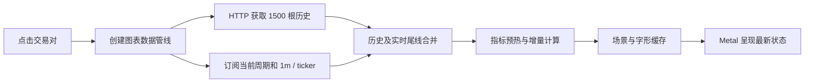
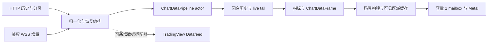

# 行情与原生图表

整合环境使用 Python 采集和推送，SwiftUI / Metal 显示。接口和当前性能样本见 [整合说明](INTEGRATION.md)。

## 客户端数字显示（2026-11-02）

行情列表、图表页报价、价格轴、指标图例 / 副图轴、十字线 OHLC / 涨跌幅 / 振幅 / 成交量和下单标注统一使用 `DisplayNumber`。100 及以上两位小数，1 至不足 100 三位小数，非零且不足 1 四位有效数字，负数按绝对值分档，跨档进位后重选格式。成交量的 K / M / B、成交额的万 / 亿保留原单位缩放，缩放后套用同一精度；详细约定和业务页面覆盖见 [统一数字显示](ios-web-parity.md#统一数字显示2026-11-02)。

指标参数的计算值、持久实例 ID 和下单输入继续使用原始精度；格式器仅用于显示。原来的局部 NumberFormatter / 固定位数拼接由无共享可变状态的 Decimal 显示函数替代，时间格式器继续复用。

## 交易对目录与开仓报价（2026-11-01）

`market_stream.0004_marketsymbol` 仅新增公共交易对目录表。现有采集器每 300 秒读取一次 Binance `exchangeInfo` 时，将当前报价资产、`TRADING`、`PERPETUAL` 的完整非空集合写入 `MarketSymbol`，标记下架项并同步 Redis；失败或空响应保留旧目录。migration 不访问交易所、不修改账户、交易或保护单；代码回滚可保留新增表。

鉴权 `GET /api/market/symbols` 返回 `{quoteAsset, symbols}`。HTTP 仅读服务器缓存，丢失缓存时回落数据库，空目录立即返回 503；默认自选目录同样不触发外部请求。`/api/market/tickers/popular` 与 `/search` 补齐 `query/page/size/totalElements/totalPages`，修复旧客户端因缺字段解码失败的问题，保留原 `items/tickers/hasNext` 兼容。

iOS 行情搜索、编辑添加、开仓与 K 线顶部下拉四个入口共用本地筛选与五分钟目录缓存；名称导航和右侧自选操作的区别见[页面规则](ios-web-parity.md#自选与交易对底部列表2026-11-01)。开仓报价使用常驻 `DashboardViewModel` 的 ticker 缓存；所选币种优先于搜索与自选加入最多 200 个符号的现有 `/ws/v1` 订阅，在所有标签间保持。订阅变更在每条连接上串行发送，防止快速退订、恢复及切币种的旧消息覆盖新订阅。退出图表返回行情或开仓时恢复订阅，避免图表的退订留下无报价状态。客户端不再按三秒轮询币安价格代理接口；现有服务端公共 ticker 流向客户端转发，不为每个用户新增 Binance REST 请求。WSS 仍受已有建连／消息预算和重连机制管理，不能把流式行情理解为没有任何限制。

当前模拟器和隔离后端结果见 [开发回归](development.md#自选与共用交易对回归2026-11-01)；生产目录迁移及只读验收另写入 [运维](operations.md) 和 [变更](changes.md)，手机安装新版后再验收真实网络及后台恢复。

## 服务端数据

`market_stream` 发现当前报价资产全部正在交易的永续合约，默认 USDT。连续 1m K 线按组直接订阅 Binance 公共 WebSocket，ticker 独立订阅。收盘线持久化到 MySQL，热数据和事件进入 Redis；完整分钟桶聚合为 3m / 5m / 15m / 1h / 4h / 1d，缺分钟时不伪造完整桶。

补线、预热、周期保留和历史 REST 请求受共享预算约束。原生 `/api/market/klines` 使用 `beforeOpenTime` 做排除边界分页，WSS `/ws/v1` 按订阅推送。慢客户端队列有界，认证过期后刷新会话并重新连接。

2026-11-01 对齐原 USDC 关键路径，后端已部署至 47.80.22.243（首尔服务器）：未收盘 K 线由事件唤醒立即写缓存并发布，不再固定等待 200 ms；收盘存储、ticker、历史任务、统计和预热独立运行。收盘写入后才发布确认事件，数据库操作不占用 live 缓存锁。单个行情进程内统一比较／更新 live 状态，防止并发写入重新打开已收盘线；待存储收线缓冲最多 10,000 条，超限丢弃最旧公共行情并记录告警，由缺口补全恢复。

公共行情通过 `integrated:market:v2:{channel}:{symbol}:{interval}` Redis 主题路由，ticker 的周期为 `-`。ASGI 只订阅连接需要的具体／通配主题，再执行协议过滤；账户与策略继续使用原总线和用户／模式隔离。公共批次以 Redis Lua 原子分配 sequence 并发布，批量 pipeline 仅一次往返，避免并发生产者反序交付。

## 三分钟与快捷周期（2026-11-02）

`3m`（180000 ms）加入原生周期模型、服务端 `INTERVAL_MS`、补全任务和 HTTP／WSS 共享校验，保留 7 天。连续 1m 按 UTC 三分钟边界聚合，只有完整闭合分钟组成已收盘桶；仍使用原有共享缓存、缺口修复、分页和公共出口预算，无数据库迁移或额外交易路径。 3m 沿用其他高周期的推送方式：服务端发布已收盘聚合线，客户端同时订阅所选周期与 1m／ticker，用后者持续更新当前价格；单独验证 3m 收盘事件必须跨过三分钟桶边界，不能用不足一桶的等待窗口判断断流。

3m 与 1m 不安排衍生统计请求：Binance 持仓量／多空统计最短支持 5m，不能用 5m 数据冒充 3m。对应 O.I.／多空／主动买卖及基差附加统计保留空值，不显示为持续补查。原生默认快捷项与编辑规则见 [页面](ios-web-parity.md#k-线下单区域2026-11-02)。编辑采用常见的“选择周期＋星标快捷项”规则，参考 [TradingView 周期收藏说明](https://www.tradingview.com/support/solutions/43000762824-how-to-change-the-time-frame-quickly/)，仅使用原生组件，并未接入第三方图表 SDK。统计周期依据 [Binance 官方接口](https://developers.binance.com/docs/derivatives/usds-margined-futures/market-data/rest-api/Open-Interest-Statistics)。

验证和发布结果分别见 [开发](development.md#图表下单与周期回归2026-11-02) 与 [运维](operations.md)，手机 UI 和真实账户不由本地替身结果代替。

## 后台自动补全与首屏读取

2026-11-01 实现，后端已部署为 `integrated-20261101-74b8e5d-wss`：`/api/market/klines` 只读取 MySQL / Redis 快照，不在请求内访问 Binance。响应新增可选 `historyPending`、`statisticsPending`、`hasMoreHistory`，原字段保留；`Server-Timing` 分别报告历史读取和统计缓存处理耗时。币种目录只读取采集器维护的缓存及一天内的最后快照；完全未准备时返回可重试 503，不在页面请求中同步刷新目录。

`MarketHistoryTask` 为持久化公共行情任务，由既有 `market_stream` 进程单独执行；没有新增交易 worker 或交易写入。按币种、周期、分页边界及任务类型去重，页面请求优先于常规维护。任务使用 180 秒租约，进程中断后可重新领取；失败按指数退避，最长 300 秒，页面轮询不会重置退避。运行过程继续消耗共享的 background 请求预算；1500 根 continuousKlines 按 10 权重估算，不挤占交易关键请求预留。

- 启动和每 5 分钟发现币种时，为当前报价资产的全部在交易永续合约安排 1m / 3m / 5m / 15m / 1h / 4h / 1d 维护。下架任务移除，已完成的按需任务定期清理。
- 每次处理最多一页 1500 根：先补最新尾部，再检查内部缺口，之后向前扩展保留窗口。完整一轮按任务到期时间轮转，不在启动时并发轰击交易所。
- 保留窗口依次为 7 / 14 / 30 / 90 / 180 / 365 天；到上市边界或窗口边界停止向前请求。停牌等空缺不伪造 K 线，空补线稍后重查。
- 收盘数据继续按币种、周期、开盘时间 upsert。补全事务提交后变更快照缓存版本，页面下一次读取立即可见；REST 旧线不混入 Socket 有序实时流。
- 发现合约时缓存 `onboardDate`，补线向上对齐当前周期的上市边界；未知上市时间仍按保留窗口和空结果处理。
- 历史独立领取任务；持仓量、多空比、主动买卖量与基差由 6 个统计 worker 有界并发执行并缓存 30 秒，HTTP 只附加已就绪数据。并发没有增加共享 REST 配额。
- 启动与每 5 分钟刷新币种目录时，按缓存成交额优先顺序、在容量允许时逐项预热共享窗口。本地已将所有周期统一为最多 1500 根，与 HTTP 单页上限一致；47.80.22.243（首尔服务器）已于 16:42～16:44 更新为 `7daa362`，同样统一为 1500；此前 `9091179` 为 1m / 5m / 15m / 1h 各最多 3000 根、4h / 1d 各最多 1500 根。历史页每个边界最多 1500 根。缓存按 symbol／interval／before／revision 共享，limit 仅切片；TTL 300 秒，提交后更新 revision。窗口可能受现有数据及保留天数限制；本轮差异及验证见下方构建 13／14 排查。
- 当前周期缺少 live 桶时，用连续本地分钟线及最新分钟增量构造未收盘部分桶，缺分钟不伪造。

`history_cache.py` 单独约束公共历史缓存：JSON 无损压缩后每窗最多 256 KiB，Redis 最多保留 64 窗，压缩值上限合计 16 MiB（另有键和索引开销）；只淘汰自身命名空间内最久未读窗口，不改变 Redis 全局 `noeviction` 策略，也不删除账户锁／预算键。预热容量已满就跳过数据库读取，用户按需读取可替换最旧窗口；过大窗口直接读数据库而不缓存。该约束依据当前 Compose 的 80 MB Redis 配额，不承诺全市场所有周期同时驻留。TTL 从最近读取计算，版本变更使旧窗口自然过期或被淘汰；SQLite / LocMem 开发配置只用于功能替身，不模拟生产容量。

客户端先同步准备账户范围，立即启动行情连接，然后刷新账户资料；图表页面不预加载下单资料，点击交易入口后仍走原 USDT 业务表单。保留 1500 根指标预热及 500 根显示窗口，单次历史响应即展示，分页已有部分数据也立即合并；待补全空页保留边界和加载资格，取消原每 1／2 秒、最多 8 次的短轮询。快照合并保留更晚的 Socket 尾部和收盘线，切周期／关闭取消旧任务，重连 epoch 校验继续生效。

### 补全就绪协议

`ready.data.capabilities` 新增 `market.history`。客户端仅在服务端声明支持时发送该订阅，连接旧后端时仍保留 K 线、ticker 与账户订阅。订阅过滤字段与 K 线一致：`symbols`、`intervals`；服务端确认 Redis 路由已安装后返回 `ack`，客户端据此补读一次，恢复订阅前错过的通知。

按需历史／统计任务完成并提交后，发送 `market.history` 的 `upsert` 事件，data 为 `symbol`、`interval`、`kind`、`beforeOpenTime`，kind 沿用 `history` 或 `stats:…`，最新窗口的 before 为 null。客户端只刷新当前币种／周期，历史页通知只重读对应待补边界；常规维护没有额外就绪事件。通知失败只记录简短日志，不把成功任务重新标为失败；保留 15 秒校对应对漏通知、断线及旧后端。当前本地客户端将首屏、通知、校对和异常恢复统一到一个最新快照任务：先显示在途响应，通知合并为一次后读；安装后仍需恢复才退避重试。historyPending 等待通知／校对，不因实时 tick 重新请求；切周期、重连 epoch 和退出仍取消旧任务。

上线前需应用 `market_stream.0002_markethistorytask`，再配套更新 API / market 及对应客户端；本次关键路径对齐没有新增迁移。公共行情主题由原总线切换为 v2，API 与 market 必须共同升级／回滚，混用两版会丢失公共行情。迁移只新增公共行情任务表，不改交易表或持仓；旧代码回滚可忽略该表，不能把代码回滚等同于数据库还原。旧客户端能忽略新增字段，但冷数据请求可能暂时显示空图，建议配合新客户端升级。

## 与原 USDC 实现的核对（2026-11-01）

本次只读对照 `/Users/apple/work/tradetools-usdc`，来源 Git HEAD 为 `2ed33f7d2da9380e6fc6e6b1c0076550c4156c36`，整合版以当前工作区为准。11 月 1 日进一步核对时，来源目录有其他任务的导航／手势改动；以下将来源 HEAD 与工作区区别核对，不将那些改动计为本轮变更。原 Java 部署已退役，本次未重启它，没有原版与整合版在同设备、同网络下的 A/B 结果。

### 页面进入到首帧的完整顺序

双方都使用 **HTTP 历史快照 + WSS 实时增量**。iOS 连接应用后端，后端连接 Binance；全部历史并不通过 Binance Socket 直接送入 iOS。行情列表的 `DashboardViewModel` 相同，差异主要在身份、页面外壳和延迟显示。

`MarketChartViewModel.start` 先建立 pipeline 和事件监听，再启动订阅与历史请求，不等待下单资料。高于 1m 的图表同时订阅 1m，把最近价格合入当前时间桶。首次拿到历史后，用 1500 根预热指标，页面价格序列保留末 500 根，图表管线保留预热历史；实际绘制只生成可见区域与缓冲区的场景。默认 EMA／SUPER／MACD／VOL 不请求外部统计。双方均保留 15 秒校对，Socket 重连使用新 epoch，切币种／周期使旧管线结果失效。

### 历史读取：查到秒级等待的具体差异

原 Java 的 `MarketKlineController.storedKlines` 调用 Mapper 查询 MySQL 最近／边界之前最多 1500 根收线；它没有从 Redis ZSET 读取 HTTP 历史。数据不足时同步访问 Binance、保存缺失收线后合并，因此原版冷数据和外部超时也存在慢路径。当前 Python HTTP 只读取本地快照，缺线安排持久任务，不同步等待交易所。

| 细节 | 原 USDC | 整合版及本轮处理 |
| --- | --- | --- |
| 目标周期窗口 | MySQL 直接取请求根数 | `warm_history` 按 revision 失效后读库，limit 切片；已部署版短周期最多 3000，本地已改为所有周期最多 1500。分页边界独立缓存，不是逐根 ZSET 的原样复制 |
| 当前未收盘桶 | `aggregatePartialBucket` 只查询当前桶范围内的闭合分钟，检查连续性后聚合 | 旧整合实现先读／预热 3000 根 1m 再过滤当前桶；11 月 1 日定向修复为相同的时间范围查询，仍叠加最新分钟增量且检查缺口 |
| 证据 | 范围查询见 Java `KlineAggregationService` 与 `MarketKlineMapper.selectClosedInRange` | 47.80.22.243（首尔服务器）的分段样本：BTC 1h 目标窗口 16.3 ms，额外 1m 窗口 2653.67 ms，其中 SELECT 2619.67 ms；总计 2675.18 ms。ADA／LINK 同路径为 673.25／482.91 ms |
| 线数据体积 | `KlineItem` 主要包含八个时间／OHLC／成交量字段及可选统计 | 当前每根还含 symbol／contractType／interval／closed／eventTime；保留字段兼容，历史 GET 已启用 gzip。1500 根 BTC 从约 423 KB 降至约 66 KB |
| 冷数据与补线 | HTTP 不足时同步补线；守护另行巡检 | 已有数据立即返回；持久化任务去重、租约、优先级、退避及上市边界继续保留，不为了外观相同恢复同步外部等待 |
| 缓存容量 | 各 symbol／interval ZSET 按根数维护；预热已够长时跳过 | 版本化压缩窗口，最多 64 窗／16 MiB 压缩值，预热满容量跳过；按需窗口替换旧窗，不能承诺 522 个合约的全部周期常驻 |

部分桶回归在修复前确认读入 62 根、实际只需 2 根闭合分钟；修复后仅处理当前桶的 2 根，加上 live minute 生成相同 OHLC／成交量。缺少开头分钟时仍返回空桶，不能把不连续数据标成完整 K 线。

### 附加统计与“取消后重读”回归

Java 的 `loadChartTradingData` 将所选统计并发请求后 `allOf(...).join()`，缓存 30 秒，外部 HTTP 超时为 20 秒；请求可能等最慢的一项。Python 的 6 个统计 worker 在后台有界并发，HTTP 附加已就绪缓存，未就绪时由 `market.history` 通知更新，两者调度不完全相同。

整合版新增就绪协议时存在一个具体回归：订阅 `ack` 或每项统计／历史完成通知会调用 `reload`，后者取消在途 HTTP。网络稍慢、通知先后到达时，同一快照反复下载，首屏可能被延后。原 USDC 没有这个历史就绪频道。受控测试在第一响应被门闩阻塞时发送 6 次通知，修复前首屏下载被取消、实际出现 4 次读取；这证明取消链路存在，不证明用户 TestFlight 12 必然含该版代码。

本地客户端已将后台通知和 15 秒校对改为在途合并：先呈现现有响应，再进行至多一次合并的后续读取；翻页也不因就绪通知取消下载。每个请求有独立 ID，旧任务完成不能清除新任务或覆盖加载状态。显式切周期、重新建立连接 epoch、指标所需统计变化与离开页面仍会使旧任务失效。订阅确认恢复漏通知、旧后端能力兼容继续保留。客户端改动尚未分发。

### 实时采集、分发与收盘

| 环节 | 原 USDC | 当前整合版 |
| --- | --- | --- |
| 上游消费 | Binance continuous 1m，按 pair 的队列由虚拟线程消费，依次调用 handlers；分组重连和退避 | Binance continuous 1m，async 分组接收；live、收线、ticker、历史、统计、预热独立执行 |
| 未收盘推送 | `RealtimeLiveKlineHandler` 无匹配订阅者立即返回；进程内 dispatcher 分发 | 事件唤醒发布，不再固定等 200 ms；Redis 缓存／按 symbol 与 interval 的主题进入 ASGI，仍有一次跨进程传输和序列化成本 |
| 收盘 | 数据库事务提交后事件；完整分钟到齐才聚合大周期 | 收线事务提交后发布，同样不补造缺失分钟；live 锁不覆盖数据库，收线缓冲有界 |
| 订阅与慢客户端 | 先匹配 recipients 再序列化，bounded dispatcher 与 session 发送限额 | Redis 主题先筛选，再按连接过滤与有界队列发送；慢连接关闭，保留账户／模式鉴权 |
| 顺序与恢复 | 每流 sequence，dispatcher 多线程；不能据此声称所有跨任务发送严格串行 | 公共批次 Lua 原子分配 sequence 并发布；客户端保持 epoch／sequence／收线屏障，发现缺口重取快照 |
| 自动补全 | 单独守护 fixedDelay 60 秒、分页和请求间延时、上市边界、启动预热 | 持久化任务、共享预算、公平轮转、容量限制；原版按目标根数，当前按保留天数，调度结构仍不同 |

报价资产与负载也不同：当前覆盖全部 USDT 永续，样本目录为 522 个合约；不能将较少 USDC 合约的运行体验直接归因为 Java 语言更快。实时通道快也不能抵消历史首个 HTTP 被取消或多读 3000 根的耗时。

### 原生绘制与交互为何能保持流畅

逐段核对 `CandleStore`、`ChartDataPipeline`、`KlineIngressState`、指标引擎、`KlineChartSceneController`、`ChartSceneBuilder`、`MetalRenderer`、资源 ring 与 shader：

- 历史是不可变快照，live tail 单独替换；收盘才提交指标历史，盘中通过 provisional 计算，不逐 tick 重算全部历史。迟到收线触发恢复而非静默篡改指标。
- 每次完整快照安装都会做整段指标预热；普通实时收线按增量更新，盘中只计算 provisional 值。Python 适配保留“晚 HTTP 不覆盖较新 Socket 尾线／收盘线”的合并增强，新增工作量是内存合并，没有网络等待。
- 场景构建复用历史对象身份、viewport、面板与价格域形成的静态缓存；价格／live 变化走动态批次。字形 atlas 和格式器复用，横拖保留可见内容位置。
- 场景请求覆盖旧的 pending request；渲染 mailbox 容量为 1，有代次的 GPU 槽位防止重用仍在飞行的资源，后台／恢复只保留最新状态。
- 当前与来源的场景构建、指标、Metal 主体相同；差异包括账户／接口适配、保留更新数据、返回手势预留、未引用实现删除及日志 bundle 标识。没有证据表明总代码行数造成十多秒首屏。

### 测量与结论边界

11 月 1 日修复前，在本机直连 47.80.22.243（首尔服务器）的无绑定 QA 账号测得：12 个合约的 1h／1500 根为 0.61～0.92 秒；另一个 BTC 样本 1.036 秒，WSS 六次 RTT 中位 135.77 ms，未复现手机十多秒。gzip 发布后热 BTC 样本为 221.56／309.11 ms，但刚重启后的部分桶慢路径仍出现 1.56～3.12 秒服务处理，随后通过上面的分段探针定位额外 1m 读取。

13:26（北京时间）最终范围查询版 `integrated-20261101-kline-range-6413a8768d2b` 已部署到 47.80.22.243（首尔服务器），六容器 healthy、HTTPS 深度健康及鉴权 WSS 心跳通过。对同路径分段复测，BTC 总处理 **42.69 ms**、当前桶 SELECT **19.58 ms**；ADA／LINK 总处理 284.61／246.44 ms，仍有目标窗口冷读取。公网样本 BTC1h 为 942.14／226.48 ms，ETH1h 555.86 ms，SOL1h 353.71 ms，BTC1m 冷读取 1338.33 ms（服务 history 1104.81 ms）；均 1500 根、无 stale，六次 RTT 中位 239.755 ms。不同时间缓存与链路状态不同，不按该组样本计算稳定加速倍数。

最后一轮独立 wire 探针也记录了网络波动：identity 423060 bytes，服务 history 44.11 ms／响应头 295.85 ms／完整接收 6338.11 ms；gzip 约 66.4 KB，两次完整接收 1221.60／864.02 ms。此前 gzip 热样本曾为 221.56／309.11 ms，因此不能只选最快样本承诺半秒首屏；压缩降低流量，不能消除链路抖动。1m 冷请求依然可能读取 3000 根共享窗口，和原版 HTTP 只取最多 1500 根仍有差异，后续若继续优化需保留指标完整性和缓存容量限制。

Debug 模拟器的临时分段记录：图表启动至首个 GPU 命令完成约 2.816 秒；历史请求 1158.53 ms，快照准备 1381.44 ms，场景构建 2.423 ms，Metal 宿主初始化 267.38 ms。GPU 完成不等于手机屏幕显示；自动化曾记录的 6.7 秒包含 AX 检测等待，不能作为绘制耗时。临时 GPU 日志已删除。

用户运行 **TestFlight 1.0.1 (12)**，尚未取得该构建的 commit 对应关系；本轮 App Store Connect／Xcode Cloud 会话已过期，没有修改云端配置。不能说该包一定包含现有工作区取消回归，也不能用模拟器／HTTP 结果宣布真机十多秒问题已全部解决。最终验收仍需同设备记录点击到首帧、热／冷 HTTP、切周期、分页和断线恢复；本轮源码未提交、未推送、未上传 TestFlight。

### 按首屏交接计划补验（2026-11-01）

本轮复用已有请求合并、gzip 和部分桶范围查询，不重新实现这些路径。进一步补充真实结构的订阅 ack、无关币种／周期过滤、下载失败后重试、不响应取消的晚到请求、15 秒真实校对定时器、连接重建和旧分页失效测试。重连时发现旧 epoch 的分页任务未取消；新代际保留其待补边界、取消并使旧回调失效，等新快照及已排队的合并补读安装完成，再恢复该边界。新增“先分页、后新快照”的受控测试先失败，修复后通过；不能跨连接代际复用旧响应，也不能使新快照覆盖刚恢复的页面。

13:48（北京时间）在 47.80.22.243（首尔服务器）只读剖析当前 range 版，没有清空缓存或重新部署。BTC1h 自然缓存未命中总处理 68.54 ms（目标窗口 SELECT 29.06 ms、缓存压缩写入 10.87 ms、当前桶 6.08 ms）；BTC1m 未命中 164.02 ms（SELECT 130.70 ms、缓存写入 13.98 ms），随后的命中读取 10.12 ms（缓存读取／解压 7.37 ms）；ETH1h 未命中 52.18 ms。MySQL EXPLAIN 分别使用已有 `market_candle_identity` 的反向读取和 `market_candle_recent`，没有添加索引、扩大缓存或修改 3000 根共享窗口。该组样本的服务处理成本不足以解释十多秒首屏，暂不扩大 P1。

本轮公网 wire 复核：identity 423060 bytes／1477.33 ms，gzip 66443／66474 bytes、283.40／305.67 ms，解压后均为 1500 根；gzip 服务 history 分别 11.35／10.86 ms。首次 QA 登录曾 20 秒读取超时，重试后成功；该失败发生在登录阶段，不计入图表首帧样本，也不从报告中省略。同期内部健康读取约 13 ms、六容器 healthy。

13:55～14:01（北京时间）使用专用 iPhone 18 Pro／iOS 27.2 模拟器、Xcode 27.2、Debug-Seoul、关闭覆盖率、本地 `74b8e5d` 加当前未提交工作区，连接同一 range 版后端；本地版本设置为 1.0.1 (3)，不等于手机 TestFlight 12。BTCUSDT／1h，每次历史返回 1500 根，默认 EMA／SUPER／MACD／VOL 和 500 根显示窗口保留，未开启外部统计。计时为应用内单调时钟，从列表按钮 action 到首个有效 Metal 命令完成；AX 仅用于操作和确认，截图已实际查看。

| 场景 | 有效样本 | 中位数 | P95 | 范围 |
| --- | ---: | ---: | ---: | ---: |
| 连续热进入 | 20 | 467.63 ms | 756.49 ms | 343.61～1249.45 ms |
| App 重启后进入 | 5 | 772.31 ms | 924.16 ms | 499.37～934.58 ms |

重启共尝试 6 次：原批次第 5 次在 20 秒内没有出现 BTC 列表，尚未点击图表；保留为一次启动恢复失败，补测一次成功。它不在图表耗时分位数内，不能把原批次 UI 用例写成全部通过。最初搭建采样时另有一次系统保存密码弹窗阻挡返回，排除该轮，随后测试增加延迟弹窗处理和准确的返回按钮标识。App 重启不能证明服务端冷缓存；本轮没有清空生产 Redis，也没有取得 5 次可确认的冷缓存首帧。

20 次热进入均为一次首屏读取、一次 ack 合并补读，普通通知取消数为 0；第一份 frame 已安装后才开始补读，不等待第二份响应。分段中位数：点击→VM 18.56 ms、VM→HTTP 调用 17.93 ms、请求适配 2.24 ms、完整 HTTP 接收 299.97 ms、解码 5.76 ms、返回→快照／指标 frame 71.23 ms、场景 4.29 ms、宿主初始化 4.41 ms、GPU 提交→完成 6.49 ms。各段中位数不能相加冒充总耗时分位数。最初一次进入的 VM→HTTP 为 202.33 ms，此后明显降低；当前采样没有重现旧日志中的 831 ms 缺口，证明它不能统称为取消重发，不能反推旧样本每毫秒的归属。

上述模拟器首帧代理达到交接报告提出的热进入 P95 1.5 秒观察目标，因此不扩大 P2、不重写渲染器或减少指标。GPU completion 仍不等于物理手机屏幕呈现，公网波动、启动恢复超时和 TestFlight 12 的实际代码关系继续待验。28 处临时探针已逐项删除，网络、场景、宿主、Metal 和列表源码哈希恢复到插入探针前；没有保留调试日志模块。原 USDC Java 已退役，本轮仍是源码对照与整合版测量，没有同条件 A/B。

14:02～14:04 的独立 HTTP 核对覆盖 BTC／ETH／ZEC／SOL／BCH／DOGE／BNB／ADA 的 1h，均返回 1500 根，耗时 414～929 ms；BTC1m 为 1500 根／383 ms，4h 为 1081 根／244 ms，1d 为 366 根／197 ms。全部检查排序、唯一时间、OHLC、实际 gzip 和 `Vary: Accept-Encoding`。ZEC／SOL 首次为 stale／pending，14:04 只读复查已不 stale，最新闭合小时线无滞后，对应按需补线任务已完成、attempts=0；不是声称全市场始终无缺口。BTC4h／1d 的可用窗口较短、pending 保留；1h 历史页立即返回 662 根且严格小于排除边界，后台继续准备。开启 openInterest 的读取返回 1500 根／350 ms，statisticsPending=true，证明待统计不阻塞历史响应；未在本轮逐个币种／周期做 UI 首帧或长稳验收。

最终本地行情后端 41 项全过（含专用临时 Redis），客户端快速路径 18 项与核心图表 127 项全过；移除探针后 generic iOS Release 未签名构建通过。证据在忽略的 `.integration-runtime/KlineFirstFrame/`，包括 `CorrectnessFinal.xcresult`、`first-frame-summary.json`、wire、阶段剖析、API 矩阵及补全复查；原批次 UI 结果有一次进入列表前超时，补测单项通过。没有新增后端发布、提交、推送或 TestFlight 分发。

## 客户端

- `Features/Dashboard/`：列表、搜索、自选和可见行情订阅。
- `Features/Chart/`：周期切换、历史请求、实时价格、指标设置与交互。
- `Features/ChartEngine/`：闭合历史 / live tail、增量指标、场景、Metal、字形图集和手势。
- REST 快照与 Socket 事件经入口状态合并；epoch / sequence / 收线屏障避免旧连接、乱序和恢复过程污染当前图表。
- 历史与 live tail 分离，实时变化不重建整段历史。渲染 mailbox 容量为 1，GPU 资源使用有代次的槽位；暂停和恢复只呈现最新快照。

图表当前维护入口见 [图表架构](../frontend/ios-app/docs/KLINE_CHART_ARCHITECTURE.md) 与 [校准方法](../frontend/ios-app/docs/KLINE_CHART_CALIBRATION.md)。来源项目的设计和历史报告从 [来源索引](sources.md) 查询。

### 图表代码体积与引用清理（2026-11-01）

按 `Features/Chart/` 与 `Features/ChartEngine/` 的 Swift／Metal 物理行统计，清理前为 49 文件、26,910 行，清理后为 46 文件、25,652 行，净减少 1,258 行；不把空行、注释或测试算作纯 GPU 绘制逻辑。其他目录的网络、模型、测试若一起计数，口径会更大。

| 清理后范围 | 物理行 | 实际用途 |
| --- | ---: | --- |
| `Chart/` | 3,530 | 图表页面、行情加载、指标配置与当前划线下单覆盖层 |
| `ChartEngine/Data`、`Domain` | 1,465 | 历史与 live 合并、时序隔离、颜色与数据模型 |
| `ChartEngine/Host`、`Viewport` | 2,923 | UIKit／SwiftUI 宿主、缩放、横拖、十字光标、时间轴与惯性 |
| `ChartEngine/Indicators` | 5,967 | 正在使用的主图／副图技术指标、参数、临时值与收盘值 |
| `ChartEngine/Scene` | 5,328 | 场景构建、文字布局、面板、坐标投影与批次 |
| `ChartEngine/Rendering/Metal` | 3,495 | shader、渲染器、GPU 槽位、字形图集、故障恢复与呈现健康 |
| `ChartEngine/Diagnostics` | 2,944 | 其中 2,844 行压力工具受 `#if DEBUG` 保护，另有已接入的 MetricKit 订阅 |

删除了无页面／运行调用的 `ChartDrawingTools.swift` 通用标注模块、`ChartSignposts.swift`、`ChartLeverageSettingsView.swift`，以及未使用的 Figure／Bar 描述与旧订单提交状态。同时移除图表目录外 932 行 `TradingSettingsModels.swift`：它服务于已经没有入口的 Java 账户／风控／订单／杠杆 API，当前 Python 业务使用 `USDTStore`；当前划线覆盖层实际需要的订单类型移入自身文件。仅验证这些退休实现的 14 项旧单测同步移除。现在使用的价格线覆盖层和技术指标有真实调用，仍在工程中。

图表的行数包括数据正确性、指标与交互责任，不能仅按总行数推断首屏速度。当前首屏仍由 HTTP／WSS 与场景准备链路决定；该清理任务当时按用户安排没有进行性能复测；后续本轮定向排障和性能样本见上文。此前模拟器目标及测试目标编译、设备 Release 未签名构建通过，不能视为本次手机验收。

### 行情页延迟指示

行情页右上角在编辑自选按钮左侧显示“延迟数字 + 四格信号图标”。测量复用已鉴权的 App → 后端 WSS 应用层 ping / pong，以 `requestId` 匹配、`ContinuousClock` 单调时钟计算往返耗时（RTT），取最近三次有效样本的中位数。它反映客户端到应用服务的链路，不代表 Binance 行情源延迟或订单成交速度。

当前本地客户端仅在行情页可见且 App 在前台时每 2 秒探测，保持单个在途样本；未返回的请求不会被下一次自动探测覆盖，超时仍为 3 秒。进入页面、恢复前台或活动网络变化时立即重置并探测。下拉刷新行情列表时保留正常 WSS 连接，同时立即重测延迟；点击延迟区域也可重测，连续操作合并。手动重测清空平滑样本和旧请求身份，但保留最后一次已测读数，数字左侧显示约 10 pt 的系统圆形进度指示；收到匹配 pong 后结束指示并更新数值。图标预留固定宽度，显示切换不挤动数字。首次没有读数时以 `-- ms` 和进度指示等待，失败或断线仍显示红色 `-- ms`。自动采样已有读数时保留上一读数，避免周期性闪烁。有效值显示 0–999 ms，超上限截为 999；低于 200 ms 为绿色，200–499 ms 为黄色，500 ms 及以上为红色。离开行情页或进入后台取消额外探测和网络监听，连接仍沿用服务端协商的常规心跳（默认 20 秒）。重复调用 `connect()` 保留已有连接状态与心跳，避免页面重新初始化后停止采样。

2026-11-01 本轮客户端修改仅保留本地，尚未推送或分发。旧安装包仍可能把未测得状态显示成 999；服务端部署不会改变手机里的显示代码。新版 WSS 鉴权在同步线程调用前后清理过期 Django 数据库连接，避免长时间复用线程保留空闲 MySQL 连接；拒绝日志仅记录异常类型，不记录 Token 或账号。部署前发现 WSS 403，更新后基础握手和 ping / pong 已通过；尚未用长稳复测证明连接清理就是全部 403 的根因。

## 构建 13／14 速度回退排查（2026-11-01）

用户确认 TestFlight `1.0.1 (13)` 的 BTC 约 1 秒、`(14)` 的 BTCUSDT 1h 一度约 3 秒；配合本轮点击采样后补充为首次超过 3 秒，后续约 1～2 秒。只读访问 App Store Connect 被要求重新登录，尚未核实两个构建各自的 commit；本轮以相邻源码 `9091179` 和 `915aee0` 作候选对照，不能将其称为已确认的手机包 A/B。

约 15:40～15:53（北京时间）核对 47.80.22.243（首尔服务器）：API／market／worker／scheduler 镜像与 current 仍为 `integrated-20261101-git-90911798159b`，没有部署 `915aee0` 的冷读锁／公共 WS 出口守卫。market 有一次重启，开始时间为 15:31:35，重启原因未确认；不能据此认定限频或内存不足。没有清缓存、更新配置、迁移或重新部署。

将两份确定 commit 导出到忽略目录，使用同一专用 iPhone 18 Pro／iOS 27.2 模拟器、Debug-Seoul、BTCUSDT1h、1500 根和相同默认指标顺序运行。这一 A/B 阶段只在隔离副本加入 monotonic 探针；随后按用户要求在主客户端加入下节所述持久诊断。时间为点击到首个有效 GPU completion 的代理，包含页面准备，不能等同真机屏幕呈现。

| 条件 | 9091179 P50／P95 | 915aee0 P50／P95 |
| --- | --- | --- |
| 公网，连续进入 8 次（含本次安装后首次） | 771／1819 ms | 655／1655 ms |
| 公网，App 重启后各 2 次 | 960／1250 ms | 833／854 ms |
| 相同固定历史响应，各 8 次 | 153／589 ms | 143／364 ms |

本轮 36 次进入均有首帧，4 轮 opt-in UI 用例通过。两个固定数据批次只替换 K 线 HTTP 历史响应，仍连接实际 WSS，不能称完全离线；均未出现秒级计算等待。公网稳定进入的历史返回→frame 中位数约 77／86 ms，场景约 5.1／6.4 ms，宿主约 4.9／4.1 ms，GPU 约 7.1／7.1 ms，样本不支持“新增绘制固定多等两秒”。两版安装后首次宿主初始化分别约 625／667 ms，后续约数毫秒，需区分首次资源准备和持续退化。采样量小、顺序测试且网络非固定，不能据此宣称新版本稳定提速。

公网连续进入各 8 次未取消在途历史，首个 frame 来自首屏响应，不等待 ack 补读完成。重启样本遇到 WSS ready 建立新 epoch，旧版 1 次、新版 2 次取消旧 epoch 读取并重新请求；这一安全规则两版均有，本轮重启首帧为 639～1282 ms，保留为重连路径的已测成本，不能笼统宣称所有进入均零取消。

### 已确认的历史读取与传输慢点

- 公网独立 GET 六个样本为 0.988～2.686 秒；BTC1m 慢样本的 `history` 为 2084 ms。另有 BTC1h `history` 84 ms、完整接收 2191 ms，证明服务处理快也可能仍在传输阶段等待。gzip 保持有效，1h 约 66.4 KB、1m 约 52.9 KB；URLSession 日志中的约 423 KB 是解压后体积。
- 47.80.22.243（首尔服务器）内部同进程只读剖析：BTC1m 自然缓存未命中 1564 ms，其中 SQL 1526 ms；随后命中 18 ms。仍使用已有索引，没有索引全表扫描证据。该路径在 `9091179` 已存在，不能归因为 `915aee0` 的新锁，因为新锁尚未部署。
- HTTP 最多返回 1500 根，旧 `warm_history` 对短周期却先物化 3000 根再切片。通过同一读取路径门控回归，修复前明确失败 `3000 != 1500`；本地将所有周期共享窗口上限收至 1500，继续保留完整指标预热、旧分页独立边界、保留天数、缓存容量／TTL、补全和最新 Socket 合并。
- 内部进程临时替换窗口大小、禁用该探针自身缓存读写作受控对照：已暖数据库下 BTC 3000／1500 根读取为 55.84／34.33 ms，ETH 为 50.38／30.77 ms；返回的 1500 根收盘线 SHA-256 相同。另有首轮 221／182 ms，未清数据库 buffer pool，不能当作同条件冷缓存提速倍数，也不能承诺此修复消除公网抖动。

冷读减量回归覆盖 1m、1h 两种窗口；旧 1h 共享窗口同样为 3000，减量也覆盖它；但本轮 1.56 秒冷读样本来自 1m，不能直接套到用户 BTC1h，更不能用它解释响应头已返回后的 4.62 秒传送。旧 v4 缓存值即使暂有 3000 根仍可按现有方式切片，不要求清空缓存。A/B 与冷读证据在忽略目录 `.integration-runtime/KlineRegression/`。

### 手机实际请求与响应体传送

按用户配合的 build 14 点击，在 47.80.22.243（首尔服务器）临时启用定向 Nginx 计时，不记录 IP、认证、完整 URL 或账号。慢样本响应头等待 72 ms、整份响应 4620 ms、应用 history 52.02 ms；其他样本完整响应 1500／1963／818／915／30 ms，响应头 29～41 ms，均 HTTP/2、gzip 约 66 KB。原访问日志确认 build 13／14 都是 BTC1h、limit 1500、未请求附加统计，不能归因为新包增加统计或 gzip 失效。

`proxy_buffering off` 时 upstream response time 可能包含下游背压，不能把 4.62 秒当作 Django 计算时间。现有证据指向响应体传送阶段有等待，尚不能区分丢包、HTTP/2 流控、客户端接收调度或其他链路问题，也未证明唯一根因。临时 Nginx 配置已撤销，`nginx -t` 和 reload 通过，站点文件与原备份 SHA-256 相同。受限证据位于 `/opt/trade-tools-integrated/backups/kline-diagnostic-20261101/`；这不是新应用部署。

### 客户端加载诊断（本地实现，尚未分发）

一次 ViewModel 启动／周期切换生成一个 trace UUID，每次历史 HTTP 生成 request UUID，通过 `X-Chart-Trace-ID`／`X-Chart-Request-ID` 关联。开始时间指 ViewModel 启动或请求准备开始，不冒充手指点击时间。记录以下边界：

| 部分 | 保存内容 |
| --- | --- |
| 请求 | 请求准备、鉴权适配、完整响应接收、JSON 解码开始／结束、HTTP 状态和数字错误码 |
| URLSession | 请求／首字节／响应结束时间，DNS、连接、TLS、TTFB、响应体和总耗时；协议、连接复用、代理、网络或本地缓存来源、传送及解压字节数 |
| 图表 | 快照安装／指标计算开始与结束、frame 就绪、场景构建开始与结束、首帧呈现 |
| 恢复 | Socket ready、epoch 切换、历史通知、恢复请求、取消及周期替换；同次加载最多 8 个请求、64 个事件和每请求 3 段网络 metrics，超量标记截断 |
| 完成 | displayed、cancelled、superseded 或 40 秒 timeout；物理机为 drawable presentedTime，模拟器明确标记 gpu_completion_proxy |

每条事件同时保存墙钟毫秒和从本次加载开始的单调耗时；不传原始 uptime。首帧回调校验当前 epoch，只结束一次。手机墙钟与服务端墙钟不能直接相减计算网络耗时；单调时钟用于本机阶段和总耗时。40 秒超时在进程挂起期间不会执行，恢复后可能延迟上报；服务端允许最长七天的有界耗时字段。失败／退出报告可能包含尚未收齐 metrics 的 pending 请求，不把它说成完整下载。

结束后独立异步 `POST /api/market/chart-load-reports`，使用现有登录鉴权，不在图表加载路径等待写库。最多两次、每次 5 秒，中间隔 2 秒；4xx 不重试，失败不弹 toast、不发全局登出通知，不建立磁盘离线队列。App 被系统终止／未联网时可能丢失记录，不能作为保证投递的审计日志。仅公共行情和固定诊断字段，不保存 token、URL、订单、资金、请求正文或错误描述。

后端 `ChartLoadReport` 由 migration `market_stream.0003_chartloadreport` 新增，按 user＋trace 幂等、已保存重复报告不覆盖。入口实际正文上限 24 KiB、每用户 180 次／小时；约 5000 条全局容量上限（并发接收可能略超）。每小时独立维护最多清理 500 条：过七天的记录优先，达到 4500 条时可提前淘汰最早记录，因此并非保证保存七天。该表独立于交易表。K 线 GET 只附合法追踪头与服务端接收／数据就绪时间，不同步写诊断表；ready 边界在 JSON render／gzip 之前，不代表完整 HTTP 响应结束。

只读查询命令、发布及回滚见 [运维](operations.md#图表加载诊断)。验证范围见 [开发](development.md#图表加载诊断回归)。TestFlight 14 不包含本轮埋点，必须后端迁移部署与新客户端分发后，才能取得该手机的完整链路。本轮随后获得客户端推送授权，源码 `7daa362` 的配套后端已部署到 47.80.22.243（首尔服务器），诊断提交／幂等落库和行情／WSS 冒烟通过。客户端交给用户既有 Jenkins／Apple 流程打包，分发及手机安装结果未核实；同一手机验收、Cloud 构建映射和真正根因仍待确认。

## 连续纵轴适配（2026-11-01，本地实现）

用户要求先评估主图与 MACD 在横向缩放／拖动期间连续适配纵轴的代价；完成下列评估后，用户明确同意实施。客户端已接入，源码纳入本次 [整批 GitHub 交付](changes.md#2026-11-01整批源码提交与-github-交付)，尚未验收新包分发或手机安装。BN 的外部交互仅作为体验参照，没有核实其内部实现。

### 当前实现

- 横拖、捏合和惯性沿用既有 `CADisplayLink`：手势事件继续更新最新视口和 Metal 横向变换，每个显示帧最多发布一次纵轴适配请求。在途场景未返回时只保留最新目标，不逐个排队；静止不增加持续重建。超出 48 根缓冲区的必要重建也按帧合并，惯性在缓冲区不足时沿用等待策略。
- 新场景返回时只更新绘制基准，保留手指累计位移、捏合锚点和普通惯性时钟。结束／取消时提交最后视口；即使已回到起始比例，也会覆盖尚在途的中间目标，避免晚结果令图表跳回去。生命周期暂停沿用取消与最终提交路径。
- 主图和 MACD 等副图使用场景构建器按实际可见 K 线及预计算指标确定范围；物理面板高度保持固定。主图价格刻度、MACD 零轴／刻度、最新价和十字光标数据随同一场景更新，手动价格倍率仍生效。可见集合改变时直接采用新拟合范围，本轮未加入额外纵轴补间动画、独立 GPU 纵向变换或新的范围缓存。
- 复用现有指标、字形缓存、场景构建和渲染 mailbox；未改指标算法、shader 或行情协议，也没有为纵轴计算增加网络探测。连续操作期间确实比旧版仅做横向变换多出场景和静态 buffer 更新工作，频率由显示节奏和在途限制共同约束。

### 评估时的旧行为与成本来源

- [手势宿主](../frontend/ios-app/TradeTool/Features/ChartEngine/Host/KlineChartHostView.swift) 原先的 `updateInteractiveTimelineViewport` 先提交交互帧，在现有场景仍覆盖目标范围时不通知场景层；越出 48 根缓冲区、缩放达到需要重建的范围，或 `settleInteractionViewport` 在松手／惯性结束提交时，才发布新的时间视口。`submitInteractiveFrame` 复用静态场景；[shader](../frontend/ios-app/TradeTool/Features/ChartEngine/Rendering/Metal/ChartShaders.metal) 只有横向位移／缩放，纵向像素坐标沿用旧场景，因此旧版出现结束后才适配的观感。直接拖动右侧价格轴已有 `.changed` 持续更新路径，与横向手势原先的冻结策略不同。
- [场景构建器](../frontend/ios-app/TradeTool/Features/ChartEngine/Scene/ChartSceneBuilder.swift) 在 `staticPrices`、`makePriceDomain` 和 `makePanelDomains` 按实际可见 K 线及指标取数值范围，再映射为像素坐标。MACD 使用已计算好的 DIF／DEA／柱值并包含零点；固定范围指标应保留其策略。可见根数限制为 10–164，绘制另加两侧缓冲，正常无需为了纵轴再扫描全部 1500／10000 根历史或重新计算 EMA／MACD，也无需新增网络请求。
- `StaticIdentity` 包含完整时间视口，小数偏移也会使静态场景缓存失效；直接把每个手势事件发布到 SwiftUI，会带来完整场景、刻度／文字、极值标注和命中数据重建。[MetalRenderer](../frontend/ios-app/TradeTool/Features/ChartEngine/Rendering/Metal/MetalRenderer.swift) 的 `updateStaticBufferIfNeeded` 随静态 revision 变化重新打包并创建 GPU buffer。数字上下限计算只是这条路径的一部分，不能只测 min/max 就判定总成本。

### 离线测量及边界

2026-11-01 在 Apple M4／16 GB Mac 上，以 `swiftc -O -whole-module-optimization` 编译 29 份未修改的当前图表源码快照，另原样提取 `ChartDataFrame` 声明，使用合成 OHLCV 和生产指标引擎。390 pt 宽、3 倍显示比例，面板高度按现有布局计算；每组先预热 20 次、记录 500 次同步顺序构建的墙钟时间。场景和字形缓存已热，测试不含首个字形图集生成。快照 SHA-256、基准、原始结果位于忽略目录 `.integration-runtime/ContinuousScaleAssessment/`；测量后 29／29 份仍与生产源码相同。

| 条件 | 场景准备 P50 | P95 |
| --- | ---: | ---: |
| 1500 根、默认 EMA／SUPER／MACD／VOL，横拖显示约 43 根 | 0.404 ms | 0.436 ms |
| 同上，横拖显示上限 164 根 | 0.433 ms | 0.477 ms |
| 同上，持续改变显示范围约 43–153 根 | 0.431 ms | 0.454 ms |
| 10000 根、默认指标，显示 164 根 | 0.519 ms | 0.556 ms |
| 1500 根、14 个本地指标／8 副图，显示 164 根 | 0.963 ms | 1.024 ms |

以上每组均实际发生 500／500 次静态重建；不是已经接入连续适配后的手势帧率。固定视口对照中静态场景复用为 500／500 次，整个 `build` 的 P50／P95 为 0.225／0.265 ms，但评估时旧版手势通常连这次 `build` 都不执行，不能把该对照当作旧版手势总耗时。纯横向矩阵算术的微基准不包含宿主提交，没有用于计算 App 提速或退化比例。

按 GPU 实例数量和现有结构尺寸推算，每次完整静态更新默认约 103–187 KB，14 指标约 528 KB；假设每秒重建 120 次，对应约 12.4–22.4／63.4 MB 数据打包量。该估算不含 buffer 对齐、纹理、动态尾部及 GPU 绘制，既不是实测带宽，也不能直接换算耗电。测量表本身包含场景内刻度和文字准备，但不含 SwiftUI 通知、MTLBuffer 创建／写入、GPU 执行、屏幕呈现及并发行情更新；Mac 字体和调度也不同于 iPhone。

### 实施验证与性能边界

采用按显示帧合并并只消费最新目标的方式，暂未增加 shader 纵轴变换。实施版的离线基准沿用相同夹具、优化参数、20 次预热和 500 次采样；29 份场景／指标等输入源码的 SHA-256 与评估快照全部相同，本次产品改动位于 UIKit 宿主调度。复测场景准备 P50／P95：默认 43 根为 0.414／0.555 ms、164 根为 0.454／0.584 ms、持续缩放为 0.457／0.760 ms、10000 根历史为 0.535／0.726 ms、14 指标为 1.076／1.564 ms。数据位于忽略目录 `.integration-runtime/ContinuousScaleImplementation/`；首次评估值以原目录 `run.log` 为准。相同代码的顺序复测仍有调度波动，不能据此宣称单次构建提速或 App 帧率提高；新增的主要成本是交互时调用频率上升。

新增真实 UIKit 手势宿主回归，先复现松手前不请求纵轴更新，再验证按帧合并、单个在途、主图／MACD 域变化、累计锚点、惯性连续、越缓冲区快速缩放、取消与回到起始比例时的最终提交。完整核心结果和专用模拟器的固定行情捏合／横拖／十字光标画面检查见 [变更记录](changes.md)。录屏抽帧可见手势期间范围变化；模拟器样本没有出现明显的松手后整图二次跳位，但不等于呈现间隔或卡顿率测量。证据包括 `ContinuousScaleCoreFinal.xcresult`、`ContinuousScaleUI.xcresult`、`continuous-scale-simulator.mp4`，均保持忽略。

真实 iPhone 的 60／120 Hz 相同数据前后对照、呈现间隔、漏帧、主线程／场景准备 P95、buffer 分配、持续操作时温度和能耗仍待验证；同时应覆盖 164 根、10000 根历史、多指标及实时行情并发。当前 Mac 基准与模拟器结果不能承诺真机无掉帧或零功耗增长。若真机剖析显示完整场景／buffer 更新占用过高，再评估范围缓存或按面板的 GPU 纵向变换。

Apple 的[响应性能指导](https://developer.apple.com/documentation/xcode/improving-app-responsiveness)给出 60／120 Hz 约 16.7／8.3 ms 的帧间隔，并指出 App 不能独占全部时间；[ProMotion 指导](https://developer.apple.com/documentation/quartzcore/optimizing-iphone-and-ipad-apps-to-support-promotion-displays)支持合并显示节奏，实际频率受设备和系统状态影响；[MTKView](https://developer.apple.com/documentation/metalkit/mtkview)允许静止按需绘制。[Metal 性能分析](https://developer.apple.com/documentation/xcode/analyzing-the-performance-of-your-metal-app)与[模拟器说明](https://developer.apple.com/documentation/metal/developing-metal-apps-that-run-in-simulator)要求区分 CPU／GPU／呈现，并在真实硬件确认性能和电池表现。以上资料核对于本节日期。

## 排障与验收

分别记录历史接口耗时、首条有效 Socket 数据、渲染耗时、连接恢复及分页一致性。HTTP 的 `Server-Timing` 不含网络传输或客户端呈现时间；Debug 的 `MarketChart` 日志分别记录 `history_http` 和 `chart_snapshot_ready`（快照准备完成，不能当作 GPU 已呈现）。HTTP101 只证明握手，不证明有行情；K 线事件延迟不等于订单执行延迟。

网络切换、后台恢复、token 刷新、切币种 / 周期及历史分页均需覆盖。当前短样本存在本机链路延迟离群点，尚未完成真机长期稳定性验收；实际结果与边界见 [变更](changes.md) 和 [已知事项](known-issues.md)。

## 读取协调与出口保护（2026-11-01，本地）

本节源码此前随 `915aee0` 交付，已于 16:42～16:44 随 `7daa362` 配套诊断发布到 47.80.22.243（首尔服务器），验证范围见 [运维](operations.md#最新发布与核验2026-11-01)。保留 Python 与 Metal，读取协调本身不改变交易业务或表结构；同次新增诊断表迁移另见上节，手机新包仍待分发验收。

- 快照合并保留已加载旧页及较新 Socket 收线，同时间的闭合线允许修订，总历史仍限 10000 根。相同内容保留不可变历史与指标对象，live 也未变时 revision 不递增；收线／统计修订或指标配置变化仍更新对应缓存。默认 `preservingNewerData: false` 仍是整段替换。
- pipeline actor 独占同步 `CandleStorage`，epoch 校验、存储和指标修改之间没有跨 actor await；独立 `CandleStore` actor 共用该核心。安装前检查取消，ViewModel 仍按请求 ID、会话、周期和 epoch 拒绝晚响应。恢复与首屏共用读取任务，仍需恢复时约 1～30 秒指数退避加 jitter；historyPending 等待通知／15 秒校对。
- 冷读使用固定 64 个进程锁条带和 Redis 10 秒 owner lease，取得锁后重查缓存。锁竞争总等待预算为 300 ms，到期允许直接读本地 SQL，故慢库／故障时不保证严格只读一次；释放校验 owner token，避免删除新的租约。Redis 异常后本次跳过重复缓存尝试。300 ms 是锁等待预算，不是 Redis 网络超时或接口 SLA。预热不等待繁忙窗口，不挤占已满缓存；HTTP 内不补线。
- WSS 使用当前 task 内的 timeout，避免 `wait_for` 内层恰好完成时吞掉取消；发送 5 秒、队列 128、订阅确认 3 秒边界保留。记录 `market_ws_closed reason=…` 及 `market:ws:closed:<分钟>:<固定原因>`，计数 TTL 120 秒；不含 token、账号、URL 或原始消息，计数失败不影响清理。外部监控及告警尚未接入。

### 币安额度与出口范围

官方 USDⓈ-M 资料核对日期为 2026-11-01。项目保守阈值与交易所上限分开，不将现货文档的建连额度套给合约流。

| 资源 | 官方规则／现有预算 | 本轮实现 |
| --- | --- | --- |
| REST 权重 | 同出口 IP 共享；依据 exchangeInfo 的 rateLimits 和 X-MBX-USED-WEIGHT，429 后继续请求可能变为 418；订单次数另按账户 | 沿用 common 共享预算、header 反馈及冷却。默认 futures 2400/min，background／normal／critical 门槛为 65%／85%／96%，按实际额度配置；1500 根 continuousKlines 仍为 10 权重 |
| Redis 不可用 | 每进程完整预算不能代表同 IP 总额 | 仅行情公共 REST 显式要求共享预算，不可用时推迟；普通交易调用未启用该标记，保留原保护／关键请求降级规则 |
| 市场 WS 建连 | 此次 USDⓈ-M Connect 页面没有可直接套用的每 IP 建连次数 | 自设最多 30 次／滚动 60 秒、相邻尝试至少 1 秒，可配置得更保守；Redis 原子准入跨进程共享。Redis 不可用时每 5 秒重查，不建公共连接 |
| 市场 WS 运行 | 每连接最多 1024 streams、发往币安的 incoming messages 每秒最多 10 条、24 小时有效期 | 每组 80 个 K 线 stream，ticker 独立连接，URL 一次订阅；自动 ping 20 秒并按协议 pong，无动态订阅发送循环。23.5～23.75 小时随机轮换，先关闭再重新准入，不随手机数扩容 |
| 握手与短断 | 反复超限断开可能封 IP | 429／418 解析 Retry-After／banned-until，共享公共连接冷却，短冷却不覆盖长冷却；失败指数退避加 jitter，最长 60 秒，稳定连接至少 60 秒才重置失败序列。已有 REST 冷却阻止新公共 WS 尝试，健康连接继续运行 |
| 补线任务 | 已知限制期间不再请求交易所 | 领取前检查 futures 冷却；失败后 due_at 至少为预算等待／冷却结束，加少量 jitter，避免反复领取已知被封禁的任务 |

依据：[USDⓈ-M WebSocket Connect](https://developers.binance.com/en/docs/products/derivatives-trading-usds-futures/websocket-market-streams/Connect)、[REST General Info](https://developers.binance.com/en/docs/products/derivatives-trading-usds-futures/general-info)、[Market Data 权重](https://developers.binance.com/en/docs/catalog/core-trading-derivatives-trading-usd-s-m-futures/api/rest-api/market-data)。incoming 是发往币安的消息，并非行情每秒只能下发 10 次；手机到本后端的 2 秒 RTT 探测不占币安额度。

共享范围为同一 Redis 和 cache key prefix 的本项目进程。新建连守卫用于公共行情，账户事件流沿用既有独立恢复逻辑。共用 NAT／代理出口的其他应用若不共享预算，仍会消耗该 IP 额度，应统一预算或下调本项目额度给它们留额；多 API Key 不扩大 IP 配额，不以轮换出口绕过封禁。入口 IP 不据此视为已核实的实际出口；本轮未盘点该出口全部应用，也不制造生产限频或封禁。

本地测试及 Release 构建范围见 [开发验证](development.md#k-线协调与出口保护回归)。手机首帧、跨网络和长稳仍待发布后验收。

## 性能与可替换性评估（2026-11-01）

审阅基线为源码 `9091179`，沿 HTTP／WSS → 入口状态 → CandleStore → 指标 → 场景 → 宿主 → Metal 检查，另读原 USDC Controller／采集实现。渲染层具备性能设计，编排层仍可简化；不能据此宣称最高性能或大规模可靠性。同日已在本地实施下列读取协调、分页保留、历史复用及关闭诊断，发布状态以上一节为准。

### 数据与绘制已经分层

`ChartDataFrame` 已为数据／绘制之间的不可变输入；网络请求没有放入 Metal draw 回调，图表也不等待账户资料才能显示。可继续将 `MarketChartViewModel` 中的 HTTP、分页、订阅、恢复策略抽成独立行情会话，让 Metal 与其他 renderer 使用同一份规范化行情。TradingView 有自己的缓存与指标引擎，接入时应明确谁拥有这两类状态，避免双份重算、重复网络订阅或逐 tick 通过 bridge 重传整段历史。下单仍调用现有原生业务表单和 Python 接口。

### 前端质量与具体余量

| 代码事实 | 价值或限制 |
| --- | --- |
| `ChartDataPipeline` actor 独占同步 `CandleStorage`，不可变闭合历史与独立 live tail | 有清楚的数据所有权，盘中更新不复制整段历史；epoch／sequence／可信收线屏障处理重复、乱序、缺口及缓冲丢弃 |
| committed／provisional 指标、可见区域加缓冲区场景、静态／动态批次和字形缓存 | 普通 tick 主要计算尾部，拖动／十字光标有独立呈现路径；不是逐根 SwiftUI View 绘制 |
| latest 场景请求、容量 1 mailbox、3 槽 GPU ring 和租约代次 | 不积压已过期的展示帧，不覆盖仍在 GPU 使用的资源；失败隔离、暂停／恢复和内存告警有路径 |
| ViewModel 管理历史、实时、分页、统计、恢复及参数 | 本地已删除独立恢复 HTTP 循环，最新快照共享读取槽、分页独立；尚未提取完整行情会话模块 |
| 15 秒校对及 ack 后补读仍会调用 `installSnapshot` | 本地按归一化内容比较；历史相同复用历史和指标对象，live 也未变时保留 revision，使静态场景可复用；收线／统计修订及指标配置改变仍更新 |
| `installSnapshot(preservingNewerData: true)` 合并旧历史与最新窗口 | 本地保留较早分页及较晚 Socket 收线，同时间由新快照修订，仍限 10000 根；默认 false 保留整段替换语义 |
| `intervalTask` 统一刷新与恢复 | 在途首屏可满足恢复，管线内部无跨 actor 存储 await；已覆盖取消、旧 epoch 拒绝安装和并发快照／分页／配置一致性 |

已有模拟器测量：HTTP 接收中位约 300 ms、解码 5.76 ms、响应到 frame 71.23 ms、场景 4.29 ms、宿主 4.41 ms、GPU completion 6.49 ms；20 次热进入 P50／P95 为 468／756 ms。各阶段中位数不能相加冒充分位数，GPU completion 也不等于实际屏幕呈现。证据支持先优化网络和数据编排，没有证明替换 Metal 可大幅缩短首屏。缺少物理 iPhone 的 60／120Hz 掉帧、内存峰值、耗电和长稳报告，尚不能认证其为最优实现。

### 当前数据推送与故障恢复

| 方面 | 已实现 | 仍需改进或验证 |
| --- | --- | --- |
| 首屏 | HTTP 只读本地历史／live，gzip；缺历史与统计返回 pending 并交给后台；本地增加有界窗口锁／Redis owner lease | 64 个热窗口不覆盖全部市场；锁等待到期允许重复读本地库；ticker／watchlist 缓存缺失仍有同步外部请求路径 |
| 实时分发 | 原生 1m、事件唤醒、live／收线／ticker 分开；Redis 按主题筛选，Lua 原子 sequence＋publish | Python 多进程序列化与 Redis hop 有成本；当前单 collector 与单 API worker 的峰值容量尚未压测 |
| 数据完整性 | 收线唯一键 upsert、完整分钟聚合、不伪造缺口；后台任务去重、租约、预算、优先级与指数退避 | 收线暂存最多 10000，失败或溢出依赖巡检恢复；这是最终补齐机制，不是每个展示事件都有持久确认 |
| 重连与补读 | iOS 心跳、鉴权续期、新 epoch、快照补读、通知合并及 15 秒兜底；本地 collector／图表恢复均加 jitter，公共上游还有共享准入、冷却及轮换 | Redis PubSub 无游标重放；恢复为快照重建，不是断点续传；进程崩溃、网络切换及长稳仍待验 |
| 慢客户端 | WSS outgoing 有界 128、发送超时 5 秒；图表缓冲 64，丢弃触发恢复；本地已有固定关闭原因及分钟计数 | 关闭诊断尚未接入外部监控与告警，不能以单测替代生产趋势验收 |
| 运维 | 健康／任务重试状态与部分 `Server-Timing` 已有，缓存只淘汰自身 namespace | 缺统一跨层 request／trace identity、首屏 P95、缺序列、补线时延、缓存命中、队列积压及慢连接关闭指标；六容器 healthy 不能替代这些业务指标 |

上述设计适合展示行情采用“快速增量＋快照校正”的模式。行情 PubSub 的最终恢复语义不能作为下单／资金事件可靠性的证明；交易命令、Inbox／Outbox 与 REST 对账有独立规则，见 [交易安全](trading-safety.md)。

### TradingView 接入取舍

| 选择 | 与当前后端的接法 | 预计收益与成本 |
| --- | --- | --- |
| 保留 SwiftUI／Metal | 使用现有 ChartDataFrame／场景 | 原生交互和性能可控，现有功能不需重做；需自己维护指标、手势与 GPU 实现 |
| Lightweight Charts | 历史使用 `setData`，实时使用 `update`，补线／重连由自有 feed 处理；Swift wrapper 实际为 WebView | 可能减少绘制维护及便于跨平台复用；完整分析工具仍需自行补充，增加 WebView 初始化、JS bridge、序列化和双侧状态成本 |
| Advanced Charts | 适配 `getBars`／`subscribeBars`／unsubscribe，按 `countBack` 与时间范围供数；历史修订按库规则 reset | 提供更完整指标与绘图工具；iOS 需 WebView 与自建 bridge，许可与产品接入条件需先满足，不等于直接替换一个原生 View |
| 托管 Widget | 使用 TradingView 托管的数据与界面 | 与“继续使用自有行情数据处理”的要求不同；不作为该方案的替代接口 |

官方资料核对于 2026-11-01：[Lightweight Charts iOS wrapper](https://tradingview.github.io/lightweight-charts/docs/ios) 明确内部 WebView；[实时更新](https://tradingview.github.io/lightweight-charts/docs) 建议用 `update` 更新尾根，反复 `setData` 会影响性能；[Advanced Charts 移动接入](https://www.tradingview.com/charting-library-docs/latest/mobile_specifics/) 不提供原生 iOS wrapper；[Datafeed 必需方法](https://www.tradingview.com/charting-library-docs/latest/connecting_data/datafeed-api/required-methods/) 规定时间顺序、历史缓存与旧历史修订方式；[产品与许可说明](https://www.tradingview.com/free-charting-libraries/) 区分库／Widget，Lightweight 为 Apache 2.0 并需遵守署名要求，Advanced Charts 免费使用有申请、公开环境和品牌展示条件，不能假定个人私用或当前登录产品自动满足。

TradingView 只能替换显示／分析工具，不能消除当前 HTTP 耗时、数据缺口、上游故障或恢复竞态。它的潜在优势主要是开发和维护效率，运行速度能否提高必须用同一物理手机、同后端、1500 根和等价指标对照；测 App 冷启动／预热首帧 P50／P95、拖动掉帧、CPU／内存、耗电、重连及历史修订，不拿空白图或少指标场景比较。

### 实施后仍待验证

本地已完成读取协调、分页合并、相同历史复用、有界冷读合并、出口保护和关闭诊断。后续需发布对应后端及新手机包，用同一物理手机测不同币种／周期和已确认缓存状态的 P50／P95，并完成网络切换、进程重启、补全时限和长稳验收。统一 trace、全部队列／缺口监控和外部告警尚未实现，TradingView 未接入。
