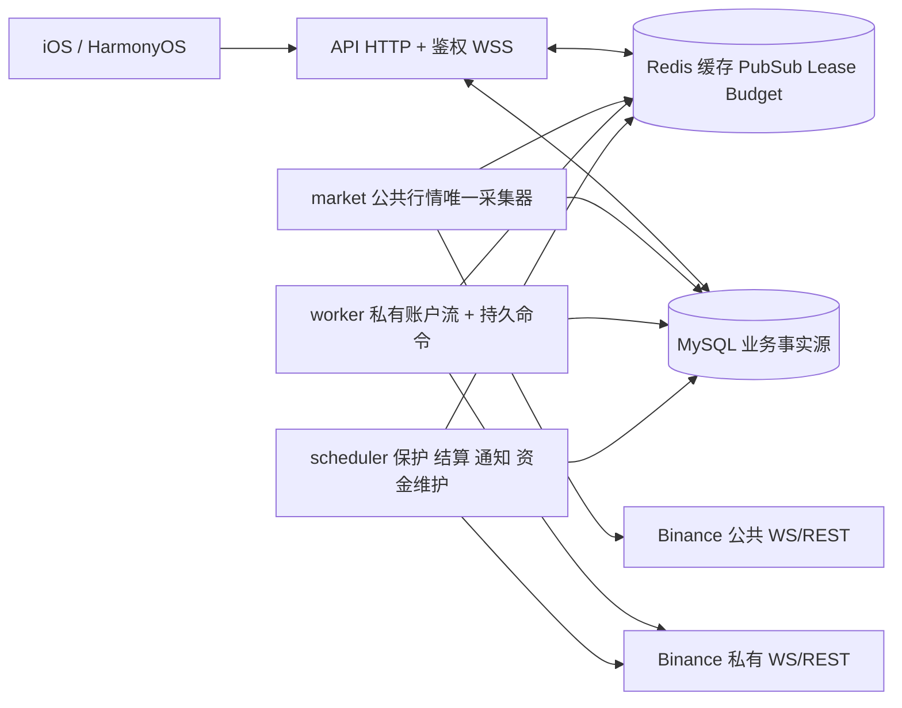

# 后端架构审查（2026-11-14）

## 结论

当前后端是“模块化单体 + 四个专职运行进程”，不是无边界的微服务。对现有单机规模，这个结构是合理的；四个 Python 容器不应为了减少容器数量而合并。真正需要优化的是单例所有权、可观测性和数据库高可用，而不是重新拆分业务。

## 运行单元判断

| 单元 | 当前职责 | 判断 |
| --- | --- | --- |
| `api` | HTTP、认证、业务接口、鉴权 WSS 和 Redis fanout | 保留。不能和交易 worker 合并，避免请求负载或 API 重启影响命令执行。 |
| `market` | 公共行情 WS、ticker、K 线落库、历史修复、预热、保留期清理 | 保留单实例。重复运行会重复订阅 Binance、消耗连接预算并增加写入。 |
| `worker` | 私有账户流、账户事实、持久命令、Inbox/Outbox、交易命令执行 | 保留。它承担未知结果恢复和账户 lease，不能依赖 API 进程存活。 |
| `scheduler` | 保护单、策略、手动仓接管、开仓收敛、平仓补偿、通知、资金提醒 | 保留单实例。职责较多，但与 worker 的故障域分开更重要；直接合并会让一个 health 状态掩盖另一个进程故障。 |
| MySQL | 订单、持仓、命令、账户事实和迁移后的持久事实 | 必须保留，是最终事实源。当前同一宿主单实例，具备明显单点属性。 |
| Redis | 缓存之外还承担锁、lease、序列、PubSub、请求预算和 heartbeat | 必须保留。它不是可随意删除的缓存层，移除需要重做一致性和跨进程协调。 |

`worker` 事件触发的对账与 `scheduler` 周期兜底存在重复调用，但这是有意的故障恢复设计：私有流断开时仍需由 scheduler 保护仓位。两条路径通过账户锁、绑定代际和幂等状态收敛，不能简单删除其中一条。

## 现在最需要修的架构问题

1. `scheduler` 和 `market` 依赖 Compose 只启动一个实例，但当前没有明确的全局 leader lease。误启动第二个 scheduler 会重复通知、资金提醒、结算和同步任务；误启动第二个 market 会重复订阅和写入。应增加 Redis 单例 lease，并把“是否持有 lease”纳入健康状态。
2. API 的 `/v1/health` 主要检查数据库、迁移和 scheduler heartbeat；部署脚本目前另外检查四个容器，但监控入口仍不能从一个接口看出 market／worker 是否健康。应增加 worker、market heartbeat 的新鲜度和当前 owner 信息。
3. 单机 MySQL 和 Redis 共享同一宿主、同一磁盘，容器 `restart: unless-stopped` 只能处理进程故障，不能处理宿主或磁盘故障。发布时可以跳过每次数据库备份；长期运行仍需要独立的数据库备份／恢复策略，否则数据库损坏不可逆。
4. `market` 的资源上限较紧。一次只读采样中它约 119 MiB / 192 MiB，CPU 在稳定采样约 14%～49%，曾出现单次约 92% 峰值；当前没有证据要求立即拆分，但应监控历史修复队列、统计 worker、内存和 Binance 请求预算。
5. Redis 和 MySQL 的 Compose `depends_on` 只解决启动顺序，不会在依赖容器运行中重启后自动重启应用；代码有重连路径，但需要把依赖恢复、Redis 写入探针和 OOM 事件纳入告警。Redis 当前健康检查只是 `PING`，不能证明锁、PubSub 和 noeviction 写入都正常。

## 推荐演进顺序

### P0：先补所有权和健康

- 给 `market`、`scheduler` 增加 Redis singleton lease；lease 丢失时主动停止业务循环并报警。
- 健康接口增加 `market`、`worker`、`scheduler` heartbeat age、owner 和最近一次任务时间。
- 保持四个 Python 容器，不增加副本；API、market、worker、scheduler 继续独立发布和重启。

### P1：再做可观测性

- 记录命令队列年龄、UNKNOWN 数量、每账户 worker heartbeat、保护任务延迟和失败率。
- 记录 market 的 live 缓冲长度、历史修复积压、Binance 预算等待时间、Redis 内存和 eviction。
- 记录 scheduler 每个 job 的运行时长、错过次数和最近成功时间，避免只看到进程“存活”。

### P2：有数据后再扩容

- API 只有在并发或 WSS 连接数证明单 worker 饱和时才扩副本；届时复核 fanout、连接数和健康检查。
- worker 只有在绑定数和命令队列证明单实例不足时才扩副本；现有账户 lease 可以作为基础，但需要改健康聚合和部署脚本。
- scheduler 不直接扩副本；若 job 数量增长，先把保护／结算与通知／分析拆成不同调度域，再分别设置 owner lease。

## 发布策略

日常服务端改动使用 `deploy/integrated/quick_deploy.py`，跳过备份和隔离测试；涉及 migration、交易生命周期、保护逻辑或资金状态机时使用完整发布。快速发布减少交付时间，但不会改变上述运行单点，也不能替代数据库恢复策略。
