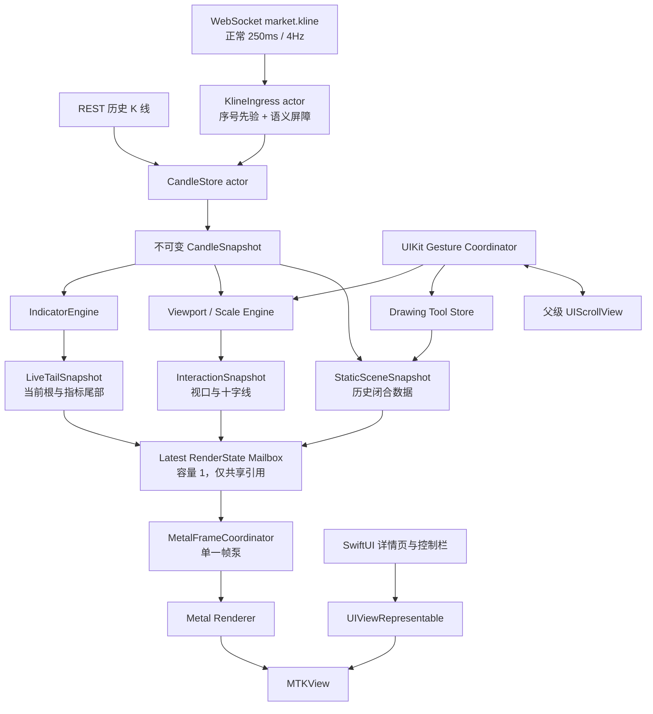

# iOS K 线图架构与实施方案

> 状态：方案 v4 已冻结；原生图表、历史分页、多指标面板和绘图工具底座已实现，
> 60Hz 真机门禁持续复验中；正式 2 小时 soak 不在本轮执行范围
>
> 目标平台：iOS 17+、SwiftUI 外壳、iPhone 真机
>
> 首期数据范围：原生 `1h` USD-M 永续合约 K 线
>
> 调研快照：2026-07-30
>
> 决策结论：生产渲染固定使用纯原生 `Metal + Core Text 字形图集 + UIKit 手势/无障碍 + SwiftUI 容器`；性能样机用于证明 Metal 达标和定位瓶颈，不再实现第二套 Core Graphics 生产后端，不使用 SciChart、WebView 或 JavaScript 图表

## 0. 实施状态

2026-07-30 已落下阶段 0.5 的第一批可编译、可测试骨架：

- 强类型 `KlineIngressState` 与 actor 入口，覆盖 epoch、sequence、收线屏障、同根 latest-wins、缓冲溢出和 REST 恢复请求；
- `CandleStore` 将闭合历史与 live tail 分离，10,000 次同根实时更新保持历史 storage 身份不变；
- 分层 `RenderState`、容量 1 mailbox、分级 invalidation 与相对原点坐标；
- Metal 蜡烛 instance shader、稳定/动态 buffer 分离、带租约代次校验的三槽 resource ring、按需/交互单帧泵；
- 真机路径使用 `drawable.addPresentedHandler/presentedTime`；模拟器仅用 command completion 维持测试可运行，不把模拟器数据作为真机 present 延迟结论；
- SwiftUI/UIKit/`MTKView` 宿主与受控初始化错误态；
- 新增 `TradeToolTests` target，目前 11 项内核测试通过。

2026-07-30 第二批继续完成：

- `BarKey/BarSlot`、Figure 最小定义，以及 candle/line/bar/glyph 连续 instance batch；
- Core Text glyph atlas，联合使用 fallback font PostScript 名和 glyph 作为键，并设置字形数、尺寸、页数和字节上限；
- 屏幕与离屏共用的 Metal pipeline/shader/encode 路径，固定 `bgra8Unorm_srgb`；
- 2x/3x 离屏 golden hash 与图像附件，覆盖蜡烛、虚线、柱体和动态文字；
- [ADR-0001：K 线 Metal 渲染稳定性边界](./ADR-0001-KLINE_METAL_STABILITY.md)。

第二批结束时测试基线提升为 15 项，并把 provisional indicator、MetricKit、
故障重建/熔断、memory warning 和真机 Shader Validation 列为第三批门槛。

2026-07-30 第三批关闭了稳定性代码门槛：

- EMA 使用独立 committed state 和 live-tail provisional 分支；10,000 次同根 250ms 更新不修改已收盘状态，warm-up、数据缺口和非法点为显式 validity；
- command buffer error 隔离原 resource ring，在安全 completion 点重建 renderer；60 秒内连续第 3 次失败停止新帧并显示受控错误层，成功帧会复位连续错误窗口；
- memory warning 清理稳定 GPU scene buffer 和 glyph texture LRU，再由不可变 scene 快照按需重建；
- `MXMetricManager` 订阅 app 级聚合 metrics/diagnostics，图表 signpost 使用 MetricKit log handle；日志只记录数量和错误分类，不包含账户、symbol 或价格；
- 模拟器与已连接 iPhone 17e 均为 20/20 测试通过；真机任务明确启用了 Metal API Validation 和 Metal GPU/Shader Validation，真实 Metal 离屏 golden 未报告验证错误。

阶段 0.5 当前仍未完成的退出项是 120Hz 完整 `MTKView` 压力、Instruments
分段数据、故障观察和未通过的 2 小时长稳复验。旧
`StaticKlineChartView` 继续保留，直到这些退出项与币安交互定标完成。

2026-07-30 第四批建立了真实前台 `MTKView` 短压：

- `RenderState` 增加单调 `readyTime`，`MetalRendererHealth` 用固定 256 槽
  ring 保存最近 actually-presented 样本，并跟踪 completed/current/peak
  in-flight；采样热路径不做无界 append；
- `MetalFrameCoordinator` 增加独立 suspended 门禁；暂停期间行情只覆盖容量 1
  mailbox，不请求 drawable、不提交 GPU，恢复后只画最新 revision；
- Debug-only `--chart-stress` 前台入口使用真实 SwiftUI/UIKit/MTKView 路径，
  Release 不包含入口逻辑；物理 unit-test host 不再被误当作上屏性能环境；
- iPhone 17e 无验证层短压：4Hz ready-to-present p95 `44.258ms`，20Hz
  `32.526ms`，峰值 in-flight `1`、GPU busy `0`、command error `0`；
- 同场景启用 Metal API/GPU Validation：55/55 command 完成，零 validation
  error，峰值 in-flight `2`；validation 延迟不用于性能门槛；
- 模拟器 23/23 自动化通过，真机 core 21 项通过；完整命令和限制见
  [阶段 0.5 真机短压报告](./KLINE_CHART_STAGE_0_5_TEST_REPORT.md)。

当前已关闭 60Hz 短时 4Hz/20Hz、暂停/恢复和 memory warning 的代码门槛；
30 分钟交互、2 小时长稳、120Hz、Instruments 和真实故障注入仍未关闭，所以
阶段 0.5 仍不能退出。

2026-07-30 第五批把短压入口扩展成可重复长稳工具：

- Debug harness 增加 `quick`、`interaction`、`soak` 三种场景；interaction
  默认 30 分钟并行产生 4Hz 行情与连续 viewport/crosshair 状态，soak 默认
  2 小时 4Hz 并均匀插入 10 轮 20Hz burst；
- 长跑参数可由环境变量或 launch argument 设置，不需要修改源码或重新定义
  fixture；Release 仍由 `#if DEBUG` 完全移除；
- `MetalRendererHealth` 增加固定桶延迟直方图，长跑 p95 不再受最近 256 个
  presentation ring 覆盖窗口限制；仍保留 ring 供 revision 级短压校验；
- RSS 只按 1 秒采样并只保存 start/end/peak，避免压测工具自己形成无界记录或
  把每帧 `task_info` 开销计入渲染；
- iPhone 17e 的 30 秒 interaction 证明样本为 `60.0fps`、p95 `50ms` 桶、
  peak in-flight `1`、dropped `0`、RSS peak delta `1.3MB`；
- 同机 30 秒 soak 证明样本完成 177 次混合更新和 2 轮 burst，p95 `40ms`
  桶、peak in-flight `1`、dropped `0`、RSS peak delta `1.1MB`；
- 活跃 interaction 已取得 15 秒 Time Profiler 和 10 秒 Metal System Trace
  短样本：无 100/250ms hang，Metal application command-buffer p95
  `4.332ms`，vertex/fragment GPU interval p95 分别为 `0.079ms`/`0.627ms`，
  CPU-to-GPU latency p95 `1.067ms`，command-buffer error 为 0；
- 模拟器自动化升为 25/25；Metal Validation quick 回归为 55/55 command
  完成、零 command error。

这些是长稳工具与短样本的验收，不替代 30 分钟/2 小时正式运行；阶段 0.5
退出状态不变。

2026-07-30 第六批补上页面生命周期与 renderer 失败恢复验证：

- Debug harness 增加 `lifecycle` 场景，默认重复创建、挂载、提交和销毁
  `KlineChartHostView` 500 次；每个宿主用 weak reference 验证释放，并刻意让部分
  宿主在仍有 in-flight command 时立即销毁；
- 宿主销毁时同步移除通知观察者，并把 coordinator 的显式 `dispose()` 调度回
  MainActor；旧 command completion 只通过弱引用和 renderer generation 返回，
  不访问已经销毁的 UIKit 对象；
- Debug-only simulated command failure 走真实的隔离、重建与熔断策略，但使用独立
  `simulatedCommandBufferErrors` 计数，不能伪装成真实 GPU command error；
- iPhone 17e 无验证层正式 500 轮通过：500/500 宿主释放，其中 166 次为
  in-flight 销毁，334 个等待轮次均获得真实 presentation；快速挂载/销毁产生的
  681 个 `presentedTime == 0` 全部按 dropped 记录并限速重画，没有用 command
  completion 冒充上屏，RSS peak delta `4.4MB`；
- 同机开启 Metal API/GPU Validation 的 10 轮通过：10/10 宿主释放，其中 3 次
  为 in-flight 销毁，模拟失败 5 次、重建成功 4 次、熔断 1 次，没有 validation
  error，RSS peak delta `4.5MB`；
- 模拟器自动化升为 26/26，真机 Metal Validation 下 24 项 core unit tests
  通过。

这批关闭了 500 轮页面销毁竞态和可确定模拟失败策略；真实 GPU command error、
前后台竞态、30 分钟/2 小时长稳和 120Hz 仍未关闭，所以阶段 0.5 仍不能退出。

2026-07-30 第七批关闭前后台渲染竞态：

- `KlineChartHostView` 以“已挂载 window 且 UIApplication 为 active”作为唯一
  renderer 运行条件；初始化、离开 window 或 `willResignActive` 均暂停并
  `releaseDrawables()`，只有重新挂载且收到 `didBecomeActive` 才恢复；
- suspend/resume 变为幂等状态转换并进入健康计数。重复系统通知不会重复释放或
  重复恢复；inactive 期间 submit 只覆盖容量 1 mailbox，`draw()` 和 display
  link 都不能提交 GPU；
- SwiftUI dismantle 显式调用 host `dispose()`，立即移除通知 observer、delegate、
  display link 与 renderer 引用；deinit 仍保留 MainActor 清理兜底；
- Debug harness 增加 `app-lifecycle`，每轮在 command in-flight 时发出 inactive，
  连续写入 25 个 revision，再恢复并要求只实际呈现最后一个；还可等待外部工具
  执行真实系统后台/前台往返；
- 首次真机运行发现 external cycle 为 0 时诊断工具使用 `1...0` 导致 Swift
  precondition crash，已改为安全半开区间并用同一场景复测；
- iPhone 17e 无验证层 20 轮通过：20 次 in-flight suspend、480 个过期状态被
  合并、suspend/resume 各 20 次、command error 为 0；
- 同机由 Settings 真实切后台再恢复原 TradeTool 进程通过：5 轮注入加 1 轮真实
  往返得到 suspend/resume 各 6 次、120 个过期状态被合并、command error 为 0；
- Metal API/GPU Validation 10 轮通过：10 次 in-flight suspend、240 个过期状态
  被合并、零 validation error；模拟器自动化升为 27/27。
- 真实 command buffer failure 现在有固定容量诊断 ring：completion 非
  `.completed` 时记录 status、NSError domain/code 和截断 message。非法
  Metal API/越界 shader 不进入自动 fault 注入，因为验证层可能直接终止进程；
  剩余 GPU error 项改为外部真实 fault 条件下观察验证。

前后台切换竞态现已关闭。阶段 0.5 仍未关闭外部真实 GPU command error、
30 分钟/2 小时正式长稳、120Hz、Allocations/Energy Log 和 TestFlight 门槛。

2026-07-30 第八批启动正式 30 分钟 interaction 验收，但首轮未通过：

- 完整运行 1,800 秒，108,037 次实际呈现保持 `60.0fps`，零 dropped、零
  GPU busy、零 command error，peak in-flight 为 2，RSS peak delta 为
  `1.2MB`；
- 全程 ready-to-present p95 落入 `67ms` 桶，超过 `50ms` 硬门槛；
- 原 harness 用当前唤醒时间重置下一个 250ms deadline，导致行情平均只有
  `3.81Hz`；现已改成固定时间轴推进，并把 `market_hz >= 3.95` 加入 PASS；
- 遥测新增 `ready→submit` 与 `submit→presentedTime` 两段固定容量直方图，
  用短诊断确定尾延迟位于 CPU/帧泵还是 GPU/系统合成；
- Debug 压测新增显式自动退出码和可见期间 idle-timer lease，quick 的 4Hz
  样本从 8 增到 20，避免冷启动单点让 p95 判定抖动。

本轮是有效失败证据，不能计作 30 分钟验收完成，也不降低门槛。阶段 0.5
仍需在定位和修正后重新完成 30 分钟 interaction。

2026-07-30 第九批完成修正后的正式 30 分钟 interaction：

- 固定 deadline 递增后，设备实际行情刷新为 `4.0Hz`（`7200` 次），不再有
  `3.81Hz` 的累计漂移；
- 同一 iPhone 17e 真机持续 pan/pinch/crosshair 状态 `1800s`，实际呈现
  `60.0fps`，目标刷新率 `60.0fps`；
- 行情 revision ready-to-present p95 上界 `50.250ms`，目标 `50.000ms`，
  只使用锁定的 `0.250ms` 固定直方图量化容差；ready→submit p95
  `20.000ms`、submit→present p95 `34.000ms`；
- `dropped=0`、`errors=0`、`last_gpu_error=none`、`gpu_busy=0`、
  `peak_inflight=1`，RSS 峰值增量 `1.5MB`；
- `CHART_STRESS_EXIT_AFTER_RESULT=1` 无人值守运行完成后，使用
  `devicectl appDataContainer` 回收 `latest-result.txt`，结果与运行时输出一致；
- 模拟器自动化基线升为 `30/30`，Release 构建及 Debug-only 字符串审计通过。

这批关闭了 60Hz 30 分钟 interaction 退出项。阶段 0.5 仍不能退出，下一步是
2 小时 4Hz + 20Hz burst soak，并随后完成 120Hz ProMotion、长时 Instruments、
MetricKit/TestFlight 与外部真实 GPU fault 观察。

2026-07-31 第十批完成首次正式 2 小时 soak，但审计后未通过：

- 完整 `7200s`、`27,772` 次混合更新和 `10/10` 轮 burst 跑完，p95
  `34ms`、GPU busy `0`、command error `0`、peak in-flight `2`，RSS
  peak delta `1.4MB`；
- 第 71–72 分钟的普通 4Hz 区间出现 2 个 `presentedTime == 0`，后续差值
  固定，没有持续积压；这不是 20Hz burst 过载、GPU error 或内存泄漏；
- 原 harness 的 long-run PASS 漏掉 dropped 判定，错误打印 PASS。审计按 ADR
  的零 dropped 门槛将本轮改判为失败，并在 interaction/soak 中显式锁定
  本轮 `dropped == 0`；生命周期故意销毁 drawable 的场景保持独立；
- 聚合遥测不足以事后确认两次系统未呈现的具体外部触发，本轮不盲目复跑 2 小时。

阶段 0.5 的 2 小时 soak 退出项仍未关闭；下一次长跑前应先增加 bounded drop
diagnostic ring，记录 drop 的 uptime、revision、UIApplication/host 可见状态，
用短时 targeted 场景验证诊断能力后再决定是否需要长跑。

2026-07-31 第十一批完成 dropped 定向诊断与生命周期帧泵修复：

- `MetalRendererHealth` 增加固定 16 槽 dropped ring；每条同时保存提交时和回调
  时的 App/host/window/renderer/interaction 上下文、revision、uptime、
  submit→callback、submitted/completed/in-flight 与 suspend/resume 计数；
  不持有 drawable 或业务数据；
- harness 的进度和最终结果只输出本轮最近一条 dropped 上下文，long-run
  dropped 门槛仍严格为 0；
- 首次 60 秒 targeted interaction 在启动后约 1.7 秒捕获 5 个 dropped；回调
  时 host/window 可见且 renderer 已恢复，但 interaction 已关闭，suspend/resume
  已发生第二次，最终只有 `58.4fps`；
- 审计发现 coordinator 把 interaction requested 与 active 混为一个状态：
  suspend 清掉请求，resume 无法恢复 display link。现已分离 requested/active，
  短暂失活保留请求，恢复后重建单一 display link；显式手势结束、dispose 和熔断
  仍清除请求；
- 同一真机、同一 60 秒配置 A/B 复测为 `60.0fps`、4Hz、dropped `0`、GPU
  error `0`、peak in-flight `1`、RSS peak delta `1.1MB`；模拟器自动化
  `31/31` 通过，Release 构建及 Debug-only 字符串审计通过。

本批没有重新执行两小时 soak，也不改变首次两小时失败结论；它关闭的是下一次
长跑前的诊断能力与已复现生命周期状态机缺陷。

2026-07-31 第十二批补齐真实数据管线到 Metal 的短时端到端门禁：

- Debug harness 新增 `pipeline` 场景，不再从合成 `RenderState` 起步，而是实际
  经过 `KlineIngressState -> CandleStore -> provisional EMA21/55/144 ->
  RenderState -> Metal`；
- 常态为 4Hz；20Hz burst 每次 drain 合并 4 个同根更新，latest-wins 生效。
  10 轮分别确定性注入 duplicate/late、sequence gap、invalid candle、
  out-of-order open time 和 upstream buffer drop，并用 snapshot 完成有界恢复；
- 门禁锁定 pending live `<= 1`、固定 barrier 上限、恢复全部完成、EMA 无非法值、
  3,000 根历史在 live-tail 更新中不复制，以及 dropped/GPU error 均为 0；
- 同一 iPhone 17e 60 秒得到 `events=1422`、`render_states=522`、
  `coalesced=900`、`recoveries=40/40`、`ema_invalid=0`、
  `history_copy_violations=0`、p95 `36ms`、dropped `0`、GPU error `0`、
  peak in-flight `2`，模拟器自动化升为 `32/32`；
- Release 通用 iOS 构建通过，生产二进制未包含压测入口或 pipeline 诊断字符串。

本批没有重新执行两小时 soak；该结果关闭“性能 harness 绕过真实入站/存储/指标
管线”的覆盖缺口，不改变长稳门禁状态。

2026-07-31 第十三批接通生产 REST/WebSocket 到 ChartEngine 的并行数据路径：

- 新增生产 `ChartDataPipeline` actor，固定持有 stream/epoch、
  `KlineIngressState`、`CandleStore` 和 EMA21/55/144 committed/provisional
  状态；输出结构共享的 `ChartDataFrame`，尚不直接生成场景；
- `MarketChartViewModel` 将 REST 快照上限从 500 提升到接口当前允许的 1,500 根，
  旧页面数组仍只保留 500 根。快照必须匹配请求的 symbol/interval 且非空；
  空快照和旧 epoch 快照不能清空当前 ChartEngine 可见数据；
- WebSocket `ready` 建立新 epoch 并重新取快照；旧连接事件、重复/迟到 sequence
  被拒绝，gap、buffer drop、历史修正和指标状态异常进入单一 REST 恢复任务，
  失败按 `1s -> 2s -> ... -> 30s` 有界退避；
- 详情页事件流使用 `.bufferingNewest(64)`；丢弃任意上游消息即标记恢复，actor
  内 live pending 固定为 1、close barrier 固定为 8。行情接收与图表发布分离，
  drain 最多每 250ms 一次；drain/recovery 都保留任务结束边界的 pending
  latch，避免新事件恰好在任务退出时丢失下一次调度；
- REST 快照到达前的最新 WebSocket live tail 会在快照安装后重新应用，避免请求
  窗口内价格倒退；同根实时更新复用 candle 与 EMA 历史对象，闭合 K 才生成新的
  committed 指标历史；
- 最新 REST 页可携带后端从连续闭合 `1m` 聚合的 provisional 当前柱。安装首屏快照
  时，ViewModel 在同一发布帧内合并同周期缓存实时价；若缓存尚未到达，则依次使用
  当前 ticker 和列表页价格生成 live tail，不等待下一条 WebSocket 消息；
- 自动化新增快照分类、同根合并/结构共享、sequence gap 恢复、重连 epoch、
  空快照保护和闭合修正恢复，模拟器全套基线升为 `37/37`。

`StaticKlineChartView` 本批继续保留并显示；新生产路径只发布下一批
`SceneBuilder` 所需的数据帧。下一步是把完整可见蜡烛、网格、轴和最新价格线
编译为 `RenderState`，仍不提前启用手势或删除静态回退。

2026-07-31 第十四批完成生产 `SceneBuilder` 并启用第一版可见 Metal K 线：

- 新增 actor 隔离的 `ChartSceneBuilder`，按真实 view point 尺寸与 1x～4x
  display scale 生成 drawable 像素坐标；只截取当前可见窗口，不把 1,500 根
  历史全部编译到 GPU；
- 稳定层包含网格、闭合蜡烛、EMA21/55/144 历史线、价格轴和时间轴；动态层只
  包含 provisional candle、三条 EMA 尾段、最新价格虚线、价格标记和文字；
- 静态 cache 以 stream/epoch、candle/EMA 历史对象身份、viewport 和 live-slot
  形态为边界。同根 250ms 更新只要仍在既有价格域内，就复用同一个
  `StaticSceneSnapshot`；只有收线、尺寸改变、epoch 改变或价格越界才重建稳定层；
- 价格域基于可见 OHLC 和有效 EMA，并预留有限 padding；实时价离开域时安全
  rebase，不裁剪蜡烛，也不把绝对价格直接转为 GPU Float；
- Core Text atlas 按 display scale 缓存，实时价格文字复用 formatter，并只布局
  一次后平移对齐；图表空闲仍按需绘制，没有新增 display link；
- 详情页有合法 `ChartDataFrame` 和 `RenderState` 后显示 Metal 图，无数据、尺寸
  非法或场景构建失败时继续显示 `StaticKlineChartView` 回退。本批没有启用手势；
- 新增生产场景完整性、静态结构共享、价格越界 rebase、2x/3x Metal 离屏确定性
  测试，模拟器全套基线升为 `41/41`。离屏图人工确认轴文字、网格、蜡烛、EMA
  和最新价格标记在 2x/3x 一致。

本批没有重跑两小时 soak。下一步是主图图例、SuperTrend/VOL/MACD 的插件化
场景和真实页面视觉校对；核心手势仍按阶段 2 单独实现。

2026-07-31 第十五批完成主图指标插件链路和 SuperTrend：

- 新增 `ChartIndicatorDescriptor`、实例参数、输出定义、颜色 token、autoscale、
  Y 轴策略及 `ChartIndicatorRegistry`；重复插件 ID、非法参数、重复单实例会在
  引擎创建时拒绝，不允许运行到渲染阶段再失败；
- `ChartIndicatorEngine` 通过 protocol existential 持有插件 calculator，统一发布
  连续历史序列、provisional 尾点和图例。新增测试用常量指标只注册插件即可进入
  引擎，未修改数据管线、SceneBuilder 或 Metal renderer；
- EMA21/55/144 已迁移为同一 EMA 插件的三个实例；`ChartDataFrame` 和
  `ChartSceneBuilder` 不再暴露或读取写死的 EMA 字段，而是遍历通用主图序列；
- 新增 SuperTrend(ATR10, multiplier 6) 插件。ATR warm-up、Wilder MMA 初始化、
  上下轨 ratchet 和翻转判断对齐当前后端 ta4j 0.22.6；断档会重置 committed 状态，
  未收盘更新只从 committed 状态生成临时分支；
- SuperTrend 用 up/down 两个带显式 hidden span 的输出表达红绿分段，避免 renderer
  出现逐点特判。主图 autoscale 只读取声明为共享价格轴且参与缩放的序列；
- 主图新增两行 Metal 图例：SuperTrend 名称为中性灰，值随方向红绿；EMA 名称和值
  分别使用黄、粉、紫。2x/3x 离屏图确认未越界、缺字或发生坐标漂移；
- 新增 Registry、示例插件无核心修改、SuperTrend 数值规则和断档/provisional
  测试，模拟器全套基线升为 `45/45`。

本批仍未启用手势，也未实现副图 panel。下一步建立 `PanelLayout` 和通用柱/折线
副图编译，再接 VOL 与 MACD；两小时 soak 继续留到功能边界稳定后统一复验。

2026-07-31 第十六批完成通用副图布局以及 VOL/MACD 插件：

- 新增 `ChartPanelLayout`，主图和零到多个副图共用同一时间轴/X 轴，分别持有独立
  Y 轴、图例区和绘图区；396pt 高度下主图不低于 120pt，每个副图不低于 54pt，
  非法尺寸和重复 panel ID 会在场景编译前拒绝；
- 通用指标输出新增 line/histogram figure style，以及 fixed、数值正负、K 线涨跌
  三种柱颜色策略。`ChartSceneBuilder` 只按 descriptor 的 placement/style 编译，
  没有增加 MACD/VOL 专用 Metal draw path；
- 新增 VOL + MA5/MA10 增量计算，成交量柱按 K 线方向着色；参数化周期会同步反映
  在 Metal 图例中。VOL 已注册，当前未选中时不会占用副图高度；
- 新增 MACD(12,26,9)，采用 `DIF = EMA12 - EMA26`、`DEA = EMA9(DIF)`、
  `MACD = 2 * (DIF - DEA)`；红绿 histogram 与 DIF/DEA 曲线在独立自动 Y 域绘制，
  当前生产默认激活 MACD，与详情页初始选中态一致；
- VOL/MACD 均保持 committed/provisional 双分支，同根 250ms 更新只生成临时尾点，
  不重复推进递归状态；时间断档重置 warm-up。MACD 信号 EMA 的计数和求和增加
  显式溢出保护，非法输入不会污染已提交状态；
- 生产 3x 离屏图人工确认主图/MACD 边界、共享时间轴、独立 Y 轴、图例、正负柱和
  曲线均无越界；模拟器全套基线升为 `50/50`。

本批没有重跑两小时 soak，也没有启用手势。下一步把详情页指标栏的实际选择状态
接入 pipeline 配置，使 MACD/VOL 增删能够重建对应插件实例和 panel；随后补参数
编辑/持久化，再进入阶段 2 核心手势。

2026-07-31 第十七批完成指标选择状态、持久化和运行时管线切换：

- 新增强类型 `ChartIndicatorSelection`。EMA 与 SuperTrend 可分别开关；VOL 与
  MACD 作为单一副图槽互斥，再次点击当前副图可关闭副图；允许关闭所有指标，只
  保留原生蜡烛图；
- 详情页指标栏不再维护仅改变按钮颜色的局部状态，而是读取并修改
  `MarketChartViewModel` 的真实选择；尚未接入的按钮保持可见但不可伪选中，并通过
  accessibility hint 明确说明状态；
- 选择使用版本化 UserDefaults key 持久化，存储顺序固定。未知 ID、重复项或同时
  选中多个副图会安全回退默认组合，避免升级或损坏数据产生非法插件配置；
- `ChartDataPipeline` actor 使用单调 selection revision 接受重配置，并从当前
  `CandleStore` 历史构建候选引擎后一次性交换。actor 在等待快照后再次校验 revision，
  防止可重入期间较慢的旧选择覆盖新选择；提交前还要复查 CandleStore revision，
  若同时发生 REST 安装或 drain 则用新快照重建，不能让旧历史覆盖新 epoch；
- 切换不重新请求 REST、不清空当前可见帧，也不替换 ingress actor；快照期间到达的
  live/barrier 继续留在原有有界队列，下一次 drain 正常应用。若重建发现数据断档，
  仍沿用现有 last-good + snapshot recovery 路径；
- ViewModel 还使用 stream session、epoch 与 selection revision 三重校验，旧任务不能
  向新 symbol/连接发布结果。选择写入后重新进入页面仍恢复同一合法组合；
- 新增动态切换、pending live 保留、旧 revision 拒绝、VOL/MACD 互斥、关闭全部指标
  和持久化损坏回退测试；模拟器全套基线升为 `52/52`，Release 构建通过。

本批没有重跑两小时 soak，也没有启用手势。下一步进入指标参数编辑与参数持久化，
再开始阶段 2 的平移、缩放、十字光标和父级长页面滚动仲裁。

2026-07-31 第十八批完成指标参数编辑、持久化和运行时应用：

- 指标栏末尾原有设置图标已接入原生深色参数页，集中编辑 EMA 三周期、SuperTrend
  ATR/倍数、VOL 快慢均量以及 MACD 快慢线/信号线；支持取消、恢复默认和应用；
- 编辑页保留原始文本草稿，空值和无法解析的内容不会悄悄沿用旧值。只有点击应用且
  全部校验通过才更新 ViewModel、写入本地存储并触发计算，输入过程中不反复全量重算；
- 新增强类型 `ChartIndicatorParameters`：EMA 周期为 `1...500` 且严格递增；
  SuperTrend ATR 为 `1...200`、倍数为 `0.1...20` 且按 `0.1` 对齐；VOL 快慢周期
  分别为 `1...200`/`1...500` 且快线不大于慢线；MACD 快慢/信号周期分别为
  `1...200`/`2...500`/`1...200` 且快线小于慢线；
- 参数以包含 `schemaVersion` 的 JSON payload 保存到版本化 UserDefaults key。
  数据损坏、未知未来版本或关系约束非法时安全回退默认参数，不把未校验内容交给插件；
- 生产插件配置不再写死 `21/55/144`、`10/6`、`5/10`、`12/26/9`；参数会进入
  calculator、稳定 instanceID 和图例标签，SceneBuilder/Metal renderer 无需专用修改；
- Pipeline 将选择与参数合并为同一个单调 configuration revision，从稳定的
  CandleStore snapshot 重建候选引擎后原子替换。切换参数不请求 REST、不清空
  last-good frame、不重建 ingress，也不丢 pending live/close barrier；
- 自动化新增范围/关系/步长校验、损坏及未来 schema 回退、自定义 instanceID/图例、
  自定义 VOL 运行时重建和历史结构共享覆盖；模拟器全套基线升为 `53/53`，Release
  构建通过。

本批没有重跑两小时 soak，也没有启用手势。阶段 3 的首批指标开关与参数链路已闭合；
下一步开始阶段 2 核心手势，先实现横向平移、缩放与父级长页面滚动仲裁。

2026-07-31 第十九批完成阶段 2 核心手势的第一段闭环：

- 新增 `ChartTimelineViewport`，用连续 `visibleSlotCount` 和
  `trailingOffsetSlots` 表达时间轴；单指平移保留 fractional slot，不再等移动满
  一根 K 线才跳动。左/右历史边界统一 clamp，回到最新端只重置尾部偏移，不破坏
  用户当前缩放；
- pinch 开始时冻结双指中心在绘图区中的比例，缩放后反算尾部偏移，保证触点下的
  数据槽位不漂移。当前可见范围集中限制为 `24...120` 根，方向锁比例 `1.15`、
  系统左边缘保护 `20pt`；这些是可替换的初始行为 token，尚未冒充币安真机最终
  标定值；
- `KlineChartHostView` 使用 UIKit pan/pinch recognizer。父级详情
  `UIScrollView.panGestureRecognizer` 等待图表横向 pan 失败：横向由图表接管，
  纵向/斜向主方向为纵向时图表主动失败，长页面继续滚动；从左边缘开始的 pan
  保留给系统导航；
- 离开最新端后显示无文字的原生“返回最新”图标按钮，并提供明确的 accessibility
  label/hint。App inactive、后台、dispose 或 recognizer cancelled 都收敛回 idle、
  停止 interaction display link，不留下粘滞状态；
- `ChartSceneBuilder` 的可见历史范围不再写死为 suffix。历史视窗只对可见 OHLC 和
  指标 autoscale，实时尾根/实时指标/最新价标记离开绘图区后不再被夹到最右侧；
  手动停在历史位置时，新 slot 追加会同步增加尾部偏移，保持原历史内容不跳动，
  follow-latest 状态则继续停在最新端；
- 手势状态仍由 Host/SceneController 管理，不进入行情 ViewModel。Rapid gesture
  revision 和 250ms 行情 revision 共用取消旧请求、只提交最新场景的路径；每次
  场景最多编译 120 根，不扫描或复制 1,500 根完整历史；
- 新增小数平移/边界/返回最新、pinch 锚点、横纵/系统边缘归属、状态互斥、历史
  视窗隐藏 live tail 和半槽像素位移测试，模拟器完整基线升为 `58/58`；Release
  通用 iOS 无签名构建通过。

本批没有重跑两小时 soak。它完成的是可操作的 pan/pinch/父滚动/返回最新第一段，
尚未关闭阶段 2：惯性与边界回弹、长按十字光标、gesture trace 真机逐帧定标仍未
实现；当前场景在手势 revision 到达时重编译有界可见窗口，下一步先增加 guard-band
几何和仅更新时间轴 uniform 的热路径，避免持续手势为每个采样创建新的稳定 GPU
buffer，再接惯性与十字光标。

2026-07-31 第二十批完成阶段 2 的 guard-band 与交互热路径：

- `ChartSceneBuilder` 在真实可见窗口两侧各编译最多 48 根历史 guard-band，稳定场景
  上限由“最多 120 根可见 K 线”变为“120 根可见 + 两侧各 48 根缓冲”。价格主图和
  独立指标 panel 的 domain 仍只读取真实可见范围；缓冲区中的异常高低价和暂不可见
  live tail 不得提前改变 Y 轴；
- `ChartTimelineInteractionTransform` 将逻辑 viewport 间的变化精确折算为像素级
  `translationX/scaleX`。pan/pinch 的 `.changed` 在 guard-band 内不再修改 SwiftUI
  controller，也不再启动 `ChartSceneBuilder` 任务，只通过 latest-wins mailbox
  提交新的 `InteractionSnapshot`；离开最新槽时只过滤轻量 latest-price batch，稳定
  `StaticSceneSnapshot` revision 和 GPU buffer 在该段手势中保持不变；
- 手势离开 guard-band 时提交一次逻辑 viewport 并异步 rebase；新稳定 scene 到达前
  继续保留旧 scene 的交互变换，防止主动清零形成闪跳。rebase 期间拒绝第二个手势，
  新 scene revision 到达后再把 recognizer translation/scale 归零；手势正常结束也
  只提交一次最终 viewport；
- `ChartRenderBatch` 明确区分 `.timeline` 与 `.fixed` 坐标空间。candle、指标折线和
  histogram 在 vertex shader 中应用 X 轴 uniform；网格、价格/时间轴、图例、最新价
  虚线与 marker 保持屏幕坐标，不随 pinch 漂移。timeline fragment 以绘图区左右边界
  裁剪，guard-band K 线不会覆盖右侧价格轴；
- 距离当前可见窗口不超过 guard-band 的 provisional live candle 与指标尾段预先进入
  timeline batch，以便从历史区域连续拖回最新端；它在真正可见前不参与 autoscale，
  最新价虚线、标签和 marker 也不会提前出现。250ms 行情更新若落在手势期间，Host
  会把当前 transform 重新应用到新的 live-tail snapshot，不把图表跳回旧 viewport；
- 新增 affine transform 等价、guard-band 覆盖/越界 rebase、历史区隐藏 live tail、
  临近 live tail 预缓冲和 fixed/timeline 分层覆盖。模拟器完整基线升为 `61/61`，
  Debug Metal shader/Swift 编译和 Release 通用 iOS 无签名构建均通过。

本批没有重跑两小时 soak，也没有生成新的真机 gesture trace。guard-band 已解决持续
手势反复构建稳定几何的问题，但惯性、边界回弹、长按十字光标以及币安真机速度曲线
仍未实现；下一步先接基于同一 viewport/transform 通道的惯性与边界状态，再做十字光标。

2026-07-31 第二十一批完成阶段 2 的惯性与边界状态实现：

- `ChartTimelineMotion` 是与 UIKit/Metal 解耦的纯值状态机，包含 idle、decelerating、
  springing 三个 phase。松手速度限制为有界范围，按毫秒衰减率推进；低于停止阈值或
  总时长到达 2 秒即确定结束，不允许 display link 无限存活；
- latest/oldest 边界不写入负 offset 或超出历史范围的逻辑 viewport，只通过额外的
  `boundaryTranslationPoints` 应用橡皮筋阻力。屏幕位移最多 72pt，松手后使用解析形式
  的临界阻尼回到 0；帧间隔最多按 1/30 秒积分，避免前后台或主线程停顿造成巨幅跳跃；
- `MetalFrameCoordinator` 的现有 interaction display link 在 draw 前回调 Host，惯性
  不创建第二个 timer/display link。每帧仍只发布 `InteractionSnapshot`，稳定 scene、
  GPU buffer、fixed batch 和 250ms live-tail 热更新路径均保持上一批约束；
- 惯性越过 guard-band 时暂停 display link 并异步 rebase，保留动力学速度/已用时；
  新 static revision 到达后重置 interaction baseline 并继续减速，不在第一个 48-slot
  边界截断长 fling。新横向手势可以中断惯性；纵向父滚动或系统边缘手势接管时则提交
  当前逻辑 viewport 后停止；
- 新增 latest/oldest 橡皮筋上限、内部减速停止和 latest 边界回弹 3 项测试。独立纯
  Swift smoke 和 iPhone 17 Pro 模拟器完整 `64/64` XCTest 均通过；Release 通用 iOS
  无签名构建通过。

本批的 `0.998/ms` 衰减率、45pt/s 停止阈值、72pt 最大回弹和 14rad/s 弹簧频率是
集中、可替换的第一版 token，不是“与币安完全相同”的验收结论。长按十字光标与
吸附已在下一批接通；下一步用币安/本 App 同机逐帧 trace 校准惯性速度曲线、边界
手感与十字光标视觉 token。

### 第二十二批——长按十字光标、吸附与数值联动（功能已实施，待真机校准）

下一步只实现生产级十字光标闭环，不提前进入画线工具，也不在本批替换旧静态图。
这是阶段 2 尚未完成的最后一个核心交互，也是后续校对币安视觉、指标图例和绘图工具
坐标体系的共同基础。现有 `InteractionSnapshot.crosshair` 只是一个屏幕点占位；压力
测试页生成的十字线也不代表详情页已经具备该能力。本批需要把它替换成以 K 线时间
身份为数据真值的完整选择快照。

实施顺序：

1. **选择模型与命中测试**
   - 新增独立于 UIKit/Metal 的十字光标选择模型，至少保存选中 K 线的 `openTime`、
     当前面板、吸附后的 X、手指 Y 和面板值；不得只保存数组下标或像素点；
   - 屏幕 X 先通过 `ChartTimelineInteractionTransform` 的逆变换回到逻辑 slot，再以
     O(1) 方式吸附到最近的真实 K 线中心；不得扫描最多 1,500 根历史数据；
   - 不得吸附到未来空白、guard-band 空 slot 或尚未存在的 K 线。历史补线、追加新
     K 线和 guard-band rebase 后，选择由 `openTime` 恢复，不能因数组位移跳到邻线；
   - 竖线吸附选中 K 线，横线暂按手指 Y 在当前面板内移动；主图映射为价格，副图
     使用各自 value domain。该细节属于待真机校准 token，最终以币安同机录像为准。

2. **手势状态与仲裁**
   - Host 新增单指长按识别器，并把 `.trackingCrosshair` 纳入统一交互状态机。长按只
     能从有效 plot 区域开始；激活时立即中断惯性和边界回弹；
   - 激活后单指移动只更新十字光标，不触发横向平移。结束、取消、App 退后台、视图
     离窗和 renderer 停止时必须清理选择并停止无用 display link；
   - 保留父级纵向滚动、系统边缘手势及 pinch 的明确优先级，快速交替长按、平移和
     pinch 不得进入双重 owner 或卡死；
   - 长按时长、允许位移、激活反馈和换 K 线反馈先集中为可替换 token。只在激活及
     吸附目标真正变化时产生轻触觉反馈，不得随每个触摸采样连续震动。

3. **独立交互覆盖层渲染**
   - 用强类型 `CrosshairSnapshot` 取代裸 `ChartPolylinePoint?`，其中包含稳定选择和
     有界 overlay batch；十字线、选中点、价格标签、时间标签及文字统一位于最上层
     的屏幕坐标交互覆盖层，不写入 static scene，也不受 timeline shader 二次平移；
   - `.changed` 热路径只发布最新 `InteractionSnapshot`，复用现有 mailbox 和唯一的
     interaction display link；不得调用 `ChartSceneBuilder`、重建稳定 Metal buffer、
     触发 SwiftUI 状态发布或为每个采样创建新的 timer；
   - overlay 的线段、背景矩形与 glyph 数量必须有固定上限，并复用现有 glyph atlas。
     数字和时间格式器需缓存，不得在 120Hz 手势采样中反复构造 formatter；
   - 标签靠近左、右、上、下边界时要自动避让并保持在可见区域，不能覆盖价格轴或被
     Metal scissor 裁掉。

4. **K 线、最新价与指标数值联动**
   - 选中任意 K 线后，同一 `openTime` 联动 OHLC、涨跌、成交量以及所有已启用指标
     的值；主图顶部图例从“当前值”临时切换为“选中值”，隐藏十字光标后立即恢复；
   - 选中已收盘 K 线时，250ms 行情推送不得改变所选值；选中当前 provisional live
     candle 时允许数值更新，但选择 X 和 `openTime` 必须稳定；新周期生成后旧 candle
     收盘，选择仍留在原 `openTime`，不能自动漂到新 candle；
   - 数据不足导致某指标没有值时显示统一占位，不得用 0 冒充有效指标结果。

5. **测试与退出条件**
   - 纯模型测试覆盖 2x/3x scale 下的逆变换与最近 slot、分数平移、左右边界、未来
     空白/guard-band 拒绝、追加与 rebase 后按 `openTime` 稳定、副图 domain 映射；
   - 状态机测试覆盖长按激活/移动/结束/取消、惯性中断、父级滚动与 pinch 竞争、前后台
     和 dispose 清理；标签测试覆盖四边避让、极端价格位数和无指标值；
   - 加入热路径回归：连续 10,000 次移动不得改变 static scene revision、不得触发
     scene builder 或稳定 buffer rebuild，overlay 实例数始终有界；
   - 新增测试全部通过且现有 `64/64` 基线无回归；4Hz 行情更新叠加持续长按移动时无
     闪跳、错线、GPU validation error 或 display link 泄漏；
   - 在同一台 iPhone 上逐项对照币安：激活阈值、线宽/虚实、字体、字重、内边距、
     标签避让、吸附规则、触觉时机以及 live candle 更新行为。真机 trace 完成前只能
     标记“功能完成”，不能声称“与币安完全相同”。

实施结果（2026-07-31）：

- 新增以 `openTime` 为身份的强类型选择/数据/覆盖层快照。X 轴通过当前 interaction
  transform 的逆变换 O(1) 吸附，拒绝未来空白和不存在的 guard-band slot，并可在
  static scene rebase 后按时间恢复；
- 生产 Host 接入统一 `.trackingCrosshair` 状态和长按仲裁，激活时中断惯性。触觉只在
  激活与吸附目标变化时发生；取消、退后台、离窗和 dispose 复用统一清理路径；
- 十字线、选中点、轴标签、时间标签、OHLC/涨跌/成交量和已启用指标值使用有界的
  fixed-coordinate overlay batch。移动热路径只替换 `InteractionSnapshot`，不重建
  static scene 或稳定 GPU buffer；历史值保持不变，live provisional 值允许更新；
- 2x/3x 逆变换、未来空白/副图 domain、rebase 时间身份、极端标签边界和连续 10,000
  次移动均已纳入测试；排除 2 个 shader golden 与 1 个真实 Host shader 用例后，Core
  XCTest `62/62` 通过。应用目标与测试目标在排除本机缺失的 Metal shader toolchain 后
  均完成 Swift 编译。完整 GPU golden、Onscreen XCTest 与同机币安 trace 尚未在本批
  环境重跑，因此当前状态只标记“功能已实施”，不标记“像素/手感一致”。

本批明确不包含绘图工具、双击复位、价格轴拖拽、两小时 soak 或旧静态图切换。完成后
按以下顺序继续：第二十三批做币安/本 App 同机逐帧手势和像素校准（同时收敛惯性与
十字光标 token）；第二十四批建立绘图工具的 anchor、registry、命中测试、选中/编辑、
撤销和持久化骨架；第二十五批通过功能、视觉、性能和故障降级门禁后，用 feature flag
替换旧静态图并保留可回退路径，最后再决定是否需要两小时专项 soak。

### 第二十三批——同机手势与像素校准（五轮结束态已实施，逐帧证据待补）

2026-07-31 已在同一台 iPhone 17e 上用 Binance 3.17.3 与
`TradeTool Dev B / Debug-Dev-B` 建立独立校准入口。仓库新增真机 UI 测试 scheme、
原图附件采集和无第三方依赖的 Core Graphics/ImageIO 差分脚本；原图、录像、
`.xcresult` 与 trace 只保留在 `/tmp` 或本机，不进入 Git。完整环境、命令、裁切规则和
首轮数字见 `KLINE_CHART_CALIBRATION.md`。

首轮已修正两个不依赖币对价格形状的确定差异：

- `.bgra8Unorm_srgb` Metal 目标此前直接接收 sRGB token，导致颜色二次伽马编码；
  renderer 现统一传入 linear RGB。真机截图复核已从过亮色恢复到原 token；随后按
  Binance 主图分区的实色聚类冻结上涨、下跌、EMA21/55/144 五个图表专用颜色；
- 价格主图图例改为 EMA21/55/144 在第一行、SuperTrend 在第二行；Dev B scheme 同时
  接通 `TradeToolTests`，避免校准修改只能在默认 Debug 下验证。

首轮固定左拖暴露了 latest 边界行为差异：Binance 在松手后保留右侧未来空白，
修正前 Trade Tool 回弹到 0。随后两端各完成 5 轮相同慢拖，结果分别稳定复现；上限
专项又用第一次 `x=0.68 -> 0.35`、后续 `x=0.35 -> 0.05` 的图形区起手排除空白
命中干扰。Binance 第 2 次到达上限，第 3～5 次不再移动，像素和 slot 间距对应半个
可视窗口。视口当时允许负 `trailingOffsetSlots`，下界采用
`-visibleSlotCount * 0.5`；future blank 进入正式 viewport、transform、guard-band、
rebase 与回到最新语义，不再是松手即消失的 overscroll translation。250pt/s 慢拖不
启动惯性，750pt/s 快甩仍启动，因此最低惯性起速由 provisional 45pt/s 收敛为
300pt/s；新 Dev B 二进制同样在第 2 次到达上限并在第 3～5 次保持稳定。

2026-08-01 后续逐项人工对照曾把“半窗”误纠正为固定 5 个 future slots。
2026-08-02 用户再次真机确认：正确产品语义是左滑到极限时画面只保留最后 5 根 K 线，
不是在右侧固定留下 5 根 K 线的距离。当前 `minimumTrailingOffsetSlots` 因此取
`5 - visibleSlotCount`；该规则覆盖 viewport、rubber-band、惯性/弹簧边界和回到最新测试。

XCTest 自动保留的整段视频 nominal frame rate 约 `23.966fps`，不是 60fps，因此本批
仍不冻结 provisional 的 `0.998/ms`、72pt 与 14rad/s 动力学 token。XCTest 的长按与
截图调用会被 UI automation 序列化，现有附件实际是松手帧，不能冒充十字光标激活帧；
该项仍需用手工持续长按配合截图或 60fps 原始 trace 补证。候选测试改为 `launch()`，
避免独立 UI runner 编译/安装新包后继续激活仍在运行的旧进程；Binance 保持
`activate()`，不破坏用户准备好的公开详情页。

同机参考还确认 Binance 可同时显示 VOL、MACD、RSI，而当前插件选择只允许
MACD/VOL 二选一且没有 RSI。这属于阶段 3 的真实面板能力缺口，不通过扩大 mask 或只
调整布局掩盖。第二十三批只有在缩放、十字光标、惯性与两侧边界各完成至少 5 轮录像，
并处理面板对齐后才能标记完成；在此之前第二十四批绘图工具不提前开始。

本轮最终真机色板复验逐项命中五个参考实色；latest 视口修正后的
`TradeTool Dev B / Debug-Dev-B` iPhone 17e 模拟器完整 Core + onscreen 套件仍为
`70/70`，Java 25 后端基线为 `72/72`。
颜色变更对应的 2x/3x Metal golden 已在两次同帧 hash 一致后更新并通过。

2026-08-01 已补充 oldest 边界独立专项入口：先 5 次缩到最小 K 线宽，再以固定
120 次全宽慢速右拖接近历史上限，最后保存 5 次相同边界输入的结束帧；Binance 与
Trade Tool 共用完全相同的输入预算。专项已在 `Debug-Dev-B` iPhone 17e 模拟器目标
完成 `build-for-testing`。本轮物理机 XCTest 在进入测试方法前连续 3 次超时于
automation mode 初始化，因此没有产出或宣称 oldest 真机结论；恢复设备端 UI
Automation 会话和开发者证书信任后，首轮 20 次接近拖动的两个专项均为 0 失败，但
第 1～5 轮结束帧仍持续向更早日期移动，不能算作 oldest 已到达。该结果按有效失败
保留，固定接近预算先提高到 100 次后重跑。Trade Tool 已稳定到 1500 根数据的最老端，
但 Binance 的 5 轮仍继续进入 TRUMPUSDT 上市初期数据，因此 100 次 Binance 结果仍
按有效失败保留，统一预算提高到 120 次。

120 次物理机复验中，Trade Tool Dev B `BTCUSDC 1h` 用例为 `372.022s`、0 failures；
5 次边界输入均执行，完整的第 1、3、5 轮结束帧在 `0,760,1170,1100` 裁切内两两
逐像素相同（每组 `1,287,000` 像素、变化 `0`），确认 1500 根有限数据集的 oldest clamp
稳定，不需要生产代码修正。两张系统合成缺块帧被明确排除，校准入口后续为每个检查点
保留间隔 `0.8s` 的双截图样本。

同预算 Binance 用例为 `355.559s`、0 failures，但准备页已是长历史的 `BNBUSDT 1h`，
最后 5 轮仍持续按需加载更早数据。因此 Binance 证据冻结为“已加载左端继续补历史”，
不再用任意固定拖动次数断言 absolute oldest。

2026-08-01 又新增十字光标活动态专用真机入口：两端以相同归一化坐标长按、慢拖并
保持 3 秒，重复 5 次，再从 XCTest 自动录像提取活动帧。提取出的 PNG 明确属于约
24fps 有损录像解码帧，不作为无损截图或 60fps 动力学证据。首轮帧暴露 live-tail
图例在 crosshair 背景之后再次绘制、以及单行布局丢失 SuperTrend 的问题；renderer
现会在活动态过滤显式标记的 live 图例批次，历史选择按逻辑 legend 合并 SuperTrend
up/down series，主图选中图例恢复两行，OHLC/涨跌/成交量进入避让数据卡。修正后的
Dev B 真机用例 `52.119s`、0 failures，5 轮均无叠字且 EMA、SuperTrend、MACD 选中
值稳定；修正后的 Dev B 模拟器完整 Core + onscreen 套件为 `70/70`、0 failures。
原始无损活动截图、60fps trace 与 VOL + MACD + RSI 多副图能力仍未完成，因此第二十
三批继续开放。

2026-08-01 第二十三批继续关闭多副图与活动态证据缺口：

- 指标选择由单副图互斥改为有序多选，VOL、MACD、RSI 可以同时存在；面板注册、
  独立 Y 域、图例和 crosshair 值联动仍走通用 descriptor/series 路径；
- 新增 Wilder RSI，默认周期 14，显式处理 seed、provisional 当前根和时间缺口；
  参数 schema 升级时兼容旧 payload，损坏或未来版本仍安全回退；
- 生产指标配置改为数据驱动 catalog。新增一个同类指标只需要注册 selection、参数和
  plugin，不修改 ViewModel、SceneBuilder、PanelLayout 或 Metal renderer；
- Dev B 真机用 `--chart-indicators-all` 启动后，VOL/MACD/RSI 三个按钮均通过
  accessibility 状态断言，原始 `1170 x 2532` 截图确认三个副图同时可见；
- Debug-only 校准参数允许长按结束后保留由真实手势生成的 crosshair，仅用于让
  XCTest 保存无损活动截图；Release 不包含该入口。无损图确认选中线、轴标签、
  OHLC/涨跌/成交量卡片和 EMA/SuperTrend/MACD 联动无叠字。

同日补齐历史向前分页：后端 `/api/market/klines` 支持严格排他的
`beforeOpenTime`，Binance `endTime=beforeOpenTime-1` 与 MySQL
`open_time_ms < beforeOpenTime` 语义一致；iOS 在接近左侧 guard-band 时预取
1,500 根并前插到 10,000 根有界 `CandleStore`，只重建指标历史，不重建 ingress。
前插以 newest `openTime` 区分于新 K 线追加，保持当前视口和十字光标时间身份不跳动；
空页停止继续请求，失败保留当前画面并允许下一次边界输入重试。

2026-08-01 第二十四批完成绘图工具底座，但尚未接用户工具栏：

- `ChartAnchor` 使用 `openTime + Decimal price` 数据坐标，注释包含稳定 UUID、工具 ID、
  样式、分组、锁定/隐藏、创建/更新时间和 schema version；
- registry 首批注册水平线、垂直线、趋势线、射线和区间测量；投影、场景线段编译和
  hit-test 共用同一 geometry kind，视觉线宽与触摸容差分离；
- draft、选择、锚点移动、锁定/隐藏、删除及有界 undo/redo 已实现；本地 JSON 按
  symbol/interval 分区原子写入，坏文件不会覆盖内存中的 last-good document；
- 该底座已经给后续斐波那契、平行通道、风险收益和文字工具留出 plugin/anchor/
  persistence 入口。下一批只需接工具栏、手势 owner、控制点和属性面板，不需要改
  CandleStore、指标引擎、SceneBuilder 核心或 Metal primitive 管线。

2026-08-03 按 Binance 原始无损真机图完成十字光标交互与信息层复核，当前校准和
安装统一切换到 `TradeTool Dev A / Debug`：

- 单击主图创建并常驻十字光标；再次单击关闭；长按后可横向拖动，松手后继续常驻；
  常驻期间禁止 pan/pinch 抢占，关闭后恢复普通图表手势；
- 吸附竖线按 K 线 `openTime` 取历史值，横线按手指所在面板的 Y 域取值，选中点、
  EMA/SuperTrend/MACD 历史图例和所有副图时间标签同帧更新；
- 主图右侧使用白色双行复合标签，左段为黑底白色加号，右段显示十字价格，以及
  `(十字价格 / 最新价格) - 1` 的百分比；250ms 行情到达时常驻选择不丢失，百分比按
  最新价刷新；
- 历史信息卡固定为时间、开、高、低、收、涨跌、涨跌幅、振幅、量、额十行，其中
  涨跌和涨跌幅相对开盘价，振幅为 `(高 - 低) / abs(开)`，成交额使用 quote volume；
- Metal bar instance 增加有界圆角参数，卡片、价格标签、时间标签和交点不使用 UIKit
  动态文字覆盖；极端价格文字在标签内裁切，10,000 次移动保持固定资源上限。

Dev A 真机点按/长按专项 `1/1`、0 failures；Dev A 模拟器完整 Core + onscreen 套件
`79/79`、0 failures。此前误用 Dev B 采到的零行情候选图已作废，未参与数值或 UI
决策；Binance 参考只激活用户已准备的公开详情页，不安装或修改第三方 App。

2026-08-03 下一批按 Binance 真机统一采样落地价格轴、历史图例、当前价回位和 VOL：

- 新增独立于时间轴的 `ChartPriceViewport`。右侧价格轴竖拖采用指数映射，向上放大、
  向下压缩，倍率夹在 `0.35...4.5`；symbol/interval/epoch 切换时恢复自动价格域；
- scene request identity 同时包含 candle revision、indicator-history identity、时间视口
  和价格视口。EMA/SUPER 开关即使没有新行情也强制生成匹配配置的新场景，图形和图例
  原子出现/消失；
- 普通历史视口以最右可见真实 K 线解析 EMA、SuperTrend 和副图图例；十字光标仍以
  吸附 K 线覆盖该值。最新根离屏不再作为隐藏图例的条件；
- 离屏当前价虚线拆成价格框左右两段，框内没有虚线；线、文字与 `>` 共用框中心 Y。
  live-tail 快照携带可命中的 marker rect，点按离屏标签提交 latest timeline viewport；
- VOL 继续走通用 indicator plugin/panel/Metal primitive 管线，不添加 renderer 特例。
  其固定图例和十字图例统一显示 base volume、quote volume、MA(5)、MA(10)，用
  `K/M/B` 紧凑格式；历史值来自最右可见根或十字选中根，柱色来自该根涨跌方向。

该批不改变 250ms 数据入口、容量 1 render-state mailbox 或 stable/live/interaction
三层结构；价格轴拖动只合并最新倍率并触发场景重建，不复制 candle history。
最终 Dev A 模拟器完整 Core + onscreen 套件 `80/80`、0 failures；物理真机统一用例
`1/1`、0 failures、`68.964s`，并以“历史 -> 最新”的 accessibility 状态变化确认当前
价框回位不是仅凭截图判断。该批未触发新的两小时长稳要求。

2026-08-03 再按 Binance 真机周期切换录像替换图表加载态：

- Binance 的图表加载器不是系统圆形指示器，而是图表正中央的 4 根黄色矩形柱；
  真机 `3x` 截图测得整体约 `64px × 30px`，单柱约 `10px`、间距约 `8px`，对应
  `21.3pt × 10pt`、`3.3pt` 柱宽和 `2.7pt` 间距；
- `StaticKlineChartView` 及其模拟蜡烛、指标、坐标轴和价格标签源码已完整删除。
  首次进入、周期切换、无数据以及 Metal 场景尚未生成时统一显示 4 柱波形动画；
- controller 记录已经完成构建的 `stream + epoch` owner。新周期真实场景完成之前，
  旧周期 `RenderState` 即使仍在内存中也不能重新显示，避免加载动画后闪回旧图；
- 动画只在加载分支使用 SwiftUI `TimelineView`，不进入 Metal 行情渲染管线，不改变
  250ms 数据合并、容量 1 mailbox 或稳定/动态/交互三层缓存；Reduce Motion 开启时
  保留静态 4 柱轮廓。

本批 Dev A 模拟器完整 Core + onscreen 套件为 `82/82`、0 failures；Binance 参考和
Trade Tool 候选周期切换真机用例均为 `1/1`、0 failures。候选录像确认旧静态图不再
出现，切换时先显示居中的 4 柱动画，再由目标周期 Metal 场景直接替换。

## 1. 目标

K 线图需要同时满足三个长期目标：

1. 指标可扩展：新增指标不修改图表核心，主图、副图、参数、图例和计算都能插件化。
2. 币安一致性：以真机上可观察到的视觉、状态变化和手势结果为验收基准。
3. 工具可扩展：画线、测量、斐波那契、风险收益等工具共享统一坐标、命中测试、编辑和持久化能力。

这里的“与币安完全相同”指：

- 同尺寸设备上的可观察布局、颜色、字体、线宽和间距一致；
- 相同输入手势产生相同状态变化、惯性、边界反馈和操作结果；
- 实时 K 线、最新价格线、十字光标和指标的更新时机一致。

不复制币安的源代码、二进制资源、私有接口或专有素材。实现基于真机测量、公开行为和本项目自有代码。

## 2. 当前基线与边界

### 2.1 可以复用

- `MarketChartViewModel` 已具备历史 K 线请求、`market.kline` 实时订阅和当前蜡烛更新能力。
- `MarketCandle` 已包含 OHLCV、成交额、成交笔数、开收盘时间。
- 详情页外层结构已经确定：顶部与底部固定，中间是长页面纵向滚动。
- 现有真机对照资料保留在 [BINANCE_REAL_DEVICE_UI_REFERENCE.md](./BINANCE_REAL_DEVICE_UI_REFERENCE.md)。
- 当前生产 Metal 图表区域高度为 `396pt`，外层详情页分区保持不变。

### 2.2 必须替换或新增

- 静态 K 线占位已经删除；无可显示 `RenderState` 时只能显示实测 4 柱加载动画，
  不能再生成任何模拟行情内容。
- `MarketChartIndicators` 把若干指标固定在一个结构中，新增指标会持续扩大条件分支，需要改为注册式指标体系。
- 首屏拉取最多 1,500 根；接近左端时使用 `beforeOpenTime` 分页前插，内存历史上限
  10,000 根，继续扩展只需替换有界缓存/落盘策略，不改变视口时间身份。
- 图表位于父级纵向 `ScrollView` 内，必须建立明确的横向图表手势与纵向页面滚动仲裁规则。
- 需要新增视口、坐标转换、手势状态机、绘图场景、工具模型、撤销恢复和性能监控。

### 2.3 首期不做

- 不恢复 `5m -> 15m -> 1h -> 4h` 聚合；当前后端仍只处理原生 `1h`。
- 不在首期制作完整指标商店或云端画线同步。
- 不先做一套临时 Canvas 交互图，再整体重写为 Metal。
- 不把交易逻辑、策略信号计算直接耦合到图表渲染线程。

架构保持周期无关，但首期只对有真实数据支持的 `1h` 完成验收。其他周期必须在数据源方案明确后再开放，不能用伪造或错误聚合数据填充。

### 2.4 静态页面实时热路径审计

原有静态页面路径适合过渡阶段，但不能原样作为新图表内核：

- `RealtimeClient` 是 `@MainActor`，WebSocket JSON 首次解码和事件 fan-out 都发生在主线程；
- `RealtimeServerMessage.decodeData` 会把 `JSONValue` 再编码为 `Data`、再解码成目标 payload，K 线每次更新多一次编解码；
- `MarketChartViewModel` 在主线程扫描 candles，插入时重新排序，并通过 `@Published` 发布整个数组；
- 静态数组更新仍没有按 key 合并的专用有界队列；
- 静态数组路径仍不根据 `sequence` 缺口重建自身。

500 根、4Hz 时这些问题可能暂时不明显，但扩大到更多历史、多个指标和交互帧后
会放大主线程占用和积压风险。第十三批已经用并行 `ChartDataPipeline` 关闭
buffer drop、sequence gap、epoch、结构共享和 250ms 发布频率缺口；静态数组
仍只负责当前回退画面。后续由 `SceneBuilder` 把 `ChartDataFrame` 编译为不可变
`RenderState`，再逐步替换静态路径。

## 3. 技术选型与案例复盘

### 3.1 方案比较

| 方案 | 扩展指标 | 复杂手势 | 大量图元性能 | 精确控制 | 结论 |
| --- | --- | --- | --- | --- | --- |
| Swift Charts | 一般 | 一般 | 一般 | 受框架语义约束 | 只作系统语义与无障碍参考 |
| SwiftUI `Canvas` | 较好 | 需要外接手势 | 中等 | 较好 | 仅保留静态占位/测试用途 |
| Core Graphics/Core Animation + UIKit | 好 | 好 | 中等 | 很好 | 只作案例参考，不实现第二套生产 renderer |
| 第三方开源/商业图表 | 取决于库 | 取决于库 | 通常较好 | 容易被库结构限制 | 不作为生产依赖 |
| `MTKView` + UIKit + SwiftUI | 最好 | 最好 | 最好 | 最好 | **生产方案** |

### 3.2 当前决定

采用混合架构：

- SwiftUI：保留详情页结构、周期栏、指标栏、工具入口和业务状态绑定。
- UIKit：承载图表宿主视图、手势识别器、父级滚动协调、无障碍元素。
- 渲染无关场景：统一描述蜡烛、网格、指标、价格线、十字线与画线工具，并编译为连续的 `ChartRenderBatch`，只接一个 Metal 生产 renderer。
- Metal/MetalKit：负责蜡烛、网格、指标、柱状图、价格线、十字线和绘图工具。
- Core Text + Metal 字形图集：生成字体 atlas，坐标、图例、价格/时间气泡与编辑控制点都在同一 command buffer 绘制，避免动态 UIKit 文字层与 Metal 帧不同步。
- UIKit：只保留图表宿主、手势、父滚动仲裁和不可见无障碍元素；图表热路径不使用可见文字 overlay。
- Metal 离屏纹理：用于确定性快照测试，不再维护一套重复的 Core Graphics 场景实现。

Apple 的 `MTKView` 是管理 Metal 可显示表面的原生 `UIView`；`UIViewRepresentable` 可以把 UIKit 视图安全嵌入 SwiftUI。UIKit 的手势代理支持同时识别和动态失败关系，适合处理图表与父级滚动视图的竞争。

“纯原生”在本方案中指运行时只使用 Swift、Swift Concurrency、SwiftUI/UIKit、Metal/MetalKit 和 Core Text，不嵌入网页运行时、不通过 JavaScript bridge 绘图，也不依赖第三方图表二进制。原生 KSChart 仍用于反例研究：逐根创建 `CAShapeLayer`、捏合不按触点锚定、平移按整根 K 线量化都不能复制。

相关官方资料：

- [MTKView](https://developer.apple.com/documentation/metalkit/mtkview/)
- [UIViewRepresentable](https://developer.apple.com/documentation/swiftui/uiviewrepresentable)
- [UIGestureRecognizerDelegate](https://developer.apple.com/documentation/uikit/uigesturerecognizerdelegate)
- [Coordinating multiple gesture recognizers](https://developer.apple.com/documentation/uikit/coordinating-multiple-gesture-recognizers)
- [CADisplayLink](https://developer.apple.com/documentation/quartzcore/cadisplaylink)
- [Optimizing iPhone and iPad apps to support ProMotion displays](https://developer.apple.com/documentation/quartzcore/optimizing-iphone-and-ipad-apps-to-support-promotion-displays)
- [Metal triple buffering best practice](https://developer.apple.com/library/archive/documentation/3DDrawing/Conceptual/MTLBestPracticesGuide/TripleBuffering.html)
- [Metal drawable best practices](https://developer.apple.com/library/archive/documentation/3DDrawing/Conceptual/MTLBestPracticesGuide/Drawables.html)
- [MTLDrawable presentedTime](https://developer.apple.com/documentation/metal/mtldrawable/presentedtime)
- [Creating and sampling Metal textures](https://developer.apple.com/documentation/metal/creating-and-sampling-textures)
- [AsyncStream](https://developer.apple.com/documentation/swift/asyncstream)
- [Recording performance data with signposts](https://developer.apple.com/documentation/os/recording-performance-data)
- [MetricKit](https://developer.apple.com/documentation/metrickit)
- [Core Graphics drawing performance guidelines](https://developer.apple.com/library/archive/documentation/2DDrawing/Conceptual/DrawingPrintingiOS/DrawingTips/DrawingTips.html)
- [CAShapeLayer](https://developer.apple.com/documentation/quartzcore/cashapelayer)

### 3.3 跨平台代表案例

本节只提取架构经验，不复制第三方源码、图标、主题或专有交互参数。若将来实际引入任何代码，必须单独登记版本、许可证、NOTICE 和升级策略。

| 案例 | 平台与渲染 | 值得吸收 | 不能照搬 |
| --- | --- | --- | --- |
| [TradingView Lightweight Charts iOS](https://github.com/tradingview/LightweightChartsIOS) | iOS 包装层，`WKWebView` 内运行 JavaScript 图表 | 明确的 loading/ready/failed/disposed 生命周期、操作有序排队、稳定对象句柄、严格时间顺序检查 | WebKit/JS bridge 增加启动、错误传播和手势层级；还有归属声明要求，不适合本项目的原生一致性目标 |
| [KLineChart](https://github.com/klinecharts/KLineChart) | Web Canvas，pane/widget/figure 分层 | indicator、overlay、figure、axis 分别扩展；逻辑 bar-space；双向历史加载；figure 同时负责几何与命中测试 | 全局注册表、异步任务缺少强取消、部分计算错误只返回失败；移动端绘图与滚动冲突仍需专门处理 |
| [KSChart](https://github.com/sevtin/KSChart) | iOS `CAShapeLayer + UIBezierPath` | 关闭隐式动画可避免拖动残影 | [源码按蜡烛创建 body/wick layer](https://github.com/sevtin/KSChart/blob/103a81ee0c12192bc46a0bc608009fe93f8921be/KSChart/Chart/KSChartModel.swift#L313)，图层数随数据增长；捏合焦点和平移连续性不足；缺少实质测试 |
| [StockChart](https://github.com/wangyiqian/StockChart) | Android Canvas/Matrix，子图工厂 | 统一逻辑坐标、独立子图、overscroll 与加载阈值可配置 | 可变全局配置和索引锚点会在多图表或历史前插时泄漏状态/发生漂移 |
| [KChartView](https://github.com/tifezh/KChartView) | Android 自绘 | 指标、横屏、长按、缩放和 fling 的完整产品面可作行为清单 | 长期停止维护，不能作为新项目依赖 |
| [flutter_k_chart](https://github.com/gwhcn/flutter_k_chart) | Flutter `CustomPainter` | 单画布路径简单，适合观察最小实现 | 固定指标枚举、把指标结果写回 candle、全局静态滚动状态、warm-up 用 0 代替空值、缩放不锁定触点，都会妨碍扩展与正确性 |
| [DGCharts](https://github.com/ChartsOrg/Charts) | iOS 通用图表库 | 变换、轴、formatter 和数据集接口可参考 | 是通用图表而非交易工作台，绘图工具和币安手势仍需大量旁路定制 |
| [Apple Swift Charts interaction](https://developer.apple.com/videos/play/wwdc2023/10037/) | Swift Charts 滚动、选择、可见区 | 系统无障碍、轴语义、选择 API 可作参考 | 组合 mark 可以画蜡烛，但不足以控制完整交易图表的渲染失效、工具生命周期和父级滚动仲裁 |

### 3.4 案例导出的硬规则

1. 数据身份使用时间键，横向布局使用逻辑槽位；永久锚点绝不保存数组下标。
2. 指标输出与原始 K 线分离；warm-up、缺口和非法值必须是显式状态，不能伪装成 `0`。
3. 实时未收盘 K 线对递归指标采用“已收盘状态 + 当前根临时计算”，不能把同一根 candle 重复 append。
4. 绘制与命中测试共享 figure 定义，但视觉线宽和触摸容差分离。
5. 数据、指标、几何、坐标轴、文字和交互 overlay 分级失效；WebSocket 事件不能直接触发整图重绘。
6. 所有异步计算、历史加载和订阅都带 generation/revision、取消和终止状态；错误不能静默吞掉。
7. 开源项目普遍缺少足够的渲染、手势与竞态测试，本项目必须把 trace replay、差分计算、后端一致性和真机性能作为一等交付。

### 3.5 相对 v1-v3 的优化清单

| 优先级 | 旧方案 | 当前调整 | 原因 |
| --- | --- | --- | --- |
| P0 | 直接确定 Metal 但缺少稳定性约束 | 固定 Metal，并增加性能、GPU 背压、错误与长稳验收 | 不为替代后端付出重复成本，同时用数据证明 Metal 实现合格 |
| P0 | 时间直接映射 X | `BarKey` 负责身份，`BarSlot` 负责布局 | 保证等距 K 线、缺口、未来空白与历史前插后锚点稳定 |
| P0 | 只描述增量指标 | 增加 committed/provisional 状态和 validity mask | 防止实时递归指标漂移及 warm-up 假零值 |
| P0 | 场景图元偏绘制接口 | Figure 同时定义几何、命中和无障碍 | 指标与工具共享扩展点，避免三套几何实现 |
| P0 | 未规定重绘粒度 | 增加分级 invalidation 与逐帧合并 | 避免高频行情造成整图 redraw storm |
| P1 | CandleStore 负责加载 | 抽出 DataProvider、分页/订阅生命周期和取消 | 解决切换交易对、迟到结果、销毁后回调和历史前插 |
| P1 | 手势列出正常路径 | 补齐取消矩阵、连续偏移、pinch 焦点和自由画笔策略 | 避免状态粘滞、整根跳动、缩放漂移及父滚动抢占 |
| P1 | 单元/快照/真机测试 | 增加 Metal 离屏 golden、gesture trace、属性与竞态测试 | 开源案例最明显的共同短板是复杂交互缺乏回归保护 |
| P0 | `AsyncStream(bufferingNewest: 1)` 混装所有实时事件 | 强类型 ingress 状态机先验序号，再只合并同一根 `upsert`；收线/校正/切换是有界屏障 | 通用 newest 缓冲可能把不可丢的收线屏障一起丢掉 |
| P0 | 单体 `RenderSnapshot` 容量 1 | `StaticSceneSnapshot + LiveTailSnapshot + InteractionSnapshot` 结构共享，mailbox 只替换轻量 `RenderState` 引用 | pending 只有 1 个仍可能每 250ms 深拷贝 3,000 根数据 |
| P0 | 动态文字使用 UIKit overlay | Core Text 生成 Metal glyph atlas，图表内动态文字与图元同帧呈现 | 消除 120Hz 下第二套合成路径、帧错位和重复布局 |
| P0 | CPU/GPU 坐标精度边界未固定 | CPU 保留 `Int64 + Decimal/Double`，GPU 只接收相对 origin 的小范围 `Float` | 绝对毫秒时间和高价品种直接转 Float 会丢失像素/价格精度 |
| P0 | command completion 当作呈现完成 | 用 `addPresentedHandler/presentedTime` 测量实际上屏；0 视为 dropped | GPU 完成不等于用户已经看到该帧 |
| P1 | `MTKView` timed update 描述不够明确 | `MTKView` 始终 paused；空闲 setNeedsDisplay，交互由唯一 `CADisplayLink` 显式 `draw()` | 避免 MetalKit 内部帧泵和外部 display link 同时运行 |
| P1 | 只依赖开发阶段 Instruments | 增加 `os_signpost + MXMetricManager` 和分阶段发布门槛 | 2 小时实验不能覆盖线上设备、热状态和生命周期组合 |

第三轮结论不是更换 Metal，而是给实现增加四个开工前硬门槛：事件状态机不丢语义、10,000 次 live-tail 更新不复制历史、延迟按实际上屏计量、GPU 错误可以安全停止或重建。阶段 0.5 任一门槛失败，都应先修订内核，不进入完整指标和工具开发。

## 4. 总体架构



必须保持单向数据流：

```text
行情事件
-> 数据快照
-> 指标快照
-> 分层场景快照
-> 轻量 RenderState
-> 渲染
```

手势只改变视口或工具状态，不直接修改原始行情数据。渲染器只消费不可变快照，不读取网络对象或业务 ViewModel。

## 5. 模块职责

建议新增独立目录 `TradeTool/Features/ChartEngine`，避免继续把所有代码堆入 `MarketChartView.swift`。

```text
ChartEngine/
  Domain/
    CandleSeries.swift
    ChartInterval.swift
    ChartSnapshot.swift
  Data/
    CandleStore.swift
    HistoryPageLoader.swift
    RealtimeKlineIngress.swift
    KlineIngressState.swift
  Indicators/
    IndicatorDefinition.swift
    IndicatorCalculator.swift
    IndicatorRegistry.swift
    IndicatorDependencyCache.swift
    BuiltIn/
  Viewport/
    ChartViewport.swift
    TimeScale.swift
    PriceScale.swift
    PanelLayout.swift
  Scene/
    ChartFigureDefinition.swift
    ChartFigureRegistry.swift
    ChartLayer.swift
    ChartRenderBatch.swift
    SceneBuilder.swift
    ChartInvalidation.swift
    StaticSceneSnapshot.swift
    LiveTailSnapshot.swift
    InteractionSnapshot.swift
    RenderState.swift
  Rendering/
    Metal/
      MetalFrameCoordinator.swift
      MetalRenderer.swift
      MetalResourceRing.swift
      MetalRendererHealth.swift
      MetalGlyphAtlas.swift
      MetalTextRenderer.swift
      MetalPresentationTracker.swift
  Interaction/
    ChartGestureCoordinator.swift
    ChartInteractionState.swift
    CrosshairController.swift
  Tools/
    ChartToolDefinition.swift
    ChartAnnotation.swift
    ChartToolRegistry.swift
    ChartToolCommandStack.swift
    BuiltIn/
  Host/
    KlineChartHostView.swift
    KlineChartRepresentable.swift
  Diagnostics/
    ChartSignposts.swift
    ChartMetricKitSubscriber.swift
  Testing/
    Fixtures/
```

### 5.1 CandleStore

职责：

- 按 `(symbol, interval, openTime)` 保持有序且去重的蜡烛序列；
- 合并历史页与实时更新；
- 替换未收盘的最后一根，追加新收盘蜡烛；
- 检测断档、乱序和重复事件；
- 生成带 `revision` 的不可变快照；
- 视口接近最左端时触发历史预取。

进入 Store 前必须验证：

- `openTime` 严格递增、去重并与 interval 对齐；
- symbol、interval 与当前 generation 匹配；
- OHLCV 都是有限数，成交量和成交额非负；
- `high >= max(open, close)`，`low <= min(open, close)`；
- 收盘时间和事件时间满足协议约束。

非法数据进入隔离与遥测，不得让渲染器崩溃或污染已有快照。业务/持久化层保留 `Decimal` 语义，坐标与渲染边界才转换为 `Double/Float`。

事件合并规则：

1. 相同 `openTime`：以更新更晚且合法的事件替换。
2. 更大的 `openTime`：先检查周期连续性，再追加。
3. 小于最后时间且不是历史回填：不直接重排当前帧，进入校正流程。
4. 发现缺口：保留当前可见图，后台请求缺失范围，完成后原子替换快照。
5. 切换 symbol/interval：递增 generation，丢弃旧任务的迟到结果。

实时事件使用 `eventTime` 只做新旧判定；蜡烛身份始终由 `openTime` 决定。

250ms 是图表实时输入的正常节奏，即每个已订阅 stream 约 4Hz；它与后端 `subscribe-delay-millis=250` 的建连订阅限速不是同一参数。渲染内核不能假定严格定时到达，必须同时承受网络抖动后的突发、重复、乱序和迟到事件。

最后一根更新必须是 O(1)：

- `openTime == last.openTime`：原位替换最后一根；
- `openTime > last.openTime`：验证连续性后追加；
- `openTime < last.openTime`：不扫描和排序整个数组，交给 correction/backfill 路径；
- 正常 4Hz 更新不得触发 candles 全数组复制、全量排序或全指标重算。

### 5.2 DataProvider 与生命周期

图表内核不直接依赖 REST/WebSocket，实现统一 `ChartDataProvider`：

```text
initialLoad
loadBefore
optional loadAfter/correction
subscribe
unsubscribe
cancel
```

- 生命周期显式区分 `idle/loading/ready/failed/disposed`；
- 历史请求、订阅回调与指标任务都携带 generation/revision；
- 同方向分页去重 in-flight 请求，并有失败冷却和重试；
- 接近边缘提前预取，而不是抵达边界后才显示 loading；
- 前插历史数据时，以 `BarKey` 和其屏幕 X 恢复视觉锚点；
- `disposed` 是终止状态，必须停止订阅、fling、display link 和异步回调。

实时 feed 不得把不同语义的事件都塞进 `AsyncStream(bufferingNewest: 1)`。Apple 的 `AsyncStream` 默认缓冲上限是 `Int.max`；即使改成 newest=1，也只知道“有元素被丢弃”，不知道它是不是不可丢的收线事件。网络接收循环应先解码为强类型事件，再直接 `await ingress.accept(event)`；这个 actor 入口只做 O(1) 校验和状态变更，不为每个 250ms 事件创建新 Task。

`KlineIngressState` 至少包含：

```text
streamEpoch / connectionID
lastReceivedSequence
lastAppliedRevision
currentOpenTime
pendingLiveUpsert?
boundedBarrierQueue(max: 8)
recoveryState
```

处理顺序固定：

1. 先验证 `streamEpoch + channel + key + sequence`，再考虑合并；每个 symbol/interval 独立保存状态，禁止多个 stream 共用容量 1 缓冲。
2. 同一 stream、同一 `openTime` 的普通 `upsert` 才能 latest-wins；它只替换 `pendingLiveUpsert`。
3. `closed`、新 `openTime`、history correction、symbol/interval 切换都是屏障：先 flush 当前根待处理 upsert，再应用屏障，最后接收后续根。
4. `lastReceivedSequence` 对每个网络消息推进；`lastAppliedRevision` 只在 Store/Scene 接受更新时推进。进程内主动合并中间 upsert 不能被误判为服务端 sequence gap。
5. `sequence` 跳跃、`AsyncStream.Continuation.YieldResult.dropped`、屏障队列溢出或协议非法时，立即标记 stale、丢弃未提交增量状态并启动 REST 快照恢复；内存不能靠扩大队列解决。
6. 每次 WebSocket `ready`、连接 ID 改变或服务端重启都建立新 epoch，并立即用 REST 快照校准；不能假定服务端 sequence 跨连接、跨进程连续。
7. 新 `openTime` 到达但上一根没有可信 close 时，可以把新根作为 provisional 继续展示，同时把前一根标记为 `.unverifiedClosed` 并后台恢复；不伪造最终 OHLCV，也不让最新画面冻结等待网络。
8. 可信 `closed` 或 REST correction 到达时必须覆盖相应 provisional/unverified 数据，再提交新的 committed 指标状态。

每张图最多一个 ingress consumer、一个指标尾部任务和一个待呈现 `RenderState`。屏障队列上限 8 是初始安全值，不是业务容量承诺；压力测试若触发溢出，应走恢复而不是调大到无界。

### 5.3 Viewport 与坐标

统一由 `ChartViewport` 管理：

- `rightVisibleSlot`
- `candleSlotWidth`
- `fractionalContentOffsetX`
- `followLatest`
- 各面板的价格范围和高度
- 可见索引范围及左右预加载范围

所有模块必须使用同一组变换：

```text
dataToScreen(barKey, price, panel) -> CGPoint
screenToData(point, panel) -> (barKey, price)
```

禁止指标和工具自行计算坐标，否则缩放、十字光标与画线控制点会产生像素漂移。

横轴采用双层模型：

- `BarKey(openTime)`：蜡烛、十字光标和持久化工具的稳定身份；
- `BarSlot`：等距布局和未来右侧空白的逻辑坐标。

历史分页前插后，数组 index 会整体变化，因此不能把 index 当成永久身份。缺失周期使用显式 `.gap` slot，既不压缩时间，也不伪造 K 线；指标折线在 gap 处断开。视口允许末尾存在没有 candle 的 future slots，以复现最新端右侧空白。

视口规则：

- 蜡烛实体宽度、槽位宽度和最小间隔分别配置；
- 最新端预留与币安一致的右侧空白；
- 价格范围由当前可见数据、可见主图指标共同决定；
- 自动价格范围带上下 padding，并对极端影线做稳定处理；新可见极值立即扩张，收缩只在视口/数据边界变化或币安实测允许的时机发生，不能随每次 250ms 小波动抖动；
- 只有 tick 集合变化时才重建 Y 轴文字，单纯最新价变化只更新价格气泡；
- 十字光标显示期间不因实时小幅更新突然改变其锚点；
- 手动向左拖动后关闭 `followLatest`，返回最新按钮恢复；
- 缩放以双指中心对应的数据时间为不动点，而不是以屏幕中心缩放；
- 坐标与线宽按设备 scale 对齐物理像素。

坐标精度必须分域：

- 数据与计算域：时间用 `Int64` 毫秒，价格/数量保留 `Decimal` 或 `Double`；
- GPU 域：只上传 `Float(slot - slotOrigin)` 与 `Float(price - priceOrigin)`，origin/scale 由 CPU 以 `Double` 计算，在 guard window 改变时重基准；
- shader 禁止接收绝对 Unix 毫秒或未经平移的绝对价格；
- 误差验收为往返转换不超过 `0.25` 物理像素，价格显示误差不超过交易对半个 `tickSize`。

### 5.4 多面板与坐标轴

用 `PanelLayout` 描述，而不是写死主图 + 一个副图：

- 主图 panel：蜡烛和叠加指标。
- 零到多个副图 panel：VOL、MACD、RSI 等。
- 每个 panel 有独立 Y 轴、图例、裁剪区域和最小高度。
- X 时间轴由所有 panel 共用。
- 副图增删只触发布局和对应图层重建，不改变数据模型。
- X/Y 轴是独立扩展点；首期 Y 轴为线性，接口预留对数、百分比和指数化模式。
- symbol/interval 切换必须重置与旧数据绑定的自动范围，不能泄漏上一张图的 Y 轴状态。
- tick 精度取自 REST/交易对元数据中的 `tickSize/quantityStep`，不根据“当前数值看起来有几位”猜测；元数据缺失时进入明确的 degraded precision 状态并重试，不能静默猜位数。
- 自动范围只包含可见 candle 与声明参与 autoscale 的指标输出；画线、气泡和价格标签默认不扩张价格范围。

当前生产 UI 已支持同时打开 VOL、MACD、RSI 多个副图；布局按可用高度统一分配并为
每个 panel 保留独立 Y 轴与图例。后续新增 oscillator 不增加 renderer 专用分支。

这些状态隔离不是过度设计：KLineChart 的 [v10 release notes](https://github.com/klinecharts/KLineChart/releases) 曾专门修复切换 symbol/period/data loader 后 Y 轴未重置的问题，并新增 future time、zoom anchor 和移动端 Y 轴拖动，说明它们必须进入内核语义而不是页面层补丁。

## 6. 指标插件体系

### 6.1 设计原则

指标分为三个独立问题：

1. 定义：名称、参数、颜色、放置区域和图例格式。
2. 计算：输入蜡烛，输出有名字的数值序列。
3. 绘制：把输出序列转换成线、柱、点、带状区域或文字。

新增指标应只注册新插件，不修改图表宿主、视口和具体渲染后端。

概念接口：

```swift
protocol ChartIndicatorPlugin: Sendable {
    var descriptor: IndicatorDescriptor { get }
    func makeCalculator(parameters: IndicatorParameters) -> any IndicatorCalculator
    func makeFigureSeries(output: IndicatorOutput) -> [ChartFigureSeries]
}

protocol IndicatorCalculator: Sendable {
    mutating func reset(series: CandleSeries) -> IndicatorOutput
    mutating func append(closedCandle: Candle) -> IndicatorDelta
    mutating func replaceLast(liveCandle: Candle) -> IndicatorDelta
}
```

最终 Swift API 可以根据并发检查调整，但职责边界不得合并回单体结构。

`ChartFigureSeries` 表达一组连续值、样式与 validity span；它不是“每个数据点一个对象”。Scene 编译器负责把 series 批量转换为 `ChartRenderBatch`。

### 6.2 Descriptor

`IndicatorDescriptor` 至少包含：

- 稳定 ID 与显示名称；
- definition version 与插件兼容版本；
- 主图 overlay / 副图 oscillator 类型；
- 参数定义、默认值、范围和步长；
- 输出序列定义及颜色 token；
- warm-up 根数；
- Y 轴策略：自动、固定范围、共享价格轴；
- 每个输出的 autoscale contribution：不参与、参与、带额外 padding；
- 图例数字精度和空值规则；
- 是否允许同时添加多个实例。

例如 EMA(21)、EMA(55) 是同一插件的不同稳定实例，不是两套实现。每个实例拥有独立 `instanceID`、参数快照、计算状态和 attach/detach 生命周期，注册表不保存跨图表的可变实例。

### 6.3 依赖与缓存

建立 `IndicatorDependencyCache`，共享以下基础序列：

- OHLC、典型价格、成交量；
- TR / ATR；
- SMA / EMA；
- 最高值 / 最低值滚动窗口。

插件声明依赖，计算引擎构建有向无环依赖图。相同参数的 EMA 或 ATR 只计算一次。

### 6.4 增量计算

- 首次加载、切换周期、改变参数：后台完整计算。
- 未收盘 K 线更新：从最后一根已收盘状态生成临时分支，只计算当前根。
- 新收盘 K 线：增量追加，正常情况下为 O(1) 或摊销 O(1)。
- 后台结果附带 `revision`；revision 过期则丢弃，避免旧指标覆盖新行情。
- 计算结果使用连续数组和缺失值掩码，避免每个点产生对象。
- 正常 250ms 更新只重算最后一个 provisional 点；同一指标实例只允许一个任务执行和一个 latest pending revision。

EMA、MACD、SuperTrend 等递归指标不能对同一 `openTime` 的每次实时更新重复 append，否则内部状态会漂移。引擎必须维护：

```text
committedState（截至最后一根已收盘 K 线）
-> clone
-> apply current live candle once
-> provisional output
-> candle close 时才 commit
```

每个输出点的有效性使用显式枚举或 bit mask：

```text
warmup | valid | dataGap | invalid
```

不得用 `0`、`NaN` 或空字符串混合表达“尚未形成”。`dataGap` 两侧的线段不得连接。

异步任务按 `(indicatorInstanceID, revision)` 合并；新任务到达时覆盖 pending revision，不累计任务。正在运行的计算若支持安全取消则取消，否则让它完成但禁止提交过期结果，随后只计算最新 pending revision。计算异常进入可观察的插件错误状态，并保留最后一次合法输出（若定义允许）；禁止 catch 后静默绘制一张看似正常但错误的图。

### 6.5 首批插件

按现有页面与币安对照顺序：

1. EMA：21、55、144。
2. SuperTrend：10、6，参数继续以产品定义为准。
3. VOL 与成交量均线。
4. MACD。
5. MA、BOLL。

第二批再加入 SAR、AVL、RSI、KDJ、WR、OBV 等。指标选择栏可以先展示已有入口，但只有完成计算、渲染、图例和单元测试的指标才能启用。

### 6.6 数值正确性

每个指标必须定义：

- 初始种子算法；
- warm-up 区间；
- 未收盘蜡烛是否参与；
- Decimal/Double 的边界；
- 输出舍入只发生在显示层，计算层不提前舍入。

指标基准测试同时使用：

- 固定 OHLCV fixture；
- 手工可验证的小样本；
- 后端 ta4j 结果作为交叉检查。
- 同一序列的完整计算与逐根增量/实时替换差分。

ta4j 结果只用于对照，若初始化或 warm-up 定义不同，必须记录差异，不能为“数值看起来接近”而静默修正。

## 7. 场景与渲染

### 7.1 Figure 原语

渲染核心只识别少量通用 figure：

- candle body / wick；
- polyline / dashed line；
- bar；
- point / marker；
- filled area / band；
- grid line；
- clip rect；
- text anchor；
- selection handle。

`ChartFigureDefinition` 不只是一个枚举名，它统一提供：

- 从数据坐标生成几何和绘制 payload；
- bounds 与 panel clip；
- 精确命中测试；
- accessibility label/value/frame；
- 可选控制点与 selection path。

指标和工具输出不可变 figure 语义，不直接调用 Metal API；`SceneBuilder` 把它们编译成按 primitive/style/panel 分组的连续 `ChartRenderBatch`。视觉线宽与 hit slop 分离，同一 figure 定义可以同时被指标和绘图工具复用。热路径禁止为每根蜡烛、每个折线点创建 `ChartFigureInstance` 堆对象或通过动态派发逐点绘制：

- candle/volume 每个可见或 guard-band 槽位只保存一个紧凑 instance record，body/wick 顶点由 vertex shader 生成；
- 折线按连续 validity span 保存点缓冲，一个 gap 分裂一个 span，不是每点一个对象；
- 已闭合历史批次与实时尾部批次分离，正常 250ms 更新只改一根 candle、指标尾部和最新价；
- 新 figure 插件可以增加编译规则与 batch，但不能绕过资源上限直接发 Metal draw call。

这样可以：

- 用相同场景跑屏幕 Metal 和离屏 Metal；
- 新增指标时不改 shader；
- 将视觉快照测试与 GPU 实现解耦；
- 后续优化批处理时不影响业务层；
- 让绘制、命中测试和无障碍使用同一份几何语义。

### 7.2 图层顺序

建议固定大类顺序：

```text
背景
-> 网格
-> 区间/事件底色
-> 成交量及副图
-> 蜡烛
-> 主图指标
-> 用户画线
-> 最新价格线
-> 十字光标
-> 标签、图例和编辑控制点
```

同类内部由 `zIndex` 控制。每个 panel 独立裁剪，标签气泡允许绘制到轴区域。

### 7.3 分级失效与帧合并

`ChartInvalidation` 使用 bit set 表达：

```text
data
indicatorCalculation
geometry
axes
layout
annotations
interactionOverlay
textAndAccessibility
```

典型规则：

- 十字光标移动：只失效 `interactionOverlay + textAndAccessibility`；
- 最新 K 线更新：只更新最后一根几何、受影响的指标尾部；只有可见极值变化才失效 Y 轴；
- guard band 内平移：更新变换、轴和 overlay，跨出缓存范围才重建可见几何；
- 样式变化：只失效相关 layer；
- panel 增删/拖动分隔条：失效 layout、axes 和对应 pane。

所有行情与手势事件先进入 `MetalFrameCoordinator`，同一显示帧只提交最新 revision。容量 1 只解决“待画多少帧”，不能解决“每次发布复制多少数据”，因此场景必须结构共享：

```text
StaticSceneSnapshot
  闭合历史 candle / 稳定指标 span / 网格 / 已完成工具
LiveTailSnapshot
  当前 candle / provisional 指标尾部 / 最新价格 / autoscale extrema
InteractionSnapshot
  viewport transform / crosshair / 当前工具预览
RenderState
  上述三个不可变引用 + 各自 revision + invalidation bits
```

`LatestRenderStateMailbox` 容量固定为 1，新 state 只原子替换旧 pending 引用；静态历史使用 Swift CoW/显式共享 storage，发布不得深拷贝。只有相应 revision 变化的 batch 才重建或上传，已编码到 GPU 的 state 不可变。禁止每个 WebSocket 回调直接调用完整 `draw`。

250ms 更新链路固定为：

```text
WebSocket upsert
-> 后台解码与校验
-> KlineIngress 先验 sequence，仅同 stream/openTime upsert latest-wins
-> CandleStore O(1) 替换最后一根
-> 指标 provisional 尾部计算
-> LiveTailSnapshot delta
-> 容量 1 的 RenderState mailbox（结构共享）
-> 下一次可用 VSync 编码并呈现
```

若同一帧前到达多个 revision，只渲染最新一个；被合并的是中间视觉状态，不是最终行情状态。`closed`、correction 和 generation 切换作为屏障处理，不允许被普通 upsert 越过。

场景至少拆成背景/网格、闭合历史、实时尾部、用户注释、交互文字五类批次。实时刷新若需要过渡，必须由产品定义的时间驱动显式动画，不能依赖 Core Animation 隐式动画。

### 7.4 `MTKView` 调度模式

根据 Apple 的 [`MTKView` drawing modes](https://developer.apple.com/documentation/metalkit/mtkview/) 使用一个明确的帧泵，禁止 `MTKView` 内部 timer 与外部 display link 同时运行：

- `MTKView.isPaused = true` 始终保持；空闲/仅行情时 `enableSetNeedsDisplay = true`，每个已完成的最新场景只请求一次 `setNeedsDisplay()`，正常约 4Hz。
- pan、pinch、crosshair、工具拖动和惯性期间，把 `enableSetNeedsDisplay` 设为 `false`，只启动一个 `CADisplayLink`，由它显式调用 `MTKView.draw()`；交互结束且没有 dirty revision 后停止 link 并恢复按需模式。
- iPhone 工程必须设置并验证 `CADisableMinimumFrameDurationOnPhone = true`，再通过 `preferredFrameRateRange` 请求设备支持的高刷新率；系统仍可能因低电量、温度或辅助功能降到 80/60/40/30Hz。
- 惯性和动画使用 display link 的时间戳/`targetTimestamp` 计算经过时间，不按“每帧固定移动量”推进，刷新率变化时总时长和距离保持一致。
- 模式切换、display link、`setNeedsDisplay()` 和所有 `MTKView` 属性修改只在 MainActor 执行。
- 250ms 是数据采样节奏，不用补间制造虚假 OHLCV；交互动画可连续，但 candle 数据始终展示最近一次合法 snapshot。
- App 后台、view 不可见、drawable size 为 0 时停止 display link、暂停绘制并 `releaseDrawables()`；回到前台后只呈现最新 snapshot，不补画后台期间每个中间帧。

### 7.5 Metal 生产渲染策略

- pipeline、shader library 和静态资源在初始化阶段创建并复用；
- 按图元类型批处理，避免每根蜡烛一个 draw call；
- 已闭合历史使用稳定 GPU buffer；动态 live-tail、交互和 uniform 使用预分配循环缓冲，禁止每帧创建新 `MTLBuffer`；
- 实时更新最后一根蜡烛时，只更新受影响的 buffer range；
- 平移优先只更新 viewport uniform，跨出缓存窗口时才重建顶点；
- 当前帧只提交一个主要 command buffer；
- drawable 最后获取并尽快释放；
- 空闲时按需绘制，实时数据或交互发生才请求新帧；
- 拖动、缩放和十字光标移动期间启用 display-linked 连续帧；
- 适配系统实际刷新率，不能假设设备始终为 60Hz 或 120Hz。

渲染目标的像素契约必须在样机期固定并进入 golden test：

- on-screen `MTKView` 初始使用 `bgra8Unorm_srgb`、`sampleCount = 1`、`framebufferOnly = true`；
- 明确 layer color space、预乘 alpha、`contentScaleFactor` 与 `drawableSize` 的换算，所有 1px 线落在物理像素中心；
- 截图/readback 使用独立 offscreen texture，pixel format、颜色空间和 viewport 与屏幕路径一致，不能为了截图把 on-screen drawable 改成可读；
- 抗锯齿首期通过几何/shader/像素对齐完成；若要开启 MSAA，必须重新跑帧时间、带宽和 golden 差分后再决策。

### 7.6 GPU 背压与崩溃防护

动态资源按照 Apple 的 [triple buffering best practice](https://developer.apple.com/library/archive/documentation/3DDrawing/Conceptual/MTLBestPracticesGuide/TripleBuffering.html) 预分配 3 组。实现必须满足：

1. 最多 3 个 in-flight command buffers，不为第 4 帧临时分配资源。
2. 主线程不得 `wait forever` 等 GPU；当 3 组资源都忙时跳过本次编码、保留最新 dirty revision，任一 completion 返回后再请求下一帧。
3. 获取 frame lease 后如果 `currentRenderPassDescriptor`、drawable、command buffer 或 encoder 创建失败，所有提前返回路径都必须归还 lease。
4. command buffer completion 无论 `.completed` 还是 `.error` 都归还 lease；回调不访问 UIKit，且不得强持有已销毁的图表。
5. drawable 最后获取，不能持有 drawable 等网络、指标或场景任务。
6. buffer 扩容不发生在当前编码中；先做 checked arithmetic 和容量上限校验，超限时保留 last-good frame，后台构建新资源后原子替换。
7. CPU 与 shader 共享结构使用固定 layout、stride 和显式断言；任何 vertex/index offset 在写入和 encode 前检查边界。
8. 输入 `NaN/Inf`、负尺寸、非法 panel range 或超上限图元直接隔离，不能进入 GPU buffer。
9. 每次 encode 放在局部 `autoreleasepool` 内，drawable 尽可能晚获取并由 command buffer `present`；拿不到 drawable 就跳过本帧。
10. command buffer `.error` 后对应 frame slot 先隔离并记错，不能立即当成普通完成帧复用；资源销毁或 renderer 重建必须等所有旧 completion 安全返回。

运行时禁止用 `fatalError`、`preconditionFailure`、`try!` 或强制解包处理 Metal device、library、pipeline、drawable、buffer 和 command buffer。初始化失败显示受控错误态。单次 command error 可在安全静止点执行一次受控 renderer 重建；60 秒内连续 3 次 error、所有 frame lease 超过 watchdog 仍不归还或无法安全回收旧资源时，停止请求新帧，显示 SwiftUI 受控错误层并允许用户退出/重载，不能强行复用繁忙 buffer，也不切换到隐藏的 Core Graphics 后端。Apple 明确指出越界 shader 访问可能终止 command buffer，因此开发和 CI 真机任务必须开启 [Metal Shader Validation](https://developer.apple.com/documentation/xcode/validating-your-apps-metal-shader-usage)。

receive-to-present 延迟不能用 command buffer completion 代替。每个提交帧通过 `drawable.addPresentedHandler` 记录 `presentedTime`；值为 0 视为未实际呈现/dropped。诊断对象只保存 revision 和时间戳，不长期持有 drawable。

### 7.7 文字

图表内部可见文字从首期就使用 Core Text 生成的 Metal 字形图集：

- atlas key 包含字体、字重、字号、display scale、locale 和必要的 trait；数值、时间、标点与指标字符作为纹理，文字实例是与图元同 command buffer 的 textured quads；
- 轴刻度、图例数值、最新价格、十字光标时间/价格气泡和工具标签共享同一布局、clip、transform 与颜色空间；
- 字体/scale/locale 变化时在后台生成新 atlas，完成后原子切换；旧 atlas 等 in-flight 帧完成后回收；
- atlas 页数、字形数和字节数有硬上限与 LRU，缺字当帧使用明确 fallback glyph 并异步补充，不能同步阻塞主线程；
- SwiftUI 仍绘制图表外控制栏；UIKit 只创建不可见无障碍元素，frame/value 随 `InteractionSnapshot` 更新，不再承担动态可见文字 overlay。

文字布局结果进入分层 scene，屏幕和离屏路径使用同一个 atlas 与 batch，保证 2x/3x、locale、timezone 下都可做确定性快照测试。

### 7.8 并发与所有权

- WebSocket 解码、KlineIngress、CandleStore、指标计算和 scene build 不在 MainActor 执行；
- `StaticSceneSnapshot`、`LiveTailSnapshot`、`InteractionSnapshot` 都是不可变、`Sendable` 的共享 storage；`RenderState` 只组合引用和 revision，发布后任何线程都不能修改其数组或 storage；
- `MTKView`、无障碍元素、帧泵切换和最终 Metal encode 由 MainActor 串行拥有；
- command completion 只更新线程安全的资源环/健康计数，再异步通知 MainActor 请求帧；
- symbol/interval/view lifetime 各有 generation；任何回调提交前同时检查三者；
- deinit/dispose 先禁止新帧，再取消数据/指标任务，最后等待或失效化 in-flight completion；completion 允许晚到但只能归还资源，不能复活 view；
- memory warning 清理 guard-band 几何、历史 GPU buffer 和离屏纹理；资源有明确字节上限，不能依赖系统最终杀进程。

## 8. 手势与状态机

### 8.1 为什么必须用状态机

一个触点可能代表页面纵向滚动、K 线横向平移、十字光标移动或画线编辑。若只叠加多个 SwiftUI gesture，会出现抢手势、误触和状态残留。

统一状态：

```text
idle
pendingDirection
panningTimeline
pinchingTimeline
crosshair
drawingTool
editingAnnotation
scalingPriceAxis
decelerating
```

任意时刻只允许一个主状态。状态切换、取消和中断都需要单元测试。

### 8.2 目标手势矩阵

下表中的“待真机定标”必须先在币安真机逐项验证，再冻结阈值。

| 输入 | 目标行为 | 与页面滚动关系 | 状态 |
| --- | --- | --- | --- |
| 单指横拖 | 平移时间轴，离开最新端后关闭跟随 | 图表接管 | 待定标速度、惯性、边界 |
| 单指纵拖 | 滚动整个详情页 | 父级接管 | 已知必须保留 |
| 斜向拖动 | 超过方向阈值后锁定主方向 | 只交给一方 | 待真机定标角度/距离 |
| 双指捏合 | 围绕双指中心缩放时间轴 | 图表接管 | 待确认是否影响 Y 轴 |
| 长按 | 显示十字光标并吸附蜡烛 | 图表接管 | 待定标时长/震动 |
| 长按后拖动 | 移动十字光标，更新 OHLC/时间 | 图表接管 | 待定标吸附和边缘自动滚动 |
| 单击 | 选择工具或关闭十字光标 | 由当前状态决定 | 待真机确认 |
| 双击 | 候选：恢复自动范围或回到最新 | 图表接管 | **必须先确认，未确认不实现** |
| 拖动价格轴 | 候选：手动缩放 Y 轴 | 图表接管 | **必须先确认** |
| 触摸画线控制点 | 选择并编辑注释 | 图表优先 | 后续工具阶段 |

### 8.3 父级 ScrollView 仲裁

`KlineChartHostView` 使用 UIKit recognizer 与父级 `UIScrollView.panGestureRecognizer` 协调：

1. 触摸开始进入 `pendingDirection`，不立刻移动图表。
2. 移动超过定标阈值后判断主方向。
3. 横向意图：图表 pan 成功，父级滚动失败。
4. 纵向意图：图表 pan 主动失败，父级继续滚动。
5. 十字光标、绘图或编辑状态：图表持有触摸，父级不得中途抢走。
6. pinch 与横向 pan 是否同时识别，以币安真机行为为准。
7. iOS 系统边缘返回手势优先，不在左边缘制造导航冲突。

需要通过 `UIGestureRecognizerDelegate` 配置 simultaneous recognition 和 failure relationship，而不是依赖视图层级偶然行为。

### 8.4 惯性和边界

以下参数全部纳入“行为 token”，从真机录像逐帧测量：

- 开始拖动阈值；
- 方向锁角度；
- 平移速度比例；
- 减速率；
- 最小/最大 candle slot；
- 左右 overscroll 距离与回弹；
- 长按时间、十字光标吸附；
- 边缘自动滚动速度；
- 缩放阻尼。

这些参数集中在 `ChartInteractionMetrics`，不散落 magic number。

### 8.5 取消、连续性与高精度触摸

- 普通横向 pan 使用连续的 fractional offset，不能等移动满一根 candle 才跳动；
- pinch 开始时记录触点中心对应的 `BarSlot`，缩放后反算 offset，保证该数据点停在原屏幕 X；
- recognizer `.cancelled`、App 进入后台、view disappear、symbol/interval 切换、系统中断都必须收敛到确定状态；
- 任何取消都停止 fling、display link、边缘自动滚动并释放当前 tool ownership；
- 交互状态持有触摸期间，父级滚动不得中途接管。

常规 pan、pinch 和 crosshair 使用 UIKit recognizer 即可。未来自由画笔单独使用 raw touches/custom recognizer，并读取 [coalesced touches](https://developer.apple.com/documentation/uikit/getting-high-fidelity-input-with-coalesced-touches)；若使用 [predicted touches](https://developer.apple.com/documentation/uikit/minimizing-latency-with-predicted-touches)，预测点只绘制临时预览，真实采样到达后立即替换，绝不写入持久化锚点。

## 9. 绘图工具体系

### 9.1 数据模型

所有工具以数据坐标存储锚点：

```swift
struct ChartAnchor: Codable, Sendable {
    let barKey: BarKey
    let price: Decimal
}
```

禁止保存屏幕像素。设备旋转、缩放、切换高度后，工具仍应落在同一时间和价格。

`ChartAnnotation` 至少包含：

- `id`
- `toolID`
- `symbol`
- `intervalScope`
- `anchors`
- `style`
- `isLocked`
- `isHidden`
- `createdAt`
- `schemaVersion`
- `groupID`

### 9.2 插件职责

每个工具插件实现：

- 建立过程需要几个触点；
- 预览和完成条件；
- 从锚点生成图元；
- 命中测试；
- 可编辑控制点；
- 属性面板定义；
- 序列化迁移。
- magnet 模式：off / weak / strong；
- attach、drawing、selected、editing、locked、detached 生命周期。

工具操作经 command stack 执行：

```text
create
move anchor
change style
delete
undo
redo
```

拖动过程中只保留一个合并中的命令，手指结束后形成一次可撤销操作，不能每帧写一条历史。

### 9.3 工具路线

第一批：

1. 十字光标与区间测量；
2. 水平线、垂直线；
3. 趋势线、射线；
4. 删除、锁定、隐藏、撤销和恢复。

第二批：

1. 矩形与价格区间；
2. 平行通道；
3. 斐波那契回撤；
4. 多段线；
5. 多空风险收益。

第三批再考虑文字、图标标注和模板。

### 9.4 命中测试

- 视觉线宽与触摸命中宽度分离；
- 普通线可以是 1px，但最小触摸容差建议从约 22pt 开始真机定标；
- 控制点优先于线段，选中工具优先于未选中工具；
- 先用空间索引筛选候选，再做精确几何距离计算；
- 选中后显示控制点和操作栏，锁定后仅允许查看。
- overlay ID 在创建时生成且不可为空；分组、撤销和持久化都引用稳定 ID。

### 9.5 持久化

首期推荐本地版本化 JSON 或 SQLite，按用户、symbol 分区。后续若做多设备同步，再定义服务端冲突解决。

本地持久化也必须：

- 原子写入；
- schema version；
- 未知工具保留原始 payload 或安全忽略；
- 坏数据只隔离单条注释，不能导致整个图表打不开。

### 9.6 当前实现边界（2026-08-01）

数据锚点、五个首批工具 registry、投影/编译/命中、draft、编辑、锁定/隐藏、
有界 undo/redo 与原子 JSON 已落地并有单元测试。尚未接入详情页工具栏、工具手势
owner、控制点/属性面板和选中态 Metal overlay，因此当前是可扩展内核底座，不是已可
交付给终端用户的完整画线产品。

## 10. 币安 UI 一致性流程

### 10.1 不凭肉眼猜

建立“参考状态矩阵”，每个状态都保存币安和 TradeTool 的同尺寸无损截图：

- 默认最新位置；
- 上涨、下跌、价格未变化；
- 长按十字光标；
- 向左平移后的历史位置；
- 最小、默认、最大缩放；
- EMA / SUPER / VOL / MACD 选中；
- 工具创建、选中、编辑；
- 加载、断网、重连和数据缺口。

对比项目：

- chart rect 与 panel rect；
- candle slot、body、wick；
- 上涨/下跌颜色与透明度；
- 网格颜色、线宽和分段；
- 价格轴、时间轴、图例字体和基线；
- 最新价格虚线、标签、倒计时；
- 最新价格相对上次合法更新：未变为白色、下跌为红色、上涨为绿色；颜色只比较同一 stream epoch 的连续合法价格；
- 选中/未选中指标的字号、字重、间距；
- 手势开始、移动、结束、惯性和边界反馈。

### 10.2 测量方法

- Appium/XML：只读取能暴露的外层控件、文本和可访问区域。
- 真机原始截图：测量图表内部像素。
- 屏幕录像：测量手势轨迹、帧间位移、惯性和动画时长。
- 固定输入脚本：在两款 App 复现同一起点、位移和时长。
- 图像 diff：先对齐设备尺寸和截图裁切，再比较关键区域。

Appium 无法读取币安自绘图表内部结构不是阻塞项，图表内部以截图、录像和手势结果为准。

### 10.3 视觉 token

新增 `BinanceChartMetrics` 与 `BinanceChartPalette`，至少集中管理：

- panel 间距、轴宽、上下 padding；
- candle 默认/最小/最大宽度；
- 字体、字号、字重；
- 网格、指标和标签颜色；
- 线宽、虚线段、圆角；
- 图例布局；
- 十字光标与工具控制点。

先以当前 390pt 宽真机为基准建立精确值，再验证其他 iPhone 尺寸。不能只为一张截图写绝对坐标；布局关系需要随宽度稳定缩放或重新排布。

## 11. 性能指标

### 11.1 统一压力场景

Metal 必须在以下固定场景验收：

- 内存持有 3,000 根，可见 200 根；
- 主图 candle + EMA × 3 + SuperTrend 或 BOLL；
- VOL + MACD 两个副图；
- 100 个已完成工具，1 个选中工具；
- 十字光标移动、持续 pan/pinch；
- 正常数据流每 250ms 更新一次，即 4Hz；
- 390pt 宽、3x scale、嵌入详情页父级 `ScrollView`。

测试至少覆盖项目可取得的最老 iOS 17 60Hz 真机和一台 120Hz ProMotion 真机，并记录具体型号、系统、温度状态和构建 commit。

压力分为六档：

| 场景 | 时长/次数 | 验证目标 |
| --- | --- | --- |
| 4Hz 正常行情，页面空闲 | 2 小时 | 按需渲染、内存平台稳定、无任务/帧积压 |
| 4Hz 行情 + 持续 pan/pinch/crosshair | 30 分钟 | 60/120fps 交互中正确折叠行情 revision |
| 20Hz 突发、重复、乱序、序号缺口和非法数值 | 60 秒并重复 10 轮 | latest-wins、快照恢复、输入隔离和有界内存 |
| 前后台、页面进出、symbol/interval 快速切换 | 各 500 次 | 无 use-after-free、旧 generation 提交、semaphore 泄漏或 drawable 错误 |
| 10,000 次 live-tail 更新，历史 3,000 根不变 | 自动化分配测试 | 无历史数组/稳定 batch 深拷贝，无逐点对象增长 |
| 120Hz 请求中动态切换 120/80/60/40/30Hz | 10 分钟 | 惯性总时长/距离稳定，无双帧泵或刷新率绑定 |

### 11.2 硬门槛

- 60Hz 设备端到端帧时间 p95 小于 12ms，给系统合成和抖动留余量；
- 120Hz 设备端到端帧时间 p95 小于 7ms，系统降频时不依赖固定刷新率；
- 手势主线程处理 p95 小于 1ms；
- 正常 4Hz 下，合法事件接收到对应最新 revision 实际呈现的 p95 目标为
  `50ms`，以 `presentedTime` 而非 command completion 计算；固定直方图判定只
  允许 `0.25ms` 上界量化容差，不能扩成一帧容差；
- 空闲状态平均只按数据 revision 绘制约 4fps，不持续占用 60/120fps；
- 平移和缩放热路径不创建逐点对象，不每帧完整重算指标；
- 实时更新最后一根 K 线不复制完整历史 storage、不重建稳定指标 span 或全部历史顶点；
- ingress pending upsert、indicator pending revision、render pending state 均最多 1；语义屏障队列最多 8，溢出必须恢复；
- GPU in-flight command buffers 始终不超过 3；
- 2 小时长稳测试无单调内存增长、无 unbounded Task/AsyncStream backlog、无 semaphore lease 泄漏；
- 所有场景零 crash、零 hang、零 Metal validation error；故障注入后页面可继续退出或重载；
- 内存告警时可丢弃不可见的渲染缓存，但保留必要数据与用户工具。
- 价格/时间 CPU↔GPU 往返误差不超过 `0.25` 物理像素，格式化价格误差不超过半个 `tickSize`；
- 120Hz 真机安装包确认包含 `CADisableMinimumFrameDurationOnPhone = true`，交互期间只有一个有效 `CADisplayLink`；
- drawable `presentedTime == 0` 的 dropped frame 独立计数，不能用 GPU completion 掩盖。

### 11.3 Metal 验收规则

1. Metal 先通过离屏 golden scene、Shader Validation 和所有边界 fixture。
2. 再通过第 11.1 节真机压力场景；性能样机必须包含 250ms ingress、指标 provisional 更新和真实 `MTKView` 呈现，不能只测孤立 shader。
3. 未达门槛时先用 signpost + Metal System Trace 区分 decode/ingress、indicator、scene build、buffer upload、GPU fragment/vertex、drawable wait、present delay 和主线程布局，再优化对应环节。
4. 不得通过降到低于真实 4Hz、移除既定指标/工具、静默丢最终 revision 或增加无界缓存来制造“通过”。
5. 只有证据证明目标机型无法在完整需求下稳定使用 Metal，才重新开启架构评审；正常情况下不开发第二套 renderer。

需要在真机用 Instruments 检查：

- Metal System Trace；
- Time Profiler；
- Allocations；
- Core Animation hitches；
- Energy Log。
- Metal Performance HUD 的 GPU time、present delay、frame interval。

性能门槛不能只在模拟器验收。

### 11.4 运行指标

`MetalRendererHealth` 至少记录：

- received/coalesced/accepted/presented revision，以及 `lastReceivedSequence/lastAppliedRevision`；
- stream epoch、sequence gap、barrier overflow、snapshot recovery、invalid/unverified candle；
- decode、ingress、indicator、scene build、CPU encode、GPU duration、present delay、receive-to-present 延迟；
- in-flight 数、GPU busy frame skip、nil drawable；
- buffer growth/rejection、command buffer error、renderer rebuild、suspended；
- 当前/峰值 candle、batch、instance、vertex、index、glyph、atlas bytes、annotation 数量；
- static/live/interaction revision 与各层重建、上传字节，验证结构共享是否真的生效。

使用 `os_signpost` 标记 receive→ingress、indicator、scene、encode、presented 五段，供 Instruments 关联同一 revision；日志必须限频，不能在 4Hz 正常路径逐帧打印。Debug overlay 可显示最近窗口统计，Release 只上报聚合值和首次/分段错误。

目标 iOS 17 使用 `MXMetricManager` 接收设备端 crash、hang、内存、动画和能耗诊断；上报只包含聚合性能与错误分类，不包含用户账户、交易数据、symbol 或原始价格。发布先经过内部/TestFlight 小范围门槛：不得出现新增的 Metal 关联 crash/hang/command error，性能和内存指标不得相对静态图表基线回退，再扩大范围。

## 12. 数据与后端配合

历史向前分页已经按以下接口落地：

```text
GET /api/market/klines
  ?symbol=BTCUSDC
  &interval=1h
  &beforeOpenTime=...
  &limit=1500
```

已锁定约束：

- 排序和边界必须稳定；
- 分页之间不重不漏；
- 只使用服务器支持的真实周期；
- 图表接近左端前预取，不等拖到边界才加载；
- 加载失败保留当前内容并允许重试；
- 数据校正后，保持用户当前十字光标和视口时间尽量不跳动。

服务端边界严格排除 `beforeOpenTime` 本身；Binance live 查询为空或失败时使用同一
严格边界从 MySQL 回退。iOS 只接收比当前 oldest 更早的数据，空页终止继续翻页，
历史失败不清空 last-good frame。

后端的行情覆盖范围与策略白名单保持现有语义：图表查询不能反向把行情采集限制成白名单。

## 13. 测试体系

### 13.1 单元测试

- 时间/价格坐标正反转换；
- 随机/属性测试验证坐标单调性、正反变换误差和 OHLC 约束，覆盖极大 Unix 时间、高价格、极小 `tickSize`、最大缩放与 origin rebase；
- 可见索引计算与边界；
- pinch 焦点不漂移；
- 自动跟随与返回最新；
- K 线实时替换、追加、乱序和缺口；
- 用模型/属性测试穷举和随机生成 250ms upsert、closed、新 openTime、connection epoch、sequence gap、缓冲 dropped、屏障溢出与 REST 恢复；任何最终状态都与参考状态机一致；
- 每个指标的固定 fixture；
- 完整计算与增量/实时临时计算逐点一致；
- indicator/render mailbox 容量恒定且 revision 不倒退；`lastReceivedSequence` 与 `lastAppliedRevision` 不混用；
- 10,000 次 live-tail 更新不深拷贝历史 candle/稳定指标 storage，不新增逐点 heap object；
- 工具几何、命中测试、序列化；
- undo/redo；
- 手势状态机全部合法转移和取消路径。

### 13.2 快照测试

同一个分层 `RenderState` 进入 Metal 离屏纹理生成 golden image。固定设备 scale、字体、locale、timezone、行情 fixture、pixel format 和颜色空间，覆盖所有关键状态。字形 atlas 单独覆盖 2x/3x、数字/时间/标点、深浅 trait、locale/timezone 和 atlas 换页。容差按图元类型定义，不能用一个很大的全图阈值掩盖偏差；scene 几何与 hit-test 另做纯 Swift 数值测试，避免用另一套 renderer 当“真值”。

### 13.3 集成与真机测试

- XCTest 驱动图表宿主视图，验证 gesture recognizer 仲裁；
- 父级页面纵向滚动不被普通竖拖破坏；
- 横拖、pinch、长按之间无粘滞状态；
- WebSocket 高频更新期间仍可顺滑操作；
- 进入后台、恢复、断网重连后图表连续；
- 60Hz 与 120Hz 真机分别测量；
- 验证安装产物的 `CADisableMinimumFrameDurationOnPhone`、交互期间唯一 display link，以及系统动态降频时惯性按时间保持一致；
- 与币安参考状态逐项截图和录像比对。
- 录制真实 gesture trace 并回放，比较状态转移、viewport 和最终像素；
- 覆盖切换 symbol 时指标仍在计算、历史前插时十字光标激活、后台中断手势、view 销毁时仍有订阅回调等竞态。
- Metal failure injection 覆盖 nil drawable、`presentedTime == 0`、buffer 扩容拒绝、command buffer error、连续错误、renderer 安全重建、内存告警和 GPU 三帧繁忙；
- Address Sanitizer、Thread Sanitizer（分开运行）、Undefined Behavior Sanitizer、Metal API Validation 和 Shader Validation 全部通过。

## 14. 分阶段实施

每一阶段通过验收后再进入下一阶段，避免同时调试数据、渲染、指标、手势和工具。

### 阶段 0：参考行为冻结

交付：

- 币安手势矩阵；
- 390pt 基准视觉 token；
- 默认/缩放/十字光标/指标状态的原始截图和录像；
- 未确认手势清单关闭。

退出条件：

- 双击、轴拖动、pinch 轴向、惯性和边界行为都有实测答案；
- 可以用明确数字描述关键尺寸和阈值。

### 阶段 0.5：Metal 性能与稳定性样机

交付：

- BarKey/BarSlot、Figure、Invalidation、分层 `RenderState` 最小协议；
- 强类型 ingress 状态机，覆盖收线屏障、连接 epoch、sequence gap、buffer drop 和非阻塞 REST 恢复；
- Metal candle/line/bar instance 批处理、稳定/动态 buffer 分离、triple-buffer resource ring 和单一帧泵；
- Core Text glyph atlas 与 Metal 动态文字，2x/3x 离屏 golden；
- 250ms ingress、provisional indicator 尾部、结构共享和容量 1 render-state mailbox；
- 相对 origin 的 GPU 坐标精度、像素/颜色空间契约、ProMotion 工程开关；
- `presentedTime` 延迟、signpost、MetricKit 接入点以及第 11 节 Instruments/长稳报告；
- Metal 稳定性 ADR。

退出条件：

- 正常 4Hz、交互与突发场景全部满足性能门槛；
- closed 屏障不丢、10,000 次更新不复制完整历史，极端时间/价格仍满足精度门槛；
- nil drawable、GPU busy、command error、安全重建和生命周期故障不会崩溃或泄漏资源；
- 性能瓶颈与资源上限都有可复现数据。

### 阶段 1：图表内核与 K 线

交付：

- CandleStore、DataProvider、Viewport、Scene、Metal renderer、SwiftUI host；
- 主图蜡烛、网格、坐标、最新价格线；
- 实时最后一根更新；
- Metal 离屏快照路径。

退出条件：

- 默认静态状态与币安关键几何一致；
- 数据追加/替换无跳动；
- 性能达到只有 K 线时的预算。

### 阶段 2：核心手势

交付：

- 横向平移、惯性、pinch、长按十字光标；
- 父级纵向滚动仲裁；
- 自动跟随和返回最新；
- 手势状态机测试。

退出条件：

- 每个手势与币安录像逐项通过；
- 快速交替手势无卡死、闪跳或误滚动。

### 阶段 3：指标插件

交付：

- Registry、dependency cache、增量计算；
- EMA、SuperTrend、VOL、MACD；
- 主图/副图布局和图例；
- 参数与开关状态。

退出条件：

- 数值 fixture 通过；
- 新增一个示例指标无需修改宿主与渲染器；
- 实时更新时无全量计算抖动。

### 阶段 4：绘图工具

交付：

- 工具 Registry、锚点、命中测试、编辑；
- 水平线、垂直线、趋势线、射线、区间测量；
- undo/redo、锁定、隐藏、删除、本地持久化。

退出条件：

- 缩放和平移后锚点不漂移；
- 保存恢复一致；
- 工具编辑不触发父级滚动。

### 阶段 5：完整校对与性能加固

交付：

- 全参考状态截图/录像对比报告；
- 真机 Instruments 报告；
- 错误态、无障碍、内存和热状态验证；
- 第二批指标与工具的接入模板。

退出条件：

- 所有视觉、手势和性能门槛通过；
- 没有必须靠修改图表核心才能新增指标/工具的已知设计问题。

## 15. 开始编码前必须确认的决策

建议采用下列默认答案；在阶段 0 结束前最终确认：

| 决策 | 推荐默认值 |
| --- | --- |
| 首期周期 | 只验收真实原生 `1h` |
| 首批指标 | EMA21/55/144、SuperTrend、VOL、MACD |
| 首批工具 | 测量、水平/垂直线、趋势线、射线 |
| 历史内存窗口 | 3,000 根起步，可分页继续加载，最终由内存测试校准 |
| 工具持久化 | 本地版本化存储，后续再做云同步 |
| 渲染技术 | 纯原生 Metal 生产 renderer + Metal 离屏快照 |
| 图表内文字 | Core Text 生成 Metal glyph atlas；无可见 UIKit 动态文字 overlay |
| 场景发布 | Static/LiveTail/Interaction 三层结构共享 + 容量 1 `RenderState` mailbox |
| GPU 坐标精度 | CPU `Int64/Decimal/Double`，GPU 相对 origin 的 `Float` |
| 正常实时节奏 | `market.kline` 每 250ms/4Hz，突发按 20Hz 压测 |
| 空闲渲染 | `MTKView` 按需绘制，约随合法数据 revision 4fps |
| 交互渲染 | 单一 `CADisplayLink` 显式 draw，按设备实际动态刷新率连续绘制 |
| 实际呈现测量 | `MTLDrawable.addPresentedHandler + presentedTime` |
| 线上诊断 | `os_signpost + MXMetricManager`，聚合且不含交易数据 |
| UI 外壳 | 保留 SwiftUI 详情页，只替换静态图表槽位 |
| 手势来源 | 币安真机逐项测量后冻结，不凭经验猜测 |

## 15.1 2026-08-09 剩余副图落地

- 本地递推副图已加入 KDJ(9,3,3)、OBV、WR(14)、StochRSI(14,14,3,3) 和
  ATR(14)，全部沿用 committed/provisional 与显式 warm-up/gap validity；
- O.I.、三类多空比、主动买卖量和 Basis 使用 K 线响应的可选 `tradingData`；iOS
  只请求当前启用面板对应的统计源，默认图表不产生这些额外请求，缺失时输出
  `.hidden`，不会用零值占位或要求 REST 恢复；
- Figure style 增加左右成对柱和零轴面积，比例副图用底层总量柱加上层多头柱形成
  Binance 式堆叠，Basis 组合面积与三条参考线；
- `CandleStore` 与最新价合并会保留同一根 K 线的统计数据，15 秒 REST 快照负责刷新；
- 指标 registry/catalog、选择持久化、参数 schema v4、独立 panel ID、图例和坐标轴
  格式化均已接通，后续同类指标仍无需修改引擎、视口与 Metal 提交核心。

## 16. 主要风险与对策

| 风险 | 后果 | 对策 |
| --- | --- | --- |
| 先堆指标再定插件边界 | 每加指标都改核心 | 先用 EMA 和 MACD 验证主图/副图两类插件 |
| 只看截图不录手势 | 静态像但操作不像 | 阶段 0 冻结手势矩阵和录像 |
| 图表抢走所有触摸 | 长页面无法自然滚动 | UIKit recognizer + 父级 ScrollView 明确仲裁 |
| 每帧重算指标和顶点 | 实时行情下掉帧 | revision、增量计算、buffer range 更新 |
| UIKit 动态文字与 Metal 帧不同步 | 标签漂移、重复合成或 120Hz 掉帧 | 图表内文字统一 glyph atlas，同 command buffer 呈现 |
| 每根蜡烛单独提交 | draw call 暴涨、滚动掉帧 | Metal 按 primitive/style batch |
| Core Animation 隐式动画 | 实时更新和拖动出现残影 | 图表 layer 禁止隐式动画，产品动画显式驱动 |
| MainActor 解码、扫描/排序并发布全 candles | 4Hz 数据与手势争抢主线程 | 后台强类型解码、O(1) last upsert、不可变 scene delta |
| 每个 upsert 建 Task 或使用无界 stream | 网络抖动后内存和延迟持续增长 | 网络循环直接 await O(1) ingress；upsert pending 为 1、屏障队列有界 |
| 通用 `bufferingNewest(1)` 丢 closed 屏障 | 前一根永远停在错误收盘值，递归指标漂移 | 先验 sequence 的语义状态机，只合并同 openTime upsert |
| WebSocket 重连后沿用旧 sequence | 把合法新连接误判乱序，或漏检丢失 | connection epoch 改变立即 REST 快照并重建序号基线 |
| sequence 跳跃仍继续盲目绘制 | 图表长期缺失或倒退 | 标记 stale，last-good frame + REST 快照恢复 |
| 容量 1 snapshot 仍每次复制全历史 | 4Hz 下 CPU/内存带宽持续增长 | 分层结构共享，稳定/history 与 live-tail buffer 分离 |
| absolute timestamp/price 直接转 GPU Float | 十字线、tick 与蜡烛在极端值下漂移 | 相对 origin/rebase + 0.25px/半 tick 精度测试 |
| warm-up 用 0 占位 | 指标出现伪造零线/尖峰 | 显式 validity mask，gap 断线 |
| 指标结果写回 Candle 或使用全局可变状态 | 多图表污染、难以并发和测试 | Candle 不可变，输出和实例状态隔离 |
| 实时更新重复 append 递归指标 | EMA/MACD/SuperTrend 漂移 | committed + provisional 状态 |
| 异步错误被吞掉 | 用户看到无提示的错误指标 | 可观察错误态、revision 丢弃、保留 last-good |
| 主线程等待 GPU 空闲 | 卡顿甚至 watchdog 终止 | 最多 3 个 in-flight；资源忙时跳帧并保留最新 dirty revision |
| 提前返回未归还 frame lease | 三帧后永久停止绘制 | completion/所有失败路径统一归还，故障注入测试 |
| 顶点数乘法溢出、越界或 NaN/Inf | command buffer error 或 GPU fault | checked arithmetic、硬上限、CPU/Shader 边界校验和 Shader Validation |
| 后台仍取 drawable 或持有 drawable 等异步任务 | nil drawable、资源浪费、生命周期竞态 | 不可见即暂停/releaseDrawables，drawable 最后获取 |
| command completion 被当作已上屏 | 延迟指标虚低，dropped frame 不可见 | `presentedTime` 作为呈现真值，0 单独计数 |
| 双 display link/固定帧步进 | ProMotion 功耗上升、降频时惯性变速 | MTKView 始终 paused，只保留一个时间驱动 CADisplayLink |
| 未设置 ProMotion Info.plist key | 120Hz 设备仍被限制在 60Hz | 构建产物自动验证 `CADisableMinimumFrameDurationOnPhone` |
| GPU error 后强制复用繁忙资源 | use-after-free、花屏或进程终止 | slot 隔离、等待 completion、安全重建；连续错误进入受控暂停 |
| 用 `fatalError`/强制解包创建 Metal 资源 | 极端设备或内存状态下进程崩溃 | 初始化/运行错误状态化，保留页面导航和重载能力 |
| 画线保存屏幕坐标或数组 index | 缩放/历史前插后工具错位 | 只保存 `(BarKey, price)` 数据锚点 |
| 500 根历史到头 | 左拖体验中断 | 增加 beforeOpenTime 分页与提前预取 |
| WebView/JavaScript bridge | 生命周期、错误传播、手势和归属声明复杂化 | 保持原生引擎，只借鉴其有序队列与生命周期 |
| 粗粒度整图失效 | 高频行情造成 redraw storm | 分级 invalidation + display-linked coalescer |
| 插件 schema/API 演进 | 存量指标和工具无法恢复 | definition version、迁移与兼容测试 |
| 多周期使用错误数据 | 展示结果不可信 | 未有真实数据支持的周期不进入验收 |
| 只做实验室 2 小时测试 | 线上热状态/设备组合故障不可见 | signpost、MetricKit、TestFlight 小范围门槛后再扩大 |

## 17. 最优方案结论

本项目不应继续把 `SwiftUI Canvas` 扩展成最终 K 线组件，也不应引入 SciChart 或把 WebView 图表当成原生一致性的捷径。复盘后的最稳妥方案是：

```text
SwiftUI 页面
+ UIKit 图表宿主与手势状态机
+ BarKey/BarSlot 统一时间轴
+ 渲染无关 Figure/批处理/Invalidation
+ 纯原生 Metal/MetalKit 生产 renderer
+ sequence-first 的 250ms 语义 ingress + 不可丢 closed 屏障
+ Static/LiveTail/Interaction 结构共享 + 容量 1 RenderState mailbox
+ Core Text glyph atlas，同一 Metal 帧绘制动态文字
+ 相对 origin 的高精度 GPU 坐标
+ triple-buffer GPU 资源环与非阻塞背压
+ 单一 ProMotion 帧泵 + presentedTime 实际上屏测量
+ committed/provisional 可插拔指标引擎
+ 数据坐标化、可版本迁移的绘图工具
+ Metal 离屏快照、Shader Validation、signpost/MetricKit 和真机长稳门槛
```

第三轮审计后，Metal 选型不变，但三个实现前提被升级为 P0：通用 newest 缓冲改成语义状态机、单体快照改成分层结构共享、动态文字从 UIKit overlay 前移为 Metal glyph atlas。实施顺序仍是“先冻结币安行为，再完成 Metal 性能/稳定性样机，随后做 K 线内核与手势，再接指标，最后接工具”。样机必须同时证明数据事件正确、10,000 次实时尾部更新不复制历史、4Hz 行情与动态刷新率交互可稳定实际上屏；任一项失败都先修正架构，不用降采样或无界缓存掩盖。

## 18. 调研版本记录

为避免链接随主分支变化导致结论无法复查，本轮重点源码以以下快照为准：

| 项目 | 调研 commit/状态 |
| --- | --- |
| LightweightChartsIOS | `7eb7c0145df060d490555c97e70c829c2b53297e` |
| KLineChart | `e92d8cde938b1cbb0413df3fd26589445561d722` |
| KSChart | `103a81ee0c12192bc46a0bc608009fe93f8921be` |
| StockChart | `36e7317baa96efb90ddf413ddb295ad5d7896316` |
| flutter_k_chart | `21342b44755d6165e7cfa4f8585f8454f50c6fdd` |

公开问题用于确认风险形态，而不是把单个 issue 当成普遍结论：

- [KLineChart Pro：自由画笔与图表滚动冲突](https://github.com/klinecharts/pro/issues/52)
- [KLineChart：overlay ID 为空导致删除异常](https://github.com/klinecharts/KLineChart/issues/574)
- [Lightweight Charts：插件开发文档缺口](https://github.com/tradingview/lightweight-charts/issues/1713)
- [Lightweight Charts：旧版 iOS WebView 显示失败案例](https://github.com/tradingview/lightweight-charts/issues/231)
